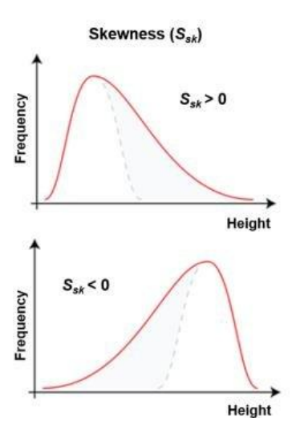
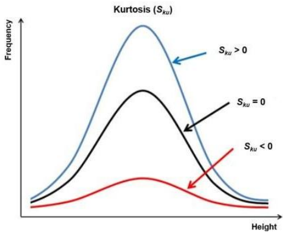
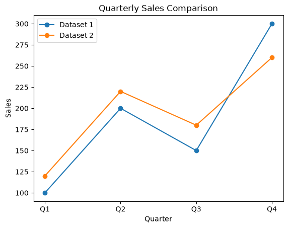
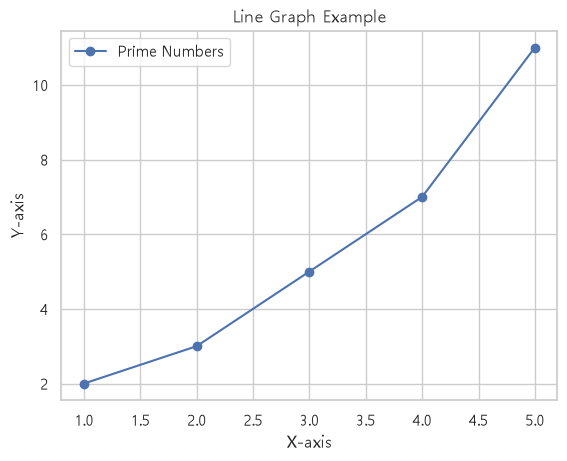
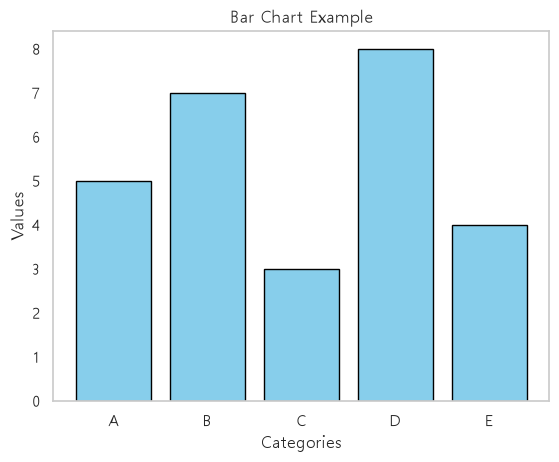
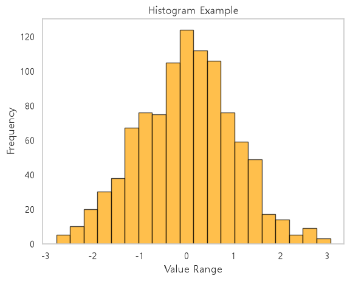
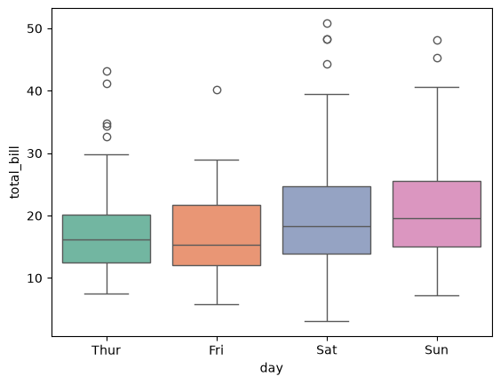
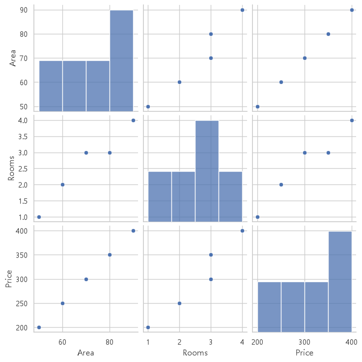

# 생성형 AI 활용을 위한 머신러닝 / 딥러닝

## 📑 목차
- [1. 데이터 수집](#data_collect)
- [2. 기초통계와 데이터과학](#statistics_and_data_science)

## 📌 질문  모음
1. [connect와 cursor 객체의 차이점은 무엇일까?](#q-cursor-connect-difference)

## <a id="data_collect"></a> 1. 데이터 수집

### 인공지능 데이터 처리 프로세스

#### 인공지능 데이터 처리 파이프라인(Data Pipeline)

1. 데이터 수집(Data Collection):
    - API 호출, 웹 스크래핑, DB 조회, 센서 데이터 등
2. 데이터 저장(Data Storage):
    - CSV, JSON, SQL(RDBMS), NoSQL, Data Lake 등
3. 데이터 전처리(Data Preprocessing):
    - 결측치 채우기, 이상치 제거, 스케일링, 인코딩
4. 피처 엔지니어링(Feature Engineering)
    - 파생변수 생성, 차원 축소, 피처 선택
5. 모델 학습 및 평가(Modeling & Evaluation):
    - 알고리즘 학습 및 하이퍼파라미터 튜닝
6. 서빙 및 배포(Serving & Deployment):
    - API 서버 배포, 배치 추론 파이프라인 구축

### 데이터 수집 방법 개요

- 데이터 수집은 데이터를 효율적으로 모으고 활용하기 위해 중요한 단계이다.
- 데이터는 다양한 형식과 출처에서 수집될 수 있으며, 목적에 따라 방법도 달라진다.<br>
    → 목적과 환경에 따라 적합한 방법을 선택해야 한다.
- 데이터 수집 방법
    - 웹 스크래핑: HTML 데이터 파싱
    - API 활용: JSON 데이터 가져오기
    - 데이터베이스: 저장된 데이터 검색
    - 공개 데이터셋: Kaggle 등에서 다운로드
    - IoT 센서: 실시간 데이터 수집
    - 소셜 미디어: 트위터 API 활용

1. 웹 스크래핑(Web Scraping)
    - 웹 스크래핑은 웹 사이트에서 HTML데이터를 가져와 필요한 정보를 추출하는 방법이다.
    - 자동화해서 데이터를 수집할 수 있다.
    - 예시
        - 목적: 온라인 쇼핑몰의 상품 가격 정보 수집
        - 방법
            1. BeautifulSoup와 같은 Python 라이브러리를 사용
            2. 웹 페이지의 HTML을 파싱한다.
            3. 상품명과 가격을 가져온다.
2. API 활용
    - API(Application Programming Interface)는 데이터를 쉽게 요청하고 응답 받을 수 있도록 제공되는 인터페이스 → 주로 REST API를 통해 JSON 형태의 데이터를 제공
    - 예시
        - 목적: 날씨 데이터를 수집
        - 방법
            - requests 모듈을 이용하여 OpenWeatherMap API를 호출
            - 공공데이터 포털(https://www.data.go.kr/)
                - 휴게음식점 인허가
                - URL로 들어가기
                - 식품_휴게음식점
3. 데이터베이스에서 데이터 가져오기
    - 이미 수집된 데이터를 데이터베이스에서 쿼리를 통해 가져오는 방법<br>
        → RDBMS(SQL)이나 NoSQL 데이터베이스를 사용
    - 예시
        - 목적: 고객 정보 조회
        - 방법
            - RDBMS를 이용하여 select를 이용해서 데이터를 조회<br> 
            → 데이터베이스 관련 모듈 이용
4. 공개된 데이터셋 활용
    - 정부나 기업, 연구기관에서 제공하는 공개 데이터셋을 다운로드하거나 API를 통해 사용<br>
        → Kaggle, Google Datase Search 등이 자주 사용
    - 예시
        - 목적: 인구 통계 데이터 분석
        - 방법
            - Kaggle에서 데이터를 다운로드한 뒤 Pandas로 읽어 분석
    - 국내 데이터 사이트

        | 사이트 | 특징 |
        | :--- | :--- |
        | **[AI Hub](https://www.aihub.or.kr/)** | 국내 최대 AI 학습용 데이터 플랫폼. 이미지, 음성, 자연어, 의료, 제조, 금융 등 다양한 데이터 제공. 일부 데이터는 회원가입 및 활용 신청 필요 |
        | **[공공데이터포털 (Data.go.kr)](https://www.data.go.kr/)** | 대한민국 정부가 제공하는 공공 데이터. CSV, JSON, Open API 형태 제공 |
        | **[KDX 한국데이터거래소](https://kdx.kr/)** | 금융, 유통, 통신 등 산업 데이터 제공. 무료와 유료 데이터 모두 포함 |
        | **[국가통계포털 KOSIS](https://kosis.kr/)** | 통계청에서 제공하는 국가 통계 데이터 |
        | **[서울 열린데이터광장](https://data.seoul.go.kr/)** | 서울시 교통, 환경, 행정, 문화 등 다양한 데이터 제공 |
        | **[농림축산식품 공공데이터포털](https://data.mafra.go.kr/)** | 농업 및 식품 관련 데이터 제공 |
        ---

    - 해외 데이터 사이트

        | 사이트 | 특징 |
        | :--- | :--- |
        | **[Kaggle Datasets](https://www.kaggle.com/datasets)** | 머신러닝 학습자들이 가장 많이 사용하는 데이터셋 저장소. 튜토리얼과 대회도 함께 제공. |
        | **[UCI Machine Learning Repository](https://archive.ics.uci.edu/)** | 머신러닝 교육에서 가장 많이 사용하는 고전 데이터셋 저장소(Iris, Wine, Adult 등). |
        | **[Google Dataset Search](https://datasetsearch.research.google.com/)** | 전 세계 공개 데이터셋을 검색하는 검색엔진 |
        | **[Hugging Face Datasets](https://huggingface.co/datasets)** | LLM, NLP, 음성, 이미지 등 최신 AI 데이터셋 제공 |
        | **[OpenML](https://www.openml.org/)** | 머신러닝 실험과 데이터셋 공유 플랫폼 |
        | **[Papers with Code Datasets](https://paperswithcode.com/datasets)** | 최신 AI 논문에서 사용하는 데이터셋과 성능 비교 |
        | **[AWS Open Data Registry](https://registry.opendata.aws/)** | AWS에서 제공하는 대용량 공개 데이터 |
        | **[Microsoft Research Open Data](https://msropendata.com/)** | Microsoft 연구용 공개 데이터 |
        | **[Data.gov (미국 정부)](https://data.gov/)** | 미국 정부의 공공 데이터 포털 |
        | **[data.world](https://data.world/)** | 다양한 분야의 공개 데이터와 협업 기능 제공 |

    - 학습 분야 사이트

        | 학습 분야 | 추천 사이트 |
        | :--- | :--- |
        | **머신러닝 입문** | Kaggle, UCI ML Repository |
        | **데이터 분석** | Kaggle, Data.gov, KOSIS |
        | **딥러닝(이미지)** | AI Hub, Kaggle, Hugging Face |
        | **자연어처리(NLP)** | AI Hub, Hugging Face |
        | **음성 인식** | AI Hub |
        | **시계열 데이터** | Kaggle, Data.gov |
        | **공공 데이터 분석** | 공공데이터포털, 서울 열린데이터광장, Data.gov |
        | **최신 AI 연구** | Papers with Code, Hugging Face |
5. IoT 또는 센서 데이터 수집
    - 센서를 이용해 실시간으로 데이터를 수집한다.<br>
        → 온도 센서, 카메라, GPS 장치 등이 사용
    - 예시
        - 목적: 스마트 홈의 온도 데이터를 수집
        - 방법
            - MQTT 프로토콜을 이용하여 센서 데이터를 수집
6. 소셜 미디어 데이터 수집
    - 소셜 미디어 플랫폼에서 사용자 활동 데이터를 수집하는 방법
        → 해당 플랫폼의 API를 사용
    - 예시
        - 목적: 트위터의 특정 키워드로 트윗 수집
        - 방법
            - Tweepy 라이브러리를 사용하여 트위터 API 호출

### requests 모듈을 활용한 데이터 수집

- Python의 requests 모듈은 HTTP요청을 보내고 응답을 처리하는 데 사용되는 라이브러리
- 웹 서버와 통신하여 데이터를 가져오거나 전송하는 작업을 쉽게 수행
    - 다양한 HTTP 메서드(GET, POST, PUT, DELETE 등)를 지원
    - 데이터를 요청하고 응답을 처리하는 과정을 간단하게 처리
- 웹 페이지나 Open API는 HTTP 프로토콜을 이용해 클라이언트와 데이터를 주고 받는다.
- Python의 requests 라이브러리는 쉽고 직관적인 HTTP 통신을 지원하는 표준적인 데이터 수집 도구이다.

#### HTTP 요청의 주요 메서드
- GET 요청: 서버에서 데이터를 가져오는 데 사용 → Read
- POST: CREATE
- UPDATE: UPDATE
= DELETE: DELETE
- 목적: 웹 페이지의 내용을 가져오기
    ```python
    import requests

    # 요청 URL
    url = 'https://jsonplaceholder.typicode.com/posts'
    response = requests.get(url)

    if response.status_code == 200:
        # 상태코드 200은 성공을 의미
        print("데이터 가져오기 성공!")
        # 응답 본문의 일부 출력
        print(response.text[:200])
    else:                                                   # 4XX, 5XX
        print(f"오류 발생: {response.status_code}")
    
    # 데이터 가져오기 성공!
    # [
    # {
    #     "userId": 1,
    #     "id": 1,
    #     "title": "sunt aut facere repellat ...",
    #     "body": "quia et suscipit\nsuscipit ..."
    # },...
    # ]
    ```

#### 응답 데이터 처리

- response.text
    - 응답 본문을 문자열로 반환
- response.json()
    - JSON 형식의 응답을 딕셔너리로 변환
- response.status_code
    - HTTP 상태 코드 반환
    ```python
    if response.status_code == 200:
        # JSON 응답을 딕셔너리로 변환
        data = response.json()

        for datum in data:
            # print("datum: {datum}")
            print(f"제목: {datum['title']}")
            print(f"내용: {datum['body']}")

    else:
        print(f"오류 발생: {response.status_code}")

    # 제목: sunt aut facere repellat provident occaecati excepturi optio reprehenderit
    # 내용: quia et suscipit
    # suscipit recusandae consequuntur expedita et cum ...
    ```
- 실제 응용 사례
    - 웹 페이지 크롤링: 뉴스 헤드라인 가져오기
    - API 활용: 날씨, 주식 정보, 소셜 미디어 데이터 수집
    - 자동화: 특정 시간에 정기적으로 데이터 요청
- 주의사항
    - API 호출 시 요청 제한(Request Limit)을 초과하지 않도록 주의
    - 민감한 데이터(API 키, 인증 정보)는 환경 변수로 관리하거나 안전하게 저장
    - 웹 스크래핑 사이트의 robots.txt 규칙을 준수해야 한다.
- 쿼리 파라미터 사용하기
    - 서버에 데이터를 전달할 때 URL에 파라미터를 포함해서 전달<br>
        → 특정 데이터 가져오기
    ```python
    # userId가 1인 게시글 가져오기
    params = {'userId': 1}

    response = requests.get(url, params=params)

    if response.status_code == 200:
        print("사용자 게시글 가져오기 성공!")

        for data in responst.json()[:5]:
            print(f"userId = {data['userId']}")
            print(f"title = {data['title'][:10]}")
            print(f"body = {data['body'][:10]}")
    else:
        print(f"오류 발생: {response.status_code}")

    # 사용자 게시글 가져오기 성공!
    # userId = 1
    # title = sunt aut f
    # body = quia et su
    # ...
    ```

### HTML 구조 이해(태그, 속성, DOM)

#### HTML이란?

- HTML(HyperText Markup Language)은 웹 페이지의 구조를 정의하는 마크업 언어
- HTML 문서는 브라우저가 읽어서 화면에 표시하는 기본 구조를 제공
- HTML
    - **태그(tag)** 를 사용하여 요소를 정의
    - 각 요소는 **속성(attribute)** 과 콘텐츠를 포함
    - 웹 페이지의 텍스트, 이미지, 링크, 버튼 등 다양한 요소를 구성

#### 태그(Tags)

- 태그는 HTML 요소를 정의하며, 다음과 같은 형식
    ```html
    <태그이름 속성="값">내용(Contents)</태그이름>
    ```
    - 시작 태그: <태그이름>
    - 종료 태그: </태그이름>(일부 태그는 종료 태그가 없음. 예: )
    - 내용: 시작 태그와 종료 태그 사이에 들어가는 컨텐츠 데이터
        ```html
        <p>Hello, World!</p>
        ```
    - \<p>: 문단(paragraph)을 나타내는 태그
    - Hello, World!: 태그 사이의 내용

#### 속성(Attributes)

- 속성은 태그에 추가 정보를 제공
- 속성="값" 형식으로 작성, 속성은 시작 태그에만 추가
    - id: 요소의 고유 식별자
    - class: CSS 스타일링이나 JavaScript 제어를 위한 클래스 이름
    - href: 링크를 나타냄(예: \<a> 태그에서 사용)
    - src: 이미지나 외부 리소스의 경로(예: \ 태그에서 사용)
        ```html
        <a href="https://example.com" target="_blank">Click Here</a>
        ```

#### DOM(Document Object Model)

- DOM은 브라우저가 HTML문서를 파싱하여 생성한 객체 모델
- HTML 문서를 트리 구조로 표현하며, 각 요소는 노드(Node)로 구성
- DOM의 구성 요소
    - HTML 요소(Element Nodes): 태그들
    - 속성(Attribute Nodes): 태그의 속성들
    - 텍스트(Text Nodes): 태그 안의 내용
        ```html
        <!DOCTYPE html>
        <html lang="en">
        <head>
            <meta charset="UTF-8">
            <meta name="viewport" content="width=device-width, initial-scale=1.0">
            <title>Document</title>
        </head>
        <body>
            <h1 id="main-title">
                Welcome to Web Scraping    
            </h1>
            <p class="description">
                This is an example paragraph.
            </p>
            <a href="https://example.com" target="_blank">
                Visit Example
            </a>
        </body>
        </html>
        ```

### BeautifulSoup을 활용한 웹 스크래핑

- Python에서 HTML과 XML 문서를 파싱하고 원하는 데이터를 추출할 때 사용하는 라이브러리<br>
→ HTML의 DOM 구조를 탐색하고 태그, 속성, 텍스트를 쉽게 추출
- 설치
    - pip install beautifulsoup4

    ```python
    from bs4 import BeautifulSoup

    html_doc = """
    <html>
        <head>
            <title>Example Page</title>
        </head>
        <body>
            <h1>Welcome to Web Scraping</h1>
            <p class="description">This is an example paragraph.</p>
            <a href="https://example.com">Visit Example</a>
        </body>
    </html>
    """

    # BeautifulSoup 객체 생성
    soup = BeautifulSoup(html_doc, 'html.parser')

    # 객체의 속성값을 이용해서 데이터 추출
    print(soup.title.string)    # Example Page
    print(soup.h1.string)       # Welcome to Web Scraping
    print(soup.a['href'])       # https://example.com
    print(type(soup.find('a'))) # <class 'bs4.element.Tag'>
    ```

#### 주요 기능

1. 특정 태그 찾기
    - 태그 이름으로 요소를 쉽게 찾을 수 있다.
        ```python
        # 첫 번째 <p> 태그 찾기
        print(soup.p)           # <p class="description">This is an example paragraph.</p>
        print(soup.p['class'])  # ['description']
        ```
2. 여러 태그 찾기
    - find_all()을 사용하면 특정 태그를 모두 찾을 수 있다.
        ```python
        # 모든 <a> 태그 찾기
        links = soup.find_all('a')
        for link in links:
            print(link['href'])     # https://example.com
        ```
3. CSS 선택자 활용
    - select()를 사용해 CSS 선택자를 기반으로 요소를 찾음
    - select는 CSS 선택자를 사용하므로 복잡한 선택 조건을 간단하게 표현
    - find나 find_all 보다 가독성이 좋고 직관적이다.
        - tag: 특정 태그명 선택(예: h1)
        - .class: 클래스명으로 선택(예: .price)
        - #id: 고유 ID명으로 선택(예: #main-title)
        - tag.class 또는 tag > tag: 부모-자식 경로 구조
            ```python
            # 클래스가 "description"인 <p>태그 찾기
            description = soup.select_one('.description')
            print(description.text)     # This is an example paragraph.
            ```

#### BeautifulSoup을 활용한 웹 스크래핑

**순서 주의**

```python
# URL 요청
url = 'https://news.ycombinator.com/'
response = requests.get(url)

# BeautifulSoup 객체 생성
soup = BeautifulSoup(response.text, 'html.parser')

# 제목과 링크 추출(href 있는 것만 필터링)
for item in soup.find_all('a'):
    href = item.get('href')
    if href:                            # href가 존재할 때만 출력
            print(f"Title: {item.get_text(strip=True)}")
            print(f"Link: {href}")

# Title: Hacker News
# Link: news
# Title: new
# Link: newest
```

#### 웹 크롤링 주의사항 및 윤리

1. robots.txt란 무엇인가?
    - 정의: 웹사이트 루트 경로(도메인/robots.txt)에 위치하여 크롤러의 접근 허용, 차단 범위를 명시한 텍스트 파일
    - 목적: 서버 과부하 방지, 민감 경로 및 불필요한 페이지 수집 차단, 트래픽 리소스 보호
2. 핵심 지시어(Directives) 4가지
    - User-agent: 규칙을 적용할 크롤러 지정('*'는 모든 크롤러, Googlebot등은 특정 봇 지칭)
    - Disallow: 수집 및 접근을 금지하는 URL 경로(예: /admin/, /private/)
    - Allow: 차단된 상위 경로 내에서 예외적으로 접근을 허용하는 하위 경로(예: /public/)
    - Crawl-delay: 연속 요청 사이의 최소 대기 시간(초) 지정으로 서버 부하 방지
3. 왜 반드시 준수해야 하는가?
    - 기술적 측면(안정성): 과도한 요청으로 인한 타겟 서버 장애(DoS 유사 상태) 예방 및 자사 IP 영구 차단 방지
    - 법적·기술적 측면: 업무 방해죄·저작권 침해·부정경쟁방지법 분쟁 시 선의의 수집 여부를 판단하는 핵심 기준
4. 실무 스크래핑 적용 3단계 수칙
    - 사전 파싱 자동화: 크럴러 실행 시 urllib.robotparser 등을 활용해 대상 사이트의 robots.txt를 먼저 조회
    - 요청 속도 제어: 명시된 Crawl-delay를 준수하고, 설정이 없더라도 요청 간 1~3초 이상의 간격(Throttling) 유지
    - 식별 정보 명시: 요청 헤더의 User-Agent에 봇 이름과 담당자 연락처(또는 안내 페이지)를 투명하게 기재

- Robots.txt
    - User-Agent 설정
        - 브라우저를 통한 정상적인 접근처럼 보이도록 HTTP 헤더에 브라우저 정보(User-Agent)를 주입해야 응답 거부를 방지할 수 있다.
            ```python
            import time

            # User-Agent 헤더 주입 예시
            headers = {
                'User-Agent': 'Mozilla/5.0 (Macintosh; Intel Mac OS X 10_15_7) AppleWebKit/537.36 (KHTML, like Gecko) Chrome/120.0.0.0 Safari/537.36'
            }
            url = "https://httpbin.org/user-agent"
            response = requests.get(url, headers=headers)
            print(response.json())      # {'user-agent': 'Mozilla/5.0 (Macintosh; Intel Mac OS X 10_15_7) AppleWebKit/537.36 (KHTML, like Gecko) Chrome/120.0.0.0 Safari/537.36'}
            ```
        
### REST API란 무엇인가?

#### REST(Representational State Transfer)

- 웹 서비스와 클라이언트 간의 통신을 설계하는 아키텍처 스타일
- REST API는 REST 원칙을 따르는 API(Application Programming Interface)
- 클라이언트(사용자)와 서버(서비스 제공자) 간 데이터(JSON 또는 XML)를 주고 받는 데 사용

#### REST API의 구조

- URL구조
    - REST API의 자원 접근은 URL로 구성 → 기본 형식: https://baseurl/resource/{id}
    - 모든 사용자의 데이터: https://api.example.com/users
    - 특정 사용자 데이터: https://api.example.com/users/123
- HTTP 메서드
    - 서버에 요청을 보낼 때 HTTP 메서드와 URL을 조합해 사용

        | 메서드 | 동작 | 설명 |
        | :---: | :---: | :--- |
        | **GET** | 데이터 조회 | 서버에서 데이터를 가져옵니다. |
        | **POST** | 데이터 생성 | 서버에 새 데이터를 추가합니다. |
        | **PUT** | 데이터 수정 | 기존 데이터를 업데이트합니다. |
        | **DELETE** | 데이터 삭제 | 서버에서 데이터를 삭제합니다. |
- Headers와 Body
    - Headers: 요청 또는 응답의 부가 정보를 담는다. (예: Content-Type, Authorization)
    - Body: 요청 시 보내는 데이터. 주로 JSON 형식을 사용한다.
        ```
        POST /users HTTP/1.1
        Host: api.example.com
        Content-Type: application/json
        Authorization: Bearer token123
        {
        "name": "king",
        "email": "john.doe@example.com"
        }
        ```
### 공공데이터 포털 또는 오픈 API 활용

#### 공공 데이터 포털

- 정부나 공공기관이 제공하는 데이터를 모아둔 플랫폼
- 대한민국의 대표적인 공공 데이터 포털: 공공데이터포털(data.go.kr)
- 다양한 분야의 데이터를 무료로 제공하며, REST API 형식으로 데이터에 접근
- 주요 데이터
    - 교통 정보(버스, 지하철 실시간 위치)
    - 기상 정보(날씨 예보)
    - 인구 통계(연령별, 지역별 인구)

#### 오픈 API

- 기업이나 기관이 데이터를 제공하기 위해 공개한 API
- 주요 데이터
    - 네이버 검색, 카카오 검색
    - 구글 지도 API(위치 데이터 제공)
    - 트위터 API(트윗 데이터 제공)
    - NASA API(우주 관련 데이터 제공)

### CSV, Excel, JSON 파일에 데이터 저장

#### CSV(Comma-Separated Values) 파일

- 데이터를 쉼표로 구분하여 저장하는 텍스트 기반의 파일 형식이다.
- 간단한 데이터 저장과 교환에 적합하며, 대부분의 데이터 분석 도구와 호환된다.
- Python에서 CSV파일을 저장할 수 있다.
    ```python
    import csv

    # 데이터 준비
    data = [
        ['Name', 'Age', 'City'],
        ['Alice', 30, 'New York'],
        ['Bob', 25, 'Log Angeles'],
        ['Charlie', 35, 'Chicago']
    ]

    # CSV 파일에 저장
    with open('data.csv', mode='w', newline='', encoding='utf-8') as file:
        writer = csv.writer(file)
        writer.writerows(data)

    print('CSV 파일이 저장되었습니다.')
    ```
- CSV 파일 읽기
    - pandas 라이브러리를 주로 사용
        - pd.read_csv('파일 경로'): CSV파일을 읽어 데이터프레임 형태로 반환
            ```python
            import pandas as pd

            # CSV 파일 읽기
            data = pd.read_csv('data.csv')
            print(data)
            ```
        - data.head(): 상위 몇 개의 데이터를 미리보기.
- CSV 파일은 단순 텍스트이므로, open()을 사용한다.
    ```python
    # open()을 사용한 CSV 파일 읽기
    with open('data.csv', 'r') as file:
        for line in file:
            print(line.strip())
    ```

#### Excel 파일

- 데이터 시각화와 분석에 강력
- 표 형태의 데이터를 저장할 수 있음
- openpyxl 또는 pandas 라이브러리를 주로 사용
- Excel 파일 쓰기
    ```python
    import pandas as pd

    # 데이터 준비
    data = {
        'Name': ['Alice', 'Bob', 'Charlie'],
        'Age': [30, 25, 35],
        'City': ['New York', 'Los Angeles', 'Chicago']
    }

    # DataFrame 생성
    df = pd.DataFrame(data)

    # Excel 파일로 저장
    df.to_excel('data.xlsx', index=False)

    print("Excel 파일이 저장 되었습니다!")
    ```
- Excel 파일 읽기
    - pd.read_excel('파일경로'): 엑셀 파일 읽기.
        ```python
        data = pd.read_excel('data.xlsx')
        print(data)

        #       Name  Age         City
        # 0    Alice   30     New York
        # 1      Bob   25  Los Angeles
        # 2  Charlie   35      Chicago
        ```

#### JSON(JavaScript Object Notation) 파일

- 키-값 쌍으로 데이터를 저장
- API와 데이터 교환에서 주로 사용
- 계층적 데이터 구조를 표현할 수 있어 XML이 대안으로 자주 사용
- Python에서 JSON 파일 저장
    - json.dump(): 데이터를 JSON 형식으로 저장
    - indent=4를 사용하여 사람이 읽기 쉽게 데이터를 정렬
- Python에서 JSON파일 읽기
    - json.load(): JSON 파일을 파이썬의 딕셔너리로 변환.
        ```python
        # JSON 파일 읽기
        with open('example.json', 'r') as file:
            data = json.load(file)
        
        print(data)
        ```

#### 각 형식의 비교

| 형식 | 장점 | 단점 |
| :---: | :--- | :--- |
| **CSV** | 간단하고 가볍다. 대부분의 도구와 호환 가능. **대규모 데이터**에 적합 | 계층적 데이터 저장 불가. |
| **Excel** | 시각화화 다중 시트 지원. 구조화된 데이터 관리. | 무겁고 대규모 데이터 교환에 적합하지 않음. |
| **JSON** | 계층적 데이터 저장 가능. API 데이터 교환에 적합. | 사람이 직접 읽기 어렵고 편집 도구가 필요함. |

#### 활용 팁

- **CSV**: 대량 데이터 저장 및 분석 초기 단계에 적합
- **Excel**: 데이터 요약, 보고서 작성, 분석 작업에 유용
- **JSON**: 웹 및 모바일 애플리케이션과의 데이터 교환에 적합

### SQLite를 활용한 간단한 데이터베이스 관리

#### SQLite

- 수집한 대용량 데이터를 매번 로컬 CSV나 JSON파일로만 다루면 여러 프로세스가 동시에 조회/수정할 때 꼬이거나 속도가 크게 느려진다.
- AI 실무 환경에서는 이를 위해 정형 데이터를 효과적으로 조회하고 관리할 ㅜ 있는 RDBMS(관계형 데이터베이스)를 사용한다.

#### SQLite의 특징

- 가볍고 파일 기반의 관계형 데이터베이스 관리 시스템(RDBMS)이다.
- 서버 설치가 필요 없으며, Python 내장 모듈로 쉽게 사용할 수 있다.
- 데이터 저장, 조회, 관리 등을 SQLite를 활용한다.

#### 관계형 데이터베이스와 SQL 기초

- RDBMS(Relational Database Management System)
    - 테이블(행과 열) 단위로 데이터를 관리하며 고유 키(PK)로 테이블 간 관계를 설정
- SQL(Strutured Query Language): DB에 질의하기 위한 공통 언어
    - CREATE: 테이블 구조 정의
    - INSERT: 데이터 신규 삽입
    - SELECT: 데이터 검색 및 필터링
    - UPDATE: 기존 데이터 수정
    - DELETE: 데이터 삭제

#### SQLite 사용하기

1. SQLite와 Python 연동
- Python의 sqlite3 모듈을 사용하면 SQLite 데이터베이스를 쉽게 사용할 수 있다.
- 데이터베이스 연결
    - example.db<br>
        SQLite 데이터베이스 파일 이름<br>파일이 없으면 새로 생성

        ```python
        import sqlite3

        # SQLite 데이터베이스 연결(파일 생성)
        connection = sqlite3.connect("example.db")
        print("데이터베이스에 연결되었습니다!")

        # 연결 닫기
        connection.close()
            ```
2. 테이블 생성
    - 데이터를 저장하기 위해 먼저 테이블을 생성
    - 테이블 저장 코드
        - CREATE TABLE IF NOT EXISTS: 테이블이 없을 경우에만 생성한다.
        - PRIMARY KEY AUTOINCREMENT: 기본 키로 자동 증가 값을 사용한다.
        - 순서 주의: `연결 → cursor → execute → close`

            ```python
            import sqlite3

            # 데이터베이스 연결
            connection = sqlite3.connect("example.db")

            # 데이터베이스 실행하는 도구 → cursor
            cursor = connection.cursor()

            # SQL 명령어로 테이블 생성
            cursor.execute("""
            CREATE TABLE IF NOT EXISTS users (
                id  INTEGER PRIMARY KEY AUTOINCREMENT,
                name TEXT NOT NULL,
                age INTEGER,
                city TEXT
            )
            """)
            print("테이블이 생성되었습니다.")

            # 연결 종료
            connection.close()
            ```
3. 데이터 삽입
    - Python 코드로 데이터 삽입
        - ?는 값의 자리표시자: SQL인젝션 공격을 방지할 수 있다.
        - executemany(): 여러 데이터를 한 번에 삽입할 수 있다.
            ```python
            # 데이터베이스 연결
            connection = sqlite3.connect("example.db")
            cursor = connection.cursor()

            # 데이터 삽입
            cursor.execute("INSERT INTO users (name, age, city) VALUES (?, ?, ?)", ("Alice", 30, "New York"))

            # 여러 데이터 삽입
            data = [
                ("Bob", 25, "Los Angeles"),
                ("Charlie", 35, "Chicago"),
                ("Diana", 28, "Houston")
            ]
            cursor.executemany("INSERT INTO users (name, age, city) VALUES (?, ?, ?)", data)

            # 변경사항 저장
            connection.commit()
            print("데이터가 삽입되었습니다.")

            # 연결 종료
            connection.close()
            ```
4. 데이터 조회
    - Python  코드로 데이터 조회
        - fetchall(): 모든 조회 결과를 가져온다.
        - fetchone(): 한 행씩 가져온다.
            ```python
            # 데이터베이스 연결
            connection = sqlite3.connect("example.db")
            cursor = connection.cursor()

            # 데이터 조회
            cursor.execute("SELECT * FROM users")
            rows = cursor.fetchall()

            # 조회된 데이터 출력
            for id, name, age, city in rows:
                print(f'name: {name}, age: {age}, city: {city}')

            # name: Alice, age: 30, city: New York
            # name: Bob, age: 25, city: Los Angeles
            # name: Charlie, age: 35, city: Chicago
            # name: Diana, age: 28, city: Houston

            # 연결 종료
            connection.close()
            ```
5. 데이터 수정
    ```python
    # 데이터베이스 연결
    connection = sqlite3.connect("example.db")
    cursor = connection.cursor()

    # 데이터 수정
    cursor.execute("UPDATE users SET age = ? WHERE name = ?", (31, "Alice"))

    # 변경사항 저장
    connection.commit()
    print("데이터가 수정되었습니다")

    # 연결 종료
    connection.close()

    # [(1, 'Alice', 31, 'New York'),
    #  (2, 'Bob', 25, 'Los Angeles'),
    #  (3, 'Charlie', 35, 'Chicago'),
    #  (4, 'Diana', 28, 'Houston')]
    ```
6. 데이터 삭제
    ```python
    # 데이터베이스 연결
    connection = sqlite3.connect("example.db")
    cursor = connection.cursor()

    # 데이터 삭제
    cursor.execute("DELETE FROM users WHERE name = ?", ("Bob",))

    # 변경사항 저장
    connection.commit()
    print("데이터가 삭제되었습니다.")

    # 연결 종료
    connection.close()

    # [(1, 'Alice', 31, 'New York'),
    #  (3, 'Charlie', 35, 'Chicago'),
    #  (4, 'Diana', 28, 'Houston')]
    ```

<a id="q-cursor-connect-difference"></a>Q. connect와 cursor 객체의 차이점은 무엇일까?<br>
A.
1. Connect와 Cursor의 핵심 역할 비교

    | 구분 | `Connection` (연결 객체) | `Cursor` (커서 객체) |
    | :--- | :--- | :--- |
    | **역할 비유** | 파이썬과 데이터베이스를 이어주는 **'고속도로(통로)'** | 도로 위를 오가며 데이터를 나르는 **'트럭(작업자)'** |
    | **핵심 권한** | 통로 연결 및 종료, 최종 데이터 확정(`commit`) 및 되돌리기(`rollback`) | SQL 문장 실행(`execute`), 조회된 결과 데이터 가져오기(`fetchall`)<br><br>데이터베이스에서 트랜잭션(작업 단위)을 관리하고 확정 짓는 권한이 커서(Cursor)가 아닌 커넥션(Connection)에 있기 때문에 cursor로는 commit을 하지 못한다. <br><br>또한, 파이썬 환경에서는 하나의 연결(`connection`) 안에서 여러 개의 커서(`cursor`)를 만들어 복잡한 작업을 나누어 수행하기도 한다. 만약 커서마다 각자 따로 커밋을 할 수 있다면 데이터베이스 상태가 뒤죽박죽 꼬일 위험이 있다.|

2. 주요 메서드 상세 비교 (`execute` & `close`)

    | 비교 항목 | 공통점 및 핵심 차이점 |
    | :--- | :--- |
    | **명령 실행**<br>`.execute()` |  **[공통점]** 둘 다 작성한 SQL 쿼리문을 데이터베이스에 전달하고 성공적으로 실행한다.<br><br>**[차이점]** `cursor.execute()`는 파이썬 데이터베이스 표준 규약(DB-API)을 따르는 **정석 방식**이다. 반면 `connection.execute()`는 `sqlite3` 라이브러리에서만 편의상 제공하는 **단축키(Shortcut)**로, 실행 시 내부적으로 임시 커서를 알아서 생성한 뒤 쿼리를 처리한다. 다른 DB(MySQL 등)로 넘어갈 때를 대비해 가급적 `cursor` 방식을 쓰는 것이 좋다. |
    | **리소스 종료**<br>`.close()` | **[차이점]** `cursor.close()`는 현재 쿼리를 실행하던 개별 '작업 공간'만 깔끔하게 정리한다. 이 경우 메인 통로는 열려있으므로 필요하면 새로운 커서를 다시 만들 수 있다.<br><br>반면 `connection.close()`는 **데이터베이스와의 메인 연결 통로 자체를 완전히 끊어버린다.** 이 명령이 실행되면 기존에 열려있던 모든 커서도 즉각 사용 불능 상태가 된다. |

#### Pandas와 Database의 결합

- 실제 데이터 분석 환경에서는 sqlite3 커서로 로우를 다루기보다는, Pandas 데이터프레임과 통째로 통신하는 방식을 선호한다.
    - df.to_sql(name, conn)
        - 데이터프레임 내용을 DB 테이블로 즉시 적재
    - pd. read_sql(query, conn)
        - SQL 쿼리 실행 결과를 데이터프레임 객체로 즉시 반환
    ```python
    import sqlite3
    import pandas as pd

    # 새 커넥션 연결
    conn = sqlite3.connect(':memory:')
    # ':memory:'는 하드디스크(SSD)에 실제 .db 파일을 생성하지 않고, 컴퓨터의 RAM(주기억장치) 위에 임시로 데이터베이스를 만들어 사용하겠다는 뜻의 특수 예약어이다. 데이터베이스 연결이 끊기자마자 생성된 데이터베이스는 사라진다.
    
    # 1. Pandas DataFrame 생성
    df_source = pd.DataFrame({
        'Title': ['영화A', '영화B', '영화C'],
        'Rating': [8.5, 9.2, 7.8],
        'Votes': [1200, 3400, 800]
    })

    # 2. to_sql을 통해 DB에 테이블로 적재 (if_exists='replace': 기존 테이블이 있으면 덮어쓰기)
    df_source.to_sql('movies', conn, index=False, if_exists='replace')

    # 3. read_sql을 통해 평점 8.0 이상인 영화 조회
    query = "SELECT Title, Rating FROM movies WHERE Rating >= 8.0"
    df_filtered = pd.read_sql(query, conn)

    print("=== DB 쿼리 조회 결과 DataFrame ===")
    print(df_filtered)

    # === DB 쿼리 조회 결과 DataFrame ===
    #   Title  Rating
    # 0   영화A     8.5
    # 1   영화B     9.2

    conn.close()
    ```

#### SQLite 데이터 조작(CRUD)

**문제 3**
- 조건
    - 메모리DB에연결한뒤users 라는이름의테이블을생성하세요. 컬럼구성: id (INTEGER PK AUTOINCREMENT),name (TEXT),email(TEXT),level (TEXT).
    – 테이블에 아래의 3명 가입정보를 INSERT 하세요.
        - 홍길동, hong@example.com, gold
        - 이영희, lee@example.com, silver
        - 김철수, kim@example.com, gold
    – level이 'gold' 등급인 유저의 name과 email 컬럼만 SELECT 쿼리로 조회하세요.
- 결과 변수
    - 조회결과를 fetchall하여 얻은 튜플 목록을 gold_users 변수에 저장하세요.
    ```python
    # ==========================================
    # TODO: Mission 1 코드를 작성하세요.
    # ==========================================
    gold_users = []
    print("=== Gold 등급 회원 목록 ===")
    print(gold_users)
    ```
#### 수집된 데이터프레임의 DB 테이블 저장 및 복원

**문제 4**

- 조건
    – 아래 제공된 df_members 데이터프레임을 로컬 SQLite DB 파일인 **users.db**에 **members**라는 이름의 테이블로 저장하세요 (to_sql활용, index=False 필수).
    – 저장에 사용된 DB 커넥션을 닫았다가 다시 새롭게 users.db 데이터베이스에 연결하세요.
    – SQL 쿼리를 사용해 members 테이블 전체 내용을 SELECT 쿼리로 다시 조회하여 df_read 변수에 데이터프레임으로 복원/로드하세요.
    – 검증 후 마지막에 DB 파일 리소스를 닫아주세요.
- 결과 변수: 복원된 Pandas DataFrame인 **df_read**를 완성하세요.
    ```python
    # 실습 데이터프레임 생성
    df_members = pd.DataFrame({
        'member_id': ['M01', 'M02', 'M03'],
        'name': ['이민수', '김영희', '박준형'],
        'score': [85, 95, 78]
    })
    # ==========================================
    # TODO: Mission 2 코드를 작성하세요.
    # ==========================================
    df_read = None
    print("=== DB 복원 데이터프레임 ===")
    print(df_read)
    ```

## <a id="statistics_and_data_science"></a> 2. 기초통계와 데이터과학

### 데이터 과학

#### 데이터 과학의 3대 축과 dangerZone

- 수학, 통계학
- 컴퓨터 공학
- 도메인 지식

#### 비즈니스 분석의 4단계 모델

1. 기술적 분석(Descriptive): 무슨 일이 일어났는가
    - 통계 요약, 리포팅
2. 진단적 분석(Diagnostic): 왜 일어났는가?
    - 상관관계, 원인 규명
3. 예층적 분석(Predictive): 다음에 무슨 일이 생길까?
    - 머신러닝 예측 모델
4. 처방적 분석(Prescriptive): 어떻게 대응해야 하는가?
    - 최적화, 맞춤 추천

####  보안 분야에서 머신러닝 적용 시 핵심 고려사항

1. 문제 정의와 수치화
    - "위협 탐지와 대응 지표는 반드시 정량화된 수치와 위험 점수(Risk Score)로 정의해야 한다."
    - 단순 "침해 의심", "이상 징후"와 같은 주관적 정성 평가를 배제하고, 네트워크 패킷 페이로드 엔트로피, API 호출 빈도 편차, 임계값 초과 확률 등 구체적인 수치 지표로 변환하여 모델링해야 한다.
2. 정확도(Accuracy)의 함정(Imbalanced Data)
    - "극단적 불균형 데이터셋에서 단순 정확도(예: 99.9%) 수치는 무의미할 수 있다.
    - 전체 수십억 건의 정상 네트워크 트래픽 중 악성 패킷은 0.01% 미만이다. 모든 트래픽을 "정상"으로 예측해도 99.99%의 정확도가 나오지만, 정작 치명적인 APT 공격이나 제로데이 침투는 단 한 건도 잡아내지 못한다.
    - 따라서 단순 정확도 대신 재현율(Recall/탐지율), 정밀도(Precision), F1-Score, AUC-ROC를 핵심 평가지표로 사용해야 한다.
3. 데이터 편향(Data Bias)
    - 표집 및 과거 공격 시그니처 데이터에 내재된 편향
    - 과거에 알려진 악성코드 및 시그니처 패턴만 집중 학습할 경우, 신종 랜섬웨어 및 알려지지 않은 제로데이(Zero-Day) 공격에 대한 일반화 능력이 급격히 상실된다. 또한 특정 개발 도구나 정상 관리자 스크립트(PowerShell 등)를 악성으로 오인하는 표본 편향이 발생한다.
4. 개인정보 및 내부 기밀 유출 위험(Data Privacy & Compliance)
    - 패킷 덤프, 로그 데이터 수집을 통한 개인정보 및 사내 기밀 식별 위험
    - 보안 분석을 위해 패킷 헤더뿐만 아니라 페이로드(내용)와 단말 세부 로그를 무차벌 수집, 조합할 경우, 임직원 개인정보, 비밀번호 평문, 사내 기밀 문서가 모델 학습 파이프라인에 노출될 수 있다. (마스킹, 해싱 및 비식별화 전처리 필수)
5. 탐지 결과의 과도한 오경보 및 신뢰성 저하(Alert Fatigue & Normalizaion)
    - 과도한 오탐(False Positive)으로 인한 관제 피로와 진짜 위협의 간과 유발
    - 머신러닝 판정 임계값이 지나치게 민감하거나 신뢰도가 떨어지면, 정상적인 사용자 행위까지 의심 IP/계정으로 차단해 업무 마비를 초래하고, 하루 수만 건의 알람 폭탄(Alert Fatigue)으로 인해 관제 요원이 실제 치명적 위협을 무시하게 만드는 역효과를 낳는다.

#### 데이터를 올바르게 읽는 방법 - 데이터 리터러시 4대 기준

1. 누가 만들었는가?(출처와 신뢰도 검증)
    - 데이터의 출처가 공인된 기관인가, 아니면 상용 업체의 비공개 알고리즘인가?
    - CISA, KISA, MITRE ATT&CK같은 공인된 위협 인텔리전스 피드인지 확인해야 한다.
    - 출처가 불분명하거나 특정 솔루션 회사의 편향된 탐지 엔진을 맹신하면, 정상적인 사내 통신을 악성으로 오인해 시스템이 차단되는 대형사고가 발생할 수 있다.
2. 전수인가, 표본인가?(로그 데이터의 대표성과 누락 점검)
    - 정말 모든 패킷을 다 본 것인가, 아니면 일부만 뽑아낸 샘플(표본)인가?
    - 모든 네트워크 패킷을 다 검사(전수조사)하기는 용량상 어려워, 통상 1/1,000 수준으로 표본추출(넷플로우 샘플링)을 진행한다.
    - 이 때 표본만 보고 "위협이 전혀 없다"고 단정하면, 샘플링 틈새로 몰래 지나간 제로데이(Zero-Day)공격이나 극소량의 C2 비콘(해킹 신호)을 완전히 놓치는 표집 편향(Sampling Bias)이 발생한다.
3. 어떻게 측정했는가?(수집 주기와 결측치 보정 여부)
    - 데이터가 비어 있는 구간(통신 장애 등)을 어떻게 메웠는가?
    - 보안 센서 점검이나 네트워크 지연으로 인해 로그 수집이 끊기는 결측(Missing Data)이 일어난다.
    - 비어있는 로그를 단순 0(이상 없음)으로 메꿨는지, 통계적 보정(이동평균 등)을 거쳤는지 모르면, 실제 침투 공격으로 센서가 마비된 상황을 "평화로운 정상 상태"로 왜곡 해석하게 된다.
4. 포함, 제외 대상은?(화이트리스트와 분석 목적의 부합성)
    - 누구를 계산 대상(분모)에 넣고, 누구를 제외했는가?
    - 새벽 정기 백업이나 사내 관리자 스크립트(PowerShell)같은 정상 트래픽을 필터링(제외)하지 않고 분석 모수에 넣으면, 탐지 모델이 엉뚱한 패턴을 학습한다.
    - '외부 침투 시도 분석'인지 '내부자 기밀 유출 탐지'인지 분석 목적에 맞춰 모수(화이트리스트 처리 여부)를 명확히 분리해야 한다.

- 보안 관제 데이터의 전형적인 왜곡 사례
    - 전체 인프라 이벤트 기준: 침해 위협 지수 전월 대비 12% 감소(정상 트래픽이 폭증하여 분모가 커짐)
    - 외부 방화벽 인바운드 트래픽 기존: 고위험 공격 시도 전원 대비 35% 급증(실제 APT/DDoS 위협 증가)
    - 같은 보안 시스템의 로그 분석이라도 분모와 대상 로그를 어디로 한정하는지에 따라 조직의 침해 위험도가 정반대로 해석된다.

### 기초 통계(Statistics)

- 데이터 과학에서 통계는 데이터의 특성을 수치로 요약하고, 데이터 속에 숨겨진 사실을 과학적으로 증명(가설 검정)하기 위한 초석
- 파이썬의 pandas와 scipy 라이브러리를 사용하여 기술 통계, 상관관계 분석, 추론 통계 등의 분석 작업을 한다.
- **기술 통계(Descrptive Statistics)**  
    - 수집한 데이터의 전반적인 특징을 요약하고 묘사하는 통계 기법

#### 기술 통계(Descrptive Statistics)

- 대표값(중심 경향성)
    - 평균(Mean): 모든 관측값의 합을 개수로 나눈 값(극단값/아웃라이어에 취약)
    - 중앙값(Median): 데이터를 크기순으로 나열했을 때 가장 한가운데 있는 값(극단값에 강함)
    - 최빈값(Mode): 가장 빈번하게 나타나는 값
- 산포도(데이터의 퍼짐 정도)
    - 분산(Variance): 데이터가 평균으로부터 얼마나 떨어져 있는지 척도를 나타내는 척도
    - 표준편차(Standard Deviation): 분산의 제곱근으로, 원본 데이터와 동일한 단위를 가진다.
    - 사분위수(Quartiles): 데이터를 4등분한 지점(25% 지점 Q1, 50% 지점 Q2(중앙값), 75% 지점 Q3)

#### 상관관계 분석(Correlation Analysis)

- 두 변수 간에 선형적인 관계가 있는지 분석하는 기법
- 가장 대중적으로 사용되는 피어슨 상관계수(r)sms -1부터 1 사이의 값을 표현
    - r > 0: 양의 상관관계(한 변수가 커질 때 다른 변수도 커짐)
    - r < 0: 음의 상관관계(한 변수가 커질 때 다른 변수는 작아짐)
    - r ≈ 0: 상관관계 없음

### 데이터의 중심 경향(평균, 중앙값, 최빈값)

- 데이터의 중심 경향은 데이터를 대표하는 값을 나타내는 척도
- 평균, 중앙값, 최빈값은 각각 데이터를 요약하는 방법으로 사용
- 각 방법은 서로 다른 상황에서 유용

#### 평균

- 평균은 데이터를 모두 더한 뒤 데이터의 개수로 나눈 값으로 데이터를 고르게 나눈 "중심값"으로 볼 수 있다.
- 특징: 모든 데이터를 고려하므로 데이터가 균일할 때 유용하다.
    - 극단값(이상치)가 포함되면 영향을 크게 받는다.

#### 중앙값(Median)

- 중앙값은 데이터를 크기 순으로 정렬했을 때 가운데 위치한 값으로 데이터가 극단값의 영향을 받을 때 평균보다 대표성을 가진다.
- 계산 방법
    1. 데이터를 크기 순으로 정렬한다.
    2. **데이터 개수가 홀수면 가운데 값이 중앙값이다.**
    3. **데이터 개수가 짝수면 가운데 두 값을 평균 낸 것이 중앙값이다.**
- 특징: 극단값의 영향을 받지 않는다.

#### 최빈값(Mode)

- 최빈값은 데이터에서 가장 자주 나타나는 값으로 범주형 데이터나 특정 값의 빈도가 중요한 경우 유용하다.
- 계산 방법
    1. 데이터에서 각 값의 빈도를 계산한다.
    2. 가장 빈도가 높은 값을 선택한다.
- 특징
    - 하나 이상의 최빈값이 있을 수 있다(이중 최빈값).<br>
        예: 80, 80, 90, 90, 70 → 최빈값은 80과 90.
    - 연속형 데이터에서는 잘 사용되지 않는다.<br>
        예: 점수가 모두 다르면 최빈값이 없다.

#### 비교와 활용

| 중심 경향 | 사용 목적 | 유용한 상황 |
| :---: | :--- | :--- |
| **평균** | 데이터를 고르게 대표 | 데이터가 균일할 때 |
| **중앙값** | 극단값의 영향을 배제 | 이상치가 포함된 경우 |
| **최빈값** | 가장 흔한 값을 찾음 | 범주형 데이터 분석 시 |

### 데이터 분산성(분산, 표준편차, 사분위수)

- 데이터 분산성은 데이터가 평균을 기준으로 얼마나 퍼져있는지를 나타낸다.
- 분산, 표준편차, 사분위수는 각각 다른 방식으로 데이터를 요약하여 데이터의 분포와 특성을 파악하는 데 유용하다.

#### 분산(Variance)

- 분산값이 크면 데이터가 평균으로부터 멀리 퍼져있다.
- 단위가 원래 데이터 단위의 제곱 단위여서 해석이 어려울 수 있따.
- 계산 방법
    1. 평균
    2. 각 점수에서 평균을 뺀 편차
    3. 편차를 제곱
    4. 제곱된 값의 평균

#### 표준편차(Standard Deviation)

- **표준편차는 분산의 제곱근**
- 데이터 퍼짐의 정도를 원래 데이터와 동일한 단위로 나타낸다.
- 사례
    - 분산이 50이라고 하면 표준편차 = $\sqrt{50} \approx 7.07$
    - 이 표준편차 값은 데이터가 평균 80을 기준으로 약 7.07 정도 퍼져 있음을 의미한다.
- 특징
    - 분산과 달리 데이터와 동일한 단위를 사용하므로 해석하기 쉽다.
    - 값이 작으면 데이터가 평균에 가까이 모여있고, 값이 크면 데이터가 퍼져 있음을 의미한다.

#### 이상치 탐지

- 사분위수(Quartiles)
    - 사분위수는 데이터를 네 개의 구간으로 나누는 값으로, 데이터의 분포를 요약하는 데 사용된다.
        - Q1(1사분위수): 하위 25% 데이터 경계값.
        - Q2(2사분위수, 중앙값): 하위 50% 데이터 경계값.
        - Q3(3사분위수): 하위 75% 데이터 경계값
        - IQR(사분범위): Q3-Q1로, 중간 50% 데이터의 범위를 나타낸다.
    - 특징
        - 분산과 달리 데이터와 동일한 단위를 사용하므로 해석하기 쉽다.
        - 값이 작으면 데이터가 평균에 가까이 모여 있고, 값이 크면 데이터가 퍼져 있음을 의미한다.
        - 이상치(outliers)를 파악하는 데 유용하다.
        - 이상치는 Q1 - 1.5 x _IQR_ 보다 작거나 Q3 + 1.5 x _IQR_ 보다 큰 값으로 정의한다.
    - 계산 방법
        - 데이터를 오름차순으로 정렬한다.
        - Q1, Q2, Q3을 계산
    - 사례: 데이터가 75, 70, 85, 80, 90일 때
        1. 정렬된 데이터: 70, 75, 80, 85, 90
        2. Q1: 75(하위 25% 경계값)
        3. Q2: 80(중앙값)
        4. Q3: 85(상위 25% 경계값)
        5. 사분위범위(IQR): Q3 - Q1 = 85 - 75 = 10
- Z-score(표준점수)
    - "내 데이터가 전체 평균에서 표준편차 몇 걸음(배)만큼 떨어져 있는가?"
        - x: 내 관측값
        - m(mean): 전체 데이터의 평균
        - s(std): 전체 데이터가 퍼져있는 정도(보폭, 표준편차)
    - 예시
        - 키가 평균보다 크면 양수(+), 작으면 음수(-)가 나온다.
        - Z=0이면 정확히 평균값이다.
        - Z=+1.0이면 "평균보다 표준편차 1걸음만큼 위에 있다"는 뜻이다.
    - 정규분포(종 모양)에서는 대다수(약 99.7%)가 평균을 기준으로 ±3걸음(|𝑍|≤3)안에 들어온다. 따라서 |𝑍|>3인 값은 극히 드물게 튀는 이상치(Outlier)로 판정한다.

#### 비교와 활용

| 척도 | 정의 및 특징 | 활용 상황 |
| :---: | :--- | :--- |
| **분산** | 데이터의 퍼짐 정도를 제곱 단위로 측정 | 데이터를 수학적으로 분석할 때 |
| **표준편차** | 데이터의 퍼짐 정도를 원래 단위로 측정 | 평균과 함께 데이터의 분포를 해석할 때 |
| **사분위수** | 데이터 분포의 경계값 및 중간 50% 범위를 측정 | 데이터 분포의 범위를 시각화 하거나 이상치를 파악할 때 |

### 데이터 분포(정규분포, 왜도, 첨도)

- 데이터 분포는 데이터가 공간적으로 어떻게 퍼져 있는지를 나타낸다.
- 정규분포, 왜도, 첨도는 데이터의 분포 특성을 이해하는 데 중요한 개념이다.

#### 정규분포(Normal Distribution)

- 정규분포는 데이터가 평균을 중심으로 대칭적으로 분포된 종 모양의 분포이다.
- 데이터의 대부분이 평균 근처에 몰려 있고, 평균에서 멀어질수록 빈도가 줄어든다.
- 특징
    - 평균, 중앙값, 최빈값이 동일하다.
    - 데이터의 68%는 평균 ±1 표준편차 내에 있다.
    - 데이터의 95%는 평균 ±2 표준편차 내에 있다.
- 사례: 학생들의 수학 시험 점수가 정규분포를 따른다고 가정
    - 평균 점수: 70점
    - 표준편차: 10점
    - 이 경우
        - 68% 학생은 70±10, 즉 60점에서 80점 사이에 있다.
        - 95% 학생은 70±20, 즉 50점에서 90점 사이에 있다.

#### 왜도(Skewness)

- 왜도는 데이터의 비대칭성을 측정하는 값
- 분포가 한 쪽으로 치우쳐 있으면 왜도가 발생한다.
    - 왜도 > 0(양의 왜도): 데이터가 오른쪽으로 꼬리가 길게 늘어난다.
    - 왜도 < 0(음의 왜도): 데이터가 왼쪽으로 꼬리가 길게 늘어난다.
    - 왜도 = 0: 데이터가 대칭적이다(정규분포).
- 왜도가 심하면 정규분포로 만들어주는 처리를 해야 한다.

- 특징
    - 왜도를 통해 분포의 비대칭성을 파악
    - 양의 왜도: 평균 > 중앙값 > 최빈값
    - 음의 왜도: 평균 < 중앙값 < 최빈값

#### 첨도(Kurtosis)

- 첨도는 분포의 꼭대기가 얼마나 뾰족하거나 평평한지를 측정하는 값이다.
    - 첨도 > 0(Leptokurtic): 꼭대기가 뾰족하고 꼬리가 두껍다.
    - 첨도 = 0(Mesokurtic): 정규분포와 비슷한 모양이다.
    - 첨도 < 0(Platykurtic): 꼭대기가 평평하고 꼬리가 얇다.

    
- 첨도가 크면 극단값(꼬리)이 많아 분석에 주의가 필요하다.
- 첨도가 작으면 데이터가 편균 근처에 고르게 분포한다.

#### 비교와 활용

| 척도 | 정의 및 특징 | 활용 상황 |
| :---: | :--- | :--- |
| **정규분포** | 평균을 중심으로 대칭적 분포 | 자연현상 분석, 통계 분석 |
| **왜도** | 분포의 비대칭성 측정 | 데이터 치우침 확인 (예: 주택 가격 분석) |
| **첨도** | 분포의 꼭대기 뾰족함과 꼬리 두께 측정 | 극단값의 빈도 및 위험 분석 (예: 주식 수익률) |

### 그룹별 집계와 피벗 테이블 생성

#### 그룹별 집계(Grouping and Aggregation)

- 데이터를 특정 기준으로 묶은 후(그룹화) 각 그룹에 대해 합계, 평균, 최대값 등 다양한 연산(집계)을 수행
- 언제 사용할까?
    - 대량의 데이터를 요약하고 패턴을 파악
    - 데이터를 시각적으로 이해하거나 보고서를 작성
- 사용 예시
    - 쇼핑몰 매출 데이터를 분석해 카테고리별 총 매출
    - 회사의 직원 데이터를 부서별로 나누어 평균 급여
        ```python
        # 샘플 데이터
        data = {
            'Name': ['Alice', 'Bob', 'Charlie', 'David', 'Eva'],
            'Department': ['HR', 'IT', 'HR', 'IT', 'Finance'],
            'Salary': [50000, 60000, 55000, 70000, 65000]
        }

        df = pd.DataFrame(data)

        # 그룹화 및 집계: 부서별 평균 급여 계산
        grouped = df.groupby("Department")["Salary"].mean()
        print(grouped)

        # Department
        # Finance    65000.0
        # HR         52500.0
        # IT         65000.0
        # Name: Salary, dtype: float64
        ```

### 데이터 간 비교 분석

- 두 개 이상의 데이터 집합을 비교하여 차이점, 유사점, 상관관계 등을 분석하는 작업
- 데이터의 경향이나 패턴을 이해하고 의사 결정을 돕는 데 사용한다.
- 비교 분석의 중요성
    - 경향 파악: 데이터 간 변화를 이해하려면 미래를 예측하거나 문제를 해결해야 한다.
    - 효율적 의사 결정: 데이터를 비교하면 어떤 선택이 더 효과적인지 판단한다.
    - 실생활 적용: 마케팅 성과 비교, 제품 판매량 변화 분석, 지역별 성과 분석 등 다양한 분야에서 활용

#### 데이터 비교 분석 방법

1. 기술 통계 비교
    - 각 데이터 세트의 기본 통계(평균, 중간값, 최댓값 등)를 계산하여 비교한다.
    
    ```python
    # 샘플 데이터
    data1 = {'Sales': [100, 200, 150, 300]}
    data2 = {'Sales': [120, 220, 180, 260]}

    df1 = pd.DataFrame(data1, columns=['Sales'])
    df2 = pd.DataFrame(data2, columns=['Sales'])

    # 기술 통계 계산
    print("Dataset 1: \n", df1.describe())
    print("Dataset 2: \n", df2.describe())

    # Dataset 1: 
    #        Sales
    # count    4.000000
    # mean   187.500000
    # std     85.391256
    # min    100.000000
    # 25%    137.500000
    # 50%    175.000000
    # 75%    225.000000
    # max    300.000000

    # Dataset 2: 
    #        Sales
    # count    4.000000
    # mean   195.000000
    # std     59.721576
    # min    120.000000
    # 25%    165.000000
    # 50%    200.000000
    # 75%    230.000000
    # max    260.000000
    ```
2. 시각화 비교
    - 데이터를 그래프로 표현하여 직관적으로 비교
        ```python
        import matplotlib.pyplot as plt

        # 데이터
        x = ['Q1', 'Q2', 'Q3', 'Q4']
        y1 = [100, 200, 150, 300]
        y2 = [120, 220, 180, 260]

        # 그래프 생성
        plt.plot(x, y1, label='Dataset 1', marker='o')
        plt.plot(x, y2, label='Dataset 2', marker='o')
        plt.title('Quarterly Sales Comparison')
        plt.xlabel('Quarter')
        plt.ylabel('Sales')
        plt.legend()
        plt.show()
        ```
        
3. 상관 관계 분석
    - 두 데이터 세트가 서로 어떤 관계를 가지고 있는지 분석
    - 상관계수(Correlation Coefficient)를 사용
    - 범위는 -1에서 1까지
        - 1: 완전한 양의 상관관계
        - 0: 관계 없음
        - -1: 완전한 음의 상관관계
            ```python
            import numpy as np

            # 데이터
            dataset1 = [100, 200, 150, 300]
            dataset2 = [120, 220, 180, 260]

            # 데이터 차이 계산
            difference = [b - a for a, b in zip(dataset1, dataset2)]
            print('Difference between datasets:', difference)           # Difference between datasets: [20, 20, 30, -40]
            ```
4. 차이 분석
    - 두 데이터 집합 간 차이를 계산하여 변화량을 분석
        ```python
        import numpy as np

        # 데이터 
        dataset1 = [100, 200, 150, 300]
        dataset2 = [120, 200, 180, 260]

        # 상관 계수계산,
        # 양의 상관관계: 키가 커질수록 몸무게가 증가하는 경우.
        correlation = np.corrcoef(dataset1, dataset2)[0, 1]
        print(f"Correlation Coefficient: {correlation}")        # Correlation Coefficient: 0.9803789354850793
        ```
        
#### 데이터 비교 분석의 활용

- 비즈니스 의사 결정
    - 제품별 매출 데이터를 비교하여 어느 제품에 더 많은 자원을 투자할지 결정한다.
- 과학 연구
    - 실험 전후 데이터를 비교하여 결과의 유효성을 판단한다.
- 교육 분석
    - 학급별 성적 비교로 학습 경향을 파악한다.
- 데이터 간 비교 분석은 다양한 방법(통계, 시각화, 상관관계, 차이 분석)을 통해 데이터의 차이점과 경향을 파악한다.
- pandas와 matplotlib는 데이터 비교 분석을 간단하고 효과적으로 수행하는 도구이다.
- 필요에 따라 다양한 방법을 조합하면 더욱 깊이 있는 분석이 가능하다.

### 파이썬 데이터 시각화(Data Visualization)

- 데이터 시각화는 방대한 데이터를 한 눈에 파악하고 숨겨진 인사이트를 도출하는 탐색적 데이터 분석(EDA)의 핵심과정이다.
- 라이브러리
    - Matplotlib
        - 파이썬의 가장 원초적이고 강력한 기본 시각화 라이브러리
        - 세밀한 그래프 컨트롤이 가능
        - pip install matplotlib
    - Seaborn
        - Matplotlib 기반 위에 구축된 통계용 데이터 시각화 라이브러리
        - 세련된 디자인 테마와 복잡한 통계 차트를 단 한 줄로 생성
        - pip install seaborn

#### 한글 폰트 깨짐 설정(macOS 및 Windows 호환)

- Matplotlib은 기본적으로 한글 폰트를 지원하지 않아 한글이 깨지는 현상이 발생한다.
    ```python
    import matplotlib.pyplot as plt
    import seaborn as sns
    import platform

    # OS에 맞춰 한글 폰트 자동 설정
    if platform.system() == 'Darwin': # macOS
        plt.rc('font', family='AppleGothic')
    elif platform.system() == 'Windows':
        plt.rc('font', family='Malgun Gothic')

    # 마이너스 부호 깨짐 방지
    plt.rc('axes', unicode_minus=False)

    # Seaborn 기본 스타일 설정
    sns.set_theme(style="whitegrid", font="AppleGothic" if platform.system() == 'Darwin' else "Malgun Gothic")

    print("한글 시각화 준비 완료")
    ```

### Matplotlib의 활용

#### 선형 그래프(Line Plot)

- 선형 그래프는 데이터 점을 선으로 연결하여 값의 변화 추이를 시각화하는 그래프
- 주로 시간에 따른 변화, 연속적인 데이터 비교에 사용
- 그래프 생성 옵션
    - plt.plot: 선형 그래프를 생성하는 함수.
    - marker: 각 데이터 포인트를 나타내는 기호.
    - linestyle: 선 스타일 지정.
    - color: 선 색상.
    - plt.grid: 배경에 격자를 추가하여 가독성 향상
        ```python
        import matplotlib.pyplot as plt

        # 데이터 준비
        x = [1, 2, 3, 4, 5]     # x축 데이터
        y = [2, 3, 5, 7, 11]    # y축 데이터

        # 그래프 생성
        plt.plot(x, y, marker='o', linestyle='-', color='b', label='Prime Numbers')

        # 그래프 꾸미기
        plt.title("Line Graph Example")     # 제목
        plt.xlabel("X-axis")                # x축 레이블
        plt.ylabel("Y-axis")                # y축 레이블
        plt.legend()                        # 범례 표시

        # 그래프 출력
        plt.grid(True)                      # 격자 추가
        plt.show()
        ```

        

#### 막대 그래프(Bar Chart)

- 막대 그래프는 카테고리형 데이터를 시각화
- 각 막대의 높이 또는 길이가 해당 데이터 값의 크기를 나타낸다.
- 그래프 생성 옵션
    - plt.bar: 막대 그래프를 생성하는 함수.
    - color: 막대 색상 지정.
    - edgecolor: 막대 테두리 색상.
    ```python
    import matplotlib.pyplot as plt

    # 데이터준비
    categories = ['A', 'B', 'C', 'D', 'E']
    values = [5, 7, 3, 8, 4]

    # 막대 그래프 생성
    plt.bar(categories, values, color='skyblue', edgecolor='black')
    # plt.barh(categories, values, color='skyblue', edgecolor='black') # 수평 그래프

    # 그래프 꾸미기
    plt.title("Bar Chart Example")      # 제목
    plt.xlabel("Categories")            # x축 레이블
    plt.ylabel("Values")                # y축 레이블
    plt.grid(False)

    # 그래프 출력
    plt.show()
    ```
    

#### 히스토그램(Histogram)

- 히스토그램은 데이터를 구간별로 나누어 빈도를 시각화하는 그래프
- 주로 데이터 분포를 파악할 때 사용한다.
- 그래프 생성 옵션
    - plt.hist: 히스토그램을 생성하는 함수
    - bins: 데이터를 나눌 구간 수
    - alpha: 막대 투명도 설정(0.0 ~ 1.0)

    ```python
    import matplotlib.pyplot as plt
    import numpy as np

    # 데이터 준비
    data = np.random.randn(1000)
    # 정규 분포를 따르는 난수 1000개 생성

    # 히스토그램 생성
    plt.hist(data, bins=20, color='orange', edgecolor='black', alpha=0.7)

    # 그래프 꾸미기
    plt.title("Histogram Example")  # 제목
    plt.xlabel("Value Range")       # x축 레이블
    plt.ylabel("Frequency")         # y측 레이블
    plt.grid(False)

    # 그래프 출력
    plt.show()
    ```
    

### Seaborn의 활용

#### 박스플롯 

```python
import seaborn as sns

# 박스 플롯
tips = sns.load_dataset('tips')
'''
total_bill, tip, sex, smoker, day, time, size
'''

sns.boxplot(
    x='day',
    y='total_bill',
    data=tips,
    palette='Set2'
)
```


#### 페어플롯

```python
# 집값 데이터
data = pd.DataFrame({
    'Area':  [50,  60,  70,  80,  90],
    'Rooms': [1,   2,   3,   3,   4],
    'Price': [200, 250, 300, 350, 400]
})

# 페어플롯
sns.pairplot(data)
```
