# 생성형 AI 활용을 위한 머신러닝 / 딥러닝

## 📑 목차
- [1. 데이터 수집](#data_collect)
- [2. 기초통계와 데이터과학](#statistics_and_data_science)
- [3. 데이터 전처리](#data-preprocessing)
- [4. 머신러닝 기초 - 지도학습](#machine-learning-basic-supervised)
- [5. 머신러닝 기초 - 비지도학습](#machine-learning-basic-unsupervised)
- [6. 딥러닝 기초](#deep-learning-basic)

## 📌 질문  모음
1. [connect와 cursor 객체의 차이점은 무엇일까?](#q-cursor-connect-difference)
2. [은닉층 뉴런 개수는 항상 줄어들어야 하고, 출력층 뉴런 개수는 항상 1인가?](#q-layer-neuron-count)

## <a id="data_collect"></a>1. 데이터 수집

### 인공지능 데이터 처리 프로세스★

#### 인공지능 데이터 처리 파이프라인(Data Pipeline)

1. 데이터 수집(Data Collection):
    - API 호출, 웹 스크래핑, DB 조회, 센서 데이터 등
2. 데이터 저장(Data Storage):
    - CSV, JSON, SQL(RDBMS), NoSQL, Data Lake 등
3. 데이터 전처리(Data Preprocessing):
    - 결측치 채우기, 이상치 제거, 스케일링, 인코딩
4. 피처 엔지니어링(Feature Engineering)
    - 파생변수 생성, 차원 축소, 피처 선택
5. 모델 학습 및 평가(Modeling & Evaluation):
    - 알고리즘 학습 및 하이퍼파라미터 튜닝
6. 서빙 및 배포(Serving & Deployment):
    - API 서버 배포, 배치 추론 파이프라인 구축

### 데이터 수집 방법 개요

- 데이터 수집은 데이터를 효율적으로 모으고 활용하기 위해 중요한 단계이다.
- 데이터는 다양한 형식과 출처에서 수집될 수 있으며, 목적에 따라 방법도 달라진다.<br>
    → 목적과 환경에 따라 적합한 방법을 선택해야 한다.
- 데이터 수집 방법
    - 웹 스크래핑: HTML 데이터 파싱
    - API 활용: JSON 데이터 가져오기
    - 데이터베이스: 저장된 데이터 검색
    - 공개 데이터셋: Kaggle 등에서 다운로드
    - IoT 센서: 실시간 데이터 수집
    - 소셜 미디어: 트위터 API 활용

1. 웹 스크래핑(Web Scraping)
    - 웹 스크래핑은 웹 사이트에서 HTML데이터를 가져와 필요한 정보를 추출하는 방법이다.
    - 자동화해서 데이터를 수집할 수 있다.
    - 예시
        - 목적: 온라인 쇼핑몰의 상품 가격 정보 수집
        - 방법
            1. BeautifulSoup와 같은 Python 라이브러리를 사용
            2. 웹 페이지의 HTML을 파싱한다.
            3. 상품명과 가격을 가져온다.
2. API 활용
    - API(Application Programming Interface)는 데이터를 쉽게 요청하고 응답 받을 수 있도록 제공되는 인터페이스 → 주로 REST API를 통해 JSON 형태의 데이터를 제공
    - 예시
        - 목적: 날씨 데이터를 수집
        - 방법
            - requests 모듈을 이용하여 OpenWeatherMap API를 호출
            - 공공데이터 포털(https://www.data.go.kr/)
                - 휴게음식점 인허가
                - URL로 들어가기
                - 식품_휴게음식점
3. 데이터베이스에서 데이터 가져오기
    - 이미 수집된 데이터를 데이터베이스에서 쿼리를 통해 가져오는 방법<br>
        → RDBMS(SQL)이나 NoSQL 데이터베이스를 사용
    - 예시
        - 목적: 고객 정보 조회
        - 방법
            - RDBMS를 이용하여 select를 이용해서 데이터를 조회<br> 
            → 데이터베이스 관련 모듈 이용
4. 공개된 데이터셋 활용
    - 정부나 기업, 연구기관에서 제공하는 공개 데이터셋을 다운로드하거나 API를 통해 사용<br>
        → Kaggle, Google Datase Search 등이 자주 사용
    - 예시
        - 목적: 인구 통계 데이터 분석
        - 방법
            - Kaggle에서 데이터를 다운로드한 뒤 Pandas로 읽어 분석
    - 국내 데이터 사이트

        | 사이트 | 특징 |
        | :--- | :--- |
        | **[AI Hub](https://www.aihub.or.kr/)** | 국내 최대 AI 학습용 데이터 플랫폼. 이미지, 음성, 자연어, 의료, 제조, 금융 등 다양한 데이터 제공. 일부 데이터는 회원가입 및 활용 신청 필요 |
        | **[공공데이터포털 (Data.go.kr)](https://www.data.go.kr/)** | 대한민국 정부가 제공하는 공공 데이터. CSV, JSON, Open API 형태 제공 |
        | **[KDX 한국데이터거래소](https://kdx.kr/)** | 금융, 유통, 통신 등 산업 데이터 제공. 무료와 유료 데이터 모두 포함 |
        | **[국가통계포털 KOSIS](https://kosis.kr/)** | 통계청에서 제공하는 국가 통계 데이터 |
        | **[서울 열린데이터광장](https://data.seoul.go.kr/)** | 서울시 교통, 환경, 행정, 문화 등 다양한 데이터 제공 |
        | **[농림축산식품 공공데이터포털](https://data.mafra.go.kr/)** | 농업 및 식품 관련 데이터 제공 |
        ---

    - 해외 데이터 사이트

        | 사이트 | 특징 |
        | :--- | :--- |
        | **[Kaggle Datasets](https://www.kaggle.com/datasets)** | 머신러닝 학습자들이 가장 많이 사용하는 데이터셋 저장소. 튜토리얼과 대회도 함께 제공. |
        | **[UCI Machine Learning Repository](https://archive.ics.uci.edu/)** | 머신러닝 교육에서 가장 많이 사용하는 고전 데이터셋 저장소(Iris, Wine, Adult 등). |
        | **[Google Dataset Search](https://datasetsearch.research.google.com/)** | 전 세계 공개 데이터셋을 검색하는 검색엔진 |
        | **[Hugging Face Datasets](https://huggingface.co/datasets)** | LLM, NLP, 음성, 이미지 등 최신 AI 데이터셋 제공 |
        | **[OpenML](https://www.openml.org/)** | 머신러닝 실험과 데이터셋 공유 플랫폼 |
        | **[Papers with Code Datasets](https://paperswithcode.com/datasets)** | 최신 AI 논문에서 사용하는 데이터셋과 성능 비교 |
        | **[AWS Open Data Registry](https://registry.opendata.aws/)** | AWS에서 제공하는 대용량 공개 데이터 |
        | **[Microsoft Research Open Data](https://msropendata.com/)** | Microsoft 연구용 공개 데이터 |
        | **[Data.gov (미국 정부)](https://data.gov/)** | 미국 정부의 공공 데이터 포털 |
        | **[data.world](https://data.world/)** | 다양한 분야의 공개 데이터와 협업 기능 제공 |

    - 학습 분야 사이트

        | 학습 분야 | 추천 사이트 |
        | :--- | :--- |
        | **머신러닝 입문** | Kaggle, UCI ML Repository |
        | **데이터 분석** | Kaggle, Data.gov, KOSIS |
        | **딥러닝(이미지)** | AI Hub, Kaggle, Hugging Face |
        | **자연어처리(NLP)** | AI Hub, Hugging Face |
        | **음성 인식** | AI Hub |
        | **시계열 데이터** | Kaggle, Data.gov |
        | **공공 데이터 분석** | 공공데이터포털, 서울 열린데이터광장, Data.gov |
        | **최신 AI 연구** | Papers with Code, Hugging Face |
5. IoT 또는 센서 데이터 수집
    - 센서를 이용해 실시간으로 데이터를 수집한다.<br>
        → 온도 센서, 카메라, GPS 장치 등이 사용
    - 예시
        - 목적: 스마트 홈의 온도 데이터를 수집
        - 방법
            - MQTT 프로토콜을 이용하여 센서 데이터를 수집
6. 소셜 미디어 데이터 수집
    - 소셜 미디어 플랫폼에서 사용자 활동 데이터를 수집하는 방법
        → 해당 플랫폼의 API를 사용
    - 예시
        - 목적: 트위터의 특정 키워드로 트윗 수집
        - 방법
            - Tweepy 라이브러리를 사용하여 트위터 API 호출

### requests 모듈을 활용한 데이터 수집

- Python의 requests 모듈은 HTTP요청을 보내고 응답을 처리하는 데 사용되는 라이브러리
- 웹 서버와 통신하여 데이터를 가져오거나 전송하는 작업을 쉽게 수행
    - 다양한 HTTP 메서드(GET, POST, PUT, DELETE 등)를 지원
    - 데이터를 요청하고 응답을 처리하는 과정을 간단하게 처리
- 웹 페이지나 Open API는 HTTP 프로토콜을 이용해 클라이언트와 데이터를 주고 받는다.
- Python의 requests 라이브러리는 쉽고 직관적인 HTTP 통신을 지원하는 표준적인 데이터 수집 도구이다.

#### HTTP 요청의 주요 메서드
- GET 요청: 서버에서 데이터를 가져오는 데 사용 → Read
- POST: CREATE
- UPDATE: UPDATE
= DELETE: DELETE
- 목적: 웹 페이지의 내용을 가져오기
    ```python
    import requests

    # 요청 URL
    url = 'https://jsonplaceholder.typicode.com/posts'
    response = requests.get(url)

    if response.status_code == 200:
        # 상태코드 200은 성공을 의미
        print("데이터 가져오기 성공!")
        # 응답 본문의 일부 출력
        print(response.text[:200])
    else:                                                   # 4XX, 5XX
        print(f"오류 발생: {response.status_code}")
    
    # 데이터 가져오기 성공!
    # [
    # {
    #     "userId": 1,
    #     "id": 1,
    #     "title": "sunt aut facere repellat ...",
    #     "body": "quia et suscipit\nsuscipit ..."
    # },...
    # ]
    ```

#### 응답 데이터 처리

- response.text
    - 응답 본문을 문자열로 반환
- response.json()
    - JSON 형식의 응답을 딕셔너리로 변환
- response.status_code
    - HTTP 상태 코드 반환
    ```python
    if response.status_code == 200:
        # JSON 응답을 딕셔너리로 변환
        data = response.json()

        for datum in data:
            # print("datum: {datum}")
            print(f"제목: {datum['title']}")
            print(f"내용: {datum['body']}")

    else:
        print(f"오류 발생: {response.status_code}")

    # 제목: sunt aut facere repellat provident occaecati excepturi optio reprehenderit
    # 내용: quia et suscipit
    # suscipit recusandae consequuntur expedita et cum ...
    ```
- 실제 응용 사례
    - 웹 페이지 크롤링: 뉴스 헤드라인 가져오기
    - API 활용: 날씨, 주식 정보, 소셜 미디어 데이터 수집
    - 자동화: 특정 시간에 정기적으로 데이터 요청
- 주의사항
    - API 호출 시 요청 제한(Request Limit)을 초과하지 않도록 주의
    - 민감한 데이터(API 키, 인증 정보)는 환경 변수로 관리하거나 안전하게 저장
    - 웹 스크래핑 사이트의 robots.txt 규칙을 준수해야 한다.
- 쿼리 파라미터 사용하기
    - 서버에 데이터를 전달할 때 URL에 파라미터를 포함해서 전달<br>
        → 특정 데이터 가져오기
    ```python
    # userId가 1인 게시글 가져오기
    params = {'userId': 1}

    response = requests.get(url, params=params)

    if response.status_code == 200:
        print("사용자 게시글 가져오기 성공!")

        for data in responst.json()[:5]:
            print(f"userId = {data['userId']}")
            print(f"title = {data['title'][:10]}")
            print(f"body = {data['body'][:10]}")
    else:
        print(f"오류 발생: {response.status_code}")

    # 사용자 게시글 가져오기 성공!
    # userId = 1
    # title = sunt aut f
    # body = quia et su
    # ...
    ```

### HTML 구조 이해(태그, 속성, DOM)

#### HTML이란?

- HTML(HyperText Markup Language)은 웹 페이지의 구조를 정의하는 마크업 언어
- HTML 문서는 브라우저가 읽어서 화면에 표시하는 기본 구조를 제공
- HTML
    - **태그(tag)** 를 사용하여 요소를 정의
    - 각 요소는 **속성(attribute)** 과 콘텐츠를 포함
    - 웹 페이지의 텍스트, 이미지, 링크, 버튼 등 다양한 요소를 구성

#### 태그(Tags)

- 태그는 HTML 요소를 정의하며, 다음과 같은 형식
    ```html
    <태그이름 속성="값">내용(Contents)</태그이름>
    ```
    - 시작 태그: <태그이름>
    - 종료 태그: </태그이름>(일부 태그는 종료 태그가 없음. 예: \)
    - 내용: 시작 태그와 종료 태그 사이에 들어가는 컨텐츠 데이터
        ```html
        <p>Hello, World!</p>
        ```
    - \<p>: 문단(paragraph)을 나타내는 태그
    - Hello, World!: 태그 사이의 내용

#### 속성(Attributes)

- 속성은 태그에 추가 정보를 제공
- 속성="값" 형식으로 작성, 속성은 시작 태그에만 추가
    - id: 요소의 고유 식별자
    - class: CSS 스타일링이나 JavaScript 제어를 위한 클래스 이름
    - href: 링크를 나타냄(예: \<a> 태그에서 사용)
    - src: 이미지나 외부 리소스의 경로(예: \ 태그에서 사용)
        ```html
        <a href="https://example.com" target="_blank">Click Here</a>
        ```

#### DOM(Document Object Model)

- DOM은 브라우저가 HTML문서를 파싱하여 생성한 객체 모델
- HTML 문서를 트리 구조로 표현하며, 각 요소는 노드(Node)로 구성
- DOM의 구성 요소
    - HTML 요소(Element Nodes): 태그들
    - 속성(Attribute Nodes): 태그의 속성들
    - 텍스트(Text Nodes): 태그 안의 내용
        ```html
        <!DOCTYPE html>
        <html lang="en">
        <head>
            <meta charset="UTF-8">
            <meta name="viewport" content="width=device-width, initial-scale=1.0">
            <title>Document</title>
        </head>
        <body>
            <h1 id="main-title">
                Welcome to Web Scraping    
            </h1>
            <p class="description">
                This is an example paragraph.
            </p>
            <a href="https://example.com" target="_blank">
                Visit Example
            </a>
        </body>
        </html>
        ```

### BeautifulSoup을 활용한 웹 스크래핑

- Python에서 HTML과 XML 문서를 파싱하고 원하는 데이터를 추출할 때 사용하는 라이브러리<br>
→ HTML의 DOM 구조를 탐색하고 태그, 속성, 텍스트를 쉽게 추출
- 설치
    - pip install beautifulsoup4

    ```python
    from bs4 import BeautifulSoup

    html_doc = """
    <html>
        <head>
            <title>Example Page</title>
        </head>
        <body>
            <h1>Welcome to Web Scraping</h1>
            <p class="description">This is an example paragraph.</p>
            <a href="https://example.com">Visit Example</a>
        </body>
    </html>
    """

    # BeautifulSoup 객체 생성
    soup = BeautifulSoup(html_doc, 'html.parser')

    # 객체의 속성값을 이용해서 데이터 추출
    print(soup.title.string)    # Example Page
    print(soup.h1.string)       # Welcome to Web Scraping
    print(soup.a['href'])       # https://example.com
    print(type(soup.find('a'))) # <class 'bs4.element.Tag'>
    ```

#### 주요 기능

1. 특정 태그 찾기
    - 태그 이름으로 요소를 쉽게 찾을 수 있다.
        ```python
        # 첫 번째 <p> 태그 찾기
        print(soup.p)           # <p class="description">This is an example paragraph.</p>
        print(soup.p['class'])  # ['description']
        ```
2. 여러 태그 찾기
    - find_all()을 사용하면 특정 태그를 모두 찾을 수 있다.
        ```python
        # 모든 <a> 태그 찾기
        links = soup.find_all('a')
        for link in links:
            print(link['href'])     # https://example.com
        ```
3. CSS 선택자 활용
    - select()를 사용해 CSS 선택자를 기반으로 요소를 찾는다.
    - select는 CSS 선택자를 사용하므로 복잡한 선택 조건을 간단하게 표현할 수 있다.
    - find나 find_all 보다 가독성이 좋고 직관적이다.
        - tag: 특정 태그명 선택(예: h1)
        - .class: 클래스명으로 선택(예: .price)
        - #id: 고유 ID명으로 선택(예: #main-title)
        - tag.class 또는 tag > tag: 부모-자식 경로 구조
            ```python
            # 클래스가 "description"인 <p>태그 찾기
            description = soup.select_one('.description')
            print(description.text)     # This is an example paragraph.
            ```

#### BeautifulSoup을 활용한 웹 스크래핑

**순서 주의**

```python
# URL 요청
url = 'https://news.ycombinator.com/'
response = requests.get(url)

# BeautifulSoup 객체 생성
soup = BeautifulSoup(response.text, 'html.parser')

# 제목과 링크 추출(href 있는 것만 필터링)
for item in soup.find_all('a'):
    href = item.get('href')
    if href:                            # href가 존재할 때만 출력
            print(f"Title: {item.get_text(strip=True)}")
            print(f"Link: {href}")

# Title: Hacker News
# Link: news
# Title: new
# Link: newest
```

#### 웹 크롤링 주의사항 및 윤리

1. robots.txt란 무엇인가?
    - 정의: 웹사이트 루트 경로(도메인/robots.txt)에 위치하여 크롤러의 접근 허용, 차단 범위를 명시한 텍스트 파일
    - 목적: 서버 과부하 방지, 민감 경로 및 불필요한 페이지 수집 차단, 트래픽 리소스 보호
2. 핵심 지시어(Directives) 4가지
    - User-agent: 규칙을 적용할 크롤러 지정('*'는 모든 크롤러, Googlebot등은 특정 봇 지칭)
    - Disallow: 수집 및 접근을 금지하는 URL 경로(예: /admin/, /private/)
    - Allow: 차단된 상위 경로 내에서 예외적으로 접근을 허용하는 하위 경로(예: /public/)
    - Crawl-delay: 연속 요청 사이의 최소 대기 시간(초) 지정으로 서버 부하 방지
3. 왜 반드시 준수해야 하는가?
    - 기술적 측면(안정성): 과도한 요청으로 인한 타겟 서버 장애(DoS 유사 상태) 예방 및 자사 IP 영구 차단 방지
    - 법적·기술적 측면: 업무 방해죄·저작권 침해·부정경쟁방지법 분쟁 시 선의의 수집 여부를 판단하는 핵심 기준
4. 실무 스크래핑 적용 3단계 수칙
    - 사전 파싱 자동화: 크롤러 실행 시 urllib.robotparser 등을 활용해 대상 사이트의 robots.txt를 먼저 조회
    - 요청 속도 제어: 명시된 Crawl-delay를 준수하고, 설정이 없더라도 요청 간 1~3초 이상의 간격(Throttling) 유지
    - 식별 정보 명시: 요청 헤더의 User-Agent에 봇 이름과 담당자 연락처(또는 안내 페이지)를 투명하게 기재

- Robots.txt
    - User-Agent 설정
        - 브라우저를 통한 정상적인 접근처럼 보이도록 HTTP 헤더에 브라우저 정보(User-Agent)를 주입해야 응답 거부를 방지할 수 있다.
            ```python
            import time

            # User-Agent 헤더 주입 예시
            headers = {
                'User-Agent': 'Mozilla/5.0 (Macintosh; Intel Mac OS X 10_15_7) AppleWebKit/537.36 (KHTML, like Gecko) Chrome/120.0.0.0 Safari/537.36'
            }
            url = "https://httpbin.org/user-agent"
            response = requests.get(url, headers=headers)
            print(response.json())      # {'user-agent': 'Mozilla/5.0 (Macintosh; Intel Mac OS X 10_15_7) AppleWebKit/537.36 (KHTML, like Gecko) Chrome/120.0.0.0 Safari/537.36'}
            ```
        
### REST API란 무엇인가?

#### REST(Representational State Transfer)

- 웹 서비스와 클라이언트 간의 통신을 설계하는 아키텍처 스타일
- REST API는 REST 원칙을 따르는 API(Application Programming Interface)
- 클라이언트(사용자)와 서버(서비스 제공자) 간 데이터(JSON 또는 XML)를 주고 받는 데 사용

#### REST API의 구조

- URL구조
    - REST API의 자원 접근은 URL로 구성 → 기본 형식: https://baseurl/resource/{id}
    - 모든 사용자의 데이터: https://api.example.com/users
    - 특정 사용자 데이터: https://api.example.com/users/123
- HTTP 메서드
    - 서버에 요청을 보낼 때 HTTP 메서드와 URL을 조합해 사용

        | 메서드 | 동작 | 설명 |
        | :---: | :---: | :--- |
        | **GET** | 데이터 조회 | 서버에서 데이터를 가져옵니다. |
        | **POST** | 데이터 생성 | 서버에 새 데이터를 추가합니다. |
        | **PUT** | 데이터 수정 | 기존 데이터를 업데이트합니다. |
        | **DELETE** | 데이터 삭제 | 서버에서 데이터를 삭제합니다. |
- Headers와 Body
    - Headers: 요청 또는 응답의 부가 정보를 담는다. (예: Content-Type, Authorization)
    - Body: 요청 시 보내는 데이터. 주로 JSON 형식을 사용한다.
        ```
        POST /users HTTP/1.1
        Host: api.example.com
        Content-Type: application/json
        Authorization: Bearer token123
        {
            "name": "king",
            "email": "john.doe@example.com"
        }
        ```
### 공공데이터 포털 또는 오픈 API 활용

#### 공공 데이터 포털

- 정부나 공공기관이 제공하는 데이터를 모아둔 플랫폼
- 대한민국의 대표적인 공공 데이터 포털: 공공데이터포털(data.go.kr)
- 다양한 분야의 데이터를 무료로 제공하며, REST API 형식으로 데이터에 접근
- 주요 데이터
    - 교통 정보(버스, 지하철 실시간 위치)
    - 기상 정보(날씨 예보)
    - 인구 통계(연령별, 지역별 인구)

#### 오픈 API

- 기업이나 기관이 데이터를 제공하기 위해 공개한 API
- 주요 데이터
    - 네이버 검색, 카카오 검색
    - 구글 지도 API(위치 데이터 제공)
    - 트위터 API(트윗 데이터 제공)
    - NASA API(우주 관련 데이터 제공)

### CSV, Excel, JSON 파일에 데이터 저장

#### CSV(Comma-Separated Values) 파일

- 데이터를 쉼표로 구분하여 저장하는 텍스트 기반의 파일 형식이다.
- 간단한 데이터 저장과 교환에 적합하며, 대부분의 데이터 분석 도구와 호환된다.
- Python에서 CSV파일을 저장할 수 있다.
    ```python
    import csv

    # 데이터 준비
    data = [
        ['Name', 'Age', 'City'],
        ['Alice', 30, 'New York'],
        ['Bob', 25, 'Log Angeles'],
        ['Charlie', 35, 'Chicago']
    ]

    # CSV 파일에 저장
    with open('data.csv', mode='w', newline='', encoding='utf-8') as file:
        writer = csv.writer(file)
        writer.writerows(data)

    print('CSV 파일이 저장되었습니다.')
    ```
- CSV 파일 읽기
    - pandas 라이브러리를 주로 사용
        - pd.read_csv('파일 경로'): CSV파일을 읽어 데이터프레임 형태로 반환
            ```python
            import pandas as pd

            # CSV 파일 읽기
            data = pd.read_csv('data.csv')
            print(data)
            ```
        - data.head(): 상위 몇 개의 데이터를 미리보기.
- CSV 파일은 단순 텍스트이므로, open()을 사용한다.
    ```python
    # open()을 사용한 CSV 파일 읽기
    with open('data.csv', 'r') as file:
        for line in file:
            print(line.strip())
    ```

#### Excel 파일

- 데이터 시각화와 분석에 강력
- 표 형태의 데이터를 저장할 수 있음
- openpyxl 또는 pandas 라이브러리를 주로 사용
- Excel 파일 쓰기
    ```python
    import pandas as pd

    # 데이터 준비
    data = {
        'Name': ['Alice', 'Bob', 'Charlie'],
        'Age': [30, 25, 35],
        'City': ['New York', 'Los Angeles', 'Chicago']
    }

    # DataFrame 생성
    df = pd.DataFrame(data)

    # Excel 파일로 저장
    df.to_excel('data.xlsx', index=False)

    print("Excel 파일이 저장 되었습니다!")
    ```
- Excel 파일 읽기
    - pd.read_excel('파일경로'): 엑셀 파일 읽기.
        ```python
        data = pd.read_excel('data.xlsx')
        print(data)

        #       Name  Age         City
        # 0    Alice   30     New York
        # 1      Bob   25  Los Angeles
        # 2  Charlie   35      Chicago
        ```

#### JSON(JavaScript Object Notation) 파일

- 키-값 쌍으로 데이터를 저장
- API와 데이터 교환에서 주로 사용
- 계층적 데이터 구조를 표현할 수 있어 XML이 대안으로 자주 사용
- Python에서 JSON 파일 저장
    - json.dump(): 데이터를 JSON 형식으로 저장
    - indent=4를 사용하여 사람이 읽기 쉽게 데이터를 정렬
- Python에서 JSON파일 읽기
    - json.load(): JSON 파일을 파이썬의 딕셔너리로 변환.
        ```python
        # JSON 파일 읽기
        with open('example.json', 'r') as file:
            data = json.load(file)
        
        print(data)
        ```

#### 각 형식의 비교

| 형식 | 장점 | 단점 |
| :---: | :--- | :--- |
| **CSV** | 간단하고 가볍다. 대부분의 도구와 호환 가능. **대규모 데이터**에 적합 | 계층적 데이터 저장 불가. |
| **Excel** | 시각화와 다중 시트 지원. 구조화된 데이터 관리. | 무겁고 대규모 데이터 교환에 적합하지 않음. |
| **JSON** | 계층적 데이터 저장 가능. API 데이터 교환에 적합. | 사람이 직접 읽기 어렵고 편집 도구가 필요함. |

#### 활용 팁

- **CSV**: 대량 데이터 저장 및 분석 초기 단계에 적합
- **Excel**: 데이터 요약, 보고서 작성, 분석 작업에 유용
- **JSON**: 웹 및 모바일 애플리케이션과의 데이터 교환에 적합

### SQLite를 활용한 간단한 데이터베이스 관리

#### SQLite

- 수집한 대용량 데이터를 매번 로컬 CSV나 JSON파일로만 다루면 여러 프로세스가 동시에 조회/수정할 때 꼬이거나 속도가 크게 느려진다.
- AI 실무 환경에서는 이를 위해 정형 데이터를 효과적으로 조회하고 관리할 수 있는 RDBMS(관계형 데이터베이스)를 사용한다.

#### SQLite의 특징

- 가볍고 파일 기반의 관계형 데이터베이스 관리 시스템(RDBMS)이다.
- 서버 설치가 필요 없으며, Python 내장 모듈로 쉽게 사용할 수 있다.
- 데이터 저장, 조회, 관리 등을 SQLite를 활용한다.

#### 관계형 데이터베이스와 SQL 기초

- RDBMS(Relational Database Management System)
    - 테이블(행과 열) 단위로 데이터를 관리하며 고유 키(PK)로 테이블 간 관계를 설정
- SQL(Strutured Query Language): DB에 질의하기 위한 공통 언어
    - CREATE: 테이블 구조 정의
    - INSERT: 데이터 신규 삽입
    - SELECT: 데이터 검색 및 필터링
    - UPDATE: 기존 데이터 수정
    - DELETE: 데이터 삭제

#### SQLite 사용하기

1. SQLite와 Python 연동
- Python의 sqlite3 모듈을 사용하면 SQLite 데이터베이스를 쉽게 사용할 수 있다.
- 데이터베이스 연결
    - example.db<br>
        SQLite 데이터베이스 파일 이름<br>파일이 없으면 새로 생성

        ```python
        import sqlite3

        # SQLite 데이터베이스 연결(파일 생성)
        connection = sqlite3.connect("example.db")
        print("데이터베이스에 연결되었습니다!")

        # 연결 닫기
        connection.close()
            ```
2. 테이블 생성
    - 데이터를 저장하기 위해 먼저 테이블을 생성
    - 테이블 저장 코드
        - CREATE TABLE IF NOT EXISTS: 테이블이 없을 경우에만 생성한다.
        - PRIMARY KEY AUTOINCREMENT: 기본 키로 자동 증가 값을 사용한다.
        - 순서 주의: `연결 → cursor → execute → close`

            ```python
            import sqlite3

            # 데이터베이스 연결
            connection = sqlite3.connect("example.db")

            # 데이터베이스 실행하는 도구 → cursor
            cursor = connection.cursor()

            # SQL 명령어로 테이블 생성
            cursor.execute("""
            CREATE TABLE IF NOT EXISTS users (
                id  INTEGER PRIMARY KEY AUTOINCREMENT,
                name TEXT NOT NULL,
                age INTEGER,
                city TEXT
            )
            """)
            print("테이블이 생성되었습니다.")

            # 연결 종료
            connection.close()
            ```
3. 데이터 삽입
    - Python 코드로 데이터 삽입
        - ?는 값의 자리표시자: SQL인젝션 공격을 방지할 수 있다.
        - executemany(): 여러 데이터를 한 번에 삽입할 수 있다.
            ```python
            # 데이터베이스 연결
            connection = sqlite3.connect("example.db")
            cursor = connection.cursor()

            # 데이터 삽입
            cursor.execute("INSERT INTO users (name, age, city) VALUES (?, ?, ?)", ("Alice", 30, "New York"))

            # 여러 데이터 삽입
            data = [
                ("Bob", 25, "Los Angeles"),
                ("Charlie", 35, "Chicago"),
                ("Diana", 28, "Houston")
            ]
            cursor.executemany("INSERT INTO users (name, age, city) VALUES (?, ?, ?)", data)

            # 변경사항 저장
            connection.commit()
            print("데이터가 삽입되었습니다.")

            # 연결 종료
            connection.close()
            ```
4. 데이터 조회
    - Python  코드로 데이터 조회
        - fetchall(): 모든 조회 결과를 가져온다.
        - fetchone(): 한 행씩 가져온다.
            ```python
            # 데이터베이스 연결
            connection = sqlite3.connect("example.db")
            cursor = connection.cursor()

            # 데이터 조회
            cursor.execute("SELECT * FROM users")
            rows = cursor.fetchall()

            # 조회된 데이터 출력
            for id, name, age, city in rows:
                print(f'name: {name}, age: {age}, city: {city}')

            # name: Alice, age: 30, city: New York
            # name: Bob, age: 25, city: Los Angeles
            # name: Charlie, age: 35, city: Chicago
            # name: Diana, age: 28, city: Houston

            # 연결 종료
            connection.close()
            ```
5. 데이터 수정
    ```python
    # 데이터베이스 연결
    connection = sqlite3.connect("example.db")
    cursor = connection.cursor()

    # 데이터 수정
    cursor.execute("UPDATE users SET age = ? WHERE name = ?", (31, "Alice"))

    # 변경사항 저장
    connection.commit()
    print("데이터가 수정되었습니다")

    # 연결 종료
    connection.close()

    # [(1, 'Alice', 31, 'New York'),
    #  (2, 'Bob', 25, 'Los Angeles'),
    #  (3, 'Charlie', 35, 'Chicago'),
    #  (4, 'Diana', 28, 'Houston')]
    ```
6. 데이터 삭제
    ```python
    # 데이터베이스 연결
    connection = sqlite3.connect("example.db")
    cursor = connection.cursor()

    # 데이터 삭제
    cursor.execute("DELETE FROM users WHERE name = ?", ("Bob",))

    # 변경사항 저장
    connection.commit()
    print("데이터가 삭제되었습니다.")

    # 연결 종료
    connection.close()

    # [(1, 'Alice', 31, 'New York'),
    #  (3, 'Charlie', 35, 'Chicago'),
    #  (4, 'Diana', 28, 'Houston')]
    ```

<a id="q-cursor-connect-difference"></a>Q. connect와 cursor 객체의 차이점은 무엇일까?<br>
A.
1. Connect와 Cursor의 핵심 역할 비교

    | 구분 | `Connection` (연결 객체) | `Cursor` (커서 객체) |
    | :--- | :--- | :--- |
    | **역할 비유** | 파이썬과 데이터베이스를 이어주는 **'고속도로(통로)'** | 도로 위를 오가며 데이터를 나르는 **'트럭(작업자)'** |
    | **핵심 권한** | 통로 연결 및 종료, 최종 데이터 확정(`commit`) 및 되돌리기(`rollback`) | SQL 문장 실행(`execute`), 조회된 결과 데이터 가져오기(`fetchall`)<br><br>데이터베이스에서 트랜잭션(작업 단위)을 관리하고 확정 짓는 권한이 커서(Cursor)가 아닌 커넥션(Connection)에 있기 때문에 cursor로는 commit을 하지 못한다. <br><br>또한, 파이썬 환경에서는 하나의 연결(`connection`) 안에서 여러 개의 커서(`cursor`)를 만들어 복잡한 작업을 나누어 수행하기도 한다. 만약 커서마다 각자 따로 커밋을 할 수 있다면 데이터베이스 상태가 뒤죽박죽 꼬일 위험이 있다.|

2. 주요 메서드 상세 비교 (`execute` & `close`)

    | 비교 항목 | 공통점 및 핵심 차이점 |
    | :--- | :--- |
    | **명령 실행**<br>`.execute()` |  **[공통점]** 둘 다 작성한 SQL 쿼리문을 데이터베이스에 전달하고 성공적으로 실행한다.<br><br>**[차이점]** `cursor.execute()`는 파이썬 데이터베이스 표준 규약(DB-API)을 따르는 **정석 방식**이다. 반면 `connection.execute()`는 `sqlite3` 라이브러리에서만 편의상 제공하는 **단축키(Shortcut)** 로, 실행 시 내부적으로 임시 커서를 알아서 생성한 뒤 쿼리를 처리한다. 다른 DB(MySQL 등)로 넘어갈 때를 대비해 가급적 `cursor` 방식을 쓰는 것이 좋다. |
    | **리소스 종료**<br>`.close()` | **[차이점]** `cursor.close()`는 현재 쿼리를 실행하던 개별 '작업 공간'만 깔끔하게 정리한다. 이 경우 메인 통로는 열려있으므로 필요하면 새로운 커서를 다시 만들 수 있다.<br><br>반면 `connection.close()`는 **데이터베이스와의 메인 연결 통로 자체를 완전히 끊어버린다.** 이 명령이 실행되면 기존에 열려있던 모든 커서도 즉각 사용 불능 상태가 된다. |

#### Pandas와 Database의 결합

- 실제 데이터 분석 환경에서는 sqlite3 커서로 로우를 다루기보다는, Pandas 데이터프레임과 통째로 통신하는 방식을 선호한다.
    - df.to_sql(name, conn)
        - 데이터프레임 내용을 DB 테이블로 즉시 적재
    - pd. read_sql(query, conn)
        - SQL 쿼리 실행 결과를 데이터프레임 객체로 즉시 반환
    ```python
    import sqlite3
    import pandas as pd

    # 새 커넥션 연결
    conn = sqlite3.connect(':memory:')
    # ':memory:'는 하드디스크(SSD)에 실제 .db 파일을 생성하지 않고, 컴퓨터의 RAM(주기억장치) 위에 임시로 데이터베이스를 만들어 사용하겠다는 뜻의 특수 예약어이다. 데이터베이스 연결이 끊기자마자 생성된 데이터베이스는 사라진다.
    
    # 1. Pandas DataFrame 생성
    df_source = pd.DataFrame({
        'Title': ['영화A', '영화B', '영화C'],
        'Rating': [8.5, 9.2, 7.8],
        'Votes': [1200, 3400, 800]
    })

    # 2. to_sql을 통해 DB에 테이블로 적재 (if_exists='replace': 기존 테이블이 있으면 덮어쓰기)
    df_source.to_sql('movies', conn, index=False, if_exists='replace')

    # 3. read_sql을 통해 평점 8.0 이상인 영화 조회
    query = "SELECT Title, Rating FROM movies WHERE Rating >= 8.0"
    df_filtered = pd.read_sql(query, conn)

    print("=== DB 쿼리 조회 결과 DataFrame ===")
    print(df_filtered)

    # === DB 쿼리 조회 결과 DataFrame ===
    #     Title  Rating
    # 0   영화A     8.5
    # 1   영화B     9.2

    conn.close()
    ```

#### SQLite 데이터 조작(CRUD)

**문제 3**
- 조건
    - 메모리 DB에 연결한 뒤 users 라는 이름의 테이블을 생성하세요. 컬럼 구성: id (INTEGER PK AUTOINCREMENT), name(TEXT), email(TEXT), level(TEXT).
    - 테이블에 아래의 3명 가입정보를 INSERT 하세요.
        - 홍길동, hong@example.com, gold
        - 이영희, lee@example.com, silver
        - 김철수, kim@example.com, gold
    - level이 'gold' 등급인 유저의 name과 email 컬럼만 SELECT 쿼리로 조회하세요.
- 결과 변수
    - 조회결과를 fetchall하여 얻은 튜플 목록을 gold_users 변수에 저장하세요.
    ```python
    # ==========================================
    # TODO: Mission 1 코드를 작성하세요.
    # ==========================================
    gold_users = []
    print("=== Gold 등급 회원 목록 ===")
    print(gold_users)
    ```
#### 수집된 데이터프레임의 DB 테이블 저장 및 복원

**문제 4**

- 조건
    - 아래 제공된 df_members 데이터프레임을 로컬 SQLite DB 파일인 **users.db**에 **members**라는 이름의 테이블로 저장하세요 (to_sql활용, in dex=False 필수).
    - 저장에 사용된 DB 커넥션을 닫았다가 다시 새롭게 users.db 데이터베이스에 연결하세요.
    - SQL 쿼리를 사용해 members 테이블 전체 내용을 SELECT 쿼리로 다시 조회하여 df_read 변수에 데이터프레임으로 복원/로드하세요.
    - 검증 후 마지막에 DB 파일 리소스를 닫아주세요.
- 결과 변수: 복원된 Pandas DataFrame인 **df_read**를 완성하세요.
    ```python
    # 실습 데이터프레임 생성
    df_members = pd.DataFrame({
        'member_id': ['M01', 'M02', 'M03'],
        'name': ['이민수', '김영희', '박준형'],
        'score': [85, 95, 78]
    })
    # ==========================================
    # TODO: Mission 2 코드를 작성하세요.
    # ==========================================
    df_read = None
    print("=== DB 복원 데이터프레임 ===")
    print(df_read)
    ```

## <a id="statistics_and_data_science"></a>2. 기초통계와 데이터과학

### 데이터 과학

#### 데이터 과학의 3대 축과 dangerZone

- 수학, 통계학
- 컴퓨터 공학
- 도메인 지식

#### 비즈니스 분석의 4단계 모델★

1. 기술적 분석(Descriptive): 무슨 일이 일어났는가
    - 통계 요약, 리포팅
2. 진단적 분석(Diagnostic): 왜 일어났는가?
    - 상관관계, 원인 규명
3. 예층적 분석(Predictive): 다음에 무슨 일이 생길까?
    - 머신러닝 예측 모델
4. 처방적 분석(Prescriptive): 어떻게 대응해야 하는가?
    - 최적화, 맞춤 추천

####  보안 분야에서 머신러닝 적용 시 핵심 고려사항

1. 문제 정의와 수치화
    - "위협 탐지와 대응 지표는 반드시 정량화된 수치와 위험 점수(Risk Score)로 정의해야 한다."
    - 단순 "침해 의심", "이상 징후"와 같은 주관적 정성 평가를 배제하고, 네트워크 패킷 페이로드 엔트로피, API 호출 빈도 편차, 임계값 초과 확률 등 구체적인 수치 지표로 변환하여 모델링해야 한다.
2. 정확도(Accuracy)의 함정(Imbalanced Data)
    - "극단적 불균형 데이터셋에서 단순 정확도(예: 99.9%) 수치는 무의미할 수 있다.
    - 전체 수십억 건의 정상 네트워크 트래픽 중 악성 패킷은 0.01% 미만이다. 모든 트래픽을 "정상"으로 예측해도 99.99%의 정확도가 나오지만, 정작 치명적인 APT 공격이나 제로데이 침투는 단 한 건도 잡아내지 못한다.
    - 따라서 단순 정확도 대신 재현율(Recall / 탐지율), 정밀도(Precision), F1-Score, AUC-ROC를 핵심 평가지표로 사용해야 한다.
3. 데이터 편향(Data Bias)
    - 표집 및 과거 공격 시그니처 데이터에 내재된 편향
    - 과거에 알려진 악성코드 및 시그니처 패턴만 집중 학습할 경우, 신종 랜섬웨어 및 알려지지 않은 제로데이(Zero-Day) 공격에 대한 일반화 능력이 급격히 상실된다. 또한 특정 개발 도구나 정상 관리자 스크립트(PowerShell 등)를 악성으로 오인하는 표본 편향이 발생한다.
4. 개인정보 및 내부 기밀 유출 위험(Data Privacy & Compliance)
    - 패킷 덤프, 로그 데이터 수집을 통한 개인정보 및 사내 기밀 식별 위험
    - 보안 분석을 위해 패킷 헤더뿐만 아니라 페이로드(내용)와 단말 세부 로그를 무차벌 수집, 조합할 경우, 임직원 개인정보, 비밀번호 평문, 사내 기밀 문서가 모델 학습 파이프라인에 노출될 수 있다. (마스킹, 해싱 및 비식별화 전처리 필수)
5. 탐지 결과의 과도한 오경보 및 신뢰성 저하(Alert Fatigue & Normalizaion)
    - 과도한 오탐(False Positive)으로 인한 관제 피로와 진짜 위협의 간과 유발
    - 머신러닝 판정 임계값이 지나치게 민감하거나 신뢰도가 떨어지면, 정상적인 사용자 행위까지 의심 IP / 계정으로 차단해 업무 마비를 초래하고, 하루 수만 건의 알람 폭탄(Alert Fatigue)으로 인해 관제 요원이 실제 치명적 위협을 무시하게 만드는 역효과를 낳는다.

#### 데이터를 올바르게 읽는 방법 - 데이터 리터러시 4대 기준

1. 누가 만들었는가?(출처와 신뢰도 검증)
    - 데이터의 출처가 공인된 기관인가, 아니면 상용 업체의 비공개 알고리즘인가?
    - CISA, KISA, MITRE ATT&CK같은 공인된 위협 인텔리전스 피드인지 확인해야 한다.
    - 출처가 불분명하거나 특정 솔루션 회사의 편향된 탐지 엔진을 맹신하면, 정상적인 사내 통신을 악성으로 오인해 시스템이 차단되는 대형사고가 발생할 수 있다.
2. 전수인가, 표본인가?(로그 데이터의 대표성과 누락 점검)
    - 정말 모든 패킷을 다 본 것인가, 아니면 일부만 뽑아낸 샘플(표본)인가?
    - 모든 네트워크 패킷을 다 검사(전수조사)하기는 용량상 어려워, 통상 1/1,000 수준으로 표본추출(넷플로우 샘플링)을 진행한다.
    - 이 때 표본만 보고 "위협이 전혀 없다"고 단정하면, 샘플링 틈새로 몰래 지나간 제로데이(Zero-Day)공격이나 극소량의 C2 비콘(해킹 신호)을 완전히 놓치는 표집 편향(Sampling Bias)이 발생한다.
3. 어떻게 측정했는가?(수집 주기와 결측치 보정 여부)
    - 데이터가 비어 있는 구간(통신 장애 등)을 어떻게 메웠는가?
    - 보안 센서 점검이나 네트워크 지연으로 인해 로그 수집이 끊기는 결측(Missing Data)이 일어난다.
    - 비어있는 로그를 단순 0(이상 없음)으로 메꿨는지, 통계적 보정(이동평균 등)을 거쳤는지 모르면, 실제 침투 공격으로 센서가 마비된 상황을 "평화로운 정상 상태"로 왜곡 해석하게 된다.
4. 포함, 제외 대상은?(화이트리스트와 분석 목적의 부합성)
    - 누구를 계산 대상(분모)에 넣고, 누구를 제외했는가?
    - 새벽 정기 백업이나 사내 관리자 스크립트(PowerShell)같은 정상 트래픽을 필터링(제외)하지 않고 분석 모수에 넣으면, 탐지 모델이 엉뚱한 패턴을 학습한다.
    - '외부 침투 시도 분석'인지 '내부자 기밀 유출 탐지'인지 분석 목적에 맞춰 모수(화이트리스트 처리 여부)를 명확히 분리해야 한다.

- 보안 관제 데이터의 전형적인 왜곡 사례
    - 전체 인프라 이벤트 기준: 침해 위협 지수 전월 대비 12% 감소(정상 트래픽이 폭증하여 분모가 커짐)
    - 외부 방화벽 인바운드 트래픽 기존: 고위험 공격 시도 전원 대비 35% 급증(실제 APT/DDoS 위협 증가)
    - 같은 보안 시스템의 로그 분석이라도 분모와 대상 로그를 어디로 한정하는지에 따라 조직의 침해 위험도가 정반대로 해석된다.

### 기초 통계(Statistics)

- 데이터 과학에서 통계는 데이터의 특성을 수치로 요약하고, 데이터 속에 숨겨진 사실을 과학적으로 증명(가설 검정)하기 위한 초석이다.
- 파이썬의 pandas와 scipy 라이브러리를 사용하여 기술 통계, 상관관계 분석, 추론 통계 등의 분석 작업을 한다.
- **기술 통계(Descrptive Statistics)**  
    - 수집한 데이터의 전반적인 특징을 요약하고 묘사하는 통계 기법

#### 기술 통계(Descrptive Statistics)

- 대표값(중심 경향성)
    - 평균(Mean): 모든 관측값의 합을 개수로 나눈 값(극단값/아웃라이어에 취약)
    - 중앙값(Median): 데이터를 크기순으로 나열했을 때 가장 한가운데 있는 값(극단값에 강함)
    - 최빈값(Mode): 가장 빈번하게 나타나는 값
- 산포도(데이터의 퍼짐 정도)
    - 분산(Variance): 데이터가 평균으로부터 얼마나 떨어져 있는지 나타내는 척도이다.
    - 표준편차(Standard Deviation): 분산의 제곱근으로, 원본 데이터와 동일한 단위를 가진다.
    - 사분위수(Quartiles): 데이터를 4등분한 지점(25% 지점 Q1, 50% 지점 Q2(중앙값), 75% 지점 Q3)

#### 상관관계 분석(Correlation Analysis)

- 두 변수 간에 선형적인 관계가 있는지 분석하는 기법
- 가장 대중적으로 사용되는 **피어슨 상관계수(r)** 는 -1부터 1 사이의 값을 표현
    - r > 0: 양의 상관관계(한 변수가 커질 때 다른 변수도 커짐)
    - r < 0: 음의 상관관계(한 변수가 커질 때 다른 변수는 작아짐)
    - r ≈ 0: 상관관계 없음

### 데이터의 중심 경향(평균, 중앙값, 최빈값)

- 데이터의 중심 경향은 데이터를 대표하는 값을 나타내는 척도
- 평균, 중앙값, 최빈값은 각각 데이터를 요약하는 방법으로 사용
- 각 방법은 서로 다른 상황에서 유용

#### 평균

- 평균은 데이터를 모두 더한 뒤 데이터의 개수로 나눈 값으로 데이터를 고르게 나눈 "중심값"으로 볼 수 있다.
- 계산 방법<br>
    $$\text{평균} = \frac{\text{데이터의 총합}}{\text{데이터의 개수}}$$
- 특징: 모든 데이터를 고려하므로 데이터가 균일할 때 유용하다.
    - 극단값(이상치)이 포함되면 영향을 크게 받는다.

#### 중앙값(Median)

- 중앙값은 데이터를 크기 순으로 정렬했을 때 가운데 위치한 값으로 데이터가 극단값의 영향을 받을 때 평균보다 대표성을 가진다.
- 계산 방법
    1. 데이터를 크기 순으로 정렬한다.
    2. **데이터 개수가 홀수면 가운데 값이 중앙값이다.**
    3. **데이터 개수가 짝수면 가운데 두 값을 평균 낸 것이 중앙값이다.**
- 특징: 극단값의 영향을 받지 않는다.

#### 최빈값(Mode)

- 최빈값은 데이터에서 가장 자주 나타나는 값으로 범주형 데이터나 특정 값의 빈도가 중요한 경우 유용하다.
- 계산 방법
    1. 데이터에서 각 값의 빈도를 계산한다.
    2. 가장 빈도가 높은 값을 선택한다.
- 특징
    - 하나 이상의 최빈값이 있을 수 있다(이중 최빈값).<br>
        예: 80, 80, 90, 90, 70 → 최빈값은 80과 90.
    - 연속형 데이터에서는 잘 사용되지 않는다.<br>
        예: 점수가 모두 다르면 최빈값이 없다.

#### 비교와 활용

| 중심 경향 | 사용 목적 | 유용한 상황 |
| :---: | :--- | :--- |
| **평균** | 데이터를 고르게 대표 | 데이터가 균일할 때 |
| **중앙값** | 극단값의 영향을 배제 | 이상치가 포함된 경우 |
| **최빈값** | 가장 흔한 값을 찾음 | 범주형 데이터 분석 시 |

### 데이터 분산성(분산, 표준편차, 사분위수)

- 데이터 분산성은 데이터가 평균을 기준으로 얼마나 퍼져있는지를 나타낸다.
- 분산, 표준편차, 사분위수는 각각 다른 방식으로 데이터를 요약하여 데이터의 분포와 특성을 파악하는 데 유용하다.

#### 분산(Variance)

- **분산은 데이터가 평균을 기준으로 얼마나 퍼져 있는지를 측정하는 값**이다.<br>
    → 값이 클수록 데이터가 더 퍼져 있음을 의미한다.
- 분산값이 크면 데이터가 평균으로부터 멀리 퍼져있다.
- 단위가 원래 데이터 단위의 제곱 단위여서 해석이 어려울 수 있다.
- 계산 방법
    1. 평균
    2. 각 점수에서 평균을 뺀 편차
    3. 편차를 제곱
    4. 제곱된 값의 평균

#### 표준편차(Standard Deviation)

- **표준편차는 분산의 제곱근**
- 데이터 퍼짐의 정도를 원래 데이터와 동일한 단위로 나타낸다.
- 사례
    - 분산이 50이라고 하면 표준편차 = $\sqrt{50} \approx 7.07$
    - 이 표준편차 값은 데이터가 평균 80을 기준으로 약 7.07 정도 퍼져 있음을 의미한다.
- 특징
    - 분산과 달리 데이터와 동일한 단위를 사용하므로 해석하기 쉽다.
    - 값이 작으면 데이터가 평균에 가까이 모여있고, 값이 크면 데이터가 퍼져 있음을 의미한다.

#### 이상치 탐지

- 사분위수(Quartiles)
    - 사분위수는 데이터를 네 개의 구간으로 나누는 값으로, 데이터의 분포를 요약하는 데 사용된다.
        - Q1(1사분위수): 하위 25% 데이터 경계값.
        - Q2(2사분위수, 중앙값): 하위 50% 데이터 경계값.
        - Q3(3사분위수): 하위 75% 데이터 경계값
        - IQR(사분범위): Q3-Q1로, 중간 50% 데이터의 범위를 나타낸다.
    - 특징
        - 분산과 달리 데이터와 동일한 단위를 사용하므로 해석하기 쉽다.
        - 값이 작으면 데이터가 평균에 가까이 모여 있고, 값이 크면 데이터가 퍼져 있음을 의미한다.
        - 이상치(outliers)를 파악하는 데 유용하다.
        - 이상치는 Q1 - 1.5 x _IQR_ 보다 작거나 Q3 + 1.5 x _IQR_ 보다 큰 값으로 정의한다.
    - 계산 방법
        - 데이터를 오름차순으로 정렬한다.
        - Q1, Q2, Q3을 계산<br>
            » $Q1$= 하위25% 위치값.<br>
            » $Q2$= 중앙값.<br>
            » $Q3$= 상위25% 위치값.
    - 사례: 데이터가 75, 70, 85, 80, 90일 때
        1. 정렬된 데이터: 70, 75, 80, 85, 90
        2. Q1: 75(하위 25% 경계값)
        3. Q2: 80(중앙값)
        4. Q3: 85(상위 25% 경계값)
        5. 사분위범위(IQR): Q3 - Q1 = 85 - 75 = 10
        
- Z-score(표준점수)
    - "내 데이터가 전체 평균에서 표준편차 몇 걸음(배)만큼 떨어져 있는가?"
        - x: 내 관측값
        - m(mean): 전체 데이터의 평균
        - s(std): 전체 데이터가 퍼져있는 정도(보폭, 표준편차)
    - 예시
        - 키가 평균보다 크면 양수(+), 작으면 음수(-)가 나온다.
        - Z=0이면 정확히 평균값이다.
        - Z=+1.0이면 "평균보다 표준편차 1걸음만큼 위에 있다"는 뜻이다.
    - 정규분포(종 모양)에서는 대다수(약 99.7%)가 평균을 기준으로 ±3걸음(|𝑍|≤3)안에 들어온다. 따라서 |𝑍|>3인 값은 극히 드물게 튀는 이상치(Outlier)로 판정한다.

#### 비교와 활용

| 척도 | 정의 및 특징 | 활용 상황 |
| :---: | :--- | :--- |
| **분산** | 데이터의 퍼짐 정도를 제곱 단위로 측정 | 데이터를 수학적으로 분석할 때 |
| **표준편차** | 데이터의 퍼짐 정도를 원래 단위로 측정 | 평균과 함께 데이터의 분포를 해석할 때 |
| **사분위수** | 데이터 분포의 경계값 및 중간 50% 범위를 측정 | 데이터 분포의 범위를 시각화 하거나 이상치를 파악할 때 |

### 데이터 분포(정규분포, 왜도, 첨도)

- 데이터 분포는 데이터가 공간적으로 어떻게 퍼져 있는지를 나타낸다.
- 정규분포, 왜도, 첨도는 데이터의 분포 특성을 이해하는 데 중요한 개념이다.

#### 정규분포(Normal Distribution)

- 정규분포는 데이터가 평균을 중심으로 대칭적으로 분포된 종 모양의 분포이다.
- 데이터의 대부분이 평균 근처에 몰려 있고, 평균에서 멀어질수록 빈도가 줄어든다.
- 특징
    - 평균, 중앙값, 최빈값이 동일하다.
    - 데이터의 68%는 평균 ±1 표준편차 내에 있다.
    - 데이터의 95%는 평균 ±2 표준편차 내에 있다.
- 사례: 학생들의 수학 시험 점수가 정규분포를 따른다고 가정
    - 평균 점수: 70점
    - 표준편차: 10점
    - 이 경우
        - 68% 학생은 70±10, 즉 60점에서 80점 사이에 있다.
        - 95% 학생은 70±20, 즉 50점에서 90점 사이에 있다.

#### 왜도(Skewness)

- 왜도는 데이터의 비대칭성을 측정하는 값
- 분포가 한 쪽으로 치우쳐 있으면 왜도가 발생한다.
    - 왜도 > 0(양의 왜도): 데이터가 오른쪽으로 꼬리가 길게 늘어난다.
    - 왜도 < 0(음의 왜도): 데이터가 왼쪽으로 꼬리가 길게 늘어난다.
    - 왜도 = 0: 데이터가 대칭적이다(정규분포).
- 왜도가 심하면 정규분포로 만들어주는 처리를 해야 한다.
    <p align="left">
        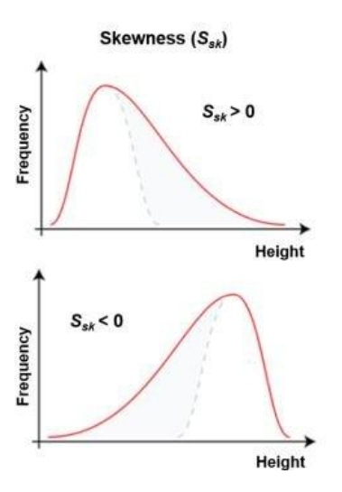
    </p>
    <!--  -->
- 특징
    - 왜도를 통해 분포의 비대칭성을 파악
    - 양의 왜도: 평균 > 중앙값 > 최빈값
    - 음의 왜도: 평균 < 중앙값 < 최빈값

#### 첨도(Kurtosis)

- 첨도는 분포의 꼭대기가 얼마나 뾰족하거나 평평한지를 측정하는 값이다.
    - 첨도 > 0(Leptokurtic): 꼭대기가 뾰족하고 꼬리가 두껍다.
    - 첨도 = 0(Mesokurtic): 정규분포와 비슷한 모양이다.
    - 첨도 < 0(Platykurtic): 꼭대기가 평평하고 꼬리가 얇다.

    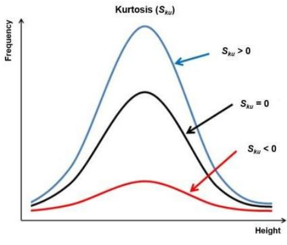
- 첨도가 크면 극단값(꼬리)이 많아 분석에 주의가 필요하다.
- 첨도가 작으면 데이터가 편균 근처에 고르게 분포한다.

#### 비교와 활용

| 척도 | 정의 및 특징 | 활용 상황 |
| :---: | :--- | :--- |
| **정규분포** | 평균을 중심으로 대칭적 분포 | 자연현상 분석, 통계 분석 |
| **왜도** | 분포의 비대칭성 측정 | 데이터 치우침 확인 (예: 주택 가격 분석) |
| **첨도** | 분포의 꼭대기 뾰족함과 꼬리 두께 측정 | 극단값의 빈도 및 위험 분석 (예: 주식 수익률) |

### 그룹별 집계와 피벗 테이블 생성

#### 그룹별 집계(Grouping and Aggregation)

- 데이터를 특정 기준으로 묶은 후(그룹화) 각 그룹에 대해 합계, 평균, 최대값 등 다양한 연산(집계)을 수행한다.
- 언제 사용할까?
    - 대량의 데이터를 요약하고 패턴을 파악할 때 사용한다.
    - 데이터를 시각적으로 이해하거나 보고서를 작성할 때 사용한다.
- 사용 예시
    - 쇼핑몰 매출 데이터를 분석해 카테고리별 총 매출
    - 회사의 직원 데이터를 부서별로 나누어 평균 급여
        ```python
        # 샘플 데이터
        data = {
            'Name': ['Alice', 'Bob', 'Charlie', 'David', 'Eva'],
            'Department': ['HR', 'IT', 'HR', 'IT', 'Finance'],
            'Salary': [50000, 60000, 55000, 70000, 65000]
        }

        df = pd.DataFrame(data)

        # 그룹화 및 집계: 부서별 평균 급여 계산
        grouped = df.groupby("Department")["Salary"].mean()
        print(grouped)

        # Department
        # Finance    65000.0
        # HR         52500.0
        # IT         65000.0
        # Name: Salary, dtype: float64
        ```

### 데이터 간 비교 분석

- 두 개 이상의 데이터 집합을 비교하여 차이점, 유사점, 상관관계 등을 분석하는 작업
- 데이터의 경향이나 패턴을 이해하고 의사 결정을 돕는 데 사용한다.
- 비교 분석의 중요성
    - 경향 파악: 데이터 간 변화를 이해하려면 미래를 예측하거나 문제를 해결해야 한다.
    - 효율적 의사 결정: 데이터를 비교하면 어떤 선택이 더 효과적인지 판단한다.
    - 실생활 적용: 마케팅 성과 비교, 제품 판매량 변화 분석, 지역별 성과 분석 등 다양한 분야에서 활용

#### 데이터 비교 분석 방법

1. 기술 통계 비교
    - 각 데이터 세트의 기본 통계(평균, 중간값, 최댓값 등)를 계산하여 비교한다.
    
    ```python
    # 샘플 데이터
    data1 = {'Sales': [100, 200, 150, 300]}
    data2 = {'Sales': [120, 220, 180, 260]}

    df1 = pd.DataFrame(data1, columns=['Sales'])
    df2 = pd.DataFrame(data2, columns=['Sales'])

    # 기술 통계 계산
    print("Dataset 1: \n", df1.describe())
    print("Dataset 2: \n", df2.describe())

    # Dataset 1: 
    #        Sales
    # count    4.000000
    # mean   187.500000
    # std     85.391256
    # min    100.000000
    # 25%    137.500000
    # 50%    175.000000
    # 75%    225.000000
    # max    300.000000

    # Dataset 2: 
    #        Sales
    # count    4.000000
    # mean   195.000000
    # std     59.721576
    # min    120.000000
    # 25%    165.000000
    # 50%    200.000000
    # 75%    230.000000
    # max    260.000000
    ```
2. 시각화 비교
    - 데이터를 그래프로 표현하여 직관적으로 비교
        ```python
        import matplotlib.pyplot as plt

        # 데이터
        x = ['Q1', 'Q2', 'Q3', 'Q4']
        y1 = [100, 200, 150, 300]
        y2 = [120, 220, 180, 260]

        # 그래프 생성
        plt.plot(x, y1, label='Dataset 1', marker='o')
        plt.plot(x, y2, label='Dataset 2', marker='o')
        plt.title('Quarterly Sales Comparison')
        plt.xlabel('Quarter')
        plt.ylabel('Sales')
        plt.legend()
        plt.show()
        ```
        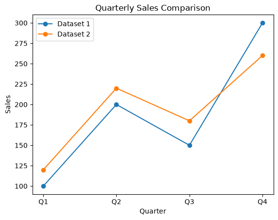
3. 상관 관계 분석
    - 두 데이터 세트가 서로 어떤 관계를 가지고 있는지 분석
    - 상관계수(Correlation Coefficient)를 사용
    - 범위는 -1에서 1까지
        - 1: 완전한 양의 상관관계
        - 0: 관계 없음
        - -1: 완전한 음의 상관관계
            ```python
            import numpy as np

            # 데이터
            dataset1 = [100, 200, 150, 300]
            dataset2 = [120, 220, 180, 260]

            # 데이터 차이 계산
            difference = [b - a for a, b in zip(dataset1, dataset2)]
            print('Difference between datasets:', difference)           # Difference between datasets: [20, 20, 30, -40]
            ```
4. 차이 분석
    - 두 데이터 집합 간 차이를 계산하여 변화량을 분석
        ```python
        import numpy as np

        # 데이터 
        dataset1 = [100, 200, 150, 300]
        dataset2 = [120, 200, 180, 260]

        # 상관 계수계산,
        # 양의 상관관계: 키가 커질수록 몸무게가 증가하는 경우.
        correlation = np.corrcoef(dataset1, dataset2)[0, 1]
        print(f"Correlation Coefficient: {correlation}")        # Correlation Coefficient: 0.9803789354850793
        ```
        
#### 데이터 비교 분석의 활용

- 비즈니스 의사 결정
    - 제품별 매출 데이터를 비교하여 어느 제품에 더 많은 자원을 투자할지 결정한다.
- 과학 연구
    - 실험 전후 데이터를 비교하여 결과의 유효성을 판단한다.
- 교육 분석
    - 학급별 성적 비교로 학습 경향을 파악한다.
- 데이터 간 비교 분석은 다양한 방법(통계, 시각화, 상관관계, 차이 분석)을 통해 데이터의 차이점과 경향을 파악한다.
- pandas와 matplotlib는 데이터 비교 분석을 간단하고 효과적으로 수행하는 도구이다.
- 필요에 따라 다양한 방법을 조합하면 더욱 깊이 있는 분석이 가능하다.

### 파이썬 데이터 시각화(Data Visualization)

- 데이터 시각화는 방대한 데이터를 한 눈에 파악하고 숨겨진 인사이트를 도출하는 탐색적 데이터 분석(EDA)의 핵심과정이다.
- 라이브러리
    - Matplotlib
        - 파이썬의 가장 원초적이고 강력한 기본 시각화 라이브러리
        - 세밀한 그래프 컨트롤이 가능
        - pip install matplotlib
    - Seaborn
        - Matplotlib 기반 위에 구축된 통계용 데이터 시각화 라이브러리
        - 세련된 디자인 테마와 복잡한 통계 차트를 단 한 줄로 생성
        - pip install seaborn

#### 한글 폰트 깨짐 설정(macOS 및 Windows 호환)

- Matplotlib은 기본적으로 한글 폰트를 지원하지 않아 한글이 깨지는 현상이 발생한다.
    ```python
    import matplotlib.pyplot as plt
    import seaborn as sns
    import platform

    # OS에 맞춰 한글 폰트 자동 설정
    if platform.system() == 'Darwin': # macOS
        plt.rc('font', family='AppleGothic')
    elif platform.system() == 'Windows':
        plt.rc('font', family='Malgun Gothic')

    # 마이너스 부호 깨짐 방지
    plt.rc('axes', unicode_minus=False)

    # Seaborn 기본 스타일 설정
    sns.set_theme(style="whitegrid", font="AppleGothic" if platform.system() == 'Darwin' else "Malgun Gothic")

    print("한글 시각화 준비 완료")
    ```

### Matplotlib의 활용

#### 선형 그래프(Line Plot)

- 선형 그래프는 데이터 점을 선으로 연결하여 값의 변화 추이를 시각화하는 그래프
- 주로 시간에 따른 변화, 연속적인 데이터 비교에 사용
- 그래프 생성 옵션
    - plt.plot: 선형 그래프를 생성하는 함수.
    - marker: 각 데이터 포인트를 나타내는 기호.
    - linestyle: 선 스타일 지정.
    - color: 선 색상.
    - plt.grid: 배경에 격자를 추가하여 가독성 향상
        ```python
        import matplotlib.pyplot as plt

        # 데이터 준비
        x = [1, 2, 3, 4, 5]                 # x축 데이터
        y = [2, 3, 5, 7, 11]                # y축 데이터

        # 그래프 생성
        plt.plot(x, y, marker='o', linestyle='-', color='b', label='Prime Numbers')

        # 그래프 꾸미기
        plt.title("Line Graph Example")     # 제목
        plt.xlabel("X-axis")                # x축 레이블
        plt.ylabel("Y-axis")                # y축 레이블
        plt.legend()                        # 범례 표시

        # 그래프 출력
        plt.grid(True)                      # 격자 추가
        plt.show()
        ```

        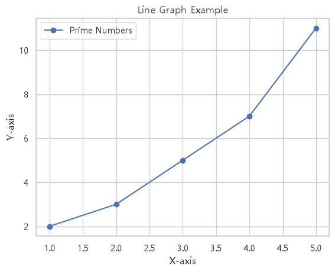

#### 막대 그래프(Bar Chart)

- 막대 그래프는 카테고리형 데이터를 시각화
- 각 막대의 높이 또는 길이가 해당 데이터 값의 크기를 나타낸다.
- 그래프 생성 옵션
    - plt.bar: 막대 그래프를 생성하는 함수.
    - color: 막대 색상 지정.
    - edgecolor: 막대 테두리 색상.
    ```python
    import matplotlib.pyplot as plt

    # 데이터준비
    categories = ['A', 'B', 'C', 'D', 'E']
    values = [5, 7, 3, 8, 4]

    # 막대 그래프 생성
    plt.bar(categories, values, color='skyblue', edgecolor='black')
    # plt.barh(categories, values, color='skyblue', edgecolor='black') # 수평 그래프

    # 그래프 꾸미기
    plt.title("Bar Chart Example")      # 제목
    plt.xlabel("Categories")            # x축 레이블
    plt.ylabel("Values")                # y축 레이블
    plt.grid(False)

    # 그래프 출력
    plt.show()
    ```
    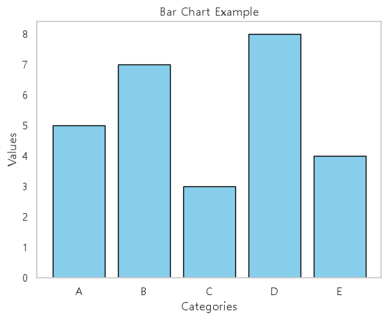

#### 히스토그램(Histogram)

- 히스토그램은 데이터를 구간별로 나누어 빈도를 시각화하는 그래프
- 주로 데이터 분포를 파악할 때 사용한다.
- 그래프 생성 옵션
    - plt.hist: 히스토그램을 생성하는 함수
    - bins: 데이터를 나눌 구간 수
    - alpha: 막대 투명도 설정(0.0 ~ 1.0)

    ```python
    import matplotlib.pyplot as plt
    import numpy as np

    # 데이터 준비
    data = np.random.randn(1000)
    # 정규 분포를 따르는 난수 1000개 생성

    # 히스토그램 생성
    plt.hist(data, bins=20, color='orange', edgecolor='black', alpha=0.7)

    # 그래프 꾸미기
    plt.title("Histogram Example")  # 제목
    plt.xlabel("Value Range")       # x축 레이블
    plt.ylabel("Frequency")         # y측 레이블
    plt.grid(False)

    # 그래프 출력
    plt.show()
    ```
    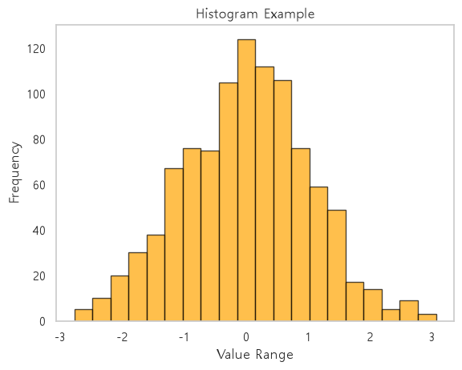

### Seaborn의 활용

#### 박스플롯 

```python
import seaborn as sns

# 박스 플롯
tips = sns.load_dataset('tips')
'''
total_bill, tip, sex, smoker, day, time, size
'''

sns.boxplot(
    x='day',
    y='total_bill',
    data=tips,
    palette='Set2'
)
```
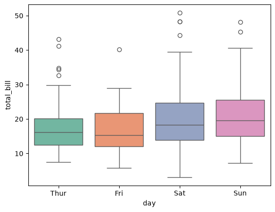

#### 페어플롯

```python
# 집값 데이터
data = pd.DataFrame({
    'Area':  [50,  60,  70,  80,  90],
    'Rooms': [1,   2,   3,   3,   4],
    'Price': [200, 250, 300, 350, 400]
})

# 페어플롯
sns.pairplot(data)
```
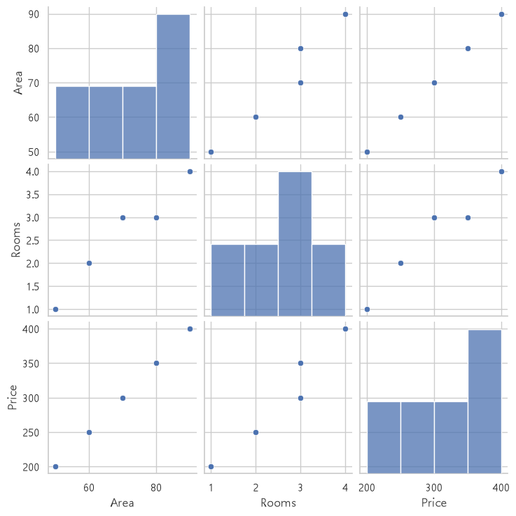

### 데이터 탐색적 분석(Exploratory Data Analysis, EDA)

- EDA는 데이터 분석 과정에서 데이터를 이해하고 통찰(insights)을 얻기 위한 초기 분석 단계이다.
    - 데이터셋의 구조와 특성을 탐색한다.
    - 문제가 되는 부분을 확인한다.
    - 분석 방향을 설정하는 데 필수적인 과정이다.
- 데이터를 "알아가는" 과정이다.

#### EDA의 주요 목적

- 데이터의 기본 특성을 이해한다.
    - 데이터를 시각적으로 관찰하고, 수치로 요약하고 데이터 분포, 이상치, 결측치 등을 확인한다.
- 데이터 정리
    - 결측값이나 이상치를 처리하고, 데이터를 분석 가능한 상태로 준비
- 가설 수립 및 데이터 기반 의사 결정
    - 데이터를 관찰하며 분석 방향과 가설을 수립<br>
    예를들어, 매출 데이터에서 특정 요일에 판매량이 높다는 패턴을 찾을 수 있음
- 문제 발견
    - 분석 중 문제가 될 수 있는 요소를 확인<br>
    예: 값이 비정상적으로 높거나 낮은 이상치(outliers), 비어 있는 데이터(null values).

#### EDA의 주요 단계

1. 데이터의 기본 특성 이해
    - 데이터 불러오기 및 기본 정보 확인<br>
    데이터셋의 크기(행과 열의 수), 변수명, 데이터 유형(숫자, 문자 등)을 확인
    - Python에서 pandas 라이브러리의 head(), info(), describe() 등을 사용
        ```python
        # 데이터 불러오기
        # 판다스는 메모리를 절약하려 데이터를 청크 단위로 나누어 읽으면서 
        # 열의 데이터 타입을 추측하는데, 파일 내부에 여러 타입이 섞여 있으면
        # 청크마다 추론 결과가 달라져 충돌 에러가 발생하므로, 
        # low_memory=False를 설정해 파일 전체를 한 번에 메모리에 올려 
        # 정확한 타입을 분석하도록 강제하는 것이다.
        df = pd.read_csv("full_data.csv", encoding="cp949", low_memory=False)

        print(df.head())
        print(df.info())
        print(df.describe())
        ```
        개방자치단체코드                    관리번호       인허가일자  영업상태명        폐업일자  소재지면적  \
        0   3000000  3000000-104-2013-00178  2013-12-09     폐업  2021-03-29  13.60   
        1   3000000  3000000-104-1967-09364  1967-11-04     폐업  1994-07-15  61.36   
        2   3000000  3000000-104-2019-00146  2019-07-15     폐업  2023-11-24  16.50   
        3   3000000  3000000-104-2015-00175  2015-10-20  영업/정상         NaN  81.00   
        4   3000000  3000000-104-1988-09477  1988-01-14     폐업  2017-02-09  52.78   
        ...

        [5 rows x 39 columns]<br>
        <class 'pandas.DataFrame'><br>
        RangeIndex: 653409 entries, 0 to 653408<br>
        Data columns (total 39 columns):<br>
        \#   Column    Non-Null Count   Dtype  
        ---  ------    --------------   -----  
        0   개방자치단체코드  653409 non-null  int64  
        1   관리번호      653409 non-null  str    
        2   인허가일자     653409 non-null  str    
        3   영업상태명     653409 non-null  str    
        4   폐업일자      454508 non-null  str    
        ...<br>
        dtypes: float64(14), int64(3), str(22)<br>
        memory usage: 194.4 MB<br>
        None

        개방자치단체코드        도로명우편번호  공장사무직직원수  공장생산직직원수  공장판매직직원수  \
        count  6.534090e+05  464834.000000    4628.0    4628.0    4628.0   
        mean   4.152683e+06   26074.658992       0.0       0.0       0.0   
        std    9.627793e+05   17687.619719       0.0       0.0       0.0   
        min    3.000000e+06    1000.000000       0.0       0.0       0.0   
        25%    3.310000e+06   10447.000000       0.0       0.0       0.0   
        50%    3.900000e+06   21946.000000       0.0       0.0       0.0   
        75%    5.020000e+06   41953.000000       0.0       0.0       0.0   
        max    6.520000e+06   63644.000000       0.0       0.0       0.0   
        ...
2. 결측 값과 이상치 확인
    - 결측값
        - 데이터가 비어 있는 경우(NaN 값).
    - 이상치
        - 비정상적으로 높거나 낮은 값.
    - 이를 확인하고 처리 방법을 결정
        - 삭제
        - 대체(평균값, 중앙값, 또는 특정값으로)
            ```python
            # 결측값확인
            print(df.isnull().sum())

            # 이상치시각화예제
            import matplotlib.pyplot as plt
            import seaborn as sns
            sns.boxplot(x=df['column_name'])
            plt.show()
            ```
3. 데이터 분포 확인
    - 변수의 분포를 이해하기 위해 히스토그램이나 커널 밀도 그래프를 사용한다.
    - 데이터가 정규 분포(normal distribution)를 따르는지 확인할 수 있다.
        ```python
        # 히스토그램
        df['column_name'].hist(bins=30)
        plt.show()
        ```
4. 변수 간 관계 탐색
    - 두 변수 사이의 상관관계를 확인하거나, 그룹별 통계량을 계산<br>
        예: 매출 데이터에서 제품별 매출 합계를 비교
5. 시각화
    - 시각화는 데이터를 더 직관적으로 이해할 수 있게 도와준다.
    - 사용하는 도구: Matplotlib, Seaborn, Plotly 등.

#### EDA의 결과물

- 데이터셋의 구조와 특성에 대한 이해
- 이상치와 결측치 처리 계획
- 데이터 분포와 변수 간 관계에 대한 통찰
- 분석 방향성 설정 및 가설 정립

### 데이터의 기본 구조 파악

- 데이터 분석을 시작하기 전에 데이터의 기본 구조를 이해하는 것은 매우 중요하다.
- 데이터를 구조적으로 이해하면 분석 목표에 맞는 전략을 세우고, 데이터를 올바르게 처리할 수 있다.
- 데이터의 기본 구조를 파악하는 과정이다.
    - 데이터의 모양(형태)
    - 데이터 타입
    - 변수의 분포 및 관계
    - 결측값 유무

#### 데이터의 기본 구조

1. 데이터셋의 크기
- 데이터셋이 몇 개의 행(row)과 열(column)로 구성되어 있는지 확인할 수 있다.
- 데이터를 요약할 때 데이터의 전반적인 크기를 알고 있어야 효율적으로 작업할 수 있다.
2. 데이터 타입
    - 각 열의 데이터 유형을 이해 → 데이터 유형은 분석방법에 영향을 미침
        - 수치형 데이터(Numeric): 정수형, 부동소수점.
        - 범주형 데이터(Categorical): 특정 그룹이나 클래스를 나타낸다.
        - 문자형 데이터(String): 텍스트 데이터.
        - 날짜/시간데이터(DateTime): 시간 기반 데이터
3. 변수의 이름과 의미
    - 데이터셋에 포함된 변수(컬럼)의 이름과 그 의미를 파악할 수 있다.
4. 결측값
    - 데이터셋에 비어 있는 값이 있는지 확인<br>
    이는 분석 결과에 영향을 미칠 수 있으므로 반드시 처리해야 한다.
5. 데이터 분포
    - 변수의 분포를 파악하여 데이터가 어떻게 구성되어 있는지 이해할 수 있다.
6. 중복값
    - 동일한 행이 여러 번 반복되는지 확인해야 한다.

#### 데이터 기본 구조를 파악하는 방법

1. 데이터 준비
    ```python
    import pandas as pd
    # 샘플 데이터
    data = {
        'Name': ['Alice', 'Bob', 'Charlie', 'David', 'Emma'],
        'Age': [25, 30, None, 35, 29],
        'Salary': [50000, 60000, 75000, 80000, None],
        'Department': ['HR', 'IT', 'Finance', 'IT', 'HR']
    }
    df = pd.DataFrame(data)
    ```
2. 데이터셋의 크기 확인
    ```python
    # 데이터 크기 확인
    print(df.shape)
    ```
3. 데이터의 기본 정보 확인
    ```python
    # 데이터 타입 및 결측값 확인
    print(df.info())

    # <class 'pandas.DataFrame'>
    # RangeIndex: 5 entries, 0 to 4
    # Data columns (total 4 columns):
    #  #   Column      Non-Null Count  Dtype  
    # ---  ------      --------------  -----  
    #  0   Name        5 non-null      str    
    #  1   Age         4 non-null      float64
    #  2   Salary      4 non-null      float64
    #  3   Department  5 non-null      str    
    # dtypes: float64(2), str(2)
    # memory usage: 292.0 bytes
    # None
    ```
4. 통계적 요약
    ```python
    # 수치형 데이터 통계 요약
    print(df.describe())

    #              Age        Salary
    # count   4.000000      4.000000
    # mean   29.750000  66250.000000
    # std     4.112988  13768.926368
    # min    25.000000  50000.000000
    # 25%    28.000000  57500.000000
    # 50%    29.500000  67500.000000
    # 75%    31.250000  76250.000000
    # max    35.000000  80000.000000
    ```
5. 결측값 확인
    ```python
    # 결측값 확인
    print(df.isnull().sum())

    # Name          0
    # Age           1
    # Salary        1
    # Department    0
    # dtype: int64
    ```

6. 데이터 타입 확인
    ```python
    # 데이터 타입 확인
    print(df.dtypes)

    # Name              str
    # Age           float64
    # Salary        float64
    # Department        str
    # dtype: object
    ```

7. 중복값 확인
    ```python
    # 중복값 확인
    print(df.duplicated().sum())

    # 0                             # 중복값이 없음
    ```

#### 데이터의 기본 구조를 파악한 후 할 수 있는 일

- 분석 전략 설정
    - 각 변수의 타입에 따라 분석 방법을 설정<br>
        예: 수치형 데이터 → 평균, 중앙값 계산.<br>
            범주형데이터→ 빈도분석.
- 데이터 전처리
    - 결측값 처리: 평균값으로 대체, 삭제, 또는 예측값(→다른 변수의 값에 영향을 받을 때)으로 대체.
    - 데이터 타입 변환: 필요에 따라 숫자를 범주형으로 변환하거나 반대 작업 수행.
- 데이터 시각화
    - 변수 간 관계를 시각적으로 탐색<br>
        예: 산점도(scatter plot)로 수치형 데이터 관계 확인.<br>
            막대그래프(bar chart)로 범주형 데이터 분포 확인.

### 기초 통계량 계산

#### Python을 활용한 기초 통계량 계산

- 평균: 데이터 전체의 균형점. 예를 들어 시험 점수 평균이 85점이라면, 대부분의 데이터가 이 근처에 분포한다고 볼 수 있다.
- 중앙값: 극단값(이상치)의 영향을 받지 않는 대표값. 데이터가 치우쳐 있을 때 평균 대신 중앙값을 사용한다.
- 최빈값: 빈도가 가장 높은 값으로, 특정값이 얼마나 자주 나타나는지 확인할 수 있다.
- 분산과 표준편차: 데이터가 얼마나 흩어져 있는지 측정한다. 표준편차가 크면 데이터의 변동성이 크다는 뜻이다.
- 왜도: 데이터가 왼쪽 또는 오른쪽으로 치우쳤는지 이해할 수 있다.
- 첨도: 데이터의 분포가 평평한지 뾰족한지 나타낸다.

### 데이터 분포 확인

#### 히스토그램(Histogram)

- 히스토그램은 데이터의 분포를 나타내는 데 사용한다.
- 연속형 데이터를 **구간(bin)** 으로 나누고 각 구간에 해당하는 데이터의 빈도를 보여준다.
- 사용목적
    - 데이터 값이 어떻게 퍼져있는지 확인(분포 확인)할 수 있다.
    - 데이터의 대략적인 형태(정규분포, 치우침등)를 파악할 수 있다.
    - 이상치(outlier)를 탐지할 수 있다.
        ```python
        # 학생 점수 데이터
        scores = [56, 67, 45, 89, 90, 77, 68, 88, 92, 76, 58, 70, 73,
        85, 62]

        # Seaborn 히스토그램 생성
        plt.rc('font', family='Malgun Gothic')

        sns.histplot(scores, bins = 5, kde=True, color="blue", edgecolor='black')
        # kde=True라는 밀도 곡선 추가
        # bins=5 5개 구간으로 구분

        plt.title("학생 점수 분포")
        plt.xlabel("점수 구간")
        plt.ylabel("학생 수")
        plt.show()
        ```
        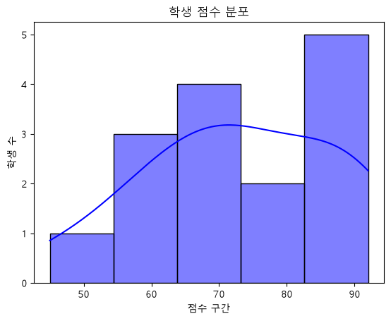

#### 박스플롯 (Boxplot)

- 데이터의 중앙값, 사분위수, 이상치를 시각화, 데이터 분포를 요약하고, 이상치를 쉽게 탐지할 수 있는 도구
- 사용목적
    - 데이터의 중앙값과 변동성 확인, 이상치(outlier) 탐지, 데이터간 비교
- 박스 플롯의 주요 구성 요소
    - 중앙값(Median): 데이터의중간값(박스의중앙선)
    - 1사분위수(Q1): 하위25% 데이터값
    - 3사분위수(Q3): 상위25% 데이터값
    - IQR(Interquartile Range): Q3 - Q1 (데이터 변동성 측정)
    - 이상치(Outliers): Q1 - 1.5 × IQR 이하, 또는 Q3 + 1.5 × IQR 이상값
        ```python
        # 부서별 월급 데이터
        departments = ['HR', 'IT', 'Finance']
        salaries = [
            [3000, 3200, 3100, 2800, 2700], # HR
            [4500, 4600, 4700, 4400, 4800], # IT
            [5200, 5300, 5000, 4900, 5400] # Finance
        ]

        # 박스플롯 생성
        plt.rc('font', family='Malgun Gothic')
        plt.boxplot(salaries, label=departments)
        plt.title('부서별 월급 분포')
        plt.ylabel('월급')
        plt.show()
        ```
        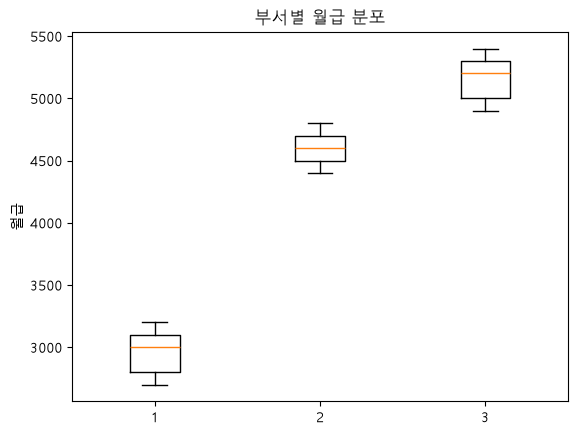

#### 히스토그램과 박스플롯의 차이점

| 특징 | 히스토그램 | 박스플롯 |
| :--- | :--- | :--- |
| **목적** | 데이터의 **빈도 분포**를 시각화 | 데이터의 **요약 통계값**과 이상치 탐지 |
| **데이터 유형** | 연속형 데이터 | 연속형 데이터 |
| **주요 정보** | 구간(bin)의 데이터 개수 | 중앙값, 사분위수, 이상치 |
| **비교 가능성** | 단일 데이터셋 시각화에 적합 | 여러 데이터셋 간 비교에 적합 |

### 데이터 탐색적 분석(EDA)을 위한 시각화 기법

- EDA(탐색적 데이터분석)는 데이터를 시각적으로 분석하여 패턴, 관계, 이상치, 분포 등을 탐구하는 과정이다.
- 다양한 시각화 기법을 통해 데이터를 더 깊이 이해하고 분석 방향을 설정할 수 있다.

#### 산점도(Scatter Plot)
- 데이터 간의 관계 확인 목적<br>
    → 두 변수 간의 관계를 확인
    - 예를 들어, 변수A와 변수B가 양의 상관관계인지, 음의 상관관계인지, 아니면 상관이 없는지 확인
- 사용 사례: 광고비와 판매량 간의 관계를 분석.
- 광고비가 증가할수록 판매량도 증가하는 양의 상관관계를 관찰할 수 있다.
    ```python
    data = pd.DataFrame({
        'Ad_Spend': [100, 200, 300, 400, 500],
        'Sales': [10, 15, 20, 25, 30]
    })

    plt.rc("font", family="Malgun Gothic")
    # 산점도 생성
    sns.scatterplot(x='Ad_Spend', y='Sales', data=data)
    plt.title('광고비와 판매량 간의 관계')
    plt.xlabel('광고비 (단위: $)')
    plt.ylabel('판매량 (단위: 개)')
    plt.show()
    ```
    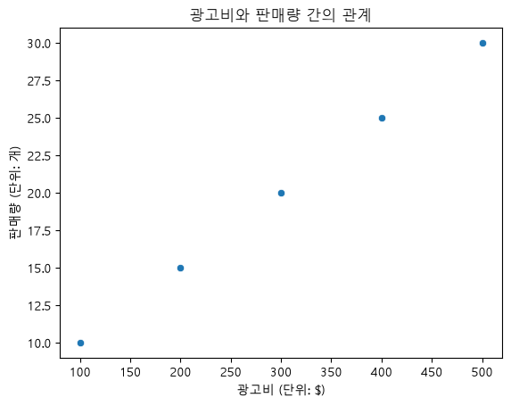

#### 히트맵(Heatmap)
- 변수 간 상관관계 분석
- 목적: 여러 변수 간의 상관관계를 확인
- 사용 사례: 학생들의 시험 점수 데이터에서 과목 간 상관관계를 확인.
- 학생 점수 상관관계
    - 현재 데이터에서는 과목 간 상관관계가 제한적이며, 영어와 과학의 상관관계(1)는 데이터 패턴의 제한된 특성에서 비롯된 것이다.
    -  보다 신뢰성 있는 결론을 위해 데이터의 크기와 다양성을 확장하고 이상치를 처리하는 과정이 필요하다.
        ```python
        # 데이터 생성
        data = pd.DataFrame({
            'Math': [90, 80, 70, 60, 85],
            'English': [85, 75, 65, 55, 10],
            'Science': [88, 78, 68, 58, 23]
        })

        # 상관계수 계산
        correlation = data.corr()

        plt.rc('font', family='Malgun Gothic')

        # 히트맵 생성
        sns.heatmap(correlation, annot=True, cmap='coolwarm')
        plt.title("과목 간 상관관계 히트맵")
        plt.show()
        ```
        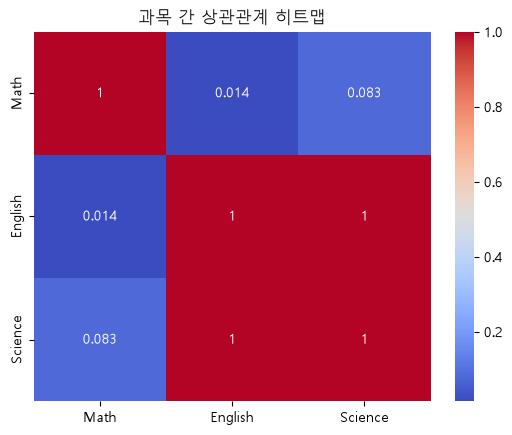
- 데이터 해석
    - Math(수학)는 다른 과목과 거의 독립적이다.
    - Math-English 상관계수 0.014는 수학 점수와 영어 점수 간의 관계가 거의 없음을 의미한다.
    - Math-Science 상관계수 0.083은 약간의 양의 상관관계를 보여주지만, 실제 데이터 상에서는 거의 무시할 만한 수준이다.
    - English(영어)와 Science(과학)는 상관계수가 1로 동일한 값을 갖는다.  이는 두 과목 점수가 동일한 패턴을 보이거나 데이터 자체에서 값들이 강하게 일치한 결과로 나타났을 가능성이 크다.

#### 페어플롯(Pair Plot)

- 변수 간 관계를 한 눈에 확인
- 데이터셋의 모든 수치형 변수 간의 관계를 시각화
- 사용 사례: 주택 데이터 분석
    - 방 개수가 많을수록 면적이 커지고, 가격도 높아지는 경향을 관찰할 수 있다.
    ```python
    # 데이터
    data = pd.DataFrame({
        'Area': [50, 60, 70, 80, 90],
        'Rooms': [1, 2, 3, 3, 4],
        'Price': [200, 250, 300, 350, 400]
    })

    # 페어플롯 생성
    sns.pairplot(data)
    plt.suptitle("주택 데이터 변수 간 관계", y=1.02)
    plt.show()
    ```
    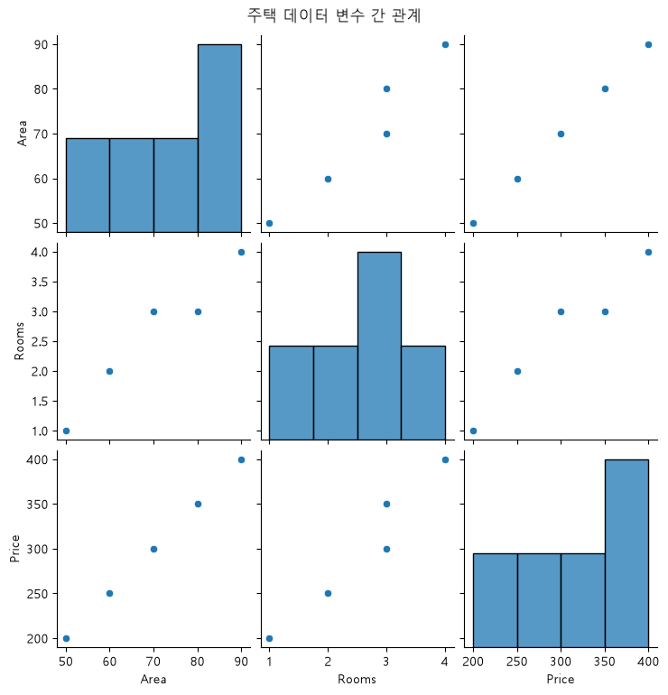

#### 카운트플롯(Count Plot)

- 범주형 데이터 시각화
- 범주형 데이터의 빈도를 확인
- 사용 사례: 제품 선호도 설문 결과를 시각화.
    - 제품 A가 가장 선호도가 높고, 제품 C가 상대적으로 낮은 선호도를 가진다.
        ```python
        # 데이터
        tips = sns.load_dataset('tips')

        # 카운트플롯 생성
        sns.countplot(
            x='day', data=tips
        )
        ```
        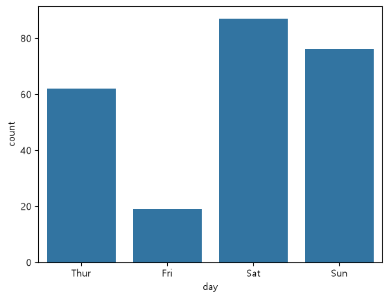

#### 시각화 기법의 선택 기준

| 시각화 기법 | 사용 목적 |
| --- | --- |
| **산점도 (Scatter Plot)** | 두 변수 간의 관계를 시각적으로 탐구 |
| **히트맵 (Heatmap)** | 여러 변수 간의 상관관계를 시각화 |
| **박스플롯 (Boxplot)** | 데이터의 분포와 이상치 탐지 |
| **페어플롯 (Pair Plot)** | 데이터셋의 모든 변수 간 관계 탐색 |
| **카운트플롯 (Count Plot)** | 범주형 데이터의 빈도 탐색 |

### 상관관계와 회귀분석 개요

#### 상관계수

- 상관계수(Pearson Correlation Coefficient, r)란?
    - **"두 변수가 단위와 관계없이 얼마나 일정한 직선(선형) 방향으로 함께 움직이는가?"**
    ```math
    r = \frac{cov(x,y)}{s_x \cdot s_y} = \frac{\sum(x_i - \bar{x})(y_i - \bar{y})}{(n-1) \cdot s_x \cdot s_y}
    ```
    - 값의 범위: −1.0 ≤𝑟≤+1.0
        - 𝑟>0: 양의 상관(한쪽이 커지면 다른 쪽도 커짐)
        - 𝑟<0: 음의 상관(한쪽이 커지면 다른 쪽은 작아짐)
        - 𝑟=0: 선형 상관관계 없음
        - |𝑟|≥0.5: 강한 상관관계(Cohen 기준)
- Perfect Positive (r=1): 데이터 점들이 완벽히 직선 위에 놓여 있고, x와 y가 동일하게 증가
- Strong Positive (r=0.8): 데이터 점들이 양의 관계를 나타내며, 약간의 분산이 있다.
- No Correlation (r=0): 데이터 점들이 무작위로 흩어져 있어 관계를 찾을 수 없다.
- Strong Negative (r=-0.8): 데이터 점들이 음의 관계를 나타내며, 약간의 분산이 있다.
- Moderate Negative (r=-0.4): 데이터 점들이 약한 음의 관계를 나타낸다.
- Perfect Negative (r=-1): 데이터 점들이 완벽히 직선 위에 있으며, x가 증가하면 y가 동일하게 감소한다.
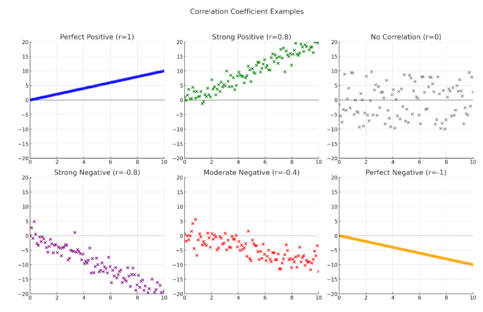

#### 상관행렬

- 상관 행렬은 여러 변수 간의 상관계수를 표 형태로 보여준다.

- **상관은 인과가 아니다**
    - REASON 01. 혼란변수(Confounder) - 제3의 잠재변수 개입
        - 원인과 결과 양쪽 모두에 은밀히 영향을 미쳐, 둘이 마치 직접 연결된 것처럼 착각을 일으키는 "배후의 숨은 변수"
    - REASON 02. 역인과관계(Reverse Causality) - 원인과 결과의 전도
        - 내가 '원인'이라고 생각했던 것이 사실은 '결과'이고, '결과'라고 생각했던 것이 '원인'인 경우이다.
    - REASON 03. 다중비교의 우연(Spurious Correlation) - 무작위 교차의 우연
        - 아무런 상관이 없는 변수들도 수십 개, 수백 개를 마구잡이로 대조하다 보면 수학적으로 우연히 딱 맞아 떨어지는 가짜 상관이 발생한다.

#### 단순 회귀 분석

- 하나의 독립변수(X)와 하나의 종속변수(Y) 사이의 관계를 모델링하여, X를 이용해 Y를 예측하는 방법
    - 데이터가 선형적 관계를 가지고 있을 때 유용하다.
    - 결과는 다음과 같은 1차 방정식으로 표현한다.<br>
    $$𝑌=𝑎𝑋+𝑏$$
    - 𝑎: 기울기(독립변수가1 증가할 때 종속변수가 얼마나 증가하는지).
    - 𝑏: 절편(독립변수가 0일 때 종속변수의 예상값).
- **회귀 분석의 주요 개념**
    - 잔차(Residuals)
        - 실제 값과 회귀선(예측값) 간의 차이를 의미한다.
        - 예) 한 학생이 3시간 공부했는데 실제 시험 점수는 60점이었지만 예측값은 65점이었다면<br>
        → 잔차는 -5이다.
    - 최소제곱법(Least Squares Method)
        - 잔차의 제곱합이 최소가 되도록 회귀선을 찾는 방법이다.
        - 잔차 제곱합이 최소일 때 가장 적합한 선형 방정식을 얻을 수 있다.
    - R² 값(결정계수)
        - SSE (Sum of Squares Error, 오차 변동 = 잔차 제곱합):<br>
        우리 모델이 만든 회귀선($\hat{y}$)이 실제 값($y$)과 얼마나 차이 나는가?
        ```math
        SSE = \sum(y - \hat{y})^2
        ```
        - SST (Total Sum of Squares, 총 변동):<br>
        데이터들이 원래 평균($\bar{y}$)에서 얼마나 흩어져 있는가?
        ```math
        SST = \sum(y - \bar{y})^2
        ```
        - $$R^2 = 1 - \frac{SSE}{SST}$$
        - 회귀 모델이 데이터를 얼마나 잘 설명하는지를 나타낸다.
        - 값의 범위는 0~1이며, 1에 가까울수록 회귀모델이 데이터를 잘 설명한다.
    - 시각적 이해
        - 데이터를 산점도로 표현하고, 그 위에 회귀선을 추가한다.
        - 예를 들어, 공부시간 vs. 시험점수를 시각화
            - 𝑥-축: 공부시간
            - 𝑦-축: 시험점수
            - 데이터 점들 사이에 회귀선이 그려져 있으며,이 선이 예측모델을 나타낸다.

#### 변수 간 관계 분석

- 두 변수 또는 여러 변수 간의 상관성이나 영향력을 이해하고,<br>
    한 변수가 다른 변수에 어떻게 영향을 미치는지를 분석하는 과정이다.
- 관계는 상관관계와 인과관계로 나눌 수 있다.
    - **상관관계**: 두 변수 간의 변화가 함께 나타나는 경우(서로 연관성이 있다).
    - **인과관계**: 한 변수의 변화가 다른 변수에 직접적인 영향을 미치는 경우.
- 상관관계와 인과관계의 차이
    - 상관관계는 인과관계가 아닐 수 있다!
    - 상관관계는 단지 두 변수 간에 규칙적으로 변하는 패턴이 있음을 나타낸다.

- **관계 분석의 도구**
    - 상관계수
        - 두 변수 간의 관계를 수치화하여 -1에서 1 사이의 값으로 표현한다.
        - 예: 공부시간과 시험점수의 상관계수가 0.85라면, 두 변수 간에는 강한 양의 상관관계가 존재한다.
    - 산점도
        - 두 변수의 데이터를 시각화하여 관계를 직관적으로 이해한다.
        - 예: 광고비와 매출의 데이터를 산점도로 표현하면, 데이터가 선형적으로 증가하는 모습을 확인할 수 있다.
    - 회귀분석
        - 두 변수 간 관계를 선형 방정식으로 나타내어 한 변수를 기반으로 다른 변수를 예측한다.
        - 예: 광고비(X)와 매출(Y) 간 회귀식이 $Y=5X+50$라면, 광고비 10만원을 더 쓰면 매출이 50만원 증가한다.

## <a id="data-preprocessing"></a>3. 데이터 전처리

### 데이터 수집 방법 개요

#### 데이터 전처리란?

- 데이터를 분석하거나 머신러닝 모델에 사용하기 전에 깨끗하고 유용한 상태로 준비하는 과정이다.
- 데이터 수집 후 비어있는 값(누락된 값), 엉뚱한 값(오류), 필요없는 값(중복)이 있다면, 이를 수정하고 정리하는 과정이다.<br>
    → 데이터 전처리는 데이터를 "사용하기 좋게" 만드는 청소 과정이다.
- 왜 필요한가?
    - 잘못된 데이터를 그대로 사용하면, 분석 결과나 모델이 엉뚱한 답을 내놓을 수 있기 때문이다.
    - 데이터 전처리는 요리 전에 재료를 씻고 다듬는 것과 같다. 깨끗한 재료로 요리를 해야 맛있는 음식을 만들 수 있듯, 깨끗한 데이터로 분석해야 좋은 결과를 얻을 수 있다.

#### 데이터 전처리의 중요성

- 데이터 전처리는 데이터의 품질을 높이고, 분석이나 모델링의 결과를 신뢰할 수 있게 해준다.
- 데이터를 잘 정리하지 않으면 잘못된 결과를 초래하고, 시간과 비용이 낭비된다.
- 앞 사례에서 보듯이, **전처리는 단순한 작업이 아니라 성공적인 데이터 프로젝트의 필수적인 단계**이다.

1. 데이터 품질이 결과에 미치는 영향
    - 사례<br>
    온라인 쇼핑몰이 고객 맞춤형 추천 시스템을 운영하고 있다.
    - 문제<br>
    데이터에 누락된 정보와 오류가 있다(예: 고객 나이 필드가 빈 상태이거나, 이름이 숫자로 저장된 경우).
    - 결과<br>
    추천시스템이 올바른 정보를 기반으로 학습하지 못해, 어린이에게 어른용 제품을 추천하거나, 고객 취향과 무관한 제품을 추천 → 이는 매출 감소로 이어질 수 있다.
    - 해결<br>
    **누락된 나이는 평균값으로 채우고, 잘못된 데이터를 수정하면, 추천 정확도가 높아진다.**<br>
    → 매출 증가와 고객 만족도 향상을 기대할 수 있다.
2. 모델 성능에 미치는 영향
    - 사례<br>
    이메일 서비스에서 스팸이 메일을 걸러내는 머신러닝 모델을 구축한다.
    - 문제<br>
    이메일 텍스트에 특수 문자와 HTML 태그가 포함되어 있어 모델이 주요 단어를 인식하지 못 한다.<br>
    데이터셋의 레이블(스팸/정상)이 잘못된 경우도 있다.
    - 결과<br>
    모델이 제대로 학습하지 못하고 스팸이 메일을 정상 이메일로 분류하거나,
    반대로 정상이 메일을 스팸으로 분류한다.
    - 해결<br>
    **데이터 전처리 단계에서 특수문자와 HTML 태그를 제거하고 텍스트를 정리한다.**
    잘못된 레이블을 확인하고 수정하면, 모델의 스팸 분류 정확도가 크게 향상된다.
3. 시간과 비용 절약
    - 사례<br>
    한 회사가 고객 이탈을 예측하는 분석 프로젝트를 진행한다.
    - 문제<br>
    동일한 고객이 이름을 다르게 입력(“홍길동”/ “Hong Gil Dong”)하거나, 중복된 구매기록이 포함된다.<br>
    분석 중간에 데이터를 수정해야 하는 상황이 빈번히 발생한다.
    - 결과<br>
    데이터를 수정하는데 시간이 소요되어 프로젝트가 지연되고, 추가 인력과 비용이 필요해진다.
    - 해결<br>
    **데이터 전처리 단계에서 중복을 제거하고, 고객 이름 포맷을 통일(한글 혹은 영어로 통일)** 하면 문제를 사전에 방지할 수 있다.<br>
    → 프로젝트 기간을 단축하고 비용을 절감할 수 있다.
4. 의사결정의 정확성 향상
    - 사례<br>
    한 병원이 환자의 건강 상태 데이터를 분석하여 질병 위험도를 예측한다.
    - 문제<br>
    혈압 필드에 비정상적으로 높은 값(1000 이상)이 포함되거나, 음수 값이 입력된 경우
    - 결과<br>
    잘못된 데이터로 분석을 진행하면, 병원이 환자의 질병 위험도를 잘못 평가할 가능성이 높다.<br>
    → 환자의 건강을 위협하거나 병원의 신뢰도를 떨어뜨린다.
    - 해결<br>
    **데이터 정제 과정에서 비정상적으로 높은 값은 제거하고, 음수 값은 적절히 수정 또는 삭제**한다.<br>
    올바른 데이터를 기반으로 분석하면, 환자에게 정확한 진단정보를 제공할 수 있다.

#### 데이터의 유형

- **정형 데이터 (Structured Data)**
    - 정형 데이터는 행(row)과 열(column)로 구성되어 있는, 잘 정리된 데이터이다.<br>
    → 데이터베이스나 엑셀 파일(은행기록, 월급명세서)
    - 특징
        - 데이터가 표처럼 정렬되어 있다. 각 열에 이름(필드명)과 데이터 유형(숫자, 문자열 등)이 정해져 있다.
- **비정형 데이터 (Unstructured Data)**
    - 비정형 데이터는 고정된 구조가 없는, 정리되지 않은 데이터이다.<br>
    → 이미지, 동영상, 텍스트 파일
    - 특징
        - 데이터의 모양이나 구조가 일정하지 않고 분석하려면 먼저 데이터를 가공해야 한다.
- **반정형 데이터 (Semi-Structured Data)**
    - 반정형 데이터는 정형 데이터와 비정형 데이터의 중간 단계로 데이터에 구조는 있지만, 정형 데이터처럼 엄격하지 않다. <br>
    → 대표적으로 JSON과 XML 같은 파일
    - 특징
        - 데이터에 구조가 있지만, 형태가 유연하다.
        - 사람이 읽을 수 있으며, 컴퓨터도 처리할 수 있다.
        
### 데이터 전처리 과정 개요

- 데이터 전처리는 데이터를 분석이나 모델링에 사용하기 위해 깨끗하고 유용하게 준비하는 단계이다.
- 데이터 수집 → 정제 → 변환 → 통합의 순서로 진행된다.
- 각 단계는 **데이터의 품질과 활용도를 높이는 데 초점**이 맞춰져 있다.

| 단계 | 비유 (요리) | 정의 (데이터) |
| --- | --- | --- |
| **수집** | 재료를 시장에서 가져오는 단계 | 필요한 데이터를 모으는 단계 |
| **정제** | 재료에서 불필요한 부분을 제거하고 깨끗이 씻는 단계 | 데이터를 깨끗하게 만드는 단계 |
| **변환** | 재료를 요리에 맞게 손질하고 준비하는 단계 | 데이터를 분석/모델링에 적합하게 바꾸는 단계 |
| **통합** | 여러 재료를 한 접시에 요리로 완성하는 단계 | 여러 데이터를 하나로 합치는 단계 |

#### 데이터 전처리 과정

1. 데이터 수집
- 데이터를 가져올 출처를 결정하고, 필요한 데이터를 수집한다.
- 데이터가 불완전하거나 잘못된 경우가 많기 때문에, 수집한 데이터의 품질을 확인해야 한다.
- 주요 출처
    - 데이터베이스(SQL, NoSQL 등)
    - API (예: 날씨 데이터, 주식 데이터)
    - 웹크롤링(인터넷에서 데이터 수집)
    - 센서 데이터(IoT 기기에서 실시간 데이터 수집)
2. 데이터 정제 (Cleaning)
- 수집한 데이터는 종종 불완전하고 오류가 있을 수 있다.<br>
    → 데이터 정제는 이런 **문제를 해결하여 데이터를 깨끗하게 만드는 단계**이다.
- 데이터를 정제하지 않으면, 이후 단계에서 잘못된 결과를 얻을 가능성이 높아진다.
- 주요 작업
    - **결측 값 처리** : 데이터에 비어 있는 값(NaN, Null 등)이 있을 경우, 이를 해결해야 한다.<br>
    예: 평균값, 중앙값으로 채우거나 해당 데이터를 삭제한다.
    - **오류 수정** : 잘못된 데이터(오타, 잘못된 값 등)를 수정한다.<br>
    예: 나이에 음수 값이 입력된 경우 이를 제거해야 한다.
    - **중복 제거** : 동일한 데이터가 여러 번 나타나는 경우 삭제한다.<br>
    예: 고객 정보가 중복되어 있는 경우 하나만 남긴다.
    - **이상치 제거** : 너무 크거나 작은 값 등 정상적이지 않은 값을 처리한다.<br>
    예: 쇼핑몰에서 상품 가격이 1억원으로 입력된 경우.
3. 데이터 변환 (Transformation)
- 정제된 데이터를 분석과 모델링에 적합한 형태로 변환하는 단계<br>
→ 데이터 변환은 **데이터를 해석하기 쉽게 하고, 모델링 과정에서 성능을 향상시킨다.**
- 주요 작업
    - **형태 변환** : 데이터를 사용 목적에 맞게 바꾼다.
    예: 텍스트 데이터를 숫자로 인코딩('남성' → 0, '여성' → 1).
    - **정규화(Normalization)** : 데이터 범위를 일정하게 조정한다.
    예: 가격 데이터를 0~1 사이로 변환하여 비교가 가능하게 만든다.
    - **집계(Aggregation)** : 데이터를 요약하거나 그룹화한다.
    예: 일별 데이터를 월별로 집계.
    - **차원 축소** : 불필요한 데이터를 제거하여 데이터 크기를 줄인다.
    예: 머신러닝 모델에서 중요하지 않은 열 제거.
4. 데이터 통합 (Integration)
- 다양한 데이터 자원에서 수집한 데이터를 하나로 합치는 과정이다.<br>
→ 데이터가 여러 개의 테이블, 파일, 또는 시스템에 분산되어 있을 수 있기 때문이다.<br>
→ 주의점: 데이터의 의미와 관계를 잘 이해하지 않으면 잘못된 결합이 이루어질 수 있다.
- 주요 작업
    - 데이터 병합(Merging)<br>
    두 개 이상의 데이터 셋을 결합한다. <br>
    예: 고객정보와 구매 데이터를 연결한다.
    - 일관성 유지<br>
    서로 다른 데이터의 포맷과 구조를 맞춘다. <br>
    예: 날짜 포맷을 'YYYY-MM-DD' 형식으로 통일한다.
    - 중복 제거<br>
    통합된 데이터에서 중복된 항목을 삭제한다.

### 데이터 정제(Cleaning)

#### 결측치 처리 (제거, 대체)

- 결측치
    - 데이터셋에서 특정 값이 누락된 상태<br>
        예: 설문조사에서 어떤 사람이 나이를 입력하지 않았거나, 센서가 데이터를 제대로 수집하지 못한 경우
    - **결측치는 데이터 분석결과에 영향을 줄 수 있으므로 반드시 처리해야 한다.**
- 결측치를 처리하는 이유
    - **분석 왜곡 방지**: 결측값을 그대로 두면 평균, 합계 같은 계산이 왜곡될 수 있다.
        - 정규 분포를 띄고 있는 경우 → 평균값
        - 분포가 편향을 가지고 있는 경우 → 중간값
    - **모델 학습 방해 방지**: 머신러닝 모델은 결측값을 포함한 데이터를 처리하지 못하는 경우가 많이 발생한다.
    - **데이터 품질 향상**: 결측치를 처리하면 데이터를 더 신뢰할 수 있게 된다.
- 결측치 처리
    - 데이터 손실을 최소화하고 분석에 미치는 영향을 줄이려면
        - 결측치의 양, 데이터의 중요성, 그리고 분석목표를 고려해야 한다.
        - 간단한 데이터셋에서는 제거와 평균/중간값 대체가 유용하다.
        - 하지만 복잡한 데이터에서는 머신러닝 기반 대체를 활용해야 한다.
    - 결측치 제거
        - 사용 상황
            - 결측치가 데이터셋에서 차지하는 비율이 매우 적을 때.
            - 해당 열이나 행이 분석에 큰 영향을 주지 않을 때.
        - 방법
            - 열 제거<br>
                특정 열에 결측값이 너무 많다면, 해당 열 자체를 삭제해야 한다.
            - 행 제거<br>
                특정 행에 결측값이 있으면, 해당 행을 삭제해야 한다.
                ```python
                # 데이터프레임 생성
                data = {
                    'Name': ['Alice', 'Bob', None],
                    'Age': [25, None, 30],
                    'Score': [85, 90, None]
                }
                df = pd.DataFrame(data)

                # 결측치가 있는 행 제거
                df_no_missing_rows = df.dropna()
                print(df_no_missing_rows)

                print('*' * 50)

                #  결측치가 있는 열 제거
                df_no_missing_cols = df.dropna(axis=1)
                print(df_no_missing_cols)

                #     Name   Age  Score
                # 0  Alice  25.0   85.0
                # **************************************************
                # Empty DataFrame
                # Columns: []
                # Index: [0, 1, 2]
                ```
    - 결측치 대체
        - 사용 상황
            - 데이터의 양이 적거나, 결측치가 무작정 삭제되면 데이터 손실이 너무 클 때.
        - 방법
            - 고정값으로 대체<br>
            특정값(예: 0, 평균, 중간값)으로 결측치를 채운다.
            - 통계 기반 대체<br>
                » 평균값으로 대체: 수치형 데이터에서 결측값을 해당 열의 평균으로 대체.<br>
                » 중간값으로 대체: 평균이 극단값에 영향을 받는 경우, 중간값 사용.<br>
                » 최빈값으로 대체: 범주형 데이터에서 가장 많이 등장한 값으로 결측치를 대체.<br>
            - 예측 기반 대체: 머신러닝 모델을 사용해 결측치를 예측하여 채운다.
                ```python
                # 데이터프레임 생성
                data = {
                    'Name': ['Alice', 'Bob', None],
                    'Age': [25, None, 30],
                    'Score': [85, 90, None]
                }
                df = pd.DataFrame(data)

                # 평균으로 대체
                df['Age'] = df['Age'].fillna(df['Age'].mean())
                # 중간값으로 대체
                df['Score'] = df['Score'].fillna(df['Score'].median())
                # 최빈값으로 대체
                df['Name'] = df['Name'].fillna(df['Name'].mode()[0])

                print(df)

                #     Name   Age  Score
                # 0  Alice  25.0   85.0
                # 1    Bob  27.5   90.0
                # 2  Alice  30.0   87.5
                ```

#### 이상치 처리 (IQR, Z-Score)

- 이상치
    - 데이터셋에서 다른 값들과 크게 동떨어져 있는 값이다.<br>
        예: 학생의 평균 시험 점수가 70~90점 사이인데, 한 학생이 150점을 받은 경우 이상치로 간주한다.
    - 이상치는 분석 결과를 왜곡하거나 모델의 성능을 저하시킬 수 있으므로 적절히 처리해야 한다.
- 이상치 처리의 필요성
    - 데이터 왜곡 방지 : 이상치는 평균, 분산, 상관관계 등의 통계값에 큰 영향을 미칠 수 있다.
    - 모델 성능 향상 : 머신러닝 모델은 이상치로 인해 잘못된 패턴을 학습할 수 있다.
    - 데이터 신뢰성 확보 : 이상치를 처리하면 데이터의 품질이 높아진다.
- 이상치 처리
    - IQR(Interquartile Range) 방법
        - IQR은 데이터의 중간 50%를 포함하는 범위를 이용해 이상치를 탐지하는 방법이다.
            - 비대칭 분포 데이터에 적합하다.
            - 극단값에 영향을 덜 받는다.
    - Q1(1사분위수): 하위25%의값.
    - Q3(3사분위수): 상위75%의값.
    - IQR: $IQR = Q3- Q1$
    - 이상치 기준
        - 아래쪽: $Q1 - 1.5 × IQR$ 보다 작은 값.
        - 위쪽: $Q3 + 1.5 × IQR$ 보다 큰 값.
            ```python
            import numpy as np
            import pandas as pd

            # 예제 데이터
            data = {'Scores': [70, 75, 80, 85, 90, 150]}
            df = pd.DataFrame(data)

            # IQR 계산
            Q1 = df['Scores'].quantile(0.25)        # 1사분위수
            Q3 = df['Scores'].quantile(0.75)        # 3사분위수
            IQR = Q3 - Q1

            # 이상치 기준
            lower_bound = Q1 - 1.5 * IQR
            upper_bound = Q3 + 1.5 * IQR

            # 이상치 확인
            outliers = df[(df['Scores'] < lower_bound) | (df['Scores'] > upper_bound)]
            print(f"outliers = {outliers}")

            # 이상치 제거
            # df = df[(df['Scores'] >= lower_bound) & (df['Scores'] <= upper_bound)]

            # 이상치 변경
            df['Scores'] = df['Scores'].astype(float)       # 정수 vs 실수 -> 실수 vs 실수로 형변환을 해준다.
            df.loc[df['Scores'] < lower_bound, 'Scores'] = lower_bound
            df.loc[df['Scores'] > upper_bound, 'Scores'] = upper_bound
            print(df)
            ```
- Z-Score 방법
    - Z-Score는 데이터의 값이 평균에서 얼마나 떨어져 있는지를 표준편차 단위로 나타낸다.
        - 정규분포를 따르는 데이터에 적합하다.
        - 계산이 간단하다.
    - Z= (X− μ)/σ
        - 𝑋: 개별 데이터 값
        - 𝜇: 평균.
        - 𝜎: 표준 편차.
    - 이상치 기준
        - 일반적으로 ∣𝑍∣>3이면 이상치로 간주한다.
        - 여기서는 ∣𝑍∣>2 또는 ∣𝑍∣<-2
            ```python
            import pandas as pd
            from scipy.stats import zscore

            # 예제 데이터
            data = {'Scores': [70, 75, 80, 85, 90, 1000000]}
            df = pd.DataFrame(data)

            # Z-Score 계산
            df['Z_Score'] = zscore(df['Scores'])

            # 이상치 확인
            outliers = df[(df['Z_Score'] < -2) | (df['Z_Score'] > 2)]
            print(outliers)

            # 이상치 제거
            df = df[(df['Z_Score'] > -2) & (df['Z_Score'] < 2)]

            # 이상치를 중간값으로 대체
            median = df['Scores'].median()
            df.loc[(df['Z_Score'] < -2) | (df['Z_Score'] > 2), 'Scores'] = median

            print('*' * 20)
            print(df)

            #     Scores   Z_Score
            # 5  1000000  2.236068
            # ********************
            #    Scores   Z_Score
            # 0      70 -0.447240
            # 1      75 -0.447227
            # 2      80 -0.447214
            # 3      85 -0.447200
            # 4      90 -0.447187
            ```

#### 데이터 중복 확인 및 제거

- 중복 데이터는 데이터셋에서 동일한 행(row)이 반복적으로 나타나는 것이다.
- 중복 데이터가 있으면 분석결과가 왜곡될 수 있으며, 특히 데이터의 크기가 큰 경우 처리 속도와 메모리 사용량에 영향을 줄 수 있다.
- 중복 데이터는 다음과 같이 나타날 수 있다.
    - 완전 중복: 모든 열의 값이 동일한 행.
    - 부분 중복: 특정 열의 값만 동일한 행.
        ```python
        data = {
            'Name': ['Alice', 'Bob', 'Alice', 'Charlie', 'Bob'],
            'Age': [25, 30, 25, 35, 30],
            'Score': [85, 90, 85, 95, 90]
        }

        df = pd.DataFrame(data)

        print(df.duplicated())
        # 0    False
        # 1    False
        # 2     True
        # 3    False
        # 4     True
        # dtype: bool
        print('*' * 20)
        print(df.duplicated().sum())                    # 2
        print(df.duplicated(subset=['Name']).sum())     # 2     # subset: 어떤 열을 기준으로 할 것인가

        print("중복 행들을 보여준다.")
        print(df[df.duplicated()])

        print("\n중복된 행 삭제: 기본값 - 앞에 있는 게 남아있다.")
        df_cleared = df.drop_duplicates()
        print(df_cleared)

        print("\n뒤에 있는 것을 남긴다")
        df_cleared_last = df.drop_duplicates(keep='last')
        print(df_cleared_last)

        print("\n모두 삭제한다.")
        df_cleared_false = df.drop_duplicates(keep=False)
        print(df_cleared_false)

        df_cleared_last1 = df.drop_duplicates(keep='last', subset=['Name'])
        df_cleared_last1

        # 0    False
        # 1    False
        # 2     True
        # 3    False
        # 4     True
        # dtype: bool
        # ********************
        # 2
        # 2
        # 중복 행들을 보여준다.
        #     Name  Age  Score
        # 2  Alice   25     85
        # 4    Bob   30     90

        # 중복된 행 삭제: 기본값 - 앞에 있는 게 남아있다.
        #     Name  Age  Score
        # 0    Alice   25     85
        # 1      Bob   30     90
        # 3  Charlie   35     95

        # 뒤에 있는 것을 남긴다
        #     Name  Age  Score
        # 2    Alice   25     85
        # 3  Charlie   35     95
        # 4      Bob   30     90

        # 모두 삭제한다.
        #     Name  Age  Score
        # 3  Charlie   35     95
        ```

### 데이터 스케일링 (표준화, 정규화)

- 데이터 스케일링은 데이터의 값 범위를 조정하는 과정이다.
- 머신러닝에서 정규화(Normalization)와 표준화(Standardization)는 모두 데이터의 수치 범위를 맞춰주는 '데이터 전처'리 기법<br>
    예) 방에서 서로 다른 단위(cm와 평수, 원화와 달러 등)를 사용하는 데이터를 컴퓨터가 공평하게 비교할 수 있도록 맞춰주는 작업이다.
- 머신러닝 모델이 데이터의 크기 차이에 영향을 덜 받게 하기 위해 중요하다.
- 특히 변수의 단위나 크기가 다를 때, 스케일링은 모델 학습에 있어 필수적인 과정이다.

#### 표준화 (Standardization)

- 표준화는 데이터의 값을 평균이 0, 표준편차가 1이 되도록 변환하는 방법이다.
- 데이터의 분포 모양을 바꾸지는 않고, 단위 차이를 없애 주는 것이다.
- 수식

    $$z = \frac{x - \mu}{\sigma}$$

    - x: 원래 데이터 값
    - 𝜇: 평균값
    - 𝜎: 표준편차
- 장점
    - 데이터가 서로 다른 범위와 단위를 가지더라도, 동일한 기준으로 변환한다.
    - 특히 거리 기반 알고리즘(예: KNN, SVM)에서 효과적이다.
- 주의점
    - 데이터가 정규분포를 따르지 않더라도 표준화를 적용할 수 있지만, 분포의 왜도는 남아 있을 수 있다.

#### 정규화 (Normalization)

- 정규화는 데이터를 0과 1 사이로 변환하는 방법이다.
- 값의 크기를 줄이고, 데이터를 일정한 스케일로 맞춘다.
- 수식(Min-Max Scaling)

    $$x' = \frac{x - \min(x)}{\max(x) - \min(x)}$$

    - $$ 원래 데이터 값
    - min(𝑥) : 데이터의 최소값
    - max(𝑥) : 데이터의 최대값
- 장점
    - 데이터가 일정 범위 내에 있어, 스케일에 민감한 알고리즘(예: 신경망, 회귀)에서 적합하다.
    - 이상치(outlier)의 영향을 줄이는데도 유용하다.
- 주의점
    - 데이터에 이상치가 있을 경우, 최대값과 최소값이 크게 왜곡될 수 있다.

#### 표준화 vs. 정규화 비교

| 특성 | 표준화 (Standardization) | 정규화 (Normalization) |
| --- | --- | --- |
| **적용 후 범위** | 평균 0, 표준편차 1 | 0에서 1 사이 |
| **사용 시기** | 정규 분포에 가까운 데이터 | 값의 범위가 클 때 |
| **알고리즘 적용** | 거리 기반 알고리즘(KNN, SVM 등) | 신경망, 회귀 등 |
| **이상치에 대한 민감도** | 덜 민감<br>이상치에 강하다(영향을 덜 받는다) | 더 민감<br>이상치에 취약하다(값이 쏠릴 수 있다) |
| **핵심 이미지** | "평균을 중심으로 예쁘게 종 모양으로 퍼트리자!" | "모든 데이터를 0과 1 사이에 빽빽하게 넣자!" |

#### 언제 사용할까?

- 데이터의 특성과 사용할 알고리즘에 따라 다르며, 보통은 **표준화**를 먼저 시도하는 것이 안전하다.
- 표준화
    - 데이터에 이상치(Outlier)가 존재하거나, 대부분의 머신러닝 알고리즘을 시작할 때 기본값(Default)으로 사용한다.
    - **이상치가 포함된 데이터**
        - 정규화는 이상치가 있으면 데이터가 한쪽으로 너무 쏠리지만, 표준화는 이상치의 영향을 덜 받는다.
    - **선형 모델 및 분류 알고리즘**
        - 선형 회귀(Linear Regression), 로지스틱회귀, 서포트벡터머신(SVM) 등은 데이터가 정규 분포(종모양)를 따른다고 가정하고 설계된 경우가 많아 표준화 가성능에 직결된다.
    - **경사하강법(Gradient Descent) 기반 알고리즘**
        - 딥러닝을 포함해 가중치 최적화를 위해 경사하강법을 쓰는 경우, 표준화를 거치면 비용함수(Loss Function)의 지형이 둥글고 고르게 변해 최적의 가중치를 찾는 속도(수렴 속도)가 압도적으로 빨라진다.
        - 많은 머신러닝 알고리즘(선형 회귀, SVM 등)이 데이터가 정규분포를 따른다고 가정하므로 표준화가 더 자주 쓰인다.
- 정규화
    - 데이터의 분포가 균일(Uniform)하거나, 최대/최소 경계가 명확할 때 사용한다.
    - **이미지 처리 (픽셀 데이터)**
        - 이미지의 픽셀 값은 항상 0 ~ 255 사이이다.
        - 이를 0 ~ 1 사이로 정규화하여 딥러닝(CNN) 모델에 입력하는 것이 내장된 정석이다.
    - **인공신경망(ANN)/딥러닝의 출력층**
        - 활성화함수로 Sigmoid(0 ~ 1)나 Tanh(-1 ~ 1)를 사용하는 알고리즘과 결합할 때 데이터의 범위를 일치시키기 좋다.
    - **거리 기반 알고리즘 중 일부**
        - KNN이나K-Means clustering처럼 데이터 간의 '절대적인 거리'가 중요하고 이상치가 없을 때 유용하다.
- 대부분의 실무 데이터셋에서는 표준화(Standardization)가 더 안정적이고 좋은 선택인 경우가 많다.
    | 비교 항목 | 정규화 (Min-Max) | 표준화 (Z-Score) | 승자 및 이유 |
    | --- | --- | --- | --- |
    | **이상치(Outlier) 대응** | 치명적임<br>(데이터 왜곡 발생) | 강인함<br>(이상치가 있어도 분포 유지) | **표준화 승**<br>(실제 데이터에는 늘 이상치가 존재하므로) |
    | **기본 모델 성능** | 트리 기반 외에는 복불복 | 대부분의 알고리즘에서 안정적임 | **표준화 승**<br>(알고리즘의 통계적 가정에 부합) |
    | **최적화(학습) 속도** | 효과 있음 | 경사하강법에서 매우 효과적임 | **표준화 승**<br>(가중치 폭발/소실 방지에 유리) |
    | **경계가 정해진 데이터** | 완벽하게 매핑 (0 ~ 1) | 상하한선 없음<br>(음수 발생 가능) | **정규화 승**<br>(이미지, 평점 등 범위가 고정된 경우) |

- 데이터에 이상치가 많고 분포가 들쭉날쭉한가요?
    - 무조건 표준화를 먼저 적용한다.
- 이미지 데이터이거나, 데이터의 상하한선(예: 0점~100점)이 확실한가요?
    - 정규화를 적용한다.
- 잘 모르겠거나 애매한 일반 테이블(Tabular) 데이터인가요?
    - 일단 표준화를 기본으로 적용해 성능을 보고, 이후에 정규화를 적용한 결과와 비교(A/B Test)해보는 것이 머신러닝 파이프라인 구축의 정석이다.
- XGBoost나 LightGBM 같은 트리 기반 알고리즘은 데이터의 스케일에 영향을 받지 않으므로, 두 처리 모두 하지 않아도 무방하다.

#### 데이터 스케일링

- 표준화 사례 : 병원 데이터 분석
- 정규화 사례 : 이미지 데이터 전처리<br>
    → 0~1 사이로 정규화하면 더 안정적이고 빠른 학습이 가능하다.

#### 데이터 스케일링 예제 

```python
import numpy as np
import pandas as pd
from sklearn.preprocessing import StandardScaler, MinMaxScaler
import matplotlib.pyplot as plt

# 데이터생성
data = pd.DataFrame({'Original': [50, 80, 90, 100, 60]})

# 표준화
scaler_standard = StandardScaler()
data['Standardized'] = scaler_standard.fit_transform(data[['Original']])

# 정규화
scaler_minmax = MinMaxScaler()
data['Normalized'] = scaler_minmax.fit_transform(data[['Original']])

# 데이터 확인
print(data)
#    Original  Standardized  Normalized
# 0        50     -1.401826         0.0
# 1        80      0.215666         0.6
# 2        90      0.754829         0.8
# 3       100      1.293993         1.0
# 4        60     -0.862662         0.2

# 데이터 시각화
plt.figure(figsize=(10, 5))
plt.plot(data['Original'], label='Original Data', marker = 'o')
plt.plot(data['Standardized'], label='Standarized Data', marker='o')
plt.plot(data['Normalized'], label='Normalized Data', marker='o')
plt.legend()
plt.title("Standardization vs Normalization")
plt.xlabel('Index')
plt.ylabel('Value')
plt.show()
```
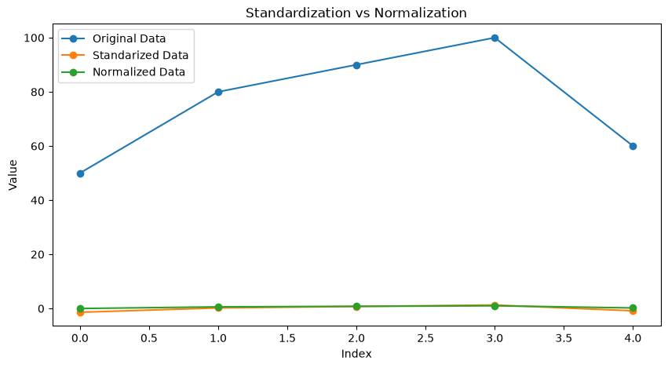

### 범주형 데이터 처리 (레이블 인코딩, 원-핫 인코딩)

#### 범주형 데이터

- 수치가 아닌 텍스트 데이터(예: "사과", "배", "포도")처럼 특정 범주를 나타내는 데이터이다.
- 머신러닝 알고리즘은 숫자 데이터를 처리하기 때문에, 범주형 데이터를 숫자로 변환해야 한다.
- 여기서 두 가지 대표적인 방법이 **레이블 인코딩**과 **원-핫 인코딩**이다.

#### 레이블 인코딩 (Label Encoding)

- 범주형 데이터를 정수로 매핑하여 각 범주를 고유한 숫자로 변환하는 방법이다.
- 방법<br>
    데이터의 범주마다 고유한 번호를 부여한다.
- 장점
    - 간단하고 직관적이며, 메모리를 적게 사용한다.
- 단점
    - 범주의 순서가 없는데도 숫자가 순서를 암시할 수 있다.<br>
    예: "사과"(0)가 "배"(1)보다 더 작거나 낮다는 의미를 부여할 위험이 있다.
- 사용 시기
    - 범주가 순서형 데이터인 경우(예: "낮음", "보통", "높음") 적합하다.

#### 원-핫 인코딩 (One-Hot Encoding)

- 범주형 데이터를 이진 벡터로 변환한다.
- 각 범주마다 별도의 열(column)을 만들고, 해당 범주에만 1을 표시하고 나머지는 0으로 표시한다.
- 방법
    - 각 범주를 새로운 열로 추가하고, 데이터가 해당 범주에 속하면 1, 아니면 0으로 표시한다.
- 장점
    - 숫자가 범주의 순서를 암시하지 않으므로, 레이블 인코딩의 단점을 극복한다.
- 단점
    - 고차원 문제: 범주의 수가 많아질수록 많은 열이 생성되어 메모리 소모가 크다.<br>
예: 1000개의 범주가 있다면 1000개의 열이 추가된다.
- 사용 시기
    - 범주가 순서가 없는 데이터(예: "사과", "배", "포도")인 경우 적합하다.

#### 레이블 인코딩 vs 원-핫 인코딩 비교

| 특성 | 레이블 인코딩 | 원-핫 인코딩 |
| :---: | --- | --- |
| **출력 형식** | 정수 (0, 1, 2, ...) | 이진 벡터 ([1, 0, 0], ...) |
| **순서 정보 암시** | 있음 | 없음 |
| **고차원 문제** | 없음 | 범주가 많으면 열이 많이 생성됨 |
| **사용 적합성** | 순서형 데이터 | 비순서형 데이터 |

#### 범주형 데이터 처리 예제

```python
import pandas as pd
from sklearn.preprocessing import LabelEncoder, OneHotEncoder

# 데이터생성
data = pd.DataFrame({'Fruits': ['사과', '배', '포도', '사과', '포도']})

# Step 1: 레이블 인코딩
label_encoder = LabelEncoder()      # 가나다 순으로 순서를 부여한다.
data['Label Encoding'] = label_encoder.fit_transform(data['Fruits'])

# Step 2: 원-핫 인코딩(OneHotEncoder 사용, sparse_output=False로 계산)
# OneHotEncoder는 기본적으로 0은 저장하지 않고 
# "몇 행 몇 열이 1"만 기록하는 희소 행렬(sparse matrix)을 돌려준다.
# sparse_output=False면 일반 배열이 나온다.
one_hot_encoder = OneHotEncoder(sparse_output=False)
one_hot_encoded = one_hot_encoder.fit_transform(data[['Label Encoding']])

# Step 3: 결과를 DataFrame으로 변환
one_hot_columns = one_hot_encoder.get_feature_names_out()
one_hot_df = pd.DataFrame(one_hot_encoded, columns=one_hot_columns)

# Step 4: 원래 데이터에 추가
data = pd.concat([data, one_hot_df], axis=1)

# 출력
print(data)

#     Fruits  Label Encoding  Label Encoding_0  Label Encoding_1  Label Encoding_2
# 0     사과               1               0.0               1.0               0.0
# 1       배               0               1.0               0.0               0.0
# 2     포도               2               0.0               0.0               1.0
# 3     사과               1               0.0               1.0               0.0
# 4     포도               2               0.0               0.0               1.0
```

### 피처 엔지니어링 (Feature Engineering)

#### 주요 피처 엔지니어링 기법

- 도메인 지식과 창의성을 발휘하여 주어진 로우 데이터(Raw Data)로부터 머신러닝 알고리즘의 예측 성능을 극대화 할 수 있는 유용한 특징(Feature)들을 만들어 내는 과정이다.
- **Garbage In, Garbage Out**

#### 피처 엔지니어링(Feature Engineering / 특성 공학)

1. **날짜/시간 데이터 분해**: 날짜 문자열로부터 연, 월, 일, 요일, 주말 여부 등을 추출한다.
2. **로그 변환 (Log Transformation)**: 한쪽으로 치우친(Skewed) 데이터 분포를 정규 분포에 가깝게 변환한다.
3. **구간화 (Binning/Bucketing)**: 연속된 숫자 데이터를 몇 개의 구간(카테고리)으로 묶는다.
4. **교차 변수 (Interaction Features)**: 두 개 이상의 피처를 곱하거나 더해서 시너지 효과를 유도한다.

#### 실습용 가상 데이터 생성
```python
import pandas as pd
import numpy as np

# 가상의 쇼핑몰 고객 데이터 테이블 생성
data = {
    'CustomerID': [101, 102, 103, 104, 105],
    'JoinDate': ['2025-01-15 14:30:00', '2025-03-22 09:15:00', '2025-06-01 18:45:00', '2025-06-07 11:00:00', '2026-02-14 23:10:00'],
    'Age': [19, 45, 28, 37, 62],
    'AnnualIncome': [15000, 300000, 48000, 72000, 450000], # 연간 소득 (소수의초고소득자존재)
    'PurchaseCount': [15, 2, 8, 12, 1], # 구매 횟수
    'AvgOrderValue': [25000, 500000, 40000, 60000, 1500000] # 평균 구매 금액
}
df = pd.DataFrame(data)
```

#### 날짜/시간 데이터 분해 (Datetime Feature Extraction)
- 단순히 '2025-01-15 14:30:00'과 같은 문자열은 모델이 학습할 수 없다.
- 이를 분석에 유용한 형태로 쪼개어 가입 연도, 월, 요일, 시간대 등을 추출해야 한다.
    ```python
    # 문자열 데이터를 datetime 객체 형식으로 변환
    df['JoinDate'] = pd.to_datetime(df['JoinDate'])

    # 다양한 시간 정보 추출
    df['JoinYear'] = df['JoinDate'].dt.year
    df['JoinMonth'] = df['JoinDate'].dt.month
    df['JoinDay'] = df['JoinDate'].dt.day
    df['JoinHour'] = df['JoinDate'].dt.hour
    df['JoinDayOfWeek'] = df['JoinDate'].dt.day_name()  # 요일 이름 추출

    # 주말 가입 여부(0: 평일, 1: 주말)
    # dt.weekday는 월요일(0)~일요일(6) 값을 반환하므로, 5와 6이 토/일요일에 해당한다.
    df['IsWeekendJoin'] = df['JoinDate'].dt.weekday.apply(lambda x: 1 if x >= 5 else 0)

    df[['JoinDate', 'JoinYear', 'JoinMonth', 'JoinDayOfWeek', 'IsWeekendJoin']]
    ```

####  로그 변환 (Log Transformation)

- AnnualIncome(연소득)처럼 몇몇 초고소득자에 의해 데이터 분포가 극단적으로 한 쪽으로 치우쳐진(Right-skewed) 경우, 경사하강법 기반의 선형 모델 등이 패턴을 학습하기 매우 곤란하다.
- 이때 자연로그(np.log 또는np.log1p)를 씌워주면 왜도(Skewness)가 크게 줄어들며 고른 분포가 된다.
    ```python
    # 원본 소득 분포와 로그 변환 후 소득 비교
    df['AnnualIncome_Log'] = np.log1p(df['AnnualIncome'])   # log1p(x) = log(x + 1) -> 0 또는 에러 방지용

    print("원본 소득 데이터:\n", df['AnnualIncome'].values)
    print("\n로그 변환 후 데이터:\n", df['AnnualIncome_Log'].values.round(2))

    # 원본 소득 데이터:
    #  [ 15000 300000  48000  72000 450000]

    # 로그 변환 후 데이터:
    #  [ 9.62 12.61 10.78 11.18 13.02]
    ```

#### 구간화 (Binning / Bucketing)

- 나이(Age)와 같은 연속형 변수를 연령대(AgeGroup)와 같이 범주형 변수로 변환하는 작업이다.
- 특정 연령대별 행동 패턴을 단순화해서 반영하고 싶을 때 유용하다.
    ```python
    # 구간 경계 설정: 0~19세(미성년/초기성인), 20~39세(청년), 40~59세(중년), 60세 이상(노년)
    bins = [0, 19, 39, 59, 100]
    labels = ['Youth', 'YoungAdult', 'MiddleAge', 'Senior']

    # pd.cute 함수를 활용해 수치형을 카테고리로 매핑한다.
    df['AgeGroup'] = pd.cut(df['Age'], bins=bins, labels=labels)
    df[['Age', 'AgeGroup']]

    #       Age	  AgeGroup
    # 0     19	     Youth
    # 1	    45	 MiddleAge
    # 2	    28	YoungAdult
    # 3	    37	YoungAdult
    # 4 	62	    Senior
    ```

#### 교차 변수 생성 (Interaction Features)

- 기존 두 변수의 수학적 조합으로 강력한 파생변수를 만든다.
- PurchaseCount(구매 건수)와 AvgOrderValue(평균 건당 결제액)가 있다면, 이를 곱해 총 매출 기여도(TotalSpending)를 직접 산출한다.
    ```python
    # 총 지출액 계산(구매 횟수 * 평균 구매 금액)
    df['TotalSpending'] = df['PurchaseCount'] * df['AvgOrderValue']

    df[['PurchaseCount', 'AvgOrderValue', 'TotalSpending']]

    # PurchaseCount	AvgOrderValue	TotalSpending
    # 0	15	        25000	        375000
    # 1	2	        500000	        1000000
    # 2	8	        40000	        320000
    # 3	12	        60000	        720000
    # 4	1	        1500000	        1500000
    ```

#### 주말 매출 비중 파생변수 만들기

- 요구사항
    - LastTransactionDate 문자열 컬럼을 datetime 데이터 타입으로 변경하세요.
    - 마지막 거래일이 주말(토/일)인지 여부를 나타내는 IsWeekendTransaction(0 또는1) 파생변수를 만드세요.

```python
import pandas as pd

data = {
    'CustomerID': [201, 202, 203],
    'LastTransactionDate': ['2026-06-12 10:00:00', '2026-06-13 15:30:00', '2026-06-14 20:00:00']
}
df_mission = pd.DataFrame(data)

# 아래에코드를완성해보세요! (힌트: dt.weekday 활용)
df_mission['LastTransactionDate'] = pd.to_datetime(df_mission['LastTransactionDate'])

df_mission['IsWeekendTransaction'] = df_mission['LastTransactionDate'].dt.day_of_week.apply(lambda x : 1 if x >= 5 else 0) 
df_mission

# CustomerID	LastTransactionDate	IsWeekendTransaction
# 0	201	2026-06-12 10:00:00	0
# 1	202	2026-06-13 15:30:00	1
# 2	203	2026-06-14 20:00:00	1
```

## <a id="machine-learning-basic-supervised"></a>4. 머신러닝 기초 - 지도학습

### 머신러닝의 정의와 활용 분야

#### 머신러닝

- 머신러닝은 데이터를 기반으로 스스로 학습하여 패턴을 발견하고, 이를 이용해 미래의 결과를 예측하거나 의사결정을 내리는 기술이다.
- 규칙(함수)을 사람이 직접 입력하는 대신, 데이터를 통해 컴퓨터가 규칙을 스스로 찾는 과정이다.
- 전통적인 프로그래밍 방식에서는 사람이 명확한 규칙(함수)을 정의하고 만들어야 하지만 머신러닝에서는 컴퓨터가 데이터를 기반으로 학습을 통해 규칙(함수)을 만든다.

### 지도학습의 개념 및 지도학습 vs 비지도학습

- 머신러닝
    - 지도학습 → 정답o → 결과 예측, 분류
    - 비지도 학습 → 정답x → 군집분석, 클러스터링

#### 지도학습(Supervised Learning)

- 데이터와 함께 해당 데이터에 대한 정답(라벨)을 제공하여 모델이 학습하도록 하는 머신러닝 방법이다.<br>
→ 입력 데이터(X)와 정답 라벨(y)을 함께 주고 모델을 학습시키는 방법이다.
- 모델은 데이터와 정답의 관계를 학습하고, 이후에는 새로운 데이터를 입력 받았을 때 정답을 예측한다.
- 학생과 교사의 관계<br>
→ 교사가 문제(데이터)와 정답(라벨)을 함께 제공하며 학생이 문제를 푸는 방법을 배운다.<br>
예: "사과와 바나나 사진을 보여주고, 각각의 이름을 가르쳐주는 과정이다."

#### 비지도학습(Unsupervised Learning)

- 데이터는 있지만 정답(라벨)은 주어지지 않은 상태에서 학습하는 머신러닝 방법이다.<br>
    → 정답 라벨(y) 없이 오직 입력 데이터(X)의 특징만으로 데이터 내부의 구조, 군집, 차원 등을 스스로 분석하게
    하는 방법이다.
- 모델은 데이터를 스스로 분석해 패턴이나 그룹을 찾아낸다.
- 탐구학습<br>
    → 학생이 문제(데이터)를 스스로 탐구하며 규칙과 패턴을 찾아낸다.<br>
    예: "사과와 바나나 사진을 보여주고, 스스로 사과와 바나나의 차이점을 발견하는 과정이다."

#### 지도학습 vs 비지도학습

| 특징 | 지도학습 | 비지도학습 |
| --- | --- | --- |
| **라벨(정답) 제공 여부** | 데이터에 정답(라벨)이 있음 | 정답(라벨)이 없음 |
| **학습 목적** | 입력 데이터와 정답 사이의 관계를 학습 | 데이터의 패턴이나 그룹을 학습 |
| **사례** | - 스팸 메일 분류<br>- 집값 예측<br>- 이미지 분류 | - 고객 그룹화<br>- 추천 시스템<br>- 데이터 압축 |
| **적용 분야** | 예측 및 분류 작업(→ 특성과 라벨을 만들어서 전달해야 한다.) | 데이터 이해 및 탐색(→ 수집한 데이터셋의 답을 빼고 학습해야 한다.) |

#### 머신러닝

- 입력(Features)과 출력(Target)의 개념
    - 입력(Features)
        - 모델이 학습할 때 사용하는 데이터의 특성
        - 데이터를 구성하는 각각의 요소로, 예측이나 분류에 영향을 미치는 중요한 정보
    - 출력(Target)
        - 모델이 예측해야 하는 결과값으로, 문제의 정답이거나 우리가 구하고자 하는 목표
- 지도학습의 주요 알고리즘: **회귀(Regression)** 와 **분류(Classification)**
    - 지도학습의 알고리즘은 크게 회귀(Regression; 예측 - 숫자)와 분류(Classification)로 나누어진다.
        - 회귀<br>
            » 집값, 주가, 매출 등 연속적인 수치(숫자)로 된 예측 문제를 해결한다.
        - 분류<br>
            » 미리 정의된 여러 범주(Category)로 데이터를 나누는 문제를 해결한다.<br>
            » 이메일 스팸 여부(O/X), 과일 종류 등 **이산적인 범주(클래스)** 를 예측한다.
- 회귀 알고리즘(Regression)
    - 회귀는 연속적인 숫자 값을 예측하는 알고리즘이다.
        - 예측 결과는 특정 숫자로 나타낸다.
        - 목표<br>
        **입력 데이터(Features)와 출력값(Target) 간의 수학적 관계(선형 / 비선형 관계)를 모델링**한다.
    - 대표 알고리즘
        - **선형 회귀(Linear Regression)**<br>
        → 입력 변수와 출력 변수 사이의 관계를 직선으로 표현한다.
        - 집값 예측
            - 문제: 집의 크기, 방 개수, 위치 등을 기반으로 집 값을 예측한다.
            - 알고리즘: 선형회귀를 사용해 입력 데이터와 집 값 간의 관계를 학습한다.
            - 결과: 입력 데이터(Features)로 크기 40평, 방 3개, 도심 위치를 넣으면, 모델이 예상 집 값(4억원)을 예측한다.
        - 판매량 예측
            - 문제: 광고 비용을 바탕으로 제품 판매량을 예측한다.
            - 알고리즘: 선형회귀를 사용해 "광고 비용과 판매량 간의 관계"를 학습한다.
            - 결과: 광고비를 100만원 쓰면, 제품 판매량이 1,000개일 것이라고 예측한다.
- 분류 알고리즘(Classification)
    - 분류는 데이터를 미리 정해진 범주(Category) 중 하나로 분류하는 알고리즘이다.
        - 예측 결과는 숫자가 아닌 범주(Label)이다.
        - 목표<br>
            입력 데이터(Features)를 보고, 각 데이터가 어떤 범주에 속하는지 판단한다.
    - 대표 알고리즘
        - 로지스틱 회귀<br>
        → 선형 회귀를 응용한 알고리즘으로, 출력 값을 특정 범주로 분류한다.
        결과는 0~1 사이의 확률값으로 나타나며, 특정기준(예: 0.5 이상)을 넘어가면 해당 범주로 분류한다.
    - 스팸 이메일 분류
        - 문제: 이메일의 내용을 기반으로 "스팸" 또는 "스팸 아님"으로 분류한다.
        - 알고리즘
        로지스틱 회귀를 사용해 이메일의 특징(특정 단어, 발신 도메인 등)과 라벨 간의 관계를 학습한다.
        - 결과: 이메일 내용에 "무료", "당첨" 같은 단어가 있으면 스팸으로 분류한다.
    - 동물 분류
        - 문제: 사진을 보고, 해당 동물이 "강아지", "고양이", "새" 중 어느 범주에 속하는지 분류한다.
        - 알고리즘: 분류 알고리즘(예: 로지스틱 회귀)을 사용해 이미지 데이터와 범주 간의 관계를 학습한다.
        - 결과: 강아지의 특징(귀 모양, 코 모양 등)을 학습하고, 새로운 사진을 보고 강아지인지 판단한다.

        | 특징 | 회귀(Regression) | 분류(Classification) |
        | :---: | --- | --- |
        | **출력 형태** | 연속적인 숫자 값 | 미리 정의된 범주(Category) |
        | **목적** | 값 예측 | 데이터 분류 |
        | **대표 알고리즘** | 선형 회귀, 다중 회귀 | 로지스틱 회귀, 서포트 벡터 머신(SVM), KNN |
        | **사례** | 집값 예측, 판매량 예측, 온도 예측 | 스팸 분류, 질병 진단, 이미지 분류 |

### 데이터의 역할 및 활용

- 학습의 기반
    - 모델이 학습하는 데 필요한 정보를 제공한다.
    - 데이터를 통해 입력(Features)과 출력(Target)의 관계를 파악한다.
- 패턴 발견 및 예측 가능
    - 데이터를 분석하여 숨겨진 패턴을 찾고, 이를 바탕으로 새로운 데이터를 예측한다.
    - 데이터가 없으면 패턴을 학습할 수도, 예측할 수도 없다.
- 모델 평가
    - 학습 후, 데이터를 통해 모델이 얼마나 정확한지 테스트한다.
    - 훈련 데이터와는 다른 검증 데이터를 사용하여 모델 성능을 평가한다.

### 데이터 준비 및 탐색

#### 데이터 전처리 및 탐색적 데이터 분석(EDA)

- 탐색적 데이터 분석 (EDA)의 역할
    - 모델을 학습시키기 전, 변수 간의 분포, 결측값, 그리고 독립변수와 종속변수 간의 상관관계 등을 시각적 / 통계적으로 분석하여 예측 모델링의 뼈대를 설계하는 필수 단계이다.
- 데이터 전처리
    1. 결측치(Missing Values) 처리
        - 데이터를 살펴보니 Age와 PurchaseAmount열에 일부값이 누락되어 있다.
        - 처리 방법
            - 평균값으로 채우기: Age의 결측치는 평균 나이로 대체한다.
            - 0으로 채우기: PurchaseAmount의 결측치는 0으로 대체한다.
                ```python
                import pandas as pd

                # 데이터 예시
                data = {
                    'CustomerID': [1, 2, 3, 4, 5],
                    'Age': [25, 30, None, 35, 28],
                    'Gender': ['Male', 'Female', 'Female', 'Male', None],
                    'Satisfaction': [5, 4, 3, None, 2],
                    'PurchaseAmount': [100, 200, None, 150, 0]
                }
                df = pd.DataFrame(data)

                # 결측치 처리
                ## 나이는 평균으로 대체
                df['Age'] = df['Age'].fillna(df['Age'].mean())          # df['Age'].fillna(df['Age'].mean(), inplace=True)

                ## 구매액은 0으로 대체
                df['PurchaseAmount'] = df['PurchaseAmount'].fillna(0)   # df['PurchaseAmount'].fillna(0, inplace=True)

                ## 만족도 평균으로 대체
                df['Satisfaction'] = df['Satisfaction'].fillna(df['Satisfaction'].mean())

                print(df)

                #    CustomerID   Age  Gender  Satisfaction  PurchaseAmount
                # 0           1  25.0    Male           5.0           100.0
                # 1           2  30.0  Female           4.0           200.0
                # 2           3  29.5  Female           3.0             0.0
                # 3           4  35.0    Male           3.5           150.0
                # 4           5  28.0     NaN           2.0             0.0
                ```
    2. 이상치(Outliers) 처리
        - 구매금액이 너무 높은 경우(예: 1억원), 이상치로 간주할 수 있다.
        - 처리 방법: 특정 기준(예: IQR)을 사용해 이상치를 제거하거나 조정한다.
-  탐색적 데이터 분석(EDA)
    1. 데이터의 기초 통계 파악
        - 평균, 중앙값, 최댓값, 최솟값을 확인해 데이터를 요약한다.
            ```python
            df.describe()

            #       CustomerID	        Age	Satisfaction	PurchaseAmount
            # count	  5.000000	   5.000000	    5.000000	      5.000000
            # mean	  3.000000	  29.500000	    3.500000	     90.000000
            # std	  1.581139	   3.640055	    1.118034	     89.442719
            # min	  1.000000	  25.000000	    2.000000	      0.000000
            # 25%	  2.000000	  28.000000	    3.000000	      0.000000
            # 50%	  3.000000	  29.500000	    3.500000	    100.000000
            # 75%	  4.000000	  30.000000	    4.000000	    150.000000
            # max	  5.000000	  35.000000	    5.000000	    200.000000
            ```
        2) 데이터 시각화로 이해
            - 나이에 따른 구매 금액 분포<br>
            나이와 구매 금액 간의 관계를 산점도로 표현
                ```python
                import matplotlib.pyplot as plt

                # 나이 vs 구매 금액 산점도
                plt.scatter(df['Age'], df['PurchaseAmount'])
                plt.title('Purchase Amount by Age')
                plt.xlabel('Age')
                plt.ylabel('Purchase Amount')
                plt.show()
                ```
                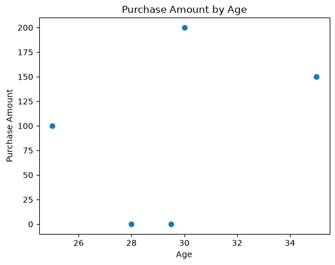
            - 성별에 따른 만족도<br>
            남성과 여성의 만족도 평균을 비교
                ```python
                import matplotlib.pyplot as plt

                # 성별별 만족도 평균 시각화
                gender_satisfaction = df.groupby('Gender')['Satisfaction'].mean()
                gender_satisfaction.plot(kind='bar')
                plt.title('Average Satisfaction by Gender')
                plt.xlabel('Gender')
                plt.ylabel('Average Satisfaction')
                plt.show()
                ```
                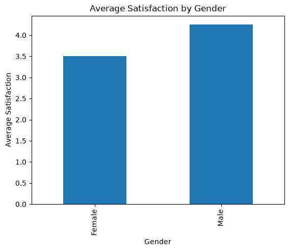
#### 학습 데이터와 테스트 데이터의 분리

- 머신러닝 모델이 데이터를 학습(Training)하는 과정과 평가(Test)하는 과정을 분리하기 위해 필요하다.
    - **학습 데이터**<br>
        모델이 학습하는 데 사용하는 데이터이다.
    - **테스트 데이터**<br>
        학습이 끝난 후 모델의 성능을 평가하는 데 사용하는 데이터이다.
- 왜 학습 데이터와 테스트 데이터를 분리해야 할까?
    - **모델 과적합(Overfitting) 방지**
        - 모델이 학습 데이터에 너무 특화되면, 새로운 데이터(테스트 데이터)에 대해 좋은 성능을 내지 못 할 수 있다.
        - 학습 데이터와 테스트 데이터를 분리하면 이런 문제를 예방할 수 있다.
        - train data로 평가했을 때 점수가 높지만, test data로 평가했을 때 점수가 낮은 경우이다. 이는 데이터가 편향되어 있어서 일반화가 덜 되어있는 것이다.
        - 과소 적합은 학습 데이터의 평가도 좋지 않고 테스트 데이터의 평가도 좋지 않는 경우이다.
    - **모델의 일반화 능력 평가**
        - 모델이 학습하지 않은 데이터에 대해 얼마나 잘 예측할 수 있는지를 평가할 수 있다.
        - 데이터는 train data와 test data로 구분되며 test data로 모델의 일반화 능력을 평가한다.
- 데이터 분리 과정
    - 특성과 타겟 분리
        - **특성(Feature)**<br>
        예측에 사용할 데이터: (Age, Gender, PurchaseAmount)
        - **타겟(Target)**<br>
        예측하고자 하는 값(Satisfaction)
            ```python
            # Gender는 숫자로 변환(Label Encoding)
            df['Gender'] = df['Gender'].map({'Male':0, 'Female':1})

            # 특성과 타겟 분리
            X = df[['Age', 'Gender', 'PurchaseAmount']]     # 입력 데이터
            y = df['Satisfaction']                          # 출력 데이터

            print(X)
            print(y)

            #     Age  Gender  PurchaseAmount
            # 0  25.0     0.0           100.0
            # 1  30.0     1.0           200.0
            # 2  29.5     1.0             0.0
            # 3  35.0     0.0           150.0
            # 4  28.0     NaN             0.0
            # 0    5.0
            # 1    4.0
            # 2    3.0
            # 3    3.5
            # 4    2.0
            # Name: Satisfaction, dtype: float64
            ```
    - 학습 데이터와 테스트 데이터 분리
        - 데이터셋을 학습용(80%)과 테스트용(20%)으로 분리한다.
        - train_test_split 함수를 사용한다.
            ```python
            from sklearn.model_selection import train_test_split

            # 데이터 분리
            X_train, X_test, y_train, y_test = train_test_split(X, y, test_size=0.2, random_state=42)

            print("학습 데이터 크기:", X_train.shape)
            print("테스트 데이터 크기:", X_test.shape)

            print(X_train)      # 학습 데이터의 입력 데이터
            print('*' * 10)
            print(y_train)      # 학습 데이터의 출력 데이터
            print('*' * 10)
            print(X_test)       # 테스트 데이터의 입력 데이터
            print('*' * 10)
            print(y_test)       # 테스트 데이터의 출력 데이터
            print('*' * 10)

            # 학습 데이터 크기: (4, 3)
            # 테스트 데이터 크기: (1, 3)
            #     Age  Gender  PurchaseAmount
            # 4  28.0     NaN             0.0
            # 2  29.5     1.0             0.0
            # 0  25.0     0.0           100.0
            # 3  35.0     0.0           150.0
            # **********
            # 4    2.0
            # 2    3.0
            # 0    5.0
            # 3    3.5
            # Name: Satisfaction, dtype: float64
            # **********
            #     Age  Gender  PurchaseAmount
            # 1  30.0     1.0           200.0
            # **********
            # 1    4.0
            # Name: Satisfaction, dtype: float64
            # **********
            ```

### 지도학습 - 회귀 알고리즘

#### 회귀 알고리즘의 이해

- 회귀(Regression)<br>
    연속적인 숫자 데이터를 예측하는 데 사용되는 지도학습(Supervised Learning) 알고리즘이다.<br>
    → 입력 데이터를 기반으로 숫자 값을 예측하는 문제를 해결하는 방법이다.
- 예시
    - 집값 예측
        - 집의 면적, 방 개수, 위치 등의 정보를 입력하면 집의 가격을 예측한다.
    - 날씨 예측
        - 시간, 온도, 습도 데이터를 기반으로 다음 날의 기온을 예측한다.
    - 회귀 알고리즘은 입력 데이터와 출력 값 사이의 관계를 모델링하여 새로운 데이터를 기반으로 값을 예측한다.
- 회귀의 특징
    - 연속적인 출력 값<br>
    예측 값은 숫자이며, 범주형 데이터(예: 고양이, 개)가 아니다.
    - 독립 변수와 종속 변수의 관계<br>
    독립 변수(입력 데이터)가 종속 변수(예측값)에 어떤 영향을 주는지 분석한다.
- 회귀의 종류
    - 단순 선형 회귀
        - 입력 변수가 하나인 경우.
        예: 공부시간에 따른 시험 점수 예측. 그래프 상에서 데이터는 직선 형태로 표현한다.
    - 다중 선형 회귀
        - 입력 변수가 여러 개인 경우.
        예: 집 값 예측(집 크기, 위치, 층수 등을 입력). 데이터 관계가 더 복잡해 질 수 있다.
    - 비선형회귀
        - 입력 데이터와 출력 값 사이의 관계가 선형이 아닌 경우.
        예: 바이러스 확산 모델, 곡선 형태의 데이터
- 회귀는 어떻게 동작하나?
    1. 학습 데이터 수집<br>
        모델이 배울 수 있도록 입력 데이터(독립 변수)와 정답(종속 변수)을 준비한다.
    2. 모델 학습<br>
        데이터를 이용해 입력과 출력 사이의 수학적 관계를 찾는다.
    3. 예측<br>
        학습한 모델을 사용해 새로운 데이터를 입력하면 결과 값을 예측한다.

#### 선형 회귀의 원리 및 모델 학습

- 선형 회귀는 데이터 간의 직선 관계를 찾는 알고리즘이다.
- 입력 데이터(독립 변수)가 증가하거나 감소할 때 출력값(종속 변수)이 어떻게 변하는지 예측하는 데 사용한다.
- 사례<br>
    공부시간과 시험 점수 예측<br>
    학생들이 공부한 시간(입력)을 가지고 시험점수(출력)를 예측하고 싶다!
-  **단순 선형 회귀(Simple Linear Regression) 이론**
    - 선형회귀는 데이터를 **y = mx + b라는 직선 방정식으로 표현**
        - x: 독립변수(공부시간)
        - y: 종속변수(시험점수)
        - m: 회귀가중치(기울기)<br>
        공부시간이 늘어나면 점수가 얼마나 증가하는지 나타낸다.
        - b: y절편(공부시간이0일때의점수)
    - 목표<br>
        데이터를 가장 잘 설명할 수 있는 **m(기울기)와 b(y절편)를 찾아 직선을 만든다**.
- 모델 학습 과정
    1) 데이터시각화
        - 먼저 데이터를 그래프에 표시.<br>
        각 점은 학생 한 명의 공부 시간과 시험 점수
            - x축: 공부 시간, y축: 시험 점수
            - 이 데이터 위에 최적의 직선을 그려야 한다.
    2) 최적의 직선 찾기
        - 직선을 그릴 때 중요한 점
            - 직선이 데이터 점과 얼마나 가까운지를 측정한다.<br>
            → 이 거리(오차)를 측정하는 방법이 **손실함수**이다.
            - 점에서 직선까지의 거리를 최소화하는 직선을 찾아야 한다! 
    3) 손실함수: 평균제곱오차(MSE; Mean Squared Error)
        - 최소제곱법(OLS; Ordinary Least Squares)
            - 실제 데이터 포인트와 회귀 직선 간의 **오차 제곱합(Residual Sum of Squares, RSS)** 을 최소화하는 최적의 w와 b를 구하는 단순 선형 회귀의 표준 학습 방식이다.
        - MSE(Mean Squared Error)
            - 모든 데이터 점과 직선 사이의 거리(오차)를 제곱한 뒤, 이들의 평균을 낸 값이다.(이 값이 0에 가까울수록 좋은 모델이다.)
            $$MSE = \frac{1}{n} \sum_{i=1}^{n} (y_i - \hat{y}_i)^2$$
        - $yi$ : 실제 점수(데이터 값)
        - $\hat{y}_i$ : 모델이 예측한 점수(직선 값)
        - $y$ : 데이터의 개수
    4) 기울기와 y절편 업데이트
        - 경사하강법(Gradient Descent)<br>
            MSE를 최소화하는 방향으로 기울기($m$)와 y절편($b$)을 조금씩 조정한다.
        - 반복적으로 업데이트하면서 오차가 최소화될 때까지 학습한다.
    5) 모델 학습의 결과<br>
        최종적으로 **$y=mx+by$에대해**
        - $m$=5 (기울기): 공부 시간이 1시간 늘면 시험 점수가 평균 5점 증가
        - $b$=45 (y절편): 공부를 전혀 하지 않아도 시험 점수는 45점
    6) 새로운 데이터 예측
        - 학습된 모델로 새로운 데이터를 예측할 수 있다.
            - 공부 시간 6시간 → 예측 점수: $y$=5(6)+45=75
            - 공부 시간 8시간 → 예측 점수: $y$=5(8)+45=85
    ```python
    import numpy as np
    import matplotlib.pyplot as plt

    # 1. 데이터준비
    X = np.array([1, 2, 3, 4, 5])       # 공부 시간 (입력 데이터)
    y = np.array([50, 55, 65, 70, 75])  # 시험 점수 (출력 데이터)


    # 2. 초기 값 설정
    m = 0                               # 초기 기울기
    b = 0                               # 초기 y절편
    learning_rate = 0.01                # 학습 속도
    epochs = 1000                       # 학습 반복 횟수

    # 3. 경사하강법을 이용한 학습
    for _ in range(epochs):
        # 예측 값 계산
        y_pred = m * X + b

        # 손실 함수(MSE) 계산
        error = y - y_pred
        mse = (error ** 2).mean()

        # 기울기(m)와 y절편(b)의 변화량 계산
        m_gradient = -(2 / len(X)) * sum(X * error)
        b_gradient = -(2 / len(X)) * sum(error)

        # 기울기와 절편 업데이트
        m -= learning_rate * m_gradient
        b -= learning_rate * b_gradient

    # 학습 결과 출력
    print(f"학습된 기울기(m): {m:.2f}")
    print(f"학습된 y절편(b): {b:.2f}")

    # 학습된 기울기(m): 6.86
    # 학습된 y절편(b): 42.19

    # 4. 학습 결과 시각화
    y_pred = m * X + b                  # 학습된 모델의 예측 값

    plt.rc('font', family='Malgun Gothic')

    plt.scatter(X, y, color='blue', label='실제 데이터')    # 실제 데이터
    plt.plot(X, y_pred, color='red', label='학습된 모델')   # 학습된 직선
    plt.xlabel('공부 시간(시간)')
    plt.ylabel('시험 점수(점수)')
    plt.legend()
    plt.title('선형 회귀 학습 결과')
    plt.show()

    # 5. 새로운 데이터 예측
    new_study_hours = np.array([6, 8, 10])      # 새로운 공부 시간
    predicted_scores = m * new_study_hours + b
    print("새로운 공부 시간에 따른 예측 점수:", predicted_scores)
    ```
    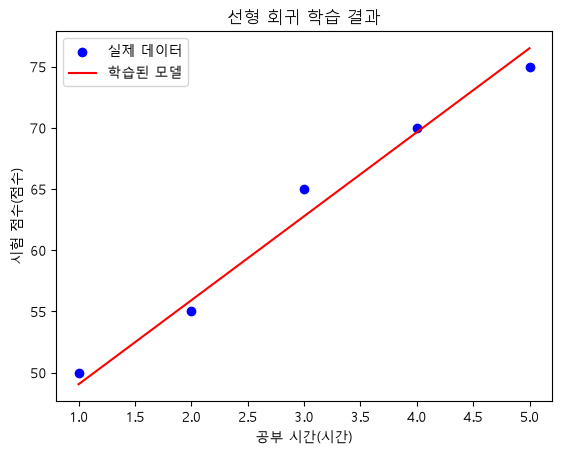

#### 성능 평가(Metrics)
- 실제 점수(y)와 모델이 예측한 점수(y_pred)를 비교한다.

| 공부 시간 (X) | 실제 점수 (Y) | 예측 점수 $\hat{y}$ | 오차(실제 - 예측) |
| --- | --- | --- | --- |
| 1시간 | 50점 | 50 | 0 |
| 2시간 | 55점 | 54 | 1 |
| 3시간 | 65점 | 65 | 0 |
| 4시간 | 70점 | 71 | -1 |
| 5시간 | 75점 | 75 | 0 |

#### 주요 성능 평가 지표
- MSE(Mean Squared Error)
    - 평균 제곱 오차 MSE는 오차(예측 값과 실제 값의 차이)의 제곱 평균이다.
    - 오차가 크면 제곱이 적용되므로 더 큰 패널티를 준다.
    - MSE 값이 작을수록 모델이 더 정확하다.<br>
        $$MSE = \frac{1}{n} \sum_{i=1}^{n} (y_i - \hat{y}_i)^2$$
        - $y_i$: 실제 값
        - $\hat{y}_i$: 예측 값
        - $n$: 데이터 개수
- RMSE(Root Mean Squared Error)
    - 평균 제곱근 오차 MSE의 제곱근을 계산한 값이다.
    - 단위를 실제 값과 동일하게 만들어 해석이 상대적으로 쉽다.
        $$RMSE = \sqrt{MSE}$$
        $$RMSE = \sqrt{0.4} = 0.63$$
    - **예측 값과 실제 값의 평균적인 오차는 약0.63**
- MAE(Mean Absolute Error): 평균 절대 오차
    - 오차의 절대값 평균을 계산한다.
    - 제곱을 사용하지 않으므로 큰 오차의 영향이 덜 하다.
    - 평균적으로 모델은 실제 값과 0.4점 정도 차이난다.
- R^2(R-squared) : 결정 계수<br>
    - 𝑅^2은 모델이 데이터를 얼마나 잘 설명하는지를 나타낸다.
    - 0에서 1 사이의 값을 가지며, 1에 가까울수록 모델이 데이터를 잘 설명한다.
        - $$R^2 = 1 - \frac{SS_{res}}{SS_{tot}}$$
        - $SS_{res}$: 잔차 제곱합(예측 값과 실제 값의 차이)
        - $SS_{tot}$: 총 제곱합(실제 값과 평균 값의 차이)
    - **모델은 데이터를 약 99% 설명한다.**

| 지표 | 값 | 해석 |
| --- | --- | --- |
| MSE | 0.4 | 평균적으로 제곱된 오차가 작다. |
| RMSE | 0.63 | 모델의 평균 오차는 약 0.63점이다. |
| MAE | 0.4 | 모델은 평균적으로 약 0.4점 차이로 예측한다. |
| R^2 | 0.99 | 모델이 데이터를 매우 잘 설명한다. |

- MSE : 큰 오차에 민감한 평가 방법(작은 실수를 크게 보려는 돋보기 같은 역할)이다.
- MAE : 절대적인 평균 오차를 단순히 계산(실수의 평균 크기를 직접 보는 역할)한다.
- RMSE : MSE의 단위를 실제 값과 맞추어 해석하기 쉽게 만든 것이다.
- 𝑅^2 : 모델이 데이터를 설명하는 정도를 백분율로 나타낸 점이다.

#### Scikit-learn을 사용한 선형 회귀 학습

1. 데이터 준비
    - X는 공부시간을 입력으로 사용하며 2D 배열로 변환(reshape(-1, 1))하여 학습한다.
2. 모델 학습
    - LinearRegression 객체를 생성한 후 fit 메서드를 사용해 학습한다.
3. 성능 평가
    - mean_squared_error : 평균 제곱 오차(MSE)를 계산한다.
    - mean_absolute_error : 평균 절대 오차(MAE)를 계산한다.
    - r2_score: 결정 계수(𝑅2)를 계산한다.
4. 결과 시각화
    - 실제 데이터는 파란점으로 표시하고, 학습된 직선은 빨간선으로 시각화한다.
5. 새로운 데이터 예측

#### 실습 데이터셋 구성 및 EDA (가상 주택 평수 대비 가격)

- 먼저 단순 선형 회귀 모델 학습에 사용할 데이터를 생성하고, 탐색적 데이터 분석(EDA)을 진행
    ```python
    import numpy as np
    import pandas as pd
    import matplotlib.pyplot as plt

    # 1. 재현성을 위한 난수 시드 설정
    np.random.seed(42)

    # 2. 데이터생성: 평수(Size) 10~50평, 총 100세대
    size = np.random.uniform(10, 50, 100)

    # 주택 가격(Price): 기본 15000 + 평당 850 + 노이즈
    price = 15000 + 850 * size + np.random.normal(0, 3000, 100)
    df_house = pd.DataFrame({'Size': size, 'Price': price})
    print("=== 데이터첫 5행 ===")
    print(df_house.head())

    # 3. EDA: 산점도와 변수 간 상관계수 구하기
    correlation = df_house['Size'].corr(df_house['Price'])
    print(f"\nSize와 Price 간의 상관계수: {correlation:.4f}")

    plt.figure(figsize=(7, 4))
    plt.scatter(df_house['Size'], df_house['Price'], color='teal', alpha=0.7)
    plt.title('House Size vs Price')
    plt.xlabel('Size (pyeong)')
    plt.ylabel('Price (10k won)')
    plt.grid(True, linestyle='--')
    plt.show()

    # === 데이터첫 5행 ===
    #         Size         Price
    # 0  24.981605  36495.505246
    # 1  48.028572  54927.264367
    # 2  39.279758  48663.076351
    # 3  33.946339  37891.681719
    # 4  16.240746  28145.618112

    # Size와 Price 간의 상관계수: 0.9632
    ```
    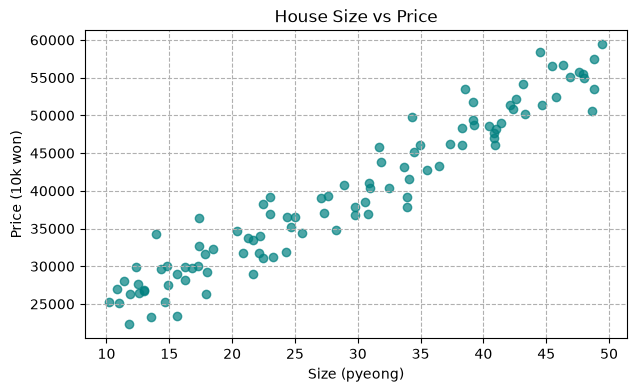

#### 데이터 분할의 이유

- 보유한 모든 데이터로 모델을 훈련시킨 후 동일한 데이터로 평가를 수행하면 모델이 단순 암기(과적합)하여 신규 데이터에 대한 예측 능력이 떨어지는 상태를 파악할 수 없다.
- 이를 예방하기 위해 전체 데이터를**훈련용(Train, 80%)** 과 **검증용(Test, 20%)** 으로 임의 분할하여 평가한다.
    ```python
    from sklearn.model_selection import train_test_split
    from sklearn.linear_model import LinearRegression

    from sklearn._config import set_config
    set_config(display='text')      # 주피터 노트북 환경에서 사이킷런(Scikit-learn) 모델 객체를 출력할 때의 시각화 방식을 일반 텍스트로 강제 지정하는 설정이다.

    # 1. 특성(X)과 타겟(y) 설정(Scikit-learn 입력 규격: X는 2차원 DataFrame, y는 1차원 Series)
    X = df_house[['Size']]          # 입력데이터는 2차원 데이터
    y = df_house['Price']

    # 2. 데이터 분할
    X_train, X_test, y_train, y_test = train_test_split(X, y, test_size=0.2, random_state=42)
    print(f"훈련 데이터 개수: {X_train.shape[0]} | 테스트 데이터 개수: {X_test.shape[0]}")

    # 3. 모델 선언 및 학습(단순 선형 회귀)
    lr_model = LinearRegression()
    lr_model.fit(X_train, y_train)

    # 4. 회귀 계수 확인
    print(f"\n기울기(w): {lr_model.coef_[0]:.2f}")
    print(f"y절편(b): {lr_model.intercept_:.2f}")

    # 훈련 데이터 개수: 80 | 테스트 데이터 개수: 20

    # 기울기(w): 819.90
    # y절편(b): 15729.75
    ```
#### 핵심 평가 지표

- MAE(Mean Absolute Error): 오차 절대값의 평균이다(직관적 해석을 할 수 있다).
- MSE(Mean Squared Error): 오차 제곱의 평균이다(큰 오차에 대해 더 큰 패널티를 부여한다).
- RMSE(Root Mean Squared Error): MSE에 루트를 씌운 지표(타겟 변수와 단위를 일치시킨다)
- 결정계수(R2Score): 예측 모델의 설명력을 0~1 범위로 나타내며, 1에 가까울수록 학습 성능이 우수함을 의미한다.
    ```python
    from sklearn.metrics import mean_absolute_error, mean_squared_error, r2_score

    # 1. 테스트 데이터를 사용한 예측값 도출
    y_pred = lr_model.predict(X_test)

    # 2. 평가지표 연산
    mae = mean_absolute_error(y_test, y_pred)
    mse = mean_squared_error(y_test, y_pred)
    rmse = np.sqrt(mse)
    r2 = r2_score(y_test, y_pred)

    print(f"평균 절대 오차(MAE): {mae:.2f}")
    print(f"평균 제곱 오차(MSE): {mse:.2f}")
    print(f"평균 제곱근 오차(RMSE): {rmse:.2f}")
    print(f"결정계수(R2 Score): {r2:.4f} (설명력 {r2*100:.1f}%)")

    # 평균 절대 오차(MAE): 1774.03
    # 평균 제곱 오차(MSE): 5883295.62
    # 평균 제곱근 오차(RMSE): 2425.55
    # 결정계수(R2 Score): 0.9446 (설명력 94.5%)
    ```

#### 과적합(Overfitting)과 과소적합(Underfitting)

- 모델 학습 과정에서 성능과 관련된 문제이다.
- 모델이 데이터에 너무 치우치거나 일반화를 잘하지 못 할 때 발생한다.

#### 과소적합(Underfitting)

- 데이터를 제대로 학습하지 못 한 상태이다.
- 모델이 데이터의 패턴을 충분히 학습하지 못 했다.
- 학습 데이터와 테스트 데이터 모두에서 성능이 나쁘다.
- 단순한 모델로 인해 데이터의 복잡한 관계를 놓친다.

#### 과적합(Overfitting)

- 데이터를 너무 많이 학습한 상태이다.
- 모델이 학습 데이터에 너무 집착해 데이터의 작은 노이즈까지 학습한다.
- 학습 데이터에서는 성능이 좋지만, 새로운 데이터(테스트 데이터)에서는 성능이 나쁘다.
- 복잡한 모델로 인해 일반화 능력이 부족하다.

#### 과적합과 과소적합 해결방법

- **과소적합 해결 방법**
    - 모델을 더 복잡하게 만든다(더 많은 특징 추가, 더 큰 모델 사용).
    - 학습 데이터를 더 많이 수집한다.학습 시간을 늘려 모델을 충분히 학습한다.
- **과적합 해결 방법**
    - 모델의 복잡도를 낮춘다(간단한 모델 사용, 차원 축소).
    - 규제(Regularization) 적용<br>
        » L1 규제: 불필요한 특징을 제거한다.<br>
        » L2 규제: 가중치를 너무 크게 만드는 것을 방지한다.
    - 더 많은 데이터를 수집하거나, 교차검증(Cross Validation)을 사용한다.

#### 당뇨병 특성(BMI) 추출 및 데이터 분할 모델 훈련
- 사이킷런 내장 당뇨병 데이터셋(load_diabetes)에서 환자의 체질량 지수(BMI) 수치를 독립변수로 삼아 당뇨 수치 진행 상태를 예측하는 선형 회귀 모델을 만들어 봅니다.
- 조건
    - TODO: Mission 1
        - load_diabetes 데이터셋을 로드하고, 특성 데이터의 2번째 컬럼(인덱스2: bmi) 값만 추출하여 X_bmi 변수에 대입하세요.<br>
        (2차원 데이터 구조를 유지하도록 X_d[:, [2]] 또는 데이터프레임으로 변환하여 열 선택)
        - train_test_split을 활용해 훈련용 데이터와 테스트용 데이터를 80:20 비율로 분할하세요. (random_state=42 설정 필수)
        - Scikit-learn의 LinearRegression모델을 정의하고 훈련데이터로 학습시키세요.
    - TODO: Mission 2
        - Mission 1 에서 훈련시킨 mission_model을 사용하여 테스트데이터(X_test_b)에 대한 예측값 y_pred_b를 구하세요.
        - 실제값 y_test_b와 예측값 y_pred_b를 비교하여 MAE, MSE, RMSE, R2 Score를 각각 계산한 후 해당 변수에 대입하세요.
    - TODO: Mission 3
        - 테스트 세트 실제 데이터(X_test_b, y_test_b)의 산점도를 검은색(black) 점으로 그리세요.
        - 테스트 세트 예측값 회귀선(X_test_b, y_pred_b)을 붉은색(red) 실선으로 겹쳐 그리는 Matplotlib 차트를 구현해보세요.
    ```python
    import matplotlib.pyplot as plt
    import numpy as np
    from sklearn.datasets import load_diabetes
    from sklearn.linear_model import LinearRegression
    from sklearn.metrics import mean_absolute_error, mean_squared_error, r2_score
    from sklearn.model_selection import train_test_split

    diabetes = load_diabetes()
    X_raw = diabetes.data
    y_raw = diabetes.target

    # TODO: Mission 1 코드를 작성하세요.
    X_bmi = X_raw[:,[2]]
    # 데이터 분할
    X_train_b, X_test_b, y_train_b, y_test_b = train_test_split(X_bmi, y_raw, test_size=0.2, random_state=42)
    # 모델 훈련
    mission_model = LinearRegression()
    mission_model.fit(X_train_b, y_train_b)

    # TODO: Mission 2 코드를 작성하세요.
    ## Mission 1 에서 훈련시킨 mission_model을 사용하여 테스트데이터(X_test_b)에 대한 예측값 y_pred_b를 구하세요
    y_pred_b = mission_model.predict(X_test_b)

    ## 실제값 y_test_b와 예측값 y_pred_b를 비교하여 MAE, MSE, RMSE, R2 Score를 각각 계산한 후 해당 변수에 대입하세요.
    mae_b = mean_absolute_error(y_test_b, y_pred_b)
    mse_b = mean_squared_error(y_test_b, y_pred_b)
    rmse_b = np.sqrt(mse_b)
    r2_b = r2_score(y_test_b, y_pred_b)
    print(f"당뇨병 BMI 선형회귀평가결과:")
    print(f"MAE: {mae_b}")
    print(f"MSE: {mse_b}")
    print(f"RMSE: {rmse_b}")
    print(f"R2 Score: {r2_b}")

    # TODO: Mission 3 코드를 작성하세요
    plt.rc("font", family="Malgun Gothic")
    plt.rc('axes', unicode_minus=False)
    plt.title("BMI에 따른 당뇨 진행 상태 수치 예측")
    plt.xlabel("BMI")
    plt.ylabel("당뇨 진행 상태 수치")
    ##테스트 세트 실제 데이터(X_test_b, y_test_b)의 산점도를 검은색(black) 점으로 그리세요.
    plt.scatter(x=X_test_b, y=y_test_b, color='black')

    ##테스트 세트 예측값 회귀선(X_test_b, y_pred_b)을 붉은색(red) 실선으로 겹쳐 그리는 Matplotlib 차트를 구현해보세요.
    plt.plot(X_test_b, y_pred_b, color='red')

    plt.show()

    # 당뇨병 BMI 선형회귀평가결과:
    # MAE: 52.25997644534553
    # MSE: 4061.8259284949268
    # RMSE: 63.73245584860925
    # R2 Score: 0.23335039815872138
    ```
    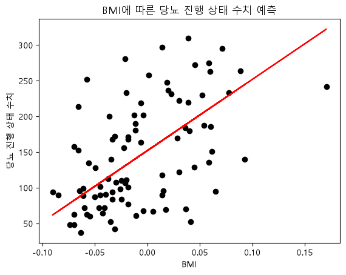

### 회귀 분석 비교 모델

#### Linear Regression (선형 회귀)

- 특징: 입력 변수(X)와 출력 변수(y) 사이의 선형 관계를 가정한다.
- 모델 형태: 직선(1차 함수)
- 장점: 빠르고 해석이 쉽다.
- 한계: 복잡한 비선형 관계를 표현하지 못한다. 과적합에 취약하다.

#### Lasso Regression (라쏘 회귀)

- 특징: 선형 회귀 + L1 정규화 (계수의 절댓값 합 제어하여 과적합 방지)
- 규제 항 추가: α × (계수 절댓값 합)
- 장점: 불필요한 변수의 계수를 0으로 만들어 변수를 선택할 수 있다.
- 한계: 관련 변수 중 일부만 선택될 수 있어 불안정성이 존재한다.

#### Ridge Regression (릿지 회귀)

- 특징: 선형 회귀 + L2 정규화 (계수의 크기를 제어하여 과적합 방지)
- 규제 항 추가: 손실 함수에 α × (계수 제곱합)을 더한다.
- 장점: 다중공선성 해결, 안정적인 예측
- 한계: 모든 변수의 계수를 0에 가깝게 만들지만 제거하지는 않는다.

#### ElasticNet

> **"L1(Lasso)과 L2(Ridge)의 장점만 쏙쏙 골라 합친 선형 회귀의 최종 진화형"**
- 변수 선택 기능이 있는 L1 규제와 모델을 안정적으로 만들어주는 L2 규제를 동시에 사용한다.
- 데이터의 특성(Feature)이 너무 많고 서로 상관관계가 높은 변수들이 얽혀있을 때 아주 강력한 힘을 발휘한다.

⚙️ **주요 파라미터 설명**

- `alpha=0.1`: **전체 규제의 강도**를 조절한다. 값이 클수록 규제가 강해져 모델이 단순해진다.
- `l1_ratio=0.5`: 전체 규제 중 **L1(Lasso) 규제가 차지하는 비율**이다. `0.5`면 L1과 L2를 반반씩 섞겠다는 뜻이다. (`0`이면 순수 Ridge, `1`이면 순수 Lasso)
- `random_state=42`: 결과를 항상 동일하게 재현하기 위한 난수 고정값이다.

#### Decision Tree Regression (의사결정트리)

- 특징: 데이터를 조건에 따라 분할하며 예측한다.
- 예측값: 리프 노드의 평균 값
- 장점: 비선형 관계를 학습하기 쉽다. 해석이 쉽다.
- 한계: 깊은 트리는 과적합 가능성이 높다.

#### Random Forest Regression (랜덤 포레스트)

- 특징: 여러 결정 트리를 훈련시키고 평균 내어 예측한다.
- 앙상블 학습 방식
- 장점: 과적합을 줄이고 성능을 향상시킨다. 비선형 문제에 강하다.
- 한계: 해석이 어렵고 느릴 수 있다.

#### Random Forest

> **"나무(Decision Tree)를 모아 울창한 숲을 이룬, 실패 없는 든든한 벤치마크"**
- 여러 개의 의사결정나무를 독립적으로 학습시킨 뒤, 그 예측값들을 평균 내어 최종 결과를 낸다(배깅 방식).
- 기본 성능이 훌륭하고 **과적합(Overfitting)에 강해 새로운 데이터셋을 만났을 때 기준으로 삼기 가장 좋다.**

⚙️ **주요 파라미터 설명**

- `n_estimators=100`: 숲을 만들 **의사결정나무의 총 개수**입니다. 나무가 많을수록 안정적이지만 연산(학습) 시간이 길어진다.
- `max_depth=12`: 각 나무의 최대 깊이(층수)입니다. 너무 깊어지면 과적합이 일어날 수 있으므로 적절히 제한한다.
- `n_jobs=-1`: 컴퓨터의 **모든 CPU 코어를 총동원**하여 병렬 연산을 수행하겠다는 설정이다. (속도가 빨라진다.)
- `random_state=42`: 모델 생성의 무작위성을 제어하여 매번 같은 결과를 보장한다.

#### XGBoost (eXtreme Gradient Boosting)

> **"한 단계씩 오차를 고쳐나가는, 오랫동안 왕좌를 지켜온 캐글의 치트키"**
- 이전 나무가 틀린 오차를 다음 나무가 보완하는 방식(부스팅)이다.
- 연산 효율을 극대화하여 **속도**가 빠르고 성능이 매우 뛰어나 데이터 분석 대회에서 오랫동안 필수 모델로 자리 잡고 있다.

⚙️ **주요 파라미터 설명**

- `n_estimators=100`: 순차적으로 만들 트리의 개수(반복 횟수)이다.
- `max_depth=6`: 각 트리의 최대 깊이이다. 부스팅 모델은 대개 깊이를 깊게 주지 않는 것이 특징이다.
- `learning_rate=0.1`: 학습률(보폭)이다. 이전 트리의 오차를 얼마나 강하게 반영할지 결정하며, 보통 `n_estimators`와 트레이드오프(Trade-off) 관계이다.
- `n_jobs=-1`: 모든 CPU 코어를 사용하여 병렬 처리를 수행한다.
- `random_state=42`: 결과 재현성을 위한 설정이다.

#### LightGBM (Light Gradient Boosting Machine)

> **"리프 중심(Leaf-wise) 성장으로 대용량 데이터도 순식간에 해치우는 속도광"**
- 다른 모델들이 나무의 층을 균형 있게 맞추며 자랄 때(Level-wise), LightGBM은 오차가 가장 큰 노드만 골라서 비대칭적으로 깊게 자란다(Leaf-wise). 이 덕분에 메모리를 훨씬 적게 쓰고, **속도**가 압도적으로 빠르다.

⚙️ **주요 파라미터 설명**

- `n_estimators=100`: 순차적으로 만들 트리의 개수이다.
- `max_depth=6`: 트리의 최대 깊이를 제한하여 리프 중심 성장이 너무 과도해져 과적합되는 것을 막습니다.
- `learning_rate=0.1`: 각 트리의 예측 결과를 반영하는 비율(학습률)이다.
- `n_jobs=-1`: 병렬 학습을 위해 CPU 코어를 모두 사용한다.
- `verbose=-1`: 학습 도중 출력되는 경고나 로그 메시지를 숨겨 화면을 깔끔하게 유지한다.
- `random_state=42`: 결과 재현성을 위한 설정이다.

#### CatBoost (Categorical Boosting)

> **"텍스트나 범주형(Categorical) 변수가 많다면 묻지도 따지지도 말고 선택해야 할 모델"**
- 원-핫 인코딩 같은 번거로운 전처리 없이도 **텍스트나 범주형 데이터를 알아서 완벽하게 처리**해 준다. 부스팅 모델의 고질적인 문제인 과적합을 구조적으로 방지(Symmetric Tree 사용)하여, 튜닝을 거의 안 해도 기본 성능이 매우 강력하다.

⚙️ **주요 파라미터 설명**

- `iterations=100`: 타 모델의 `n_estimators`와 같은 개념으로, 만들 트리의 개수(반복 횟수)이다.
- `depth=6`: 각 트리의 깊이이다. (CatBoost는 기본값 `6`이 대개 가장 잘 작동한다.)
- `learning_rate=0.1`: 모델의 학습 보폭을 결정하는 학습률이다.
- `verbose=0`: 학습 과정 중 나타나는 복잡한 이력(Loss 등) 출력을 모두 끄고 조용히 학습한다.
- `random_state=42`: 결과 재현성을 위한 설정이다.

#### Support Vector Regression (SVR)

- 특징: 마진 내 오차는 무시하고, 마진 밖의 오차만 최소화한다.
    - 커널을 사용하여 비선형 회귀도 가능하다(RBF, poly 등).
- 장점: 복잡한 패턴에도 적용할 수 있다. 일반화 성능이 우수하다.
- 한계: 데이터 크면 느리고, 파라미터 튜닝에 민감하다.

### 모델 선택 가이드라인

#### **1. 데이터의 상태(조건)에 따른 모델 선택**

내가 가진 데이터가 어떻게 생겼는지에 따라 출발점이 달라진다.

- **"표에 글자(범주형 변수)가 너무 많고, 전처리하기 귀찮아요."**
    - **CatBoost** 선택!
    - 범주형 데이터를 내부적으로 가장 완벽하게 처리하며, 기본 성능이 매우 뛰어나다.
- **"데이터 양이 수십만~수백만 건으로 너무 많아서 컴퓨터가 멈추려고 해요."**
    - **LightGBM** 선택!
    - 계산 속도가 압도적으로 빠르고 메모리를 적게 먹기 때문에 대용량 데이터의 구원투수이다.
- **"데이터 특성(Feature)이 너무 많고, 변수들끼리 서로 얽혀있어요(다중공선성)."**
    - **ElasticNet** 선택!
    - 불필요한 변수는 알아서 제거하고, 연관된 변수들은 안정적으로 묶어서 단순한 선형 모델을 만들어준다.
- **"데이터 양이 적당하고, 일단 안전하게 중간 이상 가는 성능을 뽑고 싶어요."**
    - **Random Forest** 선택!
    - 과적합이 잘 일어나지 않고 다루기 가장 무난하여 '기준점(Benchmark)'으로 삼기 좋다.
- **"성능을 극한으로 끌어올려 데이터 분석 대회에서 우승하고 싶어요."**
    - **XGBoost** 선택!
    - 세밀한 튜닝을 통해 예측 성능을 최대한으로 쥐어짜 낼 수 있다.

#### **2. 결과 지표(에러/평가 상태)에 따른 대처 방법**

모델을 돌려보고 나온 결과(오차나 학습 상태)를 보고 다음 단계로 업그레이드하는 방법이다.

**상태 1: 훈련 데이터는 백점인데, 테스트 데이터에선 빵점일 때 (과적합, Overfitting)**

모델이 공부는 안 하고 기출문제 정답만 달달 외운 상태이다. 모델을 더 '단순하고 엄격하게' 만들어야 한다.

- **ElasticNet 처방:** `alpha` 값을 높여서 규제를 더 강하게 주거나, `l1_ratio`를 조정해 불필요한 변수를 더 많이 탈락시킨다.
- **트리 모델군(RF, XGB, LGBM, CatBoost) 처방:** * 나무가 지나치게 깊게 자라지 않도록 `max_depth`(또는 `depth`)를 줄인다.
    - 부스팅 모델의 경우 `learning_rate`를 낮추고 트리 개수를 조절한다.

**상태 2: 훈련 데이터든 테스트 데이터든 둘 다 점수가 낮을 때 (과소적합, Underfitting)**

모델이 데이터의 복잡한 패턴을 전혀 잡지 못하고 있는 상태이다. 모델을 더 '똑똑하고 복잡하게' 만들어야 한다.

- **선형 모델(ElasticNet)에서 막혔다면:** 데이터가 직선 형태가 아닐 확률이 높다. 선형 회귀를 포기하고 **Random Forest** 같은 트리 모델로 갈아탄다.
- **트리 모델군 처방:**  나무가 더 깊게 공부할 수 있도록 `max_depth`를 늘려준다.
    - 배깅(Random Forest)에서 한계가 왔다면, 오차를 집중 학습하는 부스팅 모델(**XGBoost, LightGBM**)로 체급을 올린다.

**한 눈에 보는 요약 가이드**

| **상황/조건** | **추천 모델** | **조절할 핵심 파라미터** |
| --- | --- | --- |
| **텍스트/범주형 데이터가 많음** | `CatBoost` | `depth`, `learning_rate` |
| **데이터가 너무 많아 속도가 생명** | `LightGBM` | `max_depth`, `learning_rate` |
| **변수가 너무 많고 얽혀있음** | `ElasticNet` | `alpha`, `l1_ratio` |
| **가장 무난한 시작점 필요** | `Random Forest` | `n_estimators`, `max_depth` |
| **정밀한 성능 극대화 필요** | `XGBoost` | `learning_rate`, `max_depth` |

### 회귀알고리즘의 문제해결

**회귀 알고리즘에서 정규화** → 정규화 기법을 통해서 과적합 문제를 방지한다.

**회귀알고리즘에서 변수 선택** 
→ 과적합을 방지하기 위해 독립변수(특성, 피처)를 선택하거나, 불필요한 특성을 제거하는 것이다.

#### 비교 예제 코드

```python
import numpy as np
import pandas as pd
import matplotlib.pyplot as plt

from sklearn.datasets import make_regression
from sklearn.model_selection import train_test_split

from sklearn.linear_model import LinearRegression, Ridge, Lasso
from sklearn.tree import DecisionTreeRegressor
from sklearn.ensemble import RandomForestRegressor
from sklearn.svm import SVR

from sklearn.metrics import mean_squared_error, r2_score

# 간단한 회귀용 데이터 생성
X, y = make_regression(
	n_samples=200, 
	n_features=1, 
	noise=15, 
	random_state=42)

# 데이터 분리
X_train, X_test, y_train, y_test = train_test_split(
    X, y,
    test_size=0.2, 
    random_state=42)

# 사용할 회귀 모델들 정의 : dict
models = {
    "Linear": LinearRegression(),
    "Ridge": Ridge(alpha=1.0),
    "Lasso": Lasso(alpha=0.1),
    "Decision Tree": DecisionTreeRegressor(max_depth=3),
    "Random Forest": RandomForestRegressor(n_estimators=100),
    "SVR": SVR()
}

# 3. 학습 및 예측 결과 저장
results = []

plt.figure(figsize=(12, 8))
plt.scatter(X_test, y_test, color='gray', alpha=0.5, label="Actual")

for name, model in models.items():
    model.fit(X_train, y_train)
    y_pred = model.predict(X_test)
    
    mse = mean_squared_error(y_test, y_pred)
    r2 = r2_score(y_test, y_pred)
    
    results.append({
        'Model': name,
        'MSE': mse,
        'R2': r2
    })
    
    # 예측선 시각화
    sorted_idx = np.argsort(X_test[:, 0])
    plt.plot(X_test[sorted_idx], y_pred[sorted_idx], label=name)

plt.rc("font", family="Malgun Gothic")
plt.rc('axes', unicode_minus=False)
plt.title("회귀 모델 예측 비교")
plt.xlabel("X")
plt.ylabel("y")
plt.legend()
plt.grid(True)
plt.show()

# 4. 모델 성능 비교 출력
df_results = pd.DataFrame(results).sort_values(by='R2', ascending=False)
print(df_results)

#            Model          MSE        R2
# 0         Linear   246.121793  0.968085
# 2          Lasso   246.499305  0.968036
# 1          Ridge   248.485451  0.967779
# 4  Random Forest   444.951018  0.942303
# 3  Decision Tree   653.587642  0.915249
# 5            SVR  4789.737580  0.378915
```
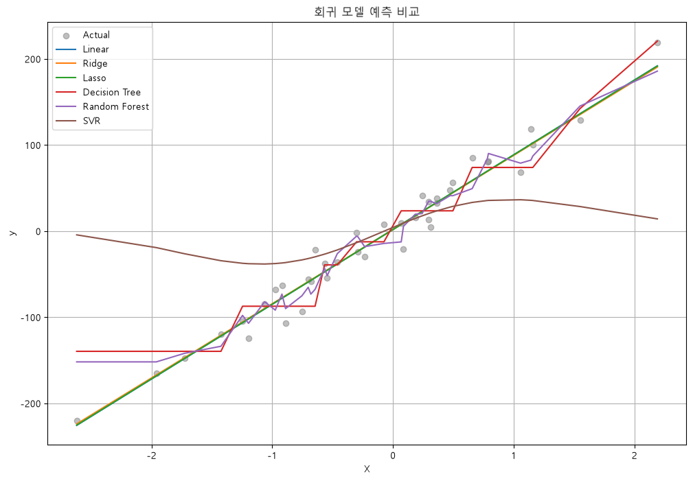

위 결과 그래프를 보면 선형과 비선형 형식의 그래프를 확인할 수 있다.<br>
**⇒ Random Forest Regression (랜덤 포레스트 회귀) 가 가장 적합해 보인다. 다만 계단식으로 되어 있어 노이즈에 민감하고 과적합된 듯 보인다.**

| 모델 | 특징 |
| --- | --- |
| Linear | 직선, 단순한 선형 모델 |
| Ridge | 직선, L2 정규화로 과적합 완화 |
| Lasso | 직선, L1 정규화로 중요하지 않은 계수를 0으로 |
| Decision Tree | 계단형 곡선, 트리 기반 모델의 특징 |
| Random Forest | 계단형 곡선, 여러 트리의 평균으로 안정적 |
| SVR | 완만한 곡선, 마진 내 오차 허용하며 일반화 |

#### 최종 비교

**Linear Regression (또는 Lasso)**

→ 평가 지표 점수가 높은 편이고, 그래프에서 실제 데이터의 추세를 잘 따라 가고 있다.

### 지도학습 - 분류 알고리즘

#### 분류 문제의 개념

- 분류(Classification)
    - 주어진 데이터를 특정 범주(Category)나 클래스(Class)로 분류하는 작업이다.
    - 지도학습(Supervised Learning)의 한 유형 → **데이터에 레이블(정답)이 존재**한다.
    - 모델은 이 레이블을 학습하여 새로운 데이터가 주어졌을 때 올바른 클래스를 예측하도록 훈련된다.
- 분류의 주요 목표
    - 정확한 예측: 데이터가 어떤 클래스에 속하는지 최대한 정확히 예측한다.
    - 실용적 적용: 실제 문제에서 유용한 정보를 제공한다.<br>
    예: 스팸 필터링 모델은 높은 정확도와 낮은 오탐(False Positive)을 목표로 한다.
- 분류 문제의 특징
    - **입력 데이터** - 다양한 특징(feature)을 가진 데이터. (예: 이메일 본문의 단어들)
    - **출력 데이터** - 데이터가 속한 범주 또는 클래스. (예: 이메일이 "스팸"인지"스팸 아님"인지)
    - **클래스 개수**
        - 이진 분류(Binary Classification)<br>
        : 두 개의 클래스만 예측한다(예: True/False, 0/1).
        - 다중 클래스 분류(Multi -Class Classification)<br>
        : 세 개 이상의 클래스를 예측한다(예: 고양이, 강아지, 새).
- 분류의 작동 방식
    1. 데이터 수집 및 전처리
        - 데이터를 수집하고, 결측값 처리, 스케일링, 정규화 등을 통해 준비한다.
    2. 모델 학습
        - 입력 데이터(특징, Features)와 레이블(정답, Labels)을 활용해 모델을 학습시킨다.<br>
        예: 키와 몸무게를 입력으로 받아 성별을 예측하는 모델.
    3. 모델 예측
        - 새로운 데이터가 들어오면 학습한 모델이 예측값을 출력한다.<br>
        예: "이메일은 스팸이다" 또는 "이 환자는 암이 아니다.“
    4. 평가
        - 모델의 예측 결과를 평가하여 성능 지표(정확도, Precision, Recall 등)로 측정한다.

#### 로지스틱 회귀(Logistic Regression)

- 분류 문제를 해결하기 위한 지도 학습 알고리즘이다.
- 이름에" 회귀"가 포함되어 있지만, 실제로는 연속적인 값을 예측하는 것이 아니라 데이터를 클래스로 분류하는 데 사용한다.
- 로지스틱 회귀는 **이진 분류 문제**에서 가장 널리 사용되는 기법 중 하나이다.
- 데이터를 분석하고 특정 데이터가 특정 클래스에 속할 확률을 예측한다.<br>
    예) 로지스틱 회귀는 "이 이메일이 스팸일 확률이 85%"와 같은 값을 출력하며,
이 확률에 따라 특정 클래스에 할당한다.

#### 로지스틱 회귀(Logistic Regression)의 작동 원리

1. 선형 회귀의 확장
- 로지스틱 회귀는 먼저 선형 회귀처럼 데이터를 학습한다.
- 선형 회귀의 예측값(연속값)을 분류 문제에 적합하도록 변환한다.
- 문제: 선형 회귀는 0에서 1 사이의 확률 값을 보장하지 않는다.
2. 시그모이드 함수 적용
- 선형회귀의 예측값(z=wX+b)을 확률 범위인 0과 1 사이의 값으로 변환하기 위해 시그모이드(Sigmoid) 함수를 통과시킨다.
- 로지스틱 회귀는 예측값 $z$를 **시그모이드 함수를 사용해 0과 1 사이의 값(확률)으로 변환**한다.
- 시그모이드 함수
    - $$\sigma(z) = \frac{1}{1 + e^{-z}}$$
        $z=w1x1+w2x2+⋯+ wnxn+b$ : 입력 특징들의 가중합.<br>
        시그모이드 함수의 출력 값은 항상 **0 ≤ 𝜎(𝑧) ≤ 1**
3. 클래스결정
- 시그모이드함수의결과(확률값)가0.5 이상이면1, 그렇지않으면0으로분류→ 임계값변경가능

**핵심 요약: 그래프 기반의 판단 원리**
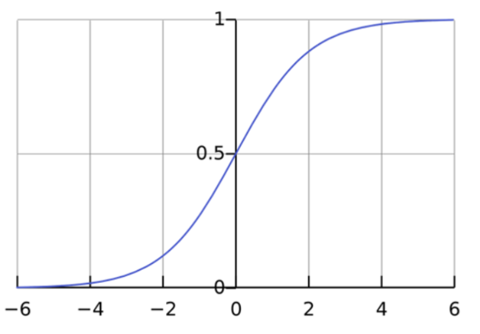
1. 초기 $w, b$ 설정: (S-곡선이 데이터에 잘 맞지 않는다.)
2. 손실 함수 그래프에서 기울기 계산: 현 위치의 Loss 기울기를 구한다.
3. 기울기 반대 방향 이동: $w, b$ 값을 조정하여 손실 값이 감소한다.
4. 최솟값 도달: 최적의 S-곡선(확률 곡선) 완성, 최적의 $w, b$ 확보

#### 로지스틱 회귀(Logistic Regression)의 학습 과정

1. 가설 설정
    - 입력 데이터의 특징을 선형 결합하여 𝑧를 계산하고, 이를 시그모이드 함수에 통과시켜 확률을 계산한다.
- 모델 출력 ℎ𝜃(𝑥)=𝜎(𝑧)
2. 손실 함수 정의
    - 로지 스틱 회귀는 로그 손실 함수(Log Loss)를 사용한다.
    - $$J(\theta) = -\frac{1}{m} \sum_{i=1}^{m} [y_i \log(h_\theta(x_i)) + (1 - y_i) \log(1 - h_\theta(x_i))]$$
    <br>여기서 $yi$는 실제 값, ℎ𝜃(𝑥𝑖)는 예측 값
    <br>목표: 손실 함수 값을 최소화하여 모델 성능을 최적화한다.
3. 모델 학습
    - 경사 하강법(Gradient Descent)을 사용하여 가중치와 절편 값을 업데이트한다.
    - 모델이 점점 더 정확하게 데이터를 분류하도록 학습한다.

#### 성능 평가 지표(정확도, Precision, Recall(재현율), F1-Score)

보안에서는 재현율을 주의 깊게 봐야 한다.

- 분류 모델의 성능을 평가하기 위해 다양한 평가 지표가 사용
- 각각의 지표는 모델의 성능을 다양한 관점에서 분석하며, 특정 문제에 더 적합한 지표를 선택해야 한다.
- **혼동 행렬 (Confusion Matrix)**
    - 모든 평가지표는 혼동행렬(Confusion Matrix)을 기반으로 계산한다.
- 지표 종류
    - 정확도(Accuracy)
    - 정밀도(Precision)
    - 재현율(Recall)
    - F1-Score
- 혼동(오차) 행렬(Confusion Matrix)
    | 항목 | 예측 Negative | 예측 Positive |
    | --- | --- | --- |
    | 실제 Negative | True Negative (TN) | False Positive (FP) |
    | 실제 Positive | False Negative (FN) | True Positive (TP) |
    - 문제 상황
        - Positive: 암환자(실제 암환자)
        - Negative: 암이 아닌 환자(실제 암이 아닌 환자)
        - 모델은 각 환자에 대해 암 여부를 **"양성(Positive)"** 또는 **"음성(Negative)"** 으로 예측
    - 혼동 행렬 구성 요소
        - True Positive (TP) : 모델이 암 환자를 암이라고 정확히 예측한 경우
        - True Negative (TN) : 모델이 암이 아닌 환자를 암이 아니라고 정확히 예측한 경우
        - False Positive (FP) : (Type I Error)모델이 암이 아닌 환자를 암이라고 잘못 예측한 경우
        - False Negative (FN): (Type II Error)모델이 암환자를 암이 아니라고 잘못 예측한 경우
- 모델이 100명의 환자 데이터를 예측한 결과
    | 항목 | 예측 Negative | 예측 Positive |
    | --- | --- | --- |
    | 실제 Negative | 50 (TN) | 10 (FP) |
    | 실제 Positive | 10 (FN) | 30 (TP) |
    - 실제 암 환자(Positive): 40명
    - 실제 암이 아닌 사람(Negative): 60명
    - 모델의 예측 결과<br>
        » TP = 30명(암 환자 40명중30명을 정확히 예측)<br>
        » TN = 50명(암이 아닌 사람 60명 중 50명을 정확히 예측)<br>
        » FP = 10명(암이 아닌사람 60명 중 10명을 암으로 잘못 예측)<br>
        » FN = 10명(암 환자 40명 중 10명을 암이 아니라고 잘못 예측)
- 정확도(Accuracy)
    - 정확도는 모델이 올바르게 예측한 비율을 의미한다.<br>
    ```math
    Accuracy = \frac{TP + TN}{TP + TN + FP + FN} \qquad \frac{30 + 50}{30 + 50 + 10 + 10} = 0.8(80\%)
    ```
    - 장점: 전체적인 예측 성능을 간단히 측정할 수 있다.
    - 단점: **데이터의 클래스 불균형(Positive와 Negative의 비율이 크게 차이날 때)에서 신뢰도가 낮아질 수 있다.**
    - 예시<br>
    암진단에서 대부분의 환자가 건강(99%)이라면, 모델이 항상 "건강"이라고 예측해도 99% 정확도를 얻을 수 있지만 이는 의미있는 성능이 아니다.
- 정밀도(Precision)
    - 정밀도는 모델이 Positive로 예측한 것들 중에서 실제로 Positive인 비율이다.<br>
        $$Precision = \frac{TP}{TP + FP} \qquad \frac{30}{30 + 10} = 0.75(75\%)$$
    - 장점: False Positive를 줄이는 데 중점을 둔다.<br>
    예: 스팸 필터링에서 정밀도가 높을수록, 스팸이 아닌 이메일을 스팸으로 잘못 분류할 가능성이 낮아진다.
    - 단점: **Positive 데이터를 놓칠 수 있다(Recall이 낮아질 수 있다).**
- **재현율**(Recall, Sensitivity, TPR)
    - **재현율은 실제 Positive 중에서 모델이 Positive로 올바르게 예측한 비율이다.**<br>
    $$Recall = \frac{TP}{TP + FN} \qquad \frac{30}{30 + 10} = 0.75(75\%)$$
    - 보안 쪽에서는 재현율을 기준으로 보는 경우가 많다.
    - 장점: False Negative를 줄이는 데 중점을 둔다.<br>
    예: **암 진단 모델에서 재현율이 높으면, 암환자를 놓칠 확률이 낮아진다(정밀도가 낮아진다).**
    - 단점: Positive로 예측하는 경향이 커져 정밀도가 낮아질 수 있다.
- F1-Score
    - 정밀도(Precision)와 재현율(Recall)의 조화 평균(Harmonic Mean)으로, 두 지표의 균형을 평가한다.
    $$F1\text{-}Score = 2 \cdot \frac{Precision \cdot Recall}{Precision + Recall} \qquad 2 \times \frac{0.75 \times 0.75}{0.75 + 0.75} = 0.75(75\%)$$
    - 장점: 정밀도와 재현율 중 어느 하나에 치우치지 않고, 종합적인 성능 평가를 할 수 있다.
    - 단점: **클래스 불균형이 심한 데이터에서는 추가적인 분석이 필요하다.**
- 지표선택기준
    - 정확도(Accuracy) : 클래스가 균형 잡혀 있을 때 적합하다.
        - 예: 시험 점수 채점 모델.
    - 정밀도(Precision) : False Positive가 중요한 경우.
        - 예: 스팸 이메일 분류(정상 이메일이 스팸으로 분류되면 안 된다).
    - 재현율(Recall) : False Negative가 중요한 경우.
        - 예: 암 진단(암 환자를 놓치는 일이 없어야 한다).
    - F1-Score : 정밀도와 재현율의 균형이 중요할 때.
        - 예: 자연어 처리에서 키워드 추출.

#### 사이킷런을 이용한 분류 성능 평가 예제

```python
# 필요한 라이브러리 불러오기
from sklearn.datasets import load_breast_cancer             # 유방암 데이터셋 로드
from sklearn.model_selection import train_test_split        # 학습용/테스트용 데이터 분리
from sklearn.linear_model import LogisticRegression         # 로지스틱 회귀 모델
from sklearn.metrics import accuracy_score, precision_score, recall_score, f1_score, confusion_matrix, classification_report    # 평가 지표
from sklearn import set_config
set_config(display='text')

# 1. 데이터셋 로드 및 분리
data = load_breast_cancer()     # 유방암 데이터셋 로드
X = data.data                   # 특징 데이터(환자의 다양한 세포 정보)
y = data.target                 # 레이블 데이터(0: 음성, 1: 양성)
print(f"data.target_names = {data.target_names}")

# 학습용 데이터와 테스트용 데이터로 나누기
X_train, X_test, y_train, y_test = train_test_split(
    X, y, test_size=0.2, random_state=42
)

# test_size=0.2: 데이터의 20%는 테스트용으로 사용
# random_state=42: 실행할 때마다 동일한 데이터 분리 결과를 얻기 위해 설정

# 2. 로지스틱 회귀 모델 학습
model = LogisticRegression(max_iter=10000)                  # 로지스틱 회귀 모델 생성(최대 반복 횟수 설정)
model.fit(X_train, y_train)                                 # 학습 데이터로 모델 훈련

# 3. 테스트 데이터 예측
y_pred = model.predict(X_test)                              # 테스트 데이터를 사용하여 결과 예측

# 4. 평가 지표 계산
accuracy = accuracy_score(y_test, y_pred)                   # 정확도 계산
precision = precision_score(y_test, y_pred, pos_label=0)    # 정밀도 계산
recall = recall_score(y_test, y_pred, pos_label=0)          # 재현율 계산
f1 = f1_score(y_test, y_pred, pos_label=0)                  # F1-Score 계산

# 5. 결과 출력
print("정확도(Accuracy):", accuracy)                        # 정확도 출력
print("정밀도(Precision):", precision)                      # 정밀도 출력
print("재현율(Recall):", recall)                            # 재현율 출력
print("F1-Score:", f1)                                      # F1-Score 출력

# 혼동 행렬 출력
print("\n혼동 행렬(Confusion Matrix):\n", confusion_matrix(y_test, y_pred))
# 혼동 행렬을 통해 TP, TN, FP, FN 값 확인

# 분류 보고서 출력
print("\n분류 보고서(Classification Report):\n", classification_report(y_test, y_pred))
# Classificatoin Report로 각 클래스에 대한 평가 지표 확인

# data.target_names = ['malignant' 'benign']
# 정확도(Accuracy): 0.956140350877193
# 정밀도(Precision): 0.975
# 재현율(Recall): 0.9069767441860465
# F1-Score: 0.9397590361445783

# 혼동 행렬(Confusion Matrix):
#  [[39  4]
#  [ 1 70]]

# 분류 보고서(Classification Report):
#                precision    recall  f1-score   support

#            0       0.97      0.91      0.94        43
#            1       0.95      0.99      0.97        71

#     accuracy                           0.96       114
#    macro avg       0.96      0.95      0.95       114
# weighted avg       0.96      0.96      0.96       114
```

- 지표 값 출력
    - 정확도: 모델이 전체 데이터 중 95%를 정확히 예측.
    - 정밀도: 양성으로 예측한 데이터 중 94%가 실제로 양성.
    - 재현율: 실제 양성 데이터 중9 8%를 정확히 양성으로 예측.
    - F1-Score : 정밀도와 재현율의 조화평균(균형).
- 혼동 행렬 출력
    - 39: 실제 음성 데이터를 음성으로예측(TN).
    - 4 : 실제 음성 데이터를 양성으로 잘못 예측(FP).
    - 1 : 실제 양성 데이터를 음성으로 잘못 예측(FN).
    - 70: 실제 양성 데이터를 양성으로 예측(TP).
- 분류 보고서 출력
    - 클래스0(양성)
    정밀도 97%, 재현율 91%, F1-Score 94%.
    - 클래스1(음성)
    정밀도 95%, 재현율 99%, F1-Score 97%.
    - 매크로 평균: 각 클래스의 단순 평균.
    - 가중 평균: 클래스 비율에 따라 가중치를 둔 평균.

#### 데이터 불균형(Data Imbalance) 문제 해결

- 실무에서는 사기 탐지(사기 거래 0.1%), 불량률 진단(불량 0.5%) 등 소수 클래스(Minority Class)의 감지가 훨씬 중요한 경우가 많다.
- 대처 방안
- **Class Weight 조절**
    - 모델 학습 시 소수 클래스의 오차에 대해 더 높은 가중치를 주어 손실을 크게 계산하게 한다(예: class_weight='balanced').
- **임계값(Threshold) 조절**
    - 확률 임계값을 0.5가 아닌 0.3 등으로 낮추어 **재현율(Recall)을 극대화**한다.
- **재샘플링 (Oversampling / Undersampling)**
    - 오버샘플링 (Oversampling): 양이 적은 소수 클래스의 데이터를 복제하거나 새롭게 생성하여 데이터의 양을 늘리는 방식이다.
    - 언더샘플링 (Undersampling): 양이 많은 다수 클래스의 데이터를 일부 무작위로 삭제하여 데이터의 양을 줄이는 방식이다.
    - SMOTE(Synthetic Minority Oversampling Technique) 알고리즘 등으로 소수 클래스의 데이터를 합성해 불균형 비율을 강제로 맞춘다.
- 대처 방안
    ```python
    # class_weight 적용 예시
    log_reg_balanced = LogisticRegression(class_weight='balanced', max_iter=10000)
    log_reg_balanced.fit(X_train, y_train)
    y_pred_balanced = log_reg_balanced.predict(X_test)

    print("Bananced F1-Score:", f1_score(y_test, y_pred_balanced))
    # Bananced F1-Score: 0.9790209790209791
    ```

### 모델 성능 향상 - K-최근접 이웃(KNN)

#### K-최근접 이웃(KNN) 알고리즘

- KNN은 지도 학습(Supervised Learning) 알고리즘 중 하나이다.
- KNN의 핵심 아이디어는 **가까운 데이터가 비슷한 특성을 가진다**는 가정이다.<br>
→ 새로운 데이터 포인트가 주어졌을 때, 이를 가장 가까운 데이터 포인트들의 그룹(이웃)으로 분류하거나 값을 예측하는데 사용한다.
- KNN은 간단하지만 매우 효과적인 분류(Classification)와 회귀(Regression) 알고리즘
- KNN을 언제 사용하면 좋을까?
- 데이터의 패턴이 비선형적이고 복잡할 때 KNN이 좋은 성능을 보일 수 있다.<br>
단, 데이터가 많거나 고차원일 경우 성능 저하를 겪을 수 있으므로 이런 경우 차원 축소나 데이터 전처리가 필요하다.

#### KNN의 작동 원리

1. 훈련 데이터 준비
    - 데이터가 여러 개의 특성(feature)으로 구성되어 있다고 가정한다.
    - 각각의 데이터는 특정 레이블(label, 정답) 또는 값을 가지고 있다.
2. 거리 계산
    - 새로운 데이터포인트(예측하려는 데이터)와 훈련 데이터 사이의 거리를 계산
    → 가장 흔히 사용하는 거리는 **유클리드 거리(Euclidean Distance)**
    - 유클리드거리 공식
    $$d = \sqrt{\sum_{i=1}^{n} (x_i - y_i)^2}$$
    여기서 $x_i$와 $y_i$는 각각 두 점의 $i$-번째 특성 값
3. K개의 이웃 선택
    - 가장 가까운 $K$개의 데이터포인트를 선택한다.
    - $K$는 미리 정해진 하이퍼파라미터로, $K$의 값에 따라 모델의 성능이 달라진다.
4. 결과 결정
    - 분류(Classification)
        - 선택된 $K$개의 이웃 중 가장 많은 빈도로 나타나는 레이블을 선택(K는 홀수로 설정해야 한다)한다.<br>
        → 이를 다수결(Majority Voting)이라고 한다.
    - 회귀(Regression)
        - 선택된 $K$개의 이웃의 값을 평균을 내어 예측값을 결정한다.
    
#### KNN의 주요 특징

- 모델 학습이 필요하지 않는다.
    - KNN은 훈련과정에서 데이터를 저장하기만 하고, 새로운 데이터가 들어올 때 실시간으로 계산한다.
    - 이 때문에 Lazy Learning(게으른 학습) 알고리즘이라고도 한다.
- 단순성
    - 복잡한 수학적 계산 없이 데이터 간 거리를 비교하여 예측을 수행하므로 이해하고 구현하기
- 다양한 응용
    - 분류와 회귀 문제 모두에 사용할 수 있다.
    - 예시
        - 분류: 이메일 스팸 탐지, 질병 진단
        - 회귀: 주택 가격 예측

#### 사이킷런 기반 KNN 예제

```python
# 1. 필요한 라이브러리 임포트
from sklearn.datasets import load_iris                              # Iris 데이터셋 로드
from sklearn.model_selection import train_test_split                # 데이터 분리
from sklearn.neighbors import KNeighborsClassifier                  # KNN 알고리즘 사용
from sklearn.metrics import classification_report, accuracy_score   # 성능 평가

# 2. 데이터 로드 및 확인
iris = load_iris()                                                  # Iris 데이터셋 로드
X = iris.data                                                       # 특성 데이터(꽃입/꽃받침의 길이와 너비)
y = iris.target                                                     # 레이블 데이터(품종: Setosa, Versicolor, Virginica)

# 데이터 구조 확인
print(f"특성 데이터 샘플:\n{X[:5]}")                                  # 처음 5개의 샘플 출력
print(f"레이블 데이터 샘플:\n{y[:5]}")                                # 처음 5개의 레이블 출력

# 3. 데이터 분리(훈련 세트와 테스트 세트)
X_train, X_test, y_train, y_test = train_test_split(X, y, test_size=0.2, random_state=42)

# 데이터 분리 결과 확인
print(f"훈련 데이터 크기: {X_train.shape}")
print(f"테스트 데이터 크기: {X_test.shape}")

# 4. KNN 모델 생성
k=3                                                                 # 가장 가까운 이웃의 개수
knn = KNeighborsClassifier(n_neighbors=k)                           # KNN 분류기 생성

# 5. 모델 학습
knn.fit(X_train, y_train)                                           # 훈련 데이터로 모델 학습

# 6. 모델 평가
y_pred = knn.predict(X_test)    # 테스트 데이터 예측
accuracy = accuracy_score(y_test, y_pred)       # 정확도 계산
print(f"KNN 모델 정확도(K={k}): {accuracy * 100:.2f}%")

# 분류 성능 세부 보고서 출력
print("\n분류 보고서:")
print(classification_report(y_test, y_pred, target_names=iris.target_names))

# 7. 새로운 데이터 예측
new_data = [[5.0, 3.5, 1.3, 0.3]]   # 예측할 새로운 데이터(꽃잎/꽃받침 크기)
prediction = knn.predict(new_data)  # 예측
predicted_class = iris.target_names[prediction][0]  # 예측된 품종 이름
print(f"\n새로운 데이터 {new_data}의 예측 결과: {predicted_class}")

# 특성 데이터 샘플:
# [[5.1 3.5 1.4 0.2]
#  [4.9 3.  1.4 0.2]
#  [4.7 3.2 1.3 0.2]
#  [4.6 3.1 1.5 0.2]
#  [5.  3.6 1.4 0.2]]
# 레이블 데이터 샘플:
# [0 0 0 0 0]
# 훈련 데이터 크기: (120, 4)
# 테스트 데이터 크기: (30, 4)
# KNN 모델 정확도(K=3): 100.00%

# 분류 보고서:
#               precision    recall  f1-score   support

#       setosa       1.00      1.00      1.00        10
#   versicolor       1.00      1.00      1.00         9
#    virginica       1.00      1.00      1.00        11

#     accuracy                           1.00        30
#    macro avg       1.00      1.00      1.00        30
# weighted avg       1.00      1.00      1.00        30


# 새로운 데이터 [[5.0, 3.5, 1.3, 0.3]]의 예측 결과: setosa
```

- 데이터 요약훈련
    - 데이터: 120개 샘플, 4개의 특징(꽃받침길이/너비, 꽃잎길이/너비).
    - 테스트데이터: 30개샘플.
    - 레이블: [0, 1, 2] 각각setosa, versicolor, virginica를나타냄.
- KNN 모델 성능
    - 정확도(Accuracy): 100% (테스트데이터30개모두정확히분류).
- 분류 보고서 출력
    - Precision (정밀도): 모든클래스1.00.
    - Recall (재현율): 모든클래스1.00.
    - F1-Score: 모든클래스1.00.
    - Support:setosa: 10개, versicolor: 9개, virginica: 11개.
- 새로운 데이터 예측
    - 입력 데이터를 setosa로정확히 예측.


#### K값의 선택과 영향

K-회귀, 분류로 찾을 수 있다.
- 회귀: k개의 이웃을 찾고 각 값의 평균을 반환한다.
- 분류: k개의 이웃을 찾고 빈도수를 확인하여 가장 많이 발견되는 클래스를 반환한다.

- KNN 알고리즘에서 $K$ 값은 매우 중요한 하이퍼파라미터이다.
    - $K$ 는 모델이 예측을 할  때 고려하는 가장 가까운 이웃의 수를 의미한다.
    - $K$ 값의 선택은 모델의 성능에 큰 영향을 미친다.
    - $K$ 는 새로운 데이터 포인트가 주어졌을 때, 데이터와 가장 가까운 $K$개의 데이터 포인트를 기반으로 예측을 수행한다.
        - 예<br>
            $K$=1: 가장가까운하나의이웃만보고결정.<br>
            $K$=3: 가장가까운3개의이웃을보고다수결로결정.
- K 값이 작을 때의 영향
    - 장점
        - 모델이 데이터의 세부적인 패턴을 잘 잡아낸다.
        - 국소적(local) 특징에 민감하므로 복잡한 데이터를 처리하는 데 적합하다.
    - 단점
        - 과적합(Overfitting) 위험이 증가
        - 노이즈(잘못된 데이터)에 의해 결과가 영향을 받을 가능성이 크다.
        - 작은 데이터 변화에도 모델의 결과가 달라질 수 있다.
-  K 값 선택 시 고려 사항
    - 데이터의 크기
        - 작은 데이터셋: $K$ 값을 **작게 설정**하는 것이 적합하다. 예: 데이터가  50개라면 $K$=3 또는 $K$=5이다.
        - 큰 데이터셋: $K$ 값을 더 크게 설정해도 된다. 예: 데이터가 수천 개라면 $K$=15 또는 $K$=20이다.
    - 홀수 값의 선택
        - $K$는 보통 홀수로 설정하는 것이 좋다. → 이는 동률(Tie)을 방지하기 위함이다.
        - 클래스가 2개일 때 $K$가 짝수라면 결과가 모호해질 수 있다.
    - 성능 평가를 위한 테스트교차 검증(Cross Validation)
        - 다양한 $K$ 값을 시도하면 서모델성능(정확도)을 비교하여 최적의 $K$ 값을 선택한다.
        - 과적합과 과소적합 사이에서 적절한 균형을 찾을 수 있다.

#### K값 선택 실습 코드(사이킷런)

```python
from sklearn.datasets import load_iris
from sklearn.model_selection import train_test_split
from sklearn.neighbors import KNeighborsClassifier
from sklearn.metrics import accuracy_score

# 1. 데이터 로드 및 분리
iris = load_iris()
X_train, X_test, y_train, y_test = train_test_split(iris.data, iris.target, test_size=0.2, random_state=42)

# 2. K값에 따른 정확도 비교
accuracies = {} # K 값 별 정확도를 저장할 딕셔너리

for k in range(1, 21): # K 값을 1부터 20까지 테스트
    knn = KNeighborsClassifier(n_neighbors=k)   # KNN 모델 생성
    knn.fit(X_train, y_train)                   # 모델 학습
    y_pred = knn.predict(X_test)                # 예측
    accuracy = accuracy_score(y_test, y_pred)   # 정확도 계산
    accuracies[k] = accuracy                    # K 값별 정확도 저장

# 3. 결과 출력
for k, acc in accuracies.items():
    print(f"K={k}: 정확도={acc * 100:.2f}%")

# 4. 최적의 K값 찾기
best_k = max(accuracies, key=accuracies.get)    # 정확도가 가장 높은 K값
print(f"\n최적의 K 값: {best_k}, 정확도: {accuracies[best_k] * 100:.2f}%")

# K=1: 정확도=100.00%
# K=2: 정확도=100.00%
# K=3: 정확도=100.00%
# K=4: 정확도=100.00%
# K=5: 정확도=100.00%
# K=6: 정확도=100.00%
# K=7: 정확도=96.67%
# K=8: 정확도=100.00%
# K=9: 정확도=100.00%
# K=10: 정확도=100.00%
# K=11: 정확도=100.00%
# K=12: 정확도=100.00%
# K=13: 정확도=100.00%
# K=14: 정확도=100.00%
# K=15: 정확도=100.00%
# K=16: 정확도=100.00%
# K=17: 정확도=100.00%
# K=18: 정확도=100.00%
# K=19: 정확도=100.00%
# K=20: 정확도=100.00%

# 최적의 K 값: 1, 정확도: 100.00%
```

#### 모델의 성능 향상 및 하이퍼파라미터 튜닝

- 모델의 성능 향상 및 하이퍼파라미터 튜닝
    - KNN 알고리즘의 성능은 다양한 요소에 의해 영향을 받는다.<br>
        → 성능을 최적화하려면 데이터 전처리, 거리 계산 방식, 그리고 하이퍼파라미터(특히 $K$ 값과 거리 계산 방식)를 신중히 조정해야 한다.
- **모델 성능 향상 방법**
    - **데이터 전처리**<br>
        스케일링, 이상치 제거, 특성 선택.
    - **거리 계산 방식**<br>
        유클리드, 맨해튼, 민코프스키등을 데이터 특성에 맞게 선택한다.
    - **하이퍼파라미터 튜닝**<br>
        최적의 $K$ 값을 교차 검증으로 선택한다. 가중치를 부여하여 더 나은 성능을 도출할 수 있다.

#### 모델의 성능 향상 및 하이퍼파라미터 튜닝 예제

```python
# 1. 필요한 라이브러리 임포트
from sklearn.datasets import load_iris                                      # Iris 데이터셋 로드
from sklearn.model_selection import train_test_split, cross_val_score       # 데이터 분리 및 교차 검증
from sklearn.neighbors import KNeighborsClassifier                          # KNN 알고리즘 사용
from sklearn.preprocessing import StandardScaler                            # 데이터 스케일링
from sklearn.metrics import accuracy_score, classification_report           # 성능 평가

# 2. 데이터 로드 및 분리
iris = load_iris()      # Iris 데이터셋 로드
X = iris.data   # 특성 데이터(꽃잎/꽃받침의 길이와 너비)
y = iris.target # 레이블 데이터(품종: Setosa, Versicolor, Virginica)

# 훈련 세트와 테스트 세트로 데이터 분리(80% 훈련, 20% 테스트)
X_train, X_test, y_train, y_test = train_test_split(X, y, test_size=0.2, random_state=42)

# 3. 데이터 스케일링(KNN은 거리 기반 알고리즘이므로 중요)
scaler = StandardScaler()                                                   # 스케일러 생성 
X_train_scaled = scaler.fit_transform(X_train)                              # 훈련 데이터 스케일링
X_test_scaled = scaler.transform(X_test)                                    # 테스트 데이터 스케일링(기준을 같게 만들기 위해 fit을 다시 하지 않았다.)

# 4. K값 튜닝(교차 검증 사용)
best_k = 1                                                                  # 최적의 K값 초기화
best_score = 0                                                              # 최적의 정확도 초기화  

# 다양한 K값을 테스트하며 최적의 K 값 찾기
for k in range(1, 21):                                                      # K=1부터 K=20까지 테스트
    knn = KNeighborsClassifier(n_neighbors=k)                               # KNN 모델 생성
    scores = cross_val_score(knn, X_train_scaled, y_train, cv=5)            # 5-fold 교차 검증
    mean_score = scores.mean()                                              # 교차 검증 정확도의 평균
    if mean_score > best_score:                                             # 가장 높은 정확도를 갱신
        best_k = k
        best_score = mean_score

print(f"최적의 K 값: {best_k}, 교차 검증 정확도: {best_score * 100:.2f}%")

# 5. 거리 계산 방식 변경 및 가중치 추가
# 최적의 K값과 다른 거리 계산 앙식을 사용하여 모델 생성
final_knn = KNeighborsClassifier(n_neighbors=best_k, weights='distance', metric='manhattan')
final_knn.fit(X_train_scaled, y_train)  # 최적의 하이퍼파라미터로 모델 학습

# 6. 최적화된 모델 평가
y_pred = final_knn.predict(X_test_scaled)                                   # 테스트 데이터로 예측
accuracy = accuracy_score(y_test, y_pred)                                   # 정확도 계산
print(f"최적화된 KNN 모델 정확도: {accuracy * 100:.2f}%")
# 세부적인 성능 보고서 출력
print("\n분류 보고서:")
print(classification_report(y_test, y_pred, target_names=iris.target_names))

# 7. 새로운 데이터 예측
new_data = [[5.0, 3.5, 1.3, 0.3]]                                           # 예측할 새로운 데이터(꽃잎/꽃받침 크기)
new_data_scaled = scaler.transform(new_data)                                # 새로운 데이터 스케일링
prediction = final_knn.predict(new_data_scaled)                             # 예측
predicted_class = iris.target_names[prediction][0]                          # 예측된 품종 이름
print(f"\n새로운 데이터 {new_data}의 예측 결과: {predicted_class}")

# 최적의 K 값: 3, 교차 검증 정확도: 95.00%
# 최적화된 KNN 모델 정확도: 100.00%

# 분류 보고서:
#               precision    recall  f1-score   support

#       setosa       1.00      1.00      1.00        10
#   versicolor       1.00      1.00      1.00         9
#    virginica       1.00      1.00      1.00        11

#     accuracy                           1.00        30
#    macro avg       1.00      1.00      1.00        30
# weighted avg       1.00      1.00      1.00        30


# 새로운 데이터 [[5.0, 3.5, 1.3, 0.3]]의 예측 결과: setosa
```

#### 분류 모델 비교

| 모델 명 | 특징 |
| :--- | :--- |
| **SVM (Support Vector Machine)** | 데이터 간 최대 Margin(여유 거리)을 찾는 분류기.<br>고차원 분류에 강하고, 커널 기법으로 비선형 분류도 가능.<br>정규화된 데이터에서 성능 우수. |
| **Random Forest** | 여러 개의 결정 트리를 앙상블(배깅) 방식으로 결합한 모델.<br>과적합 방지에 강하고, 변수 중요도 추정 가능.<br>대부분의 문제에서 안정적 성능. |
| **Gradient Boosting** | 약한 학습기(주로 결정 트리)를 순차적으로 연결해 학습하는 방식.<br>예측 성능 우수하지만 학습 속도는 느린 편.<br>하이퍼파라미터 튜닝에 민감. |
| **KNN (K-Nearest Neighbors)** | 가장 가까운 K개의 데이터를 보고 다수결로 분류.<br>모델 훈련이 빠르지만 예측이 느림.<br>이상치에 민감하고, 데이터 크기 증가에 따라 성능 저하 가능. |
| **Naive Bayes** | 조건부 확률 기반의 간단한 분류기.<br>각 특성이 독립이라는 전제를 가짐.<br>학습과 예측이 매우 빠름.<br>텍스트 분류(스팸 필터 등)에 강점. |
| **Decision Tree** | 조건 분기 구조를 사용한 규칙 기반 모델.<br>시각화 및 해석이 쉬움.<br>과적합 가능성이 크고 일반화 성능이 낮을 수 있음. |
| **Logistic Regression** | 확률 기반의 선형 분류기.<br>결정 경계가 선형일 때 빠르고 해석이 쉬움.<br>복잡한 데이터(비선형)에 약함. |

## <a id="machine-learning-basic-unsupervised"></a>5. 머신러닝 기초 - 비지도학습

### 비지도학습 소개

#### 머신러닝 비지도학습의 정의와 활용 분야

- **비지도학습**
    - 비지도학습은 정답(레이블)이 없는 데이터를 기반으로 학습하는 머신러닝의 한 방법이다.
        - 데이터의 목표 변수(정답 라벨y) 없이, 오직 **특성 데이터(X)의 분포 패턴, 군집 상태, 상관관계를 기반으로 데이터 내부의 숨겨진 구조와 규칙성을 스스로 분석해내는 방법론**이다.
    - 입력 데이터에 포함된 숨겨진 패턴이나 데이터의 구조를 파악하는데 초점을 맞춘다.<br>
        → 즉, 모델이 데이터를 보고 스스로 규칙을 발견하거나 데이터를 특정 기준에 따라 그룹으로 나누는 것이다.
        - 지도학습: "이 데이터는 고양이야" 같은 정답이 주어진 상태에서 학습한다.
        - 비지도학습: "이 데이터들이 어떻게 나뉠 수 있을까?"를 스스로 학습한다.
- **비지도학습의 활용 분야**
    - **군집화(Clustering)**: 데이터들을 비슷한 특성을 가진 그룹으로 묶는 작업이다.
        - 고객 구매 행동 패턴에 기반한 **세그먼트 분류**, **이상탐지(Anomaly Detection)**, 문서 주제별 자동 분류
    - **차원 축소(Dimensionality Reduction)**: 데이터를 더 간결하고 유용한 형태로 변환한다.
        - 데이터 시각화, 노이즈 제거, 데이터 압축
    - **이상치 탐지(Anomaly Detection)**: 정상적인 패턴에서 벗어나는 데이터(이상치)를 탐지
        - 신용카드 사기 탐지, 기계 고장 예측
    - **추천 시스템(Recommendation System)**: 비슷한 데이터를 기반으로 사용자에게 추천을 제공한다.
        - 영화 추천, 상품 추천

#### 지도학습과 비지도학습의 차이점

- 학습데이터
    - 지도학습: 데이터에 정답(레이블)이 포함되어 있다.
        - 예를 들어, 사진 데이터에 "고양이", "강아지"라는 라벨이 붙어 있다.
        - 목적: 예측이 목적이다. 입력 데이터와 정답 사이의 관계를 학습하여, 새 데이터를 예측한다.
    - 비지도학습: **데이터에 레이블이 없다**.
        - 데이터만 제공되고, 모델이 데이터를 스스로 분석하고 **숨겨진 패턴을 발견**한다.
        - 목적: 탐색이 목적이다. 입력 데이터의 구조나 그룹화를 파악한다.
- 활용 관점에서 본 차이점
    | 구분 | 지도학습 | 비지도학습 |
    | :--- | :--- | :--- |
    | **레이블 유무** | 정답(레이블)이 제공됨 | 레이블 없이 입력 데이터만 제공됨 |
    | **데이터 구조 이해** | 데이터-정답 관계 학습 | 데이터 간의 패턴과 관계를 스스로 파악 |
    | **결과물** | 새로운 데이터의 정답 예측 | 데이터의 그룹, 축소된 데이터 표현. |
    | **적용 사례** | 예측 모델<br>(스팸 이메일 분류, 가격 예측) | 데이터 탐색<br>(고객 세분화, 시각화). |

#### 비지도학습의 주요 기법: 군집화와 차원 축소

- 군집화(Clustering)
    - **K-Means**, Hierarchical Clustering, **DBSCAN (Density-Based Spatial Clustering of Applications with Noise)**
- 차원축소(Dimensionality Reduction)
    - **PCA (Principal Component Analysis)**, t-SNE (t-Distributed Stochastic Neighbor Embedding), UMAP (Uniform
Manifold Approximation and Projection)
- 이상치탐지(Anomaly Detection)
    - **Isolation Forest**, LOF (Local Outlier Factor), **Autoencoder**

### 군집화(Clustering) 기초

#### 군집화의 개념과 활용 (고객 세분화, 이미지 세그멘테이션 등)

- **군집화(Clustering)**
    - 군집화는 주어진 데이터에서 유사한 특성을 가진  데이터  포인트들을        그룹으로 묶는 것이다.
        - 이때 각 그룹을 **클러스터(Cluster)** 라고 한다.
        - 데이터를 사전에 분류하지 않고, 데이터를 살펴보며 그룹을 형성한다.
    - 군집화의 주요 목표
        - 데이터 구조 파악: 데이터를 시각화하거나 그룹화하여 숨겨진 패턴을 발견한다.
        - 유사성 기반 그룹화: 데이터 포인트들 간의 유사성을 기준으로 분류하여 각 그룹이 내포하는 의미를 이해한다.
    - 군집화의 작동 방식
    - 유사성 측정: 데이터 포인트 간의 유사성을 측정하기 위해 거리 계산(예: 유클리드 거리)을 사용한다.
    - 그룹화: 유사한 데이터 포인트들을 같은 그룹으로 묶는다.
- 군집화(Clustering) 의활용
    - 고객 세분화(Customer Segmentation)
        - 고객 데이터를 분석하여 유사한 구매 패턴, 관심사, 행동을 가진 그룹으로 나눈다.
        - 효과: 각 그룹에 맞는 마케팅 전략을 세우고, 고객 만족도를 높일 수 있다.
            - 자주 구매하는 고객 그룹(충성 고객)
            - 할인에 민감한 고객 그룹
            - 특정 상품에 집중하는 고객 그룹
    - 이미지 세그멘테이션(Image Segmentation)
        - 이미지의 픽셀을 비슷한 색상이나 질감을 가진 영역으로 나눈다.
        - 효과: 물체 탐지, 의료 영상 분석, 자율주행차의 객체 인식 등에 활용한다.
            - CT 스캔 이미지에서 장기와 조직 분리
            - 위성 이미지에서 건물, 숲, 강 구분
    - 문서 분류 및 정보 검색
        - 문서를 주제별로 그룹화하여 검색 및 추천 시스템에 활용한다.
        - 효과: 효율적인 데이터 관리와 검색 결과를 개선한다.
        - 뉴스 기사 데이터를 스포츠, 정치, 기술 등으로 자동 분류한다.
    - 이상치 탐지(Anomaly Detection)
        - 대부분의 데이터와 크게 다른 이상 데이터를 감지한다.
        - 효과: 금융 사기 탐지, 네트워크 보안 등에 활용한다.
        - 정상적인 거래와 사기 거래 구분하거나 네트워크에서 비정상적인 패킷을 탐지한다.
    - 추천 시스템(Recommendation System)
        - 유사한 관심사나 행동 패턴을 가진 사용자들을 그룹화하여 추천 항목을 생성한다.
        - 효과: 사용자 맞춤형 추천으로 사용자 만족도가 증가한다.
        - 음악 추천(스포티파이, 유튜브), 상품 추천(아마존, 쿠팡)

#### K-Means 알고리즘 원리와 적용

- **K-Means 알고리즘**
    - 데이터를 사전에 정의된 K개의 군집(Cluster)으로 묶는 대표적인 거리 기반 군집화 알고리즘이다.
    - K-Means는 데이터 군집화에서 가장 널리 사용되는 알고리즘 중 하나이다.
    - 주어진 데이터를 K개의 클러스터로 나누는 비지도 학습 방법이다.<br>
        → 반복적이고 간단한 방식으로 데이터를 그룹화하며, 각 클러스터는 하나의 중심(centroid)으로 설정한다.
    - 활용
        - **고객 세분화** : 고객 데이터를 K-Means로 클러스터링 하여, 비슷한 소비 행동을 가진 그룹으로 분류한다.
            - 예: 충성 고객, 신규 고객, 할인 선호 고객 그룹화.
        - **이미지 압축** : K-Means로 픽셀 색상을 클러스터링하여 주요 색상만 유지한다.
        - **문서 분류** : 텍스트 데이터를 클러스터링하여 문서를 주제별로 분류한다.
- **K-Means 알고리즘의 원리**
    1. 초기 클러스터 중심(Centroid) 설정
        - 클러스터의 개수 K를 사용자가 미리 설정, 초기 클러스터 중심은 무작위로 설정하거나 데이터를 기반으로 선택한다.
    2. 데이터 포인트(군집) 할당(Assignment)
        - 각 데이터 포인트를 가장 가까운 클러스터 중심에 할당 → 가까운 중심에 속하는 데이터 포인트들이 하나의 클러스터를 형성한다.
        - 데이터 포인트와 클러스터 중심 사이의 거리는 일반적으로 유클리드 거리(Euclidean Distance)를 사용하여 계산한다.
    3. 클러스터 중심 재계산(Update)
        - 각 클러스터에 속한 데이터 포인트들의 평균 위치를 계산하여 새로운 클러스터 중심으로 설정한다.<br>
        ```math
        \text{새로운 중심} = \frac{1}{n} \sum_{i=1}^{n} x_i
        ```
        여기서 $xi$는 클러스터 내 데이터 포인트, $n$은 데이터 포인트의 개수
    4. 반복
        - 데이터 포인트를 다시 가장 가까운 클러스터 중심에 할당하고, 클러스터 중심을 재계산한다.
        - 클러스터 중심이 더 이상 변하지 않거나(수렴), 최대 반복 횟수에 도달하면 알고리즘이 종료한다.
- **K-Means 알고리즘의 적용**
    1. 데이터 준비
        - 군집화를 수행할 데이터 준비 및 정규화(데이터의 크기가 클 경우 정규화가 중요).
    2. K 값 선택
        - 원하는 클러스터 개수 $K$를 결정한다.
    3. 알고리즘 실행
        - K-Means 알고리즘을 적용하여 데이터를 클러스터링한다.
    4. 결과 평가 및 시각화
        - 각 클러스터의 품질을 평가하고, 시각적으로 확인한다.

#### 클러스터 수(k) 선택 방법

- **K 값 선택 방법**
    - 엘보우 방법(Elbow Method)을 통해 최적의 $K$ 값을 선택한다.
        - 여러 $K$ 값에 대해 K-Means를 실행하고, 각 경우의 클러스터 내 데이터의 거리 합(WCSS, Within-Cluster Sum of Squares)을 계산한다.
        - $K$ 값에 따른 WCSS를 그래프로 그려, 그래프의 기울기가 급격히 완화되는 지점(엘보우 포인트)에서 최적의 $K$를 선택한다.
            - Inertia (군집 내 오차 제곱합)<br>
            » 각 데이터 포인트와 해당 군집의 중심점 간 거리를 제곱하여 모두 합산한 수치이다.
            - 군집 수 K가 커질수록 Inertia는 지속적으로 감소하지만, 군집이 데이터 구조에 비해 과도하게 쪼개지면 감소 폭이 둔화된다.
            - 팔꿈치(Elbow)처럼 그래프가 꺾여 Inertia 감소율이 급격히 줄어드는 지점이 최적의 군집 수 K를 의미한다.

                ```python
                # 필요한 라이브러리 import
                import numpy as np
                import matplotlib.pyplot as plt
                from sklearn.cluster import KMeans
                from sklearn.datasets import make_blobs

                # 1. 데이터 생성
                # make_blobs: 군집화에 적합한 샘플 데이터를 생성하는 함수
                # n_samples: 데이터 포인트 수, centers: 클러스터 수, random_state: 재현성을 위한 시드값
                n_samples = 300
                n_clusters = 3
                X, y = make_blobs(n_samples=n_samples, centers=n_clusters, cluster_std=1.0, random_state=42)

                # 2. 데이터 시각화(군집화 전)
                plt.scatter(X[:, 0], X[:, 1], s=30, c='grey', label="Original Data")
                plt.title("Data before Clustering")
                plt.xlabel("Feature 1")
                plt.ylabel("Feature 2")
                plt.legend()
                plt.show()

                # 3. K-Means 모델 생성 및 학습
                # KMeans 클래스: 사이킷런에서 제공하는 K-Means 구현
                # n_clusters: 클러스터 개수, random_state: 결과 재현성을 위한 시드값
                kmeans = KMeans(n_clusters=n_clusters, random_state=42)

                # fit_predict: 데이터를 클러스터링하고 각 데이터 포인트의 클러스터 레이블을 반환한다.
                cluster_labels = kmeans.fit_predict(X)

                # 4. 군집화 결과 시각화
                # 각 데이터 포인트의 클러스터에 따라 색을 지정한다.
                plt.scatter(X[:, 0], X[:, 1], c=cluster_labels, cmap='viridis', s=30, label="Clusterd Data")
                # 클러스터 중심 시각화
                plt.scatter(kmeans.cluster_centers_[:,0], kmeans.cluster_centers_[:,1], s=200, c='red', label='Centroids', marker='X')
                plt.title('Data after Clustering')
                plt.xlabel("Feature 1")
                plt.ylabel("Feature 2")
                plt.legend()
                plt.show()

                # 5. 모델 세부 정보 확인
                # kmeans.cluster_centers_: 클러스터 중심 좌표
                # kmeans.inertia_: 클러스터 내 거리 합(WCSS)
                print("Cluster Centers:\n", kmeans.cluster_centers_)
                print("Inertia(WCSS):", kmeans.inertia_)

                # Cluster Centers:
                #  [[-2.63323268  9.04356978]
                #  [-6.88387179 -6.98398415]
                #  [ 4.74710337  2.01059427]]
                # Inertia(WCSS): 566.8595511244131

                # 6. 최적의 K 값을 찾기 위한 엘보우 방법(추가 분석)
                # 다양한 K 값에 대한 Inertia 계산
                wcss = []
                K_range = range(1, 10)
                for k in K_range:
                    kmeans_temp = KMeans(n_clusters=k, init='k-means++', random_state=42)
                    kmeans_temp.fit(X)
                    wcss.append(kmeans_temp.inertia_)

                # 엘보우 그래프 그리기
                plt.plot(K_range, wcss, marker='o')
                plt.title("Elbow Method for Optimal K")
                plt.xlabel("Number of Clusters(K)")
                plt.ylabel("WCSS(Within-Cluster Sum of Squares)")
                plt.show()
                ```
                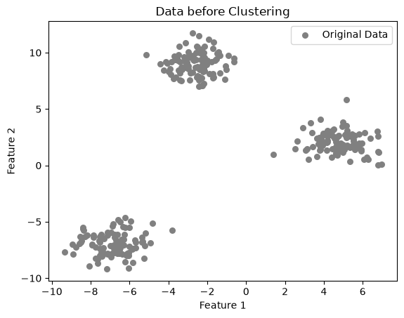
                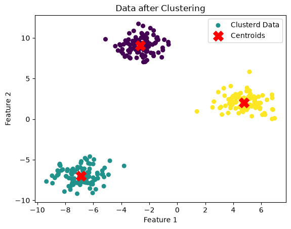
                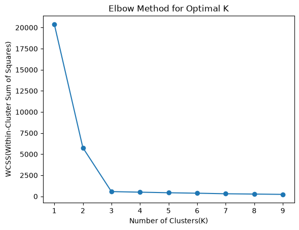

### 군집화 응용 및 성능 평가

#### 클러스터링 결과의 해석

##### 클러스터링 결과를 시각화

- 클러스터링 결과를 해석하는 첫 단계는 데이터를 시각적으로 분석하는 것이다.
- 2D 또는 3D 플롯 데이터가 2차원이나 3차원으로 변환 가능하다면 각 클러스터를 색으로 구분하여 시각화한다.
    - 주로사용하는도구
        - **Matplotlib** : 산점도(scatter plot)로 표현
        - **Seaborn** : 페어 플롯(pair plot) 등
        - **PCA** : 고차원 데이터를 2차원으로 축소하여 클러스터를 시각화
- 클러스터 중심 확인
    - 각 클러스터의 중심(centroid)을 확인한다.
    - 중심점은 클러스터 내 데이터를 대표하는 점으로, 클러스터의 특성을 요약한다.

##### 클러스터의 특징 이해

- **클러스터 내 데이터의 평균, 분포를 확인한다.**
    - 클러스터에 속한 데이터의 주요 속성(특징)의 평균값과 분포를 분석한다.<br>
    예: 고객 세그먼트를 분류했다면, 각 클러스터의 평균 구매 금액, 구매 빈도 등을 비교한다.
    - 이를 통해 각 클러스터가 어떤 특성을 가지고 있는지 이해할 수 있다.
- **클러스터 간의 차이점을 파악한다.**
    - 클러스터를 서로 비교하여 공통점과 차이점을 확인한다.<br>
    예: 하나의 클러스터는 구매 빈도가 높고 금액이 낮은 고객, 다른 클러스터는 구매 빈도는 낮지만 금액이 높은 고객일 수 있다.

##### 클러스터의 적절성 평가

- **데이터 응집도**
    - 클러스터 내의 데이터가 얼마나 가까이 모여있는지를 분석한다.<br>
        → 가까이 모여 있을수록 해당 클러스터는 응집도가 높다고 평가한다.
- **데이터 분리도**
    - 다른 클러스터와 얼마나 잘 분리되어 있는지를 분석한다.<br>
    → 클러스터 간의 거리가 멀수록 분리도가 높다고 평가한다.

##### 실질적인 의미 부여

- **도메인 지식을 활용한 해석**
    - 클러스터링은 자동으로 클러스터를 나누지만, 해석은 도메인 지식이 필요하다.<br>
    예: 의료 데이터에서 클러스터링을 했다면, 각 클러스터가 특정 질병에 걸린 환자 집단일 수 있다.
- **이름 붙이기**
    - 각 클러스터에 적절한 이름을 붙여준다.<br>
    예: 고객 데이터 클러스터링에서 "고액 구매 고객", "저빈도 구매 고객" 등으로 명명한다.

#### 클러스터 품질 평가: 실루엣 점수(Silhouette Score)

- 클러스터 품질 평가는 클러스터링 결과가 얼마나 잘 나왔는지 평가하는 과정이다.<br>
K-Means 알고리즘에서 클러스터 품질을 평가하려면<br>
→ 클러스터 내 데이터 응집도와 클러스터 간 분리도를 확인해야 한다.
- **실루엣점수(Silhouette Score)**
    - 엘보우 기법보다 군집 내부와 외부의 구조를 더 정밀하게 평가하는 지표이다.
    - 클러스터의 응집도와 분리도를 동시에 평가할 수 있는 강력한 지표이다.
    - K-Means의 품질을 판단하는 데 유용하다.
    - 실루엣 점수는 데이터 포인트가 자신의 클러스터와 얼마나 잘 응집되어 있고, 다른 클러스터와 얼마나 잘 분리되어 있는지를 나타낸다.
    - 계산 공식(각 데이터 포인트 $i$에 대해)
        ```math
        s(i) = \frac{b(i) - a(i)}{\max(a(i), b(i))}
        ```
        - $a(i)$: 데이터 포인트 $i$와 같은 클러스터내 다른 포인트간의 평균 거리(응집도)
        - $b(i)$: 데이터 포인트 $i$와 가장 가까운 다른 클러스터 포인트들 간의 평균 거리(분리도)
        - $s(i)$의 값 범위: -1 ≤ $s(i)$ ≤ 1
- 실루엣 점수(Silhouette Score)의 의미
    - $s(i)$ 값해석
        - **$s(i)$가 1에 수렴** : 데이터 포인트가 자신의 클러스터에 잘 속해있고, 다른 클러스터와 명확히 분리된다.
        - **$s(i)$가 0에 수렴** : 데이터 포인트가 경계에 가까워져, 어느 클러스터에 속했어야 하는지 불확실하다.
        - **$s(i)$가 음수** : 데이터 포인트가 잘못된 클러스터에 속했을 가능성이 높다.
    - 전체 실루엣 점수
        - 데이터셋 전체의 실루엣 점수는 모든 데이터 포인트의$s(i)$ 값 평균으로 계산된다.<br>
        ```math
        S = \frac{1}{n} \sum_{i=1}^{n} s(i)
        ```
        **$S$가 1에 가까울수록 클러스터링이 잘 되었다고 평가**한다.
    - 실무에서는 25% ~ 50%만 되어도 좋은 결과라고 여긴다.
- 실루엣 점수를 활용한 K 값 선택
    - K-Means의 가장 큰 과제는 적절한 클러스터 수 $k$를 선택하는 것이다.<br>
        → 실루엣 점수는 이를 돕는 데 매우 유용하다.
    - 방법
        1. 여러 $k$값에 대해 K-Means를 실행한다.
        2. 각 $k$ 값에 대해 실루엣 점수를 계산한다.
        3. 실루엣 점수를 시각화한다.
        4. 실루엣 점수가 가장 높은 $k$ 값을 선택한다.

##### 클러스터 품질 평가 예제

```python
import numpy as np
import matplotlib.pyplot as plt
from sklearn.cluster import KMeans
from sklearn.datasets import make_blobs
from sklearn.metrics import silhouette_score, silhouette_samples

# 1. 데이터 생성
# - make_blobs를 사용하여 군집화에 적합한 샘플 데이터를 생성한다.
# - centers: 생성할 클러스터의 수
# - n_samples: 생성할 데이터 포인트 수
data, _ = make_blobs(n_samples=300, centers=4, cluster_std=0.6, random_state=42)

# 데이터 시각화(원본 데이터)
plt.scatter(data[:,0], data[:,1], s=30 ,color='gray', label='Original Data')
plt.title('Generated Data')
plt.xlabel('Feature 1')
plt.ylabel('Feature 2')
plt.legend()
plt.show()

# 2. K-Means 알고리즘 적용
# - n_clusters: 생성할 클러스터 수
# - random_state: 결과 재현성을 위한 랜덤 시드
kmeans = KMeans(n_clusters=3, random_state=42)

# K-Means 모델 학습 및 클러스터 예측
# - fit_predict: 데이터를 학습히키고 각 데이터 포인트의 클러스터 할당을 반환
cluster_labels = kmeans.fit_predict(data)

# 클러스터링 결과 시각화
plt.scatter(data[:, 0], data[:,1], c=cluster_labels, cmap='viridis', s=30)
plt.scatter(kmeans.cluster_centers_[:,0], kmeans.cluster_centers_[:,1],
            s=200, c='red', marker='X', label='Centroids')  # 클러스터 중심
plt.title("K-Means Clustering Results")
plt.xlabel("Feature 1")
plt.ylabel("Feature 2")
plt.legend()
plt.show()

# 3. 클러스터 품질 평가 - 실루엣 점수 계산
# - silhouette_score: 전체 데이터에 대한 평균 실루엣 점수를 계산
silhouette_avg = silhouette_score(data, cluster_labels)
print(f"Overall Silhouette Score: {silhouette_avg:.2f}")

# Overall Silhouette Score: 0.80

# 4. 실루엣 점수 시각화 - 각 데이터 포인트의 실루엣 점수를 계산
silhouette_values = silhouette_samples(data, cluster_labels)

# 시각화 준비
y_lower = 10
for i in range(4):      # 각 클러스터에 대해 반복
    ith_cluster_silhouette_values = silhouette_values[cluster_labels == i]
    ith_cluster_silhouette_values.sort()
    size_cluster_i = ith_cluster_silhouette_values.shape[0]
    y_upper = y_lower + size_cluster_i
    # 클러스터별 막대 그리기
    plt.fill_betweenx(np.arange(y_lower, y_upper), 0, ith_cluster_silhouette_values)
    plt.text(-0.05, y_lower + 0.5 * size_cluster_i, str(i)) # 클러스터 번호
    y_lower = y_upper + 10                                  # 다음 클러스터로 이동

# 그래프 설정
plt.axvline(x=silhouette_avg, color="red", linestyle="--")  # 평균 실루엣 점수
plt.title("Silhouette Plot for K-Means Clustering")
plt.xlabel("Silhouette Score")
plt.ylabel("Cluster")
plt.show()

# 결과 요약
print(f"Cluster Centers:\n{kmeans.cluster_centers_}")
print(f"Silhouette Score for each point stored as silhouette_values array.")

# Cluster Centers:
# [[-5.7198651   8.11855424]
#  [-6.85126211 -6.85031833]
#  [ 4.68687447  2.01434593]]
# Silhouette Score for each point stored as silhouette_values array.
```

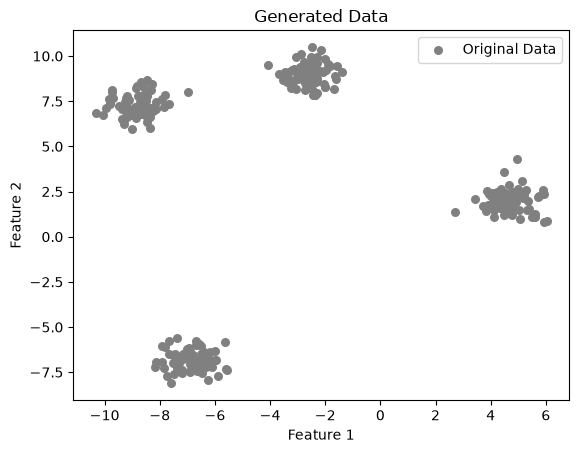
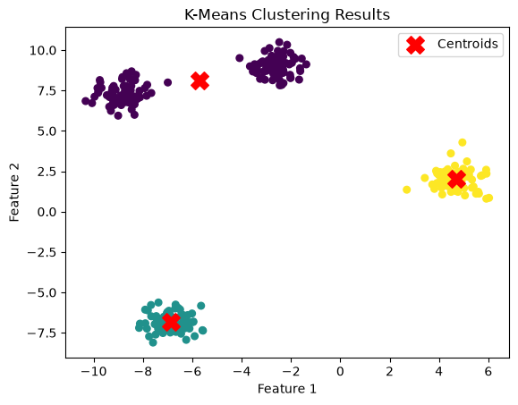
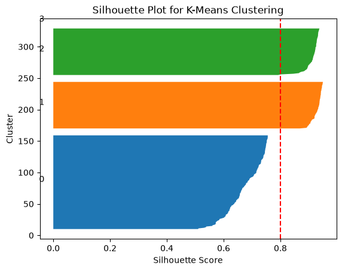

### 차원축소(Dimensionality Reduction) 기초

#### 차원 축소의 필요성 (고차원의 문제, 시각화)

- 차원 축소(Dimensionality Reduction)
- 데이터가 고차원일수록(즉, 피처(feature)의 개수가 많을수록) 모델을 학습시키거나 분석할 때 여러 가지 문제가 발생할 수 있다. → 이 **문제들을 해결하기 위해 차원 축소가 필요**하다.
1. 고차원의 문제 (Curse of Dimensionality)
    - 데이터의 차원이 증가하면 데이터가 차지하는 공간이 기하급수적으로 커진다. → 이로 인해 발생하는 문제를 "차원의 저주"라고 한다.
    - 데이터가 희소해진다.<br>
    고차원 공간에서는 데이터 포인트들이 서로 멀리 떨어져 있고, 유사성을 찾기가 어려워 진다.
    - 학습 속도 저하
    고차원 데이터는 계산 비용이 증가하여 모델 학습이 느려진다.
    - 과적합(Overfitting)<br>
    피처가 너무 많으면 모델이 학습 데이터에 지나치게 맞춰져 일반화 능력이 떨어질 수 있다.
2. 데이터 시각화
    - 고차원의 데이터는 직관적으로 이해하거나 시각화하기 어렵다. → 10차원 이상의 데이터를 사람이 시각적으로 이해할 수 있을까？
    - 차원 축소를 통해 데이터를 2차원 또는 3차원으로 변환한다. → 그래프를 통해 데이터의 분포나 패턴을 쉽게 분석할 수 있다.
3. 노이즈 제거: 이는 학습 모델의 성능 향상과 안정성을 제공한다.
    - 고차원 데이터에는 중요한 정보 뿐만 아니라 불필요한 정보(노이즈)가 포함될 수 있다.
    - 차원 축소는 데이터의 가장 중요한 특징(Variance, 변동성)을 유지하면서 노이즈를 줄여준다.
4. 모델 효율성 향상
    - 데이터 차원을 줄이면 계산량이 줄어들어 모델 학습과 예측 속도가 빨라지고, 메모리 사용량도 감소한다.
    - 차원이 줄어들면 중요하지 않은 피처가 제거되므로 모델이 학습에만 필요한 정보에 집중할 수 있다.

##### 차원 축소(Dimensionality Reduction)의 필요성 사례

- 이미지 데이터
    - 이미지 한 장은 수천, 수만 개의 픽셀로 구성된다.
    - 모든 픽셀을 사용하면 계산량이 너무 많아지므로, 중요한 정보만 추출하여 차원을 줄여야 한다.
- 유전자 데이터
    - 유전자 분석 데이터는 수천 개의 피처로 구성되지만, 실제로 중요한 것은 몇 가지 피처에 불과하다.
- 추천 시스템
    - 수천 명의 사용자가 수천 개의 상품에 대해 평가를 매겼다고 가정했을 때, 이 데이터를 모두 다루는 것은 비효율적이다.<br>
    → 중요한 사용 패턴만 추출하여 차원을 줄일 필요가 있다.

#### PCA(Principal Component Analysis) 개념 및 원리

##### PCA(Principal Component Analysis, 주성분 분석)

- 고차원 데이터를 저차원으로 축소하면서도 데이터의 중요한 정보를 최대한 보존하는 차원 축소 기법이다.<br>
→ 데이터의 주요 특징을 파악하고, 노이즈를 제거하거나 시각화를 용이하게 한다.
- PCA는 데이터를 선형 변환하여 새로운 축(Principal Components, 주성분)을 생성하는 과정이다.
    - **주성분(Principal Components)** : 데이터의 분산을 가장 잘 설명하는 새로운 축이다.
    - **데이터의 주요 패턴 찾기** : 데이터의 분산이 가장 큰 방향을 기준으로 데이터를 분석한다.
    - **축 변경** : 기존의 좌표 축(특징 공간)을 새로운 주성분 축으로 변환한다.
    - **차원 축소** : 중요하지 않은 주성분을 제거하여 데이터의 차원을 줄인다.
##### PCA의 작동 원리

- PCA의 원리는 데이터를 새로운 좌표축으로 변환하여 주요 특징을 유지하면서 차원을 줄이는 데 있다.
1. 데이터는 처음에 여러 차원(피처)으로 구성한다.
2. PCA는 각 차원의 분산(정보량)을 측정하고, 분산이 가장 큰 방향(축)을 찾는다.
3. 분산이 가장 큰 방향으로 데이터를 정렬하여 새로운 축을 정의한다.
4. 새로운 축을 기준으로 데이터를 변환(투영)하여, 적은 차원에서도 데이터를 잘 설명할 수 있도록 처리한다.

##### PCA의 적용 단계

1. 데이터 정규화(Standardization)
    - PCA를 적용하기 전에 데이터를 정규화(Standardization) 하거나 스케일링(Scaling)한다.
    - 각 피처의 값이 서로 다른 범위를 갖고 있으면 결과에 영향을 미치기 때문에, 평균이 0이고 분산이 1인 데이터로 변환한다.
2. 주성분 축을 찾기 위한 공분산 행렬을 계산한다.
    - 공분산 행렬(Covariance Matrix)은 각 피처 간의 상관관계를 나타낸다.
    - 예를 들어, 두 피처가 양의 상관관계에 있으면 공분산 값이 양수이다.
    - 공분산 행렬은 데이터의 분산 구조를 파악하는 데 필수적이다.
3. 주성분 축을 찾기 위한 고유값(Eigenvalues)과 고유벡터(Eigenvectors) 계산
    - 공분산 행렬을 분해하여 고유값과 고유벡터를 계산한다.
        - 고유값: 주성분이 설명하는 분산의 크기(중요도)
        - 고유벡터: 주성분의 방향(새로운 축).
4. 주성분 선택
    - 고유값이 큰 순서대로 주성분을 정렬한다.
    - 중요한 정보를 설명하는 주성분(변동성을 많이 설명하는 축)만 선택한다.<br>
    예: 전체 분산의 95% 이상을 설명하는 주성분만 사용한다.
5. 데이터 투영(Projection)
    - 원본 데이터를 선택된 주성분 축으로 투영한다.
    - 이렇게 하면 데이터의 차원이 축소된다.

#### 주성분의 의미와 데이터 투영

##### 주성분의 의미

- 주성분이란?
    - 주성분(Principal Components)은 데이터의 분산(정보량)이 가장 큰 방향을 나타내는 축이다.
    - 데이터를 분석할 때 중요한 정보는 데이터의 분산(변동성) 속에 포함되어 있다고 가정한다.
    - PCA는 데이터의 분산을 최대화하는 방향을 찾아 새로운 좌표축을 정의하고 이를 주성분이라고 한다.
- 주성분의 특징
    - **첫 번째 주성분(PC1)**
        - 데이터의 분산이 가장 큰 방향. 데이터의 변동성을 가장 잘 설명하는 축.
    - **두 번째 주성분(PC2)**
        - 첫 번째 주성분에 수직(직교)한 축. 두 번째로 큰 분산을 설명하는 방향
    - 추가 주성분
        - 이전 주성분들과 직교하면서 분산이 큰 방향을 순서대로 찾는다.
    - 주성분의 수<br>
    데이터의 차원 수와 동일한 수의 주성분이 존재. 예를 들어, 데이터가 4차원이라면 4개의 주성분이 있다.

##### 데이터 투영(Projection)의 의미

- PCA의 핵심 작업 중 하나는 데이터를 주성분 축으로 투영(Projection)하여 차원을 축소하는 것이다.
- **데이터 투영**이란?
    - 데이터를 기존의 좌표 축 대신 주성분 축으로 변환하는 과정이다.
    - 투영 후 데이터는 새로운 축(주성분) 상에서 표현한다. 불필요한 차원(변동성이 적은 축)은 제거된다.
- 왜 투영이 필요한가?
    - **중요한 정보만 유지**
        - 데이터의 분산이 큰 축(주성분)에 투영하면 정보량을 최대한 유지할 수 있다.
        - 분산이 작은 축은 주로 노이즈로 간주되어 제거한다.
    - **차원 축소** : 데이터가 주성분 축으로 투영되면, 더 적은 차원에서도 데이터를 잘 설명할 수 있다.
    - **시각화**: 투영된 데이터를 2차원이나 3차원으로 변환하여 시각적으로 이해할 수 있다.

##### PCA 예제

```python
# 필요한 라이브러리 import
import numpy as np
import matplotlib.pyplot as plt
from sklearn.decomposition import PCA
from sklearn.datasets import load_iris
from sklearn.preprocessing import StandardScaler

# 1. Iris 데이터셋 로드
# - Iris 데이터셋은 꽃잎 길이, 꽃잎 너비 등 4개의 피처를 가진 데이터로 구성
iris = load_iris()
X = iris.data   # 특성 데이터(4차원)
y = iris.target # 타깃 데이터(0, 1, 2의 세 가지 클래스)

# 2. 데이터 정규화(평균=0, 표준편차=1로 변환)
# - PCA는 데이터의 스케일에 만감하므로 정규화가 필수
scaler = StandardScaler()
X_scaled = scaler.fit_transform(X)

# 3. PCA 객체 생성 및 적합
# - n_components=2로 설정하여 데이터를 2차원으로 축소
pca = PCA(n_components=2)   # 2개의 주성분으로 축소
X_pca = pca.fit_transform(X_scaled)

# 4. PCA 결과 출력
# - 각 주성분이 데이터의 분산을 얼마나 설명하는지 출력
print("Explained variance ratio:", pca.explained_variance_ratio_)
# - 첫 번째 주성분과 두 번째 주성분이 전체 분산의 약 95% 이상을 설명

# Explained variance ratio: [0.72962445 0.22850762]

# 5. PCA 결과 시각화
# - 두 개의 주성분을 사용해 데이터를 2D 플롯으로 시각화
plt.figure(figsize=(8, 6))
for target, color, label in zip([0, 1, 2], ['red', 'blue', 'green'], iris.target_names):
    plt.scatter(X_pca[y == target, 0],      # 첫 번째 주성분
                X_pca[y == target, 1],      # 두 번째 주성분
                color=color, label=label, alpha=0.7)
plt.title('PCA on Iris Dataset')
plt.xlabel('Principal Component 1')
plt.ylabel('principal Component 2')
plt.legend()
plt.grid()
plt.show()
```

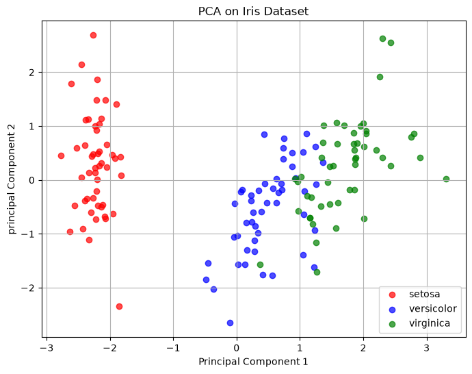

### 이상치탐지(Outlier Detection)

#### 이상치 탐지의 개념과 중요성

##### 이상치 탐지의 개념

- 이상치 탐지(Outlier Detection)
    - 데이터에서 일반적인 패턴과 크게 벗어나는 관측값(이상치, outlier)을 식별하는 과정이다.
    - 데이터 분포와 동떨어져 있거나, 예상 범위를 벗어난 데이터 포인트를 나타낸다.<br>
    → 다른 데이터와 비교했을 때 비정상적(다름)이고, 통계적으로 드문 데이터 포인트
- 목적
    - 이상치 탐지의 주된 목표는 데이터의 품질을 개선한다.
    - 비정상적인 행동을 사전에 발견하여 문제를 예방한다.

##### 이상치 탐지의 중요성

- 금융
    - 신용카드 사용 내역에서 사기 거래를 탐지한다.
    - 일반적인 소비 패턴과 다른 과도한 결제 금액이나 지역 외 사용 패턴은 금융 사기의 징후로 간주한다.
- 산업 장비 유지 보수
    - 장비의 센서 데이터에서 비정상적인 동작을 탐지한다.
    - 정상적인 동작과 다른 패턴을 가진 이상값은 기계 고장의 초기 신호일 수 있다.
- 의료
    - 환자의 건강 데이터에서 비정상적인 생체 신호를 탐지한다.
    - 심박수, 혈압 등에서 극단적인 수치는 질병의 징후일 가능성이 있다.

#### 비지도학습 기반 이상치 탐지 (Isolation Forest, DBSCAN)

##### Isolation Forest

- Isolation Forest는 이상치 탐지를 위해 설계된 비지도학습 알고리즘이다.
    - 이 알고리즘은 데이터를 반복적으로 나누는 방식으로 이상치를 탐지한다.
    - 이상치는 일반적인 데이터 보다 나누기 쉽다는 특징에 기반한다.
    - 데이터 공간을 무작위로 분할하며, 나눌수록 나머지 데이터에서 이상치가 더 빠르게 분리되는 경향이 있다.
- 작동 원리
    1. **무작위 샘플링**<br>
    데이터에서 임의의 특징(feature)을 선택하고, 임의의 분할값(split value)을 선택해 데이터를 나눈다.
    2. **분리 깊이 계산**<br>
    이상치 일수록 다른 데이터로부터 분리되는 데 필요한 단계(depth)가 작다.
    3. **여러 트리 구축**<br>
    데이터를 무작위로 분할하여 여러 개의 이진 트리(isolation tree)를 생성한다. → 각 데이터 포인트가 나뉘는 평균 깊이를 계산한다.
    4. **이상치 점수 산출**<br>
    이상치 점수는 분리 깊이에 따라 정해지며, 높은 점수를 받을수록 이상치일 가능성이 높다.
- **장점**
    - 효율성: 데이터 크기와 관계없이 선형 시간 복잡도($O(n)$)
    - 확장성: 대규모 데이터 세트에서도 작동할 수 있다.
    - 비지도학습: 레이블이 없어도 작동한다.
- **단점**
    - 고차원 데이터에서 효율이 떨어질 수 있다.
    - 분포가 매우 복잡한 데이터에는 성능이 제한될 수 있다.
    
##### Isolation Forest 예제

```python
import numpy as np
import pandas as pd
from sklearn.ensemble import IsolationForest
import matplotlib.pyplot as plt

# 1. 데이터 생성
# 시드 고정: 재현성을 위해 난수 시드를 고정
np.random.seed(42)

# 정상 트래픽 데이터 생성
# 평균(loc=50), 표준편차(scale=10)를 따르는 정규분포에서 데이터 생성(100개의 샘플, 2차원)
normal_traffic = np.random.normal(loc=50, scale=10, size=(100, 2))

# 비정상 트래픽 데이터 생성
# 일정 범위(low=100, high=150)에서 균등분포로 비정상적으로 높은 값 생성(10개의 샘플, 2차원)
anomalous_traffic = np.random.uniform(low=100, high=150, size=(10, 2))

# 정상 데이터와 비정상 데이터를 결합
traffic_data = np.vstack((normal_traffic, anomalous_traffic))

# 데이터를 pandas DataFrame으로 변환
traffic_df = pd.DataFrame(traffic_data, columns=["Request Count", "Response Time"])

# 2. Isolation Forest 모델 생성 및 학습
# Isolation Forest 초기화
# - n_estimators: 트리의 개수(모델 복잡도에 영향을 미친다.)
# - contamination: 이상치로 간주할 데이터의 비율(10%로 설정)
# - random_state : 난수 시드(재현성을 위해 설정)
model = IsolationForest(n_estimators=100, contamination=0.1, random_state=42)

# 모델 학습 후 예측 수행
# - fit_predict:  데이터를 학습하면서 이상치를 탐지(-1: 이상치, 1: 정상)
traffic_df['Anomaly Score'] = model.fit_predict(traffic_data)

# 이상 탐지 결과를 해석하여 "Normal" 또는 "Anomaly"로 표시
traffic_df['Anomaly'] = traffic_df['Anomaly Score'].apply(lambda x: "Normal" if x == 1 else "Anomaly")

# 3. 비정상 데이터의 범위 확인 - 이상 데이터만 필터링
anomalous_data = traffic_df[traffic_df['Anomaly'] == 'Anomaly']

# 이상 범위를 출력
min_request_count = anomalous_data["Request Count"].min()
max_request_count = anomalous_data["Request Count"].max()
min_response_time = anomalous_data["Response Time"].min()
max_response_time = anomalous_data["Response Time"].max()
print(f"비정상 데이터 범위:")
print(f"- 요청 수(Request Count): {min_request_count:.2f} ~ {max_request_count:.2f}")
print(f"- 응답 시간(Response Time): {min_response_time:.2f} ~ {max_response_time:.2f}")

# 비정상 데이터 범위:
# - 요청 수(Request Count): 23.80 ~ 144.50
# - 응답 시간(Response Time): 58.22 ~ 145.66

# 4. 시각화
# 정상과 비정상을 다른 색으로 표시하여 트래픽 데이터 시각화
# 한글 폰트 설정
plt.rcParams['font.family'] = 'Malgun Gothic'
plt.figure(figsize=(10, 6))
plt.scatter(
    traffic_df['Request Count'], traffic_df['Response Time'], c=traffic_df['Anomaly'].map({"Normal": "blue", "Anomaly": "red"}), label='Traffic'
)
plt.title("Traffic Data with Isolation Forest Anomaly Detection")
plt.xlabel("Request Count (요청 수)")
plt.ylabel("Response Time(응답 시간)")
plt.legend(["Normal", "Anomaly"])
plt.grid()
plt.show()

# 5. 결과 출력
# 전체 데이터프레임을 출력하여 정상/비정상 데이터 확인
print("전체 데이터와 이상 탐지 결과:")
print(traffic_df)

# 전체 데이터와 이상 탐지 결과:
#      Request Count  Response Time  Anomaly Score  Anomaly
# 0        54.967142      48.617357              1   Normal
# 1        56.476885      65.230299              1   Normal
# 2        47.658466      47.658630              1   Normal
# 3        65.792128      57.674347              1   Normal
# 4        45.305256      55.425600              1   Normal
# ..             ...            ...            ...      ...
# 105     125.567120     125.075815             -1  Anomaly
# 106     139.914759     132.498197             -1  Anomaly
# 107     135.098344     139.789633             -1  Anomaly
# 108     144.500267     116.899758             -1  Anomaly
# 109     118.779148     104.699097             -1  Anomaly
```
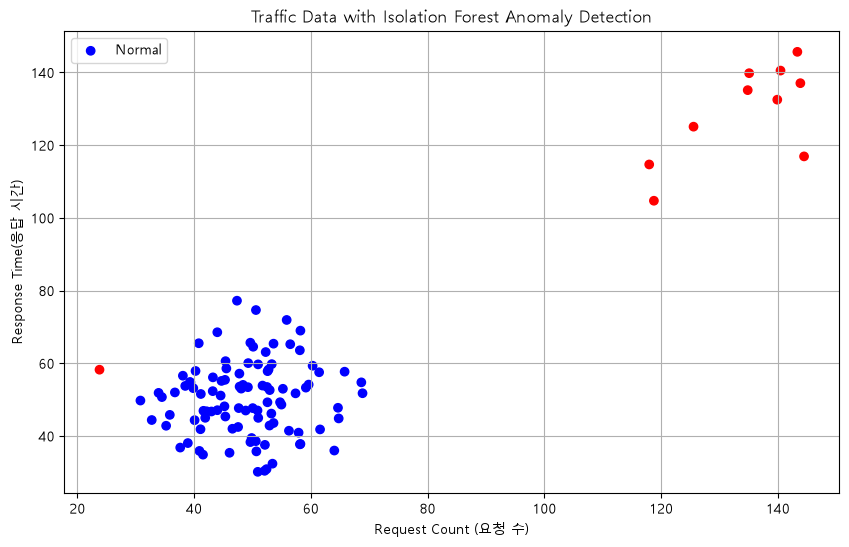

##### 응용 분야 (금융 사기 탐지, 장비 이상 감지 등)

- 금융 사기 탐지(예: 신용카드 이상 거래)
- 네트워크 보안(예: 비정상 트래픽 탐지)

##### DBSCAN (Density-Based Spatial Clustering of Applications with Noise)

- DBSCAN
    - **밀도 기반** 클러스터링 알고리즘
    - 데이터를 밀도가 높은 영역(군집)과 밀도가 낮은 영역(이상치)으로 나눈다.
    - 대부분의 군집 분석은 원형의 모양을 띠고 있지만, DBSCAN은 모양에 제약이 없다.
- 기본 아이디어
    - 데이터의 밀도가 충분히 높은 영역을 클러스터로 간주한다.
    - 밀도가 낮은 데이터 포인트는 이상치로 분류한다.
- 주요 개념
    - Epsilon(ε) : 두 데이터 포인트가 같은 클러스터에 속하기 위해 허용되는 최대 거리이다.
    - MinPts : 클러스터가 형성 되기 위해 필요한 최소 데이터 포인트 수
    - Core Points : ε 반경 안에 MinPts 이상의 데이터가 포함된 포인트
    - Border Points : ε 반경 내에 Core Point에 포함되지만 MinPts 조건을 만족하지 않는 포인트
    - Noise(이상치) : Core Point나 Border Point에 속하지 않는 포인트
- 작동 원리
    - 각 데이터 포인트에서 ε 반경 내 데이터 밀도를 계산한다.
    - 밀도가 높은 데이터 포인트(Core Point)를 중심으로 클러스터를 형성한다.
    - 밀도가 낮은 포인트는 Noise(이상치)로 간주한다.
- 장점
    - 클러스터의 모양에 제약이 없다(비구조적 데이터에서도 사용할 수 있다).
    - 사전 클러스터 개수 지정이 불필요하다.
    - 이상치 탐지와 클러스터링을 동시에 수행한다.
- 단점
    - ε와 MinPts 파라미터의 선택이 성능에 크게 영향을 미친다.
    - 고차원 데이터에 적용할 경우 효율성이 저하된다.

##### DBSCAN 예제

```python
import numpy as np
import pandas as pd
from sklearn.cluster import DBSCAN
import matplotlib.pyplot as plt

# 1. 데이터 생성
# 시드 고정: 재현성을 위해 난수 시드를 고정
np.random.seed(42)

# 정상 트래픽 데이터 생성
# 평균(loc=50), 표준편차(scale=10)를 따르는 정규분포에서 데이터 생성(100개의 샘플, 2차원)
normal_traffic = np.random.normal(loc=50, scale=10, size=(100, 2))

# 비정상 트래픽 데이터 생성
# 일정 범위(low=100, high=150)에서 균등분포로 비정상적으로 높은 값 생성(10개의 샘플, 2차원)
anomalous_traffic = np.random.uniform(low=100, high=150, size=(10, 2))

# 정상 데이터와 비정상 데이터를 결합
traffic_data = np.vstack((normal_traffic, anomalous_traffic))

# 데이터를 pandas DataFrame으로 변환
traffic_df = pd.DataFrame(traffic_data, columns=["Request Count", "Response Time"])

# 2. DBSCAN 모델 생성
# eps: 클러스터의 반경(밀도를 정의)
# min_samples: 한 클러스터를 구성하기 위한 최소 샘플 수
dbscan = DBSCAN(eps=15, min_samples=5)

# DBSCAN 모델 적용
# fit_predict: 클러스터링 수행(-1은 이상치, 나머지는 클러스터 ID)
traffic_df["Cluster"] = dbscan.fit_predict(traffic_data)

# 3. 이상치 탐지
# 이상치는 Cluster 값이 01인 데이터
traffic_df['Anomaly'] = traffic_df['Cluster'].apply(lambda x: 'Anomaly' if x == -1 else 'Normal')

# 이상치 범위 확인
anomalous_data = traffic_df[traffic_df['Anomaly'] == 'Anomaly']
min_request_count = anomalous_data['Request Count'].min()
max_request_count = anomalous_data['Request Count'].max()
min_request_time = anomalous_data['Response Time'].min()
max_request_time = anomalous_data['Response Time'].max()

print(f"비정상 데이터 범위:")
print(f"- 요청 수(Request Count): {min_request_count:.2f} ~ {max_request_count:.2f}")
print(f"- 응답 시간(Response Time): {min_response_time:.2f} ~ {max_response_time:.2f}")

# 비정상 데이터 범위:
# - 요청 수(Request Count): 117.97 ~ 144.50
# - 응답 시간(Response Time): 58.22 ~ 145.66

# 4. 시각화
plt.rcParams['font.family'] = 'Malgun Gothic'
plt.figure(figsize=(10,6))
plt.scatter(
    traffic_df['Request Count'], traffic_df['Response Time'],
    c=traffic_df['Anomaly'].map({'Normal': 'blue', 'Anomaly':'red'}),
    label='Traffic'
)
plt.title('Traffic Data with DBSCAN Anomaly Detection')
plt.xlabel('Request Count(요청 수)')
plt.ylabel("Response Time(응답 시간)")
plt.legend(["Normal", "Anomaly"])
plt.grid()
plt.show()

# 5. 결과 출력
# 전체 데이터프레임 출력
print("전체 데이터와 DBSCAN 이상 탐지 결과:")
print(traffic_df)

# 전체 데이터와 DBSCAN 이상 탐지 결과:
#      Request Count  Response Time  Cluster  Anomaly
# 0        54.967142      48.617357        0   Normal
# 1        56.476885      65.230299        0   Normal
# 2        47.658466      47.658630        0   Normal
# 3        65.792128      57.674347        0   Normal
# 4        45.305256      55.425600        0   Normal
# ..             ...            ...      ...      ...
# 105     125.567120     125.075815        1   Normal
# 106     139.914759     132.498197        1   Normal
# 107     135.098344     139.789633        1   Normal
# 108     144.500267     116.899758       -1  Anomaly
# 109     118.779148     104.699097       -1  Anomaly

# [110 rows x 4 columns]
```

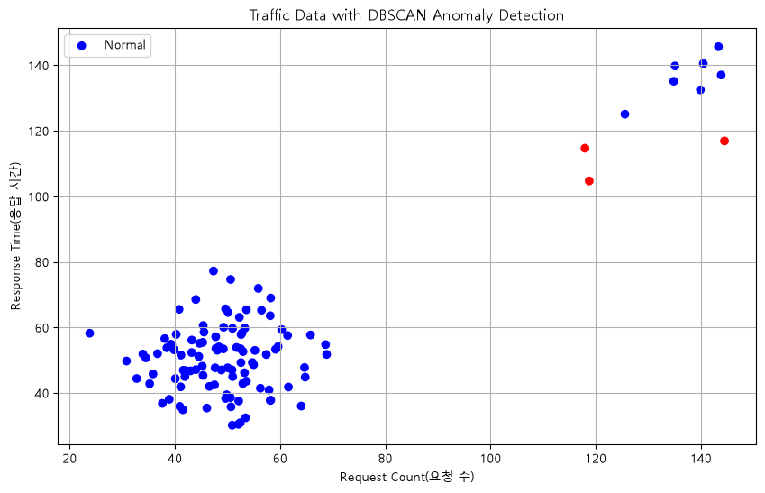

##### Isolation Forest와 DBSCAN 비교

| 특징 | Isolation Forest | DBSCAN |
| :---: | :--- | :--- |
| **기본 접근 방식** | (트리 형식) 데이터 분리를 통해 이상치 탐지 | 밀도 차이를 기반으로 클러스터와 이상치 탐지 |
| **적용 데이터** | 대규모 데이터, 일반적인 분포 | 밀도 기반의 분포 데이터 |
| **확장성** | 매우 높은 확장성 | 고차원 데이터에서 성능 저하 |
| **설정 파라미터** | 최소 설정 필요 | ε와 MinPts 설정 필요 |
| **응용 분야** | 금융, 보안, 장비 감지 | 지리 데이터, 이상 행동 탐지 |

## <a id="deep-learning-basic"></a>6. 딥러닝 기초

### 딥러닝 개요

#### 딥러닝의 정의와 활용 분야

- 비정형 데이터에서 패턴 찾기 어려웠다. → 딥러닝으로 여러 층을 만들어 해결했다.
- 인공신경망 이론에 기반하여 딥러닝을 만들었다.
- 구글에서 제공하는 프레임워크인 tensorflow를 사용한다.
- 딥러닝 특징
    1. 주요 특성을 학습 과정에서 찾는다. 그래도 결측치, 이상치 처리는 해줘야 한다.
    2. 이를 위해 데이터가 많이 필요하다.
    3. GPU(벡터 연산을 할 때 CPU보다 GPU가 더 필요하다), CPU, RAM(최소 32GB), 저장소(HDD, SSD)의 영향을 받는다.

##### 딥러닝

- "사람의 뇌가 정보를 처리하고 학습하는 방식을 모방한 **인공신경망(Artificial Neural Network)을 기반으로 한 머신러닝의 하위 분야**"<br>
    딥러닝의 핵심은 데이터를 바탕으로 복잡한 패턴을 학습하고 문제를 해결하는 것이다.
    - 컴퓨터가 인간의 뇌를 흉내낸다.
- 사람의 뇌 구조를 본 뜬 **인공신경망(Artificial Neural Network)을 기반으로** 컴퓨터가 데이터를 스스로 학습하고 이해하도록 만드는 기술이다.
    - 알고리즘 → tensorflow, PyTorch
- 계층적인 데이터 학습
    - 딥러닝은 여러 층(레이어)으로 구성된 신경망을 사용한다.
    - 각 신경망 층은 데이터에서 점점 더 높은 수준의 추상적인 특징을 학습할 수 있다.<br>
    예: 이미지 데이터 → 첫 번째 층: 엣지(선) → 두 번째 층: 간단한 패턴(모양) → 마지막 층: 복잡한 패턴(얼굴, 사물 등).
-  딥러닝의 핵심 원리
    - 딥러닝은 데이터를 여러 층(Layer)을 통과시키면서 점점 더 높은 수준의 정보를 학습한다.
        - 첫 번째 층에서는 데이터에서 간단한 패턴을 찾는다.
        - 두 번째 층에서는 더 복잡한 모양이나 패턴을 인식한다.
        - 마지막 층에서는 복잡한 형태(예: 얼굴, 물체 등)를 정확히 구별한다.
    - 층(레이어)이 아주 많은 인공신경망이다.
    - 여러 겹으로 쌓아서, **단순한 특징→ 복잡한 특징**을 단계적으로 뽑아내는 구조이다.
- 딥러닝의 주요 특징
    - **비정형 데이터 처리에 강함**
        - 딥러닝은 텍스트, 이미지, 음성 같은 구조화 되지 않은 데이터를 처리하는 데 매우 강력하다.
        - 이러한 데이터를 처리할 때 사람이 별도로 **특징을 추출할 필요없이**(피처 엔지니어링을 할 필요가 없다) 모델이 데이터를 통해 직접 학습한다.
    - **대규모 데이터와 연산 요구**
        - 딥러닝은 대량의 데이터와 강력한 계산 **자원(GPU/TPU)**(→ 필수)이 필요하다.
        - 데이터를 많이 사용할수록 더 정교한 모델을 학습할 수 있다.
    - **자동화된 학습**
        - **딥러닝은 데이터를 기반으로 스스로 학습 규칙을 생성**한다.
        - 이 규칙을 통해 새로운 데이터에 대해 예측이나 분류를 수행한다.

##### 딥러닝의 활용 분야

- 컴퓨터 비전: 이미지 인식, 객체 탐지, 자율 주행.
- **자연어 처리 (NLP) : 번역, 텍스트 요약, 챗봇**.
- 음성 처리: 음성 인식, 음성 합성.
- 의료: 질병 진단, 의료 영상 분석.
- 추천 시스템: 사용자 맞춤 추천(예: 넷플릭스, 유튜브).
- 금융: 사기 탐지, 금융 시장 예측.

#### 머신러닝과 딥러닝의 차이

##### 머신러닝과 딥러닝

- 머신러닝
    - 컴퓨터가 명시적인 프로그래밍 없이 데이터를 학습하여 예측이나 분류를 수행할 수 있게 하는 기술이다.
    - 데이터에서 특징(feature)을 추출하고, 이 특징을 바탕으로 패턴을 학습하여 결과를 예측한다.
    - 머신러닝 알고리즘은 종종 사람이 수작업으로 데이터를 전처리하고 중요한 특징을 선정해야 한다.
- 딥러닝
    - 머신러닝의 하위분야로, 인공신경망(Artificial Neural Network)을 기반으로 한 기술이다.
    - 데이터를 학습하는 과정에서 특징을 자동으로 추출한다.
    - 계층적인 학습(여러 레이어)을 통해 복잡한 패턴을 이해하고 학습한다.

##### 특징 엔지니어링

- 머신러닝
    - 데이터를 학습하기 전에 사람이 주요 특징(feature)을 선정하고, 이를 모델에 제공해야 한다.<br>
        예: 이미지에서 색상, 모서리, 텍스처 같은 특징을 사람이 추출한다.
    - 알고리즘은 제공된 특징을 기반으로 학습한다.
- 딥러닝
    - 자동 특징 학습(Auto Feature Learning)이 가능하다.
    - 모델이 원시 데이터(raw data)를 입력받아, 데이터에서 특징을 자동으로 추출하고 학습한다.<br>
        예: 이미지 데이터를 입력하면 모델이 자동으로 엣지, 패턴, 사물을 학습한다.

##### 데이터 요구량

- 머신러닝
    - 상대적으로 적은 양의 데이터로도 학습이 가능하다.
    - 작은 데이터셋에서도 좋은 성능을 낼 수 있도록 설계된 알고리즘이 많다.
- 딥러닝
    - 매우 큰 데이터셋이 필요하다.
    - 딥러닝 모델은 계층이 깊고 복잡하기 때문에, 충분히 많은 데이터를 사용해야 높은 성능을 보장한다.<br>
        예: 자율주행 차량의 딥러닝 모델은 수백만 개의 이미지와 동영상을 학습한다.

##### 연산 자원

- 머신러닝
    - 일반적인 CPU에서도 작동 가능 하며, 연산 자원 요구가 상대적으로 적다.
    - 모델이 단순하고 학습 과정이 비교적 빠르다.
- 딥러닝
    - GPU(Graphics Processing Unit)나 TPU(Tensor Processing Unit) 같은 강력한 연산 자원이 필요하다.
    - 모델의 계층이 많아 학습 과정이 시간이 많이 걸리고, 계산 복잡도가 높다.

### 인공 신경망(Artificial Neural Network, ANN)

#### 강인공지능과 약인공지능

#####  인공지능의 분류

- 약인공지능
    - 한 분야를 집중해 인공지능을 실현한다.
    - 음성 인식, 얼굴 인식 등(음악 추천, 챗봇, 스마트폰의 생체 인식)
- 강인공지능
    - 인간이 하는 행동 수준 또는 그 이상의 행동
    - 터미네이터 스카이넷, 프로메테우스 데이빗 등

#### 인공신경망

- 컴퓨터가 사람의 뇌를 본 떠서 만든 알고리즘이다.
- 뇌에는 뉴런(Neuron)이라는 작은 세포들이 서로 연결되어 정보를 주고 받으며 생각하고 결정한다.
- 인공신경망도 이와 비슷하게 여러 노드(Node, 가상의 뉴런)가 연결되어 정보를 처리한다.
- **인공신경망(Artificial Neural Network, ANN): 사람 뇌의 "뉴런 연결 방식"을 흉내 낸 계산 모델**이다.

##### 뉴런의 구조

- 신경세포체(Cell Body 또는 Soma)
    - 뉴런의 중심 부분으로, 핵과 다양한 세포소 기관이 포함된다.
    - 세포의 생명 유지와 대사 활동을 담당하며, 단백질 합성 등 중요한 기능을 수행한다.
- 가지돌기(Dendrite)
    - 신경세포체에서 나뭇가지처럼 뻗어 나온 짧은 돌기들로, 다른 뉴런으로부터 신호를 받아들이는 역할이다.
    - 여러 개의 가지돌기를 통해 동시에 다양한 신호를 수신한다.
- 축삭돌기(Axon)
    - 신경세포체에서 길게 뻗어 나온 하나의 돌기로, 전기 신호를 먼 거리까지 전달한다.
    - 축삭돌기의 끝 부분은 여러 갈래로 나뉘어 신경 말단(Axon Terminal)을 형성한다.
    - 여기서 신경 전달 물질을 분비하여 다른 뉴런이나 근육 세포와 정보를 주고 받는다.

##### 퍼셉트론(Perceptron)

- 인공신경망의 가장 기본적인 구성 요소이다.
- **여러 입력을 받아 하나의 출력을 생성하는 단순한 모델**이다.
- 1957년 프랭크 로젠블랫(Frank Rosenblatt)에 의해 개발되었다.

##### 퍼셉트론의구조

- 입력(Input)
    - 퍼셉트론은 여러 개의 입력값을 받아들인다(예를 들어, $x1$, $x2$, $x3$ 같은 데이터가 들어온다).
    - 입력은 우리가 처리하고 싶은 정보(예: 이미지의 픽셀 값, 숫자 데이터 등)를 의미한다.
- 가중치(Weights)
    - 각 입력에는 가중치라는 숫자가 곱해진다(예를 들어, $w1$, $w2$, $w3$는 입력 $x1$, $x2$, $x3$에 곱해지는 값).
    - 가중치는 입력값이 얼마나 중요한지를 나타내는 역할을 한다.
- 편향(Bias)
    - 편향은 계산에 더해지는 추가값 → 퍼셉트론이 더 유연하게 작동하도록 한다.<br>
        예를 들어, 출력값이 항상 0이 되는 것을 막아주는 역할을 한다.
- 합산기(Sum)
    - 각 입력에 가중치를 곱한 후 모두 더하고, 편향값을 추가한다.
        $$S=(x1 × w1) + (x2 × w2) + (x3 × w3) + b$$
        $S$ 값은 퍼셉트론이 다음 단계로 넘어가도록 만드는 기준이다.
- 활성화 함수(Activation Function)
    - 합산된 값 $S$가 특정 임계값을 넘는지 확인한다.<br>
        $S$ > 임계값: 출력은 1 <br>
        $S$ ≤ 임계값: 출력은 0
    - 이 과정은 스위치를 켜고 끄는 것처럼 동작한다.
- 출력(Output) : 최종적으로 0 또는 1의 값을 출력한다.
    - 퍼셉트론이 "이 데이터는 어떤 분류에 속한다"라고 판단한 결과이다.

##### 퍼셉트론의 동작 원리

- 입력 신호 수집
    - 입력층에서 여러 개의 입력 신호를 받는다.
- 가중합 계산
    - 각 입력 신호에 해당 가중치를 곱한 후, 모든 값을 합산하고 편향을 더하여 총합 $S$를 계산한다.
        $$S=(x1 × w1) + (x2 × w2) + ⋯ + (xd × wd) + b$$
- 활성화 함수 적용
    - 계산된 총합 $S$를 활성화 함수에 입력하여 출력 값을 결정한다.
- 퍼셉트론에서는 총합이 임계값을 넘으면 1, 그렇지 않으면 0을 출력한다.
    ```math
    y = \begin{cases}
    1 & \text{if } S > \text{임계값} \\
    0 & \text{if } S \le \text{임계값}
    \end{cases}
    ```

##### 퍼셉트론의 학습

- 퍼셉트론은 주어진 데이터에 대해 가중치와 편향을 조정하여 원하는 출력이 나오도록 학습한다.
- 학습 과정
    1. 초기화<br>
    가중치와 편향을 임의의 값으로 설정한다.
    2. 예측 및 오차 계산<br>
    입력 데이터를 통해 예측값을 계산하고, 실제 값과의 차이(오차)를 구한다.
    3. 가중치 및 편향 업데이트<br>
    오차를 기반으로 가중치와 편향을 조정하여 모델이 점차 정확한 예측을 할 수 있도록 한다.
    4. 반복<br>
    오차가 최소화될 때까지 또는 정해진 횟수만큼 위 과정을 반복한다.
- 주어진 조건(입력값)을 기반으로 특정 사람이 커피를 좋아하는지(결과값)를 판단한다.
    - 입력값(Input): $x1, x2, x3$ : 각각 쓴 맛, 카페인, 향에 대한 선호도
    - 가중치(Weights): 각각의 입력 값이 얼마나 중요한지 결정하는 값
        - $w1$=0.5 : 쓴 맛의 중요도
        - $w2$=0.7 : 카페인의 중요도
        - $w3$=0.6 : 향의 중요도
    - 편향(Bias): 기본값으로 $b=2$를 설정한다.
    - 활성화 함수(Activation Function):<br>
        입력값의 가중합이 임계값(Threshold) 6.0을 넘으면 커피를 좋아한다고 판단한다.
        - 합산값 𝑆 > 6.0 : 커피를 좋아한다 → 출력1
        - 합산값 𝑆 ≤ 6.0 : 커피를 좋아하지 않는다 → 출력0        
    - 입력값
        - $x1=2$ (쓴 맛을 별로 안 좋아함) ,(8)
        - $x2=3$ (카페인을 별로 안 좋아함) ,(7)
        - $x3=1$ (향을 별로 안 좋아함) ,(6)
    - 계산 과정
        - 가중합 계산 <br>
        $S = (x1 × w1) + (x2 × w2) + (x3 × w3) + b$<br>
        $S = (2 × 0.5) + (3 × 0.7) + (1 × 0.6) + 2.0$<br>
        $S = 1.0 + 2.1 + 0.6 + 2.0 = 5.7$
        - 활성화 함수 판단<br>
            **𝑆=5.7 ≤ 6.0, 따라서 출력은 1 → "커피를 좋아하지 않는다."**

##### 퍼셉트론의 한계

- 퍼셉트론은 간단한 "선형 분리" 문제(데이터를 직선으로 나눌 수 있는 문제)는 잘 해결한다.
- "XOR 문제"처럼 복잡한 문제를 해결하지 못 함
- 이를 극복하기 위해 다층 퍼셉트론(MLP)과 같은 더 복잡한 구조가 개발되었다.<br>
    → 여러 개의 은닉층을 통해 복잡한 패턴을 학습한다.

##### 퍼셉트론의 구조

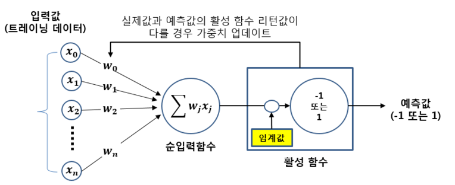
- 입력(특징): 예) 키, 몸무게, 나이 같은 정보
- 뉴런(작은 계산기): 입력을 조금씩 계산해서 다음으로 전달한다.
- 가중치(중요도): 어떤 입력을 더 중요하게 볼지 정하는 숫자이다.
- 층(레이어): 이런 계산기를 여러 층으로 쌓아 복잡한 패턴도 학습한다.
- 출력(결과): 예) "비만일 확률 0.72", "고양이 / 강아지", "가격 예측값"

##### 학습

정답이있는데이터(예: 사진과라벨)를주면,
- 처음엔가중치가엉망이라결과가틀림
- 틀린만큼가중치를조금씩수정
- 이작업을반복해서정답에가까워지게만드는과정

**여러 겹의 필터를 통과시키며 중요한 힌트를 점점 더 잘 뽑아내는 시스템**

##### 인공 신경망(Artificial Neural Network, ANN)의 구성 요소

1. 뉴런(Neuron)
    - 인공신경망의 기본 단위로, 생물학적 뉴런을 모방한 구조이다.
    - 각 뉴런은 입력 신호를 받아 계산을 수행하고, 결과를 다음 층으로 전달한다.
    - 뉴런의 동작
        - 입력 신호와 가중치를 곱한 값을 합산하고, 편향(bias)을 더한다.
        - 결과를 활성화 함수(Activation Function)에 통과시켜 최종 출력값을 생성한다.
2. 가중치(Weight)
- 뉴런 간 연결의 강도를 나타내는 값이다.
- 각 입력 데이터(feature)는 고유한 가중치를 가지며, 학습 과정에서 이 값이 조정된다.
- 가중치는 신경망이 학습하여 패턴을 인식하는 데 중요한 역할을 한다.
3. 편향(Bias)
- 가중치와 입력 값의 합에 더해지는 상수 값으로, 뉴런의 출력 값을 조정하는 역할
- 모델이 특정한 방향으로 데이터를 더 잘 학습하도록 지원한다.
4. 층(Layer)
- 신경망은 여러 층으로 구성되며, 각각의 층은 뉴런의 집합
    - **입력층(Input Layer)**: 데이터를 입력받는 층
    - **은닉층(Hidden Layer)**: 입력 데이터를 처리하고 학습하는 층, 실제로 데이터를 출력하는 층
    - **출력층(Output Layer)**: 최종 결과를 출력하는 층.
5. 활성화 함수(Activation Function)
- 뉴런이 계산한 값이 "그대로 다음으로 갈지, 얼마나 강하게 반응할지"를 결정하는 규칙
- 뉴런의 출력을 비선형(non-linear)으로 변환하여 복잡한 패턴을 학습할 수 있게 한다.
- 대표적인 활성화 함수
    - ReLU★: $max(1, max)$<br> 
                0 이하(음수)는0으로꺼버리고, 양수는그대로통과
    - Sigmoid: $\frac{1}{1 + e^{-x}}$<br>                       
                결과를0~1 사이로눌러서“확률처럼”만들때사용
    - Tans: $\frac{e^x - e^{-x}}{e^x + e^{-x}}$
    - Softmax: 여러클래스중각클래스확률을만들때사용

##### 인공 신경망(Artificial Neural Network, ANN) 의 구조

- 신경망은 입력층, 은닉층, 출력층의 계층적 구조
    1. 입력층(Input Layer)
        - 데이터를 입력받는 층으로, 입력 데이터의 각 특징(feature)은 하나의 뉴런에 대응된다.
        예: 이미지 데이터(28x28 픽셀) → 입력층 뉴런 수: 784
    2. 은닉층(Hidden Layer)
        - 신경망의 핵심 부분으로, 데이터의 패턴을 학습한다.
        - 각 은닉층의 뉴런은 이전 층의 모든 뉴런과 연결되며, 이를 완전 연결(Fully Connected)이라고 한다.
        - **은닉층의 개수와 뉴런 수는 문제의 복잡도에 따라 결정**된다.
        - 다층 구조의 은닉층을 가진 신경망을 심층 신경망(Deep Neural Network, DNN)이라고 한다.
    3. 출력층(Output Layer)
        - 최종 결과를 제공하는 층으로, 문제 유형에 따라 뉴런 수와 활성화 함수가 달라진다.
            - 회귀 문제 : 출력 뉴런 1개 (선형 활성화 함수).
            - 이진 분류 문제 : 출 력 뉴런 1개 (Sigmoid 활성화 함수).
            - 다중 분류 문제 : 출력 뉴런 = 클래스 수 (Softmax 활성화 함수).

##### 신경망의 동작 원리

- 신경망은 입력 데이터를 받아 **순전파(Forward Propagation)** 와 **역전파(Backpropagation)** 과정을 통해 학습한다.
1. 순전파(Forward Propagation)
    - 데이터를 입력층에서 시작해 은닉층을 거쳐 출력층까지 전달하며 계산을 수행하는 과정이다.
    - 각 뉴런은 다음 과정을 거치며 작업한다.
        1.  입력값과 가중치를 곱하고 합산한다.
        2.  편향값을 더한다.
        3.  활성화 함수로 변환한다.
        4. 결과를 다음 층으로 전달한다..
2. 손실 함수(Loss Function)
    - 출력층에서 예측 값과 실제 값의 차이를 계산하는 함수이다.
    - 대표적인 손실 함수
        - MSE (Mean Squared Error): 회귀 문제
        - Cross-Entropy Loss: 분류 문제
3. 역전파(Backpropagation)
    - 학습 과정에서 **손실을 최소화하기 위해 가중치와 편향값을 조정하는 과정**이다.
    - 경사하강법(Gradient Descent) 알고리즘을 사용하여 가중치를 업데이트한다.

#### 딥러닝 모델의 기본 구성 요소 (입력층, 은닉층, 출력층)

- 레이어 층 구성
    - 입력층 → 데이터 입력
    - 은닉층 → 가중치 연산
    - 출력층(loss function) → 숫자, 이진 분류, 다중 분류(→ 결과 출력)

##### 딥러닝 모델의 기본 구성

- 기본적으로 입력층(Input Layer), 은닉층(Hidden Layer), 출력층(Output Layer)으로 구성된다.
    - 이 구성 요소들은 인공신경망(Artificial Neural Network)의 구조를 이루는 핵심이다.
    - 각각의 층은 데이터를 처리하고 학습을 진행하는 역할을 한다.
- 딥러닝 모델은 **층**을 통해 **예측을 만들고**, **손실**로 **틀린 정도를 계산**하고, **옵티마이저**로 가중치를 고쳐서 점차 잘 맞추게 만드는 구조이다.

1. 레이어(층)
    - 입력층: 데이터가 들어온다.
    - 은닉층: 특징을 뽑아낸다(여러 겹이면 딥러닝).
    - 출력층: 결과를 내보낸다(분류 / 예측).
2. 가중치(Weight)와 편향(Bias)
    - 모델이 가진 **조절 다이얼(숫자)**
    - 어떤 입력을 **더 중요하게 볼지(가중치)**, 전체 기준을 **얼마나 이동할지(편향)** 를 정한다.
    - 학습이란 결국 이 숫자들을 계속 맞추는 과정이다.
3. 활성화 함수(Activation)
    - **그냥 전달할지, 강하게 반응할지**를 정하는 스위치 규칙이다.
    - **할성화 함수**가 있어야 복잡한(비선형) 문제를 해결할 수 있다.
4. 손실 함수(Loss)
    - 정답과 예측이 얼마나 다른지 계산하는 틀린 정도 점수이다.
    - 점수가 낮을수록 잘 맞춘 것이다.
5. 옵티마이저(Optimizer)
    - 손실을 줄이기 위해 가중치를 어떻게 고칠지 정하는 **수정 방법**이다.
    - SGD, Adam
6. 데이터 흐름: 학습의 2단계
    - **순전파(Forward)**: 입력 → 예측을 만든다.
    - **역전파(Backward)**: 틀린 만큼(손실) → 가중치를 수정한다.

- 입력층(Input Layer)
    - 역할
        - 입력층은 데이터가 모델로 들어가는 첫 번째 단계이다.
        - 모델이 학습해야 할 데이터를 받아들이는 역할을 한다.
        - 입력 데이터의 각 특징(feature)이 입력층의 뉴런(Neuron) 하나에 연결한다.
    - 특징
        - 입력층의 뉴런 수는 데이터의 특징(feature) 개수와 동일하다.<br>
        » 예: 이미지 데이터(28x28 픽셀의 흑백 이미지)<br>
        입력 데이터는 총 784개의 픽셀 값(특징) → 입력층의 뉴런 수는 784개이다.<br>
        » 예: CSV 데이터(5개의 열) → 입력층의 뉴런 수는 5개이다.
        - 입력층은 계산하지 않고 데이터를 단순히 전달한다.
- 은닉층(Hidden Layer)
    - 역할
        - 은닉층은 데이터의 패턴을 학습하는 역할을 한다. 신경망의 연산과 학습은 대부분 은닉층에서 이루어 진다.
        - 입력 데이터를 처리하여 더 높은 수준의 추상적 정보를 추출한다.
    - 특징
        - 은닉층의 각 뉴런은 입력 뉴런(또는 이전 층의 뉴런)과 연결되어 있으며,
        가중치(Weight)와 편향(Bias) 값을 사용하여 데이터를 변환한다.
        - 각 연결에는 가중치가 부여되고, 뉴런은 가중치와 입력값을 곱한 후 이를 더한 결과를 활성화 함수
        (Activation Function)에 전달한다.
        ```math
        \begin{gathered}
        z = \displaystyle\sum(\text{입력값} \times \text{가중치}) + \text{편향} \\
        \text{출력} = \text{활성화함수}(z)
        \end{gathered}
        ```
    - 활성화 함수(Activation Function)
        - 활성화 함수는 은닉층의 출력을 비선형(non-linear)으로 변환하여 복잡한 패턴을 학습할 수 있게 한다.
        - 대표적인 활성화 함수
            - ReLU: $max(0, x)$
            - Sigmoid: $\frac{1}{1 + e^{-x}}$
            - Tanh: $\frac{e^x - e^{-x}}{e^x + e^{-x}}$
            - Softmax: 출력값을 확률로 변환(다중 클래스 분류에 사용)한다.
    - 은닉층의 개수와 뉴런 수
        - 층 수와 뉴런 수는 모델의 복잡도에 영향을 미친다.<br>
            » 많은 층 → 더 복잡한 패턴을 학습할 수 있다(하지만 과적합 위험).<br>
            » 뉴런 수가 적으면 학습이 불충분할 수 있다.
        - 일반적으로 하이퍼파라미터 튜닝을 통해 최적의 층수와 뉴런 수를 결정한다.
- 출력층(Output Layer)
    - 출력층은 최종 결과를 제공하는 역할을 하고 은닉층에서 학습된 정보를 바탕으로 예측 값을 출력한다.
    - 출력층의 뉴런 수는 모델이 해결하려는 문제의 종류에 따라 다르다.
- 회귀 문제(Regression)<br>
    » 출력 값은 연속적인 숫자(예: 집 값 예측). → 출력층 뉴런 수: 1개.
- 이진 분류 문제 (Binary Classification)<br>
    » 출력값은 0 또는 1 (예: 이메일 스팸 여부). → 출력층 뉴런 수: 1개(Sigmoid 함수 사용).
- 다중 분류 문제 (Multiclass Classification)<br>
    » 출력값은 여러 클래스 중 하나(예: 고양이 / 개 / 새 분류).<br>
    → 출력층 뉴런 수: 클래스 개수(Softmax 함수 사용).

##### 딥러닝 모델의 기본 동작 과정

1. 데이터 입력<br>
입력층에서 데이터가 전달된다.
2. 패턴 학습<br>
은닉층에서 활성화 함수를 사용해 입력 데이터의 패턴을 학습한다.
3. 결과 출력(순전파)<br>
출력층에서 학습된 정보를 바탕으로 예측값을 계산한다.
4. 손실 계산(손실)<br>
예측값과 실제값간의 차이를 손실 함수(Loss Function)를 사용해 계산한다.
5. 가중치 업데이트(역전파 + 옵티마이저)<br>
역전파(Backpropagation)와 경사하강법(Gradient Descent)을 사용하여 가중치와 편향을 조정한다.

시험 보고(예측) → 채점하고(손실) → 오답 노트로 고치기(가중치 수정) → 다시 시험<br>
**이 과정을 수천~수만 번 반복하면 성능이 좋아진다.**

##### 딥러닝 모델의 기본 구성

| 구성 요소 | 역할 | 뉴런 수 결정 기준 |
| :---: | :--- | :--- |
| **입력층** | 데이터를 받아 모델로 전달 | 입력 데이터의 특징(feature) 개수 |
| **은닉층** | 패턴을 학습하고 데이터를 가공 | 모델의 복잡도 및 학습 목표에 따라 조정 |
| **출력층** | 최종 결과를 예측하여 출력 | 문제의 유형 (회귀, 이진 분류, 다중 분류) |

### 딥러닝 기본 수학

#### 활성화 함수(Activation Functions): ReLU, Sigmoid, Softmax

- 활성화 함수는 인공신경망에서 입력 신호를 처리하고 출력 신호를 결정하는 역할을 한다.<br>
    → 입력값을 기반으로 출력값을 비선형적으로 변환하여 신경망이 복잡한 패턴과 관계를 학습한다.
- 활성화 함수의 역할
    - **비선형성 추가**: 활성화 함수는 신경망에 비선형성을 도입한다.
        - 신경망의 각 층에서 입력과 가중치의 선형 조합만 계산하면 전체 네트워크는 선형 함수가 되어, 복잡한 문제를 해결하지 못 한다.
        - 활성화 함수는 비선형 변환을 통해 신경망이 복잡한 패턴과 관계를 학습할 수 있다.
    - **출력 범위 제한**
        - 활성화 함수는 출력값을 특정 범위로 제한하여 학습 안정성을 높이고, 극단적인 값이 네트워크 전체에 영향을 주는 것을 방지한다.
    - **특정 특징 강조**: 활성화 함수는 특정 입력 신호를 강화하거나 억제하여 중요한 특징을 강조한다.

##### ReLU (Rectified Linear Unit)

- 수식: $f(x) = max(0, x)$
- 특징
    - 입력값이 양수일 때 그대로 출력하고, 음수일 때는 0으로 출력한다.
    - 계산이 간단하고, 큰 네트워크에서도 잘 작동한다.
    - **대부분의 은닉층에서 기본적으로 사용**한다.
- 장점
    - 계산이 빠르고 학습 속도가 빠르다.
    - 기울기 소실(Vanishing Gradient) 문제를 줄여준다.
- 단점
    - 입력값이 항상 0 이하로 유지되면 뉴런이 비활성화되어 학습하지 못하는 문제가 생긴다.

##### Sigmoid

- 수식: $f(x) = \frac{1}{1 + e^{-x}}$
- 특징
    - 입력 값을 0과 1 사이로 변환 → 출력값이 확률처럼 보이기 때문에 **이진 분류 문제**에서 자주 사용된다.
    - 출력층에서 확률 값이 필요한 이진 분류 문제에 사용한다.
- 장점
    - 출력값이 제한되어 있어 안정적이다.
- 단점
    - 기울기 소실 문제가 발생할 수 있다.
    - 입력 값이 너무 크거나 작으면 출력의 변화가 거의 없어 학습이 어려워 진다.
    - 계산이 상대적으로 느리다.

##### Softmax

- 수식: $f(x_i) = \frac{e^{x_i}}{\sum_{j=1}^{n} e^{x_j}}$<br>
        **여기서 𝑥𝑖 는 출력의 각 원소이고, 𝑛은 클래스의 개수**
- 특징
    - 출력값을 확률로 변환하여, 모든 출력값의 합이 1이 되도록 만든다.
    - **다중 클래스 분류 문제**에서 사용한다.
- 장점
    - 출력값이 확률 분포를 가지므로 직관적이다.
- 단점
    - 계산이 비교적 복잡하며, 클래스 수가 많아지면 느려질 수 있다.

#### 손실 함수(Loss Functions): MSE, Cross-Entropy

- 손실함수는 모델이 예측한 값과 실제 값 간의 차이를 측정하는 함수이다.
- 신경망이 학습할 때 손실 값을 최소화하는 방향으로 가중치가 조정된다.<br>
    → 즉, 손실함수는 학습의 방향과 성능을 평가하는 기준이다.
- 손실 함수의 기능
    - **성능 평가**: 모델이 얼마나 잘 작동하고 있는지 알려준다.
    - **학습 방향 제공**: 손실값을 기준으로 경사하강법(Gradient Descent)이 실행되어 모델의 가중치를 조정한다. **Adam (효율적인 경사하강법 알고리즘)**
    - **문제 유형에 따라 손실 함수 선택**: **회귀와 분류 문제에 적합한 손실 함수가 다르다.**

##### MSE (Mean Squared Error)

- MSE는 예측 값과 실제 값의 차이를 제곱하여 평균을 구한 값<br>
    ```math
    MSE = \frac{1}{n} \sum_{i=1}^{n} (y_i - \hat{y}_i)^2
    ```
    - ${y}_i$ : 실제 값
    - $\hat{y}_i$ : 모델의 예측 값
    - $n$ : 데이터의 개수
- 간단하고 계산이 쉽고 예측 오류의 크기에 민감해 큰 오류에 더 큰 패널티를 준다.
- 오류가 큰 데이터에 민감하다(이상치의 영향).

##### Cross-Entropy Loss

- Cross-Entropy는 분류 문제에서 모델이 출력한 확률 분포와 실제 레이블의 차이를 측정한다.
    ```math
    Loss = -\frac{1}{n} \sum_{i=1}^{n} y_i \log(\hat{y}_i)
    ```
    - ${y}_i$ : 실제레이블(0 또는1)
    - $\hat{y}_i$ : 모델이 예측한 확률 값
    - $n$ : 데이터의 개수
- 확률값(0~1)을 기반으로 계산하므로 분류 문제에 적합하다.
- 모델이 잘못된 확률을 출력했을 때 큰 패널티를 준다.
- 예측값이 0에 가까울 때( 예: $\hat{y}$=0.0001 ) 손실 값이 매우 커질 수 있다.

##### MSE 와 Cross-Entropy Loss 비교

| 특성 | MSE | Cross-Entropy |
| :---: | :--- | :--- |
| **사용되는 문제** | 회귀 문제 | 분류 문제 |
| **출력 값** | 실수 값 (예: 100, 0.5 등) | 확률 값 (0~1 사이) |
| **오류 처리 방식** | 큰 오류에 민감 (제곱 계산) | 잘못된 확률에 큰 패널티 |
| **장점** | 단순하고 계산이 빠름 | 분류 문제에서 성능이 뛰어남 |
| **단점** | 이상치에 민감 | 계산이 복잡하고 확률 값에 의존 |

#### 역전파(Backpropagation) 개념

- 역전파는 신경망의 학습 과정에서 오류를 기반으로 가중치를 조정하는 알고리즘이다.
    - 시험을 보고 틀렸을 때, 마지막 답만 고치는 게 아니라 "**어떤 개념을 잘못 이해했는지**"를 거슬러 올라가며 찾아서 고치는 과정<br>
        → 이 알고리즘은 신경망이 입력 데이터를 출력으로 변환하는 과정에서 발생한 오류(Error)를
        각 층으로 역방향으로 전파(Backward Propagation)하여, 각 가중치를 조정하는데 사용한다.

##### 역전파 과정의 세부 단계

1. 순방향 전달 (Forward Propagation)
    - 입력 데이터를 각 층에 전달하여 출력을 계산한다.
    - 각 뉴런에서 활성화 함수를 적용하여 비선형성을 추가한다.
    - 마지막 층에서 출력값을 생성한다.
2. 손실 계산
    - 손실 함수(Loss Function)를 사용하여 예측값과 실제값 간의 손실을 계산한다.<br>
    예를 들어, MSE를 사용하여 계산한다.
3. 오류 역전파 (Backward Propagation)
    - 손실 함수의 출력값을 기준으로, 출력층에서 시작해 입력층으로 이동하며 각 가중치에 대한 기울기를 계산한다.
    - 이 과정은 체인 룰(Chain Rule)을 사용하여 이루어진다.<br>
    » 체인 룰: **복잡한 함수의 미분을 계산할 때, 각 단계별 미분 값을 곱하는 방법**<br>
    예를 들어, 손실 함수 $L$이 활성화 함수 $f$와 가중치 $w$에 의해 결정된다면<br>
    ```math
    \frac{\partial L}{\partial w} = \frac{\partial L}{\partial f} \cdot \frac{\partial f}{\partial w}
    ```
    - 각 뉴런의 출력에 대한 손실의 변화량(기울기)을 계산하고, 이를 다음 층으로 전달한다.
4. 가중치 업데이트
    - 경사 하강법(Gradient Descent)을 사용하여 가중치를 조정한다.
        ```math
        w_{\text{new}} = w_{\text{old}} - \eta \cdot \frac{\partial L}{\partial w}
        ```
        - $w$: 가중치
        - $\eta$: 학습률(Learning Rate)
        - $\frac{\partial L}{\partial w}$: 손실 함수의 가중치에 대한 기울기

### 딥러닝프레임워크

#### 딥러닝 프레임워크(Keras, TensorFlow)의 이해

- 딥러닝 모델을 쉽고 효율적으로 개발할 수 있도록 도와주는 도구
    - 복잡한 수학적 연산이나 하드웨어 자원의 효율적인 사용을 프레임워크가 처리해 주기 때문에, 연구자나 개발자는 모델 설계와 데이터 분석에 집중할 수 있다.
- 가장 널리 사용되는 프레임워크 중 하나가 **TensorFlow**이며, **Keras**는 TensorFlow의 고수준 API로 제공된다.

##### TensorFlow

- 구글에서 개발한 오픈소스 딥러닝 라이브러리로, 다양한 플랫폼에서 실행 가능하다.
- 복잡한 수학적 연산(예: 행렬 연산, 미분 계산 등)을 자동으로 처리한다.
- 딥러닝뿐만 아니라 머신러닝, 강화학습에도 활용될 수 있다.
- **특징**
  - **유연성**: 저수준의 연산도 제어 가능하며, 필요에 따라 매우 복잡한 모델을 설계할 수 있다.
  - **멀티플랫폼 지원**: CPU, GPU, TPU에서 실행 가능하다.
  - **확장성**: 대규모 분산 학습을 지원한다.

##### Keras

- TensorFlow 위에서 작동하는 고수준의 딥러닝 API이다.
- 초보자도 쉽게 사용할 수 있도록 설계되어, 복잡한 코드 없이 직관적으로 모델을 설계하고 학습시킬 수 있다.
- 다양한 딥러닝 구조(CNN, RNN 등)를 지원하며, 필요에 따라 커스터마이징할 수 있다.
- **특징**
  - **간결함**: 코드가 간단하고 직관적이다.
  - **빠른 프로토타이핑**: 모델을 빠르게 설계하고 실험할 수 있다.
  - **유연성**: 다양한 백엔드 엔진(TensorFlow, Theano, CNTK)을 지원한다.

##### TensorFlow와 Keras의 관계

- TensorFlow는 **엔진**, Keras는 **운전대**처럼 생각할 수 있다.
- Keras를 사용하면 TensorFlow의 복잡한 저수준 작업을 몰라도 쉽게 모델을 설계하고 훈련할 수 있다.
- 최신 TensorFlow(2.0 이상)에서는 Keras가 기본 내장되어 있어 설치와 사용이 더 간단하다.

---

#### 간단한 신경망 모델 구성 및 훈련

##### 1. 필요한 라이브러리 로드

```python
# 1. 필요한 라이브러리 임포트
# TensorFlow와 Keras의 기능을 사용하기 위해 필요한 모듈을 불러옵니다.
import numpy as np
from tensorflow.keras.models import Sequential              # 순차적 모델을 생성하기 위한 모듈
from tensorflow.keras.layers import Dense, Input, Dropout   # 밀집층(fully connected layer)을 추가하기 위한 모듈
from tensorflow.keras.callbacks import EarlyStopping
from sklearn.model_selection import train_test_split        # 데이터를 학습/테스트 세트로 나누기 위한 모듈
from sklearn.datasets import make_classification            # 예제 데이터셋 생성 모듈
```

##### 2. 데이터 생성 및 전처리

```python
# 2. 데이터 생성 및 전처리
# 예제용으로 가상 데이터셋을 생성합니다.
X, y = make_classification(
    n_samples=1000,   # 데이터 샘플 수
    n_features=20,    # 특징(특성) 수
    n_classes=2,      # 클래스 수(이진 분류)
    random_state=42   # 랜덤 시드 고정 (결과 재현 가능성 보장)
)

# 데이터를 학습용(train)과 테스트용(test)으로 나눕니다.
X_train, X_test, y_train, y_test = train_test_split(X, y, test_size=0.2, random_state=42)
```

##### 3. 모델 생성

- 리스트로 레이어드를 생성한다.
- 16, 8, 1 → 뉴런의 개수
- tensorflow에서는 이제 Dense보다 Input클래스 입력하라고 수정되었다.

```python
# 3. 모델 생성
# Sequential()은 모델을 레이어 순서대로 구성할 수 있도록 해줍니다.
model = Sequential([
    # Dense(16, activation='relu', input_shape=(X_train.shape[1],)),  # 첫 번째 은닉층 = 입력층
    Input(shape=(X_train.shape[1],)),
    Dense(16, activation='relu'),
    Dense(8, activation='relu'),                                    # 두 번째 은닉층, 핵심 레이어, 복잡도에 따라 레이어를 다양하게 구성할 수 있다.
    Dense(1, activation='sigmoid')                                  # 출력층 (이진 분류에서 사용)
])
# 여기서 `input_shape`는 입력 데이터의 차원을 지정합니다.
# `activation`은 각 층에서 사용할 활성화 함수입니다.
# relu: 0보다 큰 값은 그대로 두고, 작은 값은 0으로 설정 (비선형성 제공)
# sigmoid: 출력값을 0과 1 사이로 제한 (이진 분류에서 확률 계산에 유용)
```

<a id="q-layer-neuron-count"></a>**Q. 은닉층 뉴런 개수는 항상 줄어들어야 하고, 출력층 뉴런 개수는 항상 1인가?**<br>
**A.**
두 가지 모두 **아니다.**

1. **은닉층 뉴런 개수는 항상 줄어들어야 하는가? (X)**
   - 특징을 점차 압축한다는 직관 때문에 `64 → 32 → 16 → 8` 같은 피라미드 형태를 자주 쓸 뿐 필수 규칙은 아니다.
   - **일정 유지**: `64 → 64 → 64` (표현력을 유지하며 깊이만 확장)
   - **확장 후 축소 (다이아몬드형)**: `5 → 32 → 64 → 32 → 1` (입력 특성이 적을 때 고차원으로 확장 후 압축)
   - **축소 후 확장 (모래시계형)**: `784 → 128 → 32 → 128 → 784` (Autoencoder처럼 압축 후 복원)
   - 최적의 층 수와 뉴런 수는 모델 복잡도와 과적합 여부를 보며 하이퍼파라미터 튜닝으로 결정한다.

2. **출력층(마지막 레이어) 뉴런 개수는 항상 1인가? (X)**
   - 풀려는 **문제의 유형**에 따라 달라진다.

   | 문제 유형 | 출력층 뉴런 수 | 주로 쓰는 활성화 함수 | 예시 |
   | :--- | :--- | :--- | :--- |
   | **회귀 (Regression)** | `1` (타깃이 여러 개면 타깃 수) | 없음 (`linear`) | 집값 예측 |
   | **이진 분류 (Binary)** | `1` | `sigmoid` | 스팸 여부, 악성 요청 탐지 |
   | **다중 분류 (Multiclass)** | **클래스 개수** | `softmax` | MNIST 숫자 0~9 분류 (`10`개) |

3. **참고: `Input`과 `Dense`의 차이**
   - `Input`은 계산을 수행하지 않고 입력 데이터의 형태(`shape`)만 지정하는 층이므로 뉴런 수나 `activation`을 넣지 않는다.
   - 실제 가중합 계산과 활성화 함수를 적용하는 은닉층·출력층은 반드시 `Dense`를 사용한다.

   ```python
   from tensorflow.keras.models import Sequential
   from tensorflow.keras.layers import Input, Dense

   model = Sequential([
       Input(shape=(X_train.shape[1],)),  # 입력층 (입력 데이터 특성 수 지정)
       Dense(16, activation='relu'),      # 첫 번째 은닉층
       Dense(8, activation='relu'),       # 두 번째 은닉층
       Dense(1, activation='sigmoid')     # 출력층 (이진 분류)
   ])
   ```

##### 4. 모델 컴파일

```python
# 4. 모델 컴파일
# 모델 학습 전에 학습 방법(optimizer), 손실 함수(loss), 평가 지표(metrics)를 정의합니다.
model.compile(
    optimizer='adam',            # 학습 속도를 조정하며 손실 함수의 최솟값을 찾습니다.
    loss='binary_crossentropy',  # 이진 분류에서 자주 사용되는 손실 함수
    metrics=['accuracy']         # 학습 성과를 평가할 지표
)
```

##### 5. 모델 훈련

```python
# 5. 모델 훈련
# fit() 메서드는 모델을 학습시키는 역할을 합니다.
history = model.fit(
    X_train, y_train,      # 학습용 데이터와 레이블
    validation_split=0.2,  # 검증 데이터 비율 (학습 데이터의 20%)
    epochs=10,             # 학습 반복 횟수
    batch_size=32,         # 한 번의 학습에서 사용하는 데이터 샘플 수
    verbose=1              # 학습 진행 상태를 출력
)
# Epoch 1/10
# 20/20 ━━━━━━━━━━━━━━━━━━━━ 1s 11ms/step - accuracy: 0.5125 - loss: 0.9474 - val_accuracy: 0.5125 - val_loss: 0.8654
# Epoch 2/10
# 20/20 ━━━━━━━━━━━━━━━━━━━━ 0s 5ms/step - accuracy: 0.5156 - loss: 0.8135 - val_accuracy: 0.5125 - val_loss: 0.7518
```

##### 6. 모델 평가 및 예측

```python
# 6. 모델 평가
# 테스트 데이터로 학습된 모델을 평가합니다.
test_loss, test_accuracy = model.evaluate(X_test, y_test)
print(f"테스트 손실: {test_loss:.4f}, 테스트 정확도: {test_accuracy:.4f}")

# 7/7 ━━━━━━━━━━━━━━━━━━━━ 0s 4ms/step - accuracy: 0.7950 - loss: 0.4627  
# 테스트 손실: 0.4627, 테스트 정확도: 0.7950

# 7. 모델 예측
# 학습된 모델을 사용해 새로운 데이터 예측
predictions = model.predict(X_test[:5])  # 테스트 데이터 중 5개의 샘플 예측
print("예측 결과:", predictions)
# 여기서 predictions의 출력은 확률 값입니다.
# 일반적으로 0.5 이상은 클래스 1, 미만은 클래스 0으로 간주합니다.

# 1/1 ━━━━━━━━━━━━━━━━━━━━ 0s 80ms/step
# 예측 결과: [[0.70441794]
#  [0.58809155]
#  [0.35183337]
#  [0.52592534]
#  [0.6778351 ]]
```

##### 요약

1. **모델의 구성**
   - 모델은 `입력층 → 은닉층 → 출력층`으로 구성된다.
   - 활성화 함수는 모델이 데이터를 비선형적으로 표현할 수 있게 한다.
2. **학습 흐름**
   - `데이터 준비 → 모델 설계 → 모델 컴파일 → 훈련 → 평가 → 예측`
3. **Keras의 장점**
   - 코드가 직관적이고 간단하여 초보자도 쉽게 딥러닝 모델을 설계하고 학습시킬 수 있다.

---

### 딥러닝 모델 실습 - 이진 분류

#### 이진 분류 문제 해결

- **이진 분류(Binary Classification)**: 주어진 데이터를 두 개의 클래스로 구분하는 문제를 해결하는 과정
  - 예: 이메일 스팸 필터링(스팸/정상), 의료 진단(양성/음성), 고객 행동 예측(구매/비구매)

##### 1. 문제 정의

- 주어진 입력 데이터(특성, Features)를 기반으로 해당 데이터가 두 개의 클래스 중 어디에 속하는지 예측한다.
- 출력 → 클래스 `0` 또는 클래스 `1`의 확률

##### 2. 데이터 준비

- **데이터 수집**: 문제에 맞는 데이터셋 확보 (예: 의료 데이터, 고객 행동 데이터, 텍스트 데이터 등)
- **데이터 전처리**
  - 특성 선택 및 정규화: 숫자 데이터를 정규화하거나 범주형 데이터를 인코딩(Label Encoding, One-Hot Encoding)
  - 결측값 처리: 결측값을 제거하거나 보완(Imputation)
- **데이터 분할**: 데이터를 훈련(Train), 검증(Validation), 테스트(Test) 데이터셋으로 분리
  - 일반적인 비율: `70% (Train) - 15% (Validation) - 15% (Test)`

##### 3. 모델 설계

- **입력층(Input Layer)**: 데이터의 특성 수에 따라 노드 수 결정 (예: 특성이 10개면 입력층 노드 수 10개)
- **은닉층(Hidden Layers)**
  - Fully Connected Layer 사용
  - 활성화 함수(Activation Function): `ReLU(Rectified Linear Unit)`를 주로 사용
  - 과적합 방지를 위해 `Dropout Layer` 추가 가능
- **출력층(Output Layer)**
  - 노드 수: `1` (이진 분류는 하나의 확률값 출력)
  - 활성화 함수: `Sigmoid` (출력값을 `0~1` 사이의 확률로 변환)

##### 4. 모델 컴파일

- 손실 함수: `Binary Cross-Entropy`
- 최적화 함수: `Adam` (또는 `SGD`)
- 평가 지표: 정확도(Accuracy), F1-Score, Precision, Recall 등

```python
model.compile(
    optimizer='adam',
    loss='binary_crossentropy',
    metrics=['accuracy']
)
```

##### 5. 모델 훈련

- 훈련 데이터를 사용하여 모델을 학습하며, 동시에 검증 데이터를 사용하여 성능을 평가하고 과적합을 방지한다.
- **검증 데이터(Validation Set)**: 훈련 중 모델 성능을 측정하는 데 사용하며, 테스트 데이터와는 반드시 분리되어야 한다.

```python
history = model.fit(
    X_train, y_train,
    validation_data=(X_val, y_val),
    epochs=20,
    batch_size=32
)
```

##### 6. 과적합 방지

- **Early Stopping**
    - 훈련 중 검증 성능이 더 이상 향상되지 않으면 조기에 학습을 멈추어 과적합을 방지한다. 
    - 과적합을 방지하는 데 효과적이다.

```python
from tensorflow.keras.callbacks import EarlyStopping
early_stopping = EarlyStopping(monitor='val_loss', patience=3)
history = model.fit(
    X_train, y_train,
    validation_data=(X_val, y_val),
    epochs=50,
    batch_size=32,
    callbacks=[early_stopping]
)
```

- **Dropout**: 학습 중 일부 노드를 무작위로 제외하여 과적합을 방지한다.

```python
from tensorflow.keras.layers import Dropout
model.add(Dropout(0.5))
```

##### 7. 모델 평가
- 훈련 후 테스트 데이터를 사용해 모델 성능을 평가한다.

```python
test_loss, test_accuracy = model.evaluate(X_test, y_test)
print(f"Test Accuracy: {test_accuracy}")
```

##### 8. 예측
- 새로운 데이터를 입력하여 예측값을 출력한다.

```python
predictions = model.predict(new_data)
predicted_classes = (predictions > 0.5).astype(int)
```

---

#### 데이터셋 준비 및 모델 훈련

훈련(Training), 검증(Validation), 테스트(Test) 데이터셋은 머신러닝과 딥러닝 모델 학습 과정에서 핵심적인 역할을 한다.

##### 1. 훈련 데이터셋 (Training Dataset)

- **정의**: 모델을 학습시키는 데 사용되는 데이터셋 → 입력 데이터(`X`)와 실제 레이블(정답, `y`)을 포함
- **역할**
  - 모델이 데이터의 패턴과 관계를 학습하고 가중치와 편향(바이어스)을 조정하는 데 사용
  - 학습 과정에서 손실(Loss)을 계산하고 최적화 알고리즘으로 모델을 업데이트
  - 전체 데이터의 대부분(약 70~80%)을 차지하며, 모델이 충분히 학습할 수 있도록 많은 데이터를 포함

##### 2. 검증 데이터셋 (Validation Dataset)

- **정의**: 훈련 중 모델의 성능을 평가하기 위해 훈련·테스트 데이터와 별도로 분리된 데이터셋
- **역할**
  - 모델이 훈련 데이터에만 치우치지 않고 새로운 데이터에도 잘 작동하는지 평가 → **과적합(Overfitting) 감지**
  - 하이퍼파라미터(학습률, 은닉층 수, 드롭아웃 비율 등) 튜닝에 활용
- **특징**
  - 훈련 중 모델의 성능 변화를 실시간으로 모니터링
  - Early Stopping에서 검증 데이터의 손실이 일정 수준 이상 줄어들지 않으면 학습 중단
  - 일반적으로 전체 데이터의 약 10~15%를 차지

##### 3. 테스트 데이터셋 (Test Dataset)

- **정의**: 학습 완료 후 모델의 최종 성능을 평가하기 위해 사용하는, 모델이 한 번도 보지 못한 새로운 데이터셋
- **역할**
  - 모델이 실제 환경에서 얼마나 잘 동작할지 예측
  - 훈련·검증 데이터를 사용하지 않았으므로 모델의 일반화 능력 평가에 적합
  - 최종 평가 결과를 통해 모델의 신뢰성과 성능을 판단
- **특징**
  - 학습 과정에서 한 번도 접하지 않은 "새로운 데이터"로 성능을 측정 → 과적합이 심한 모델은 테스트 데이터에서 성능이 낮아짐

##### 4. 데이터 분할 비율 및 분할 이유

- **일반적인 분할 비율**
  - 훈련 데이터: `70~80%`
  - 검증 데이터: `10~15%`
  - 테스트 데이터: `10~15%`
  - 데이터가 적은 경우 교차 검증(Cross-Validation)을 활용해 데이터를 효율적으로 사용할 수 있다.
- **데이터를 나누는 이유**
  1. **과적합(Overfitting) 방지**: 훈련 데이터만 사용하면 해당 데이터에만 최적화되어 새로운 데이터에 대한 예측 성능이 떨어지므로 검증·테스트 데이터로 과적합 여부를 확인한다.
  2. **모델 성능 평가**: 테스트 데이터는 실제 환경에서 모델이 얼마나 잘 작동할지 평가하는 기준이 된다.
  3. **데이터 유출 방지**: 검증 또는 테스트 데이터가 훈련 데이터에 섞이면 일반화가 아니라 데이터를 "암기"하는 문제가 발생한다.

##### 실제로 데이터를 나누는 방법

```python
from sklearn.datasets import make_classification
from sklearn.model_selection import train_test_split

# 1. 데이터 생성 (이진 분류를 위한 가상 데이터셋 생성)
X, y = make_classification(
    n_samples=1000,
    n_features=20,
    n_informative=15,
    n_redundant=5,
    random_state=42
)

# 2. 데이터 분할
# (1) 전체 데이터를 훈련 데이터와 임시 데이터로 나눔 (훈련 70%, 나머지 30%)
X_train, X_temp, y_train, y_temp = train_test_split(X, y, test_size=0.3, random_state=42)

# (2) 나머지 데이터를 검증 데이터와 테스트 데이터로 나눔 (각각 15%씩)
X_val, X_test, y_val, y_test = train_test_split(X_temp, y_temp, test_size=0.5, random_state=42)

# 3. 각 데이터셋 크기 확인
print("훈련 데이터 크기:", X_train.shape, y_train.shape)  # 약 70%의 데이터
print("검증 데이터 크기:", X_val.shape, y_val.shape)      # 약 15%의 데이터
print("테스트 데이터 크기:", X_test.shape, y_test.shape)  # 약 15%의 데이터
```

##### 이진 분류 문제 해결

```python
import numpy as np
import tensorflow as tf
import matplotlib.pyplot as plt
from sklearn.datasets import make_classification
from sklearn.model_selection import train_test_split
from sklearn.preprocessing import StandardScaler
from sklearn.metrics import classification_report

# 1. 데이터 준비
# 예제 데이터 생성 (실제 데이터로 교체 가능)
X, y = make_classification(
    n_samples=1000,
    n_features=20,
    n_informative=15,
    n_redundant=5,
    random_state=42
)

# 데이터 분할: 훈련, 검증, 테스트 데이터셋
X_train, X_temp, y_train, y_temp = train_test_split(X, y, test_size=0.3, random_state=42)
X_val, X_test, y_val, y_test = train_test_split(X_temp, y_temp, test_size=0.5, random_state=42)

# 데이터 정규화 (특성 스케일링)
scaler = StandardScaler()
X_train = scaler.fit_transform(X_train)
X_val = scaler.transform(X_val)
X_test = scaler.transform(X_test)

# 2. 모델 설계 (입력층, 은닉층, 출력층으로 구성된 이진 분류 모델)
model = tf.keras.Sequential([
    tf.keras.layers.Input(shape=(X_train.shape[1],)),  # 입력층
    tf.keras.layers.Dense(64, activation='relu'),      # 첫 번째 은닉층
    tf.keras.layers.Dropout(0.5),                      # 과적합 방지를 위한 Dropout
    tf.keras.layers.Dense(32, activation='relu'),      # 두 번째 은닉층
    tf.keras.layers.Dense(1, activation='sigmoid')     # 출력층 (Sigmoid 활성화 함수)
])

# 3. 모델 컴파일
# 손실 함수: Binary Cross-Entropy / 최적화 알고리즘: Adam / 평가 지표: Accuracy
model.compile(
    optimizer='adam',
    loss='binary_crossentropy',
    metrics=['accuracy']
)

# 4. Early Stopping 설정
# 검증 데이터 손실이 개선되지 않으면 학습을 조기에 종료
early_stopping = tf.keras.callbacks.EarlyStopping(
    monitor='val_loss',
    patience=5,
    restore_best_weights=True
)

# 5. 모델 훈련
history = model.fit(
    X_train, y_train,
    validation_data=(X_val, y_val),
    epochs=50,
    batch_size=32,
    callbacks=[early_stopping]
)

# 6. 모델 평가 (테스트 데이터로 성능 평가)
test_loss, test_accuracy = model.evaluate(X_test, y_test)
print(f"Test Loss: {test_loss:.4f}, Test Accuracy: {test_accuracy:.4f}")

# 7. 예측
predictions = model.predict(X_test)
predicted_classes = (predictions > 0.5).astype(int)  # 0.5를 기준으로 클래스 결정

# 8. 분류 보고서 출력
print("\nClassification Report:")
print(classification_report(y_test, predicted_classes))

# 9. 학습 결과 시각화 (Optional)
# 훈련 및 검증 손실 시각화
plt.plot(history.history['loss'], label='Training Loss')
plt.plot(history.history['val_loss'], label='Validation Loss')
plt.title('Loss Over Epochs')
plt.xlabel('Epochs')
plt.ylabel('Loss')
plt.legend()
plt.show()

# 훈련 및 검증 정확도 시각화
plt.plot(history.history['accuracy'], label='Training Accuracy')
plt.plot(history.history['val_accuracy'], label='Validation Accuracy')
plt.title('Accuracy Over Epochs')
plt.xlabel('Epochs')
plt.ylabel('Accuracy')
plt.legend()
plt.show()
```
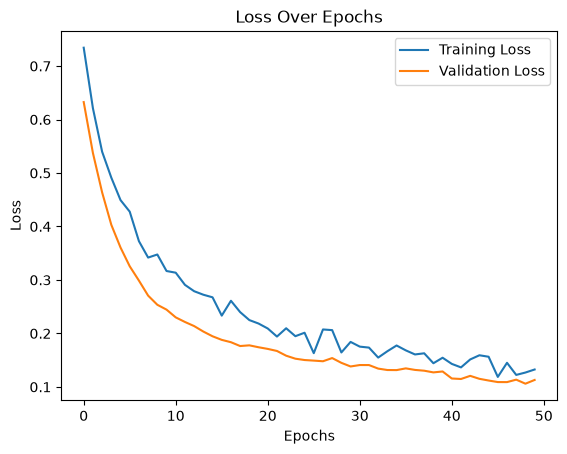
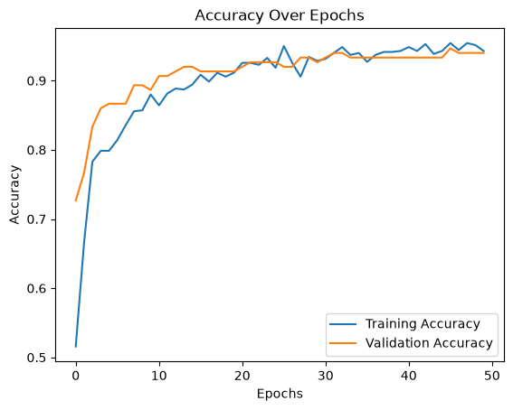
---

### 딥러닝 모델 실습 - 다중 분류

#### 다중 분류 문제 해결

- **다중 분류 문제(Multiclass Classification)**: 입력 데이터를 여러 클래스 중 하나로 분류하는 문제
- **예시**
  - 고양이, 개, 새 등 여러 동물 이미지를 특정 클래스로 분류
  - 여러 종류의 꽃을 분류하는 작업
  - 손글씨 숫자 데이터(MNIST; Modified National Institute of Standards and Technology)에서 숫자 0부터 9까지를 분류하는 문제
  - 영화 리뷰를 긍정, 중립, 부정으로 분류하는 문제

##### 다중 분류 문제를 해결하기 위한 과정

1. **데이터 준비**
   1. **데이터 수집**: 각 클래스에 해당하는 레이블이 있는 데이터셋 준비
   2. **데이터 전처리**
     - **One-Hot Encoding**: 레이블을 숫자로 인코딩하고 원-핫 벡터로 변환 (예: 클래스 0, 1, 2 → `[1, 0, 0]`, `[0, 1, 0]`, `[0, 0, 1]`)
     - **정규화**: 입력 데이터를 정규화하여 신경망 학습을 안정적으로 처리 (예: 이미지 픽셀 값 `0~255`를 `[0, 1]` 범위로 스케일링)
   3. **데이터 분리**: 훈련(`70%`), 검증(`15%`), 테스트(`15%`) 세트로 분리
2. **모델 설계**
   1. **입력층**: 데이터의 차원(예: 이미지 크기)과 동일한 입력을 받는 층
   2. **은닉층**: `Fully Connected Layer`(완전 연결층) 또는 `Convolutional Layer`(이미지 문제의 경우)를 포함하며, 활성화 함수로 `ReLU`를 사용해 비선형성 추가
   3. **출력층**: 출력 뉴런 수는 클래스 수와 동일하며(예: 클래스가 3개면 뉴런 수 3개), `Softmax` 활성화 함수를 사용해 각 클래스에 대한 확률 계산
3. **모델 훈련**
   1. **손실 함수**: 다중 분류 문제에서는 `Categorical Crossentropy` 손실 함수 사용
     ```math
     Loss = -\sum_{i} y_i \log(\hat{y}_i)
     ```
     - $y_i$: 실제 값(원-핫 벡터)
     - $\hat{y}_i$: 모델의 예측 확률
   2. **옵티마이저**: Gradient Descent 기반 알고리즘(예: `Adam`)을 사용하여 가중치 업데이트
   3. **훈련 프로세스**: 훈련 데이터를 입력해 반복적으로 가중치를 업데이트하여 손실을 최소화하고, 검증 데이터로 과적합을 방지하며 성능 모니터링
4. **모델 평가**
   - **정확도**: 테스트 데이터에서 모델이 얼마나 정확하게 예측하는지 평가
   - **혼동 행렬**: 각 클래스에 대한 정확한 예측과 잘못된 예측을 시각화
   - **클래스별 평가**: 클래스별 정밀도(Precision), 재현율(Recall), F1 점수를 계산하여 평가
5. **모델 예측**
   - 학습된 모델을 사용해 새로운 데이터를 예측
   - **`Softmax` 출력을 기반으로 가장 높은 확률 값을 가진 클래스를 선택**

---

### 실습 프로젝트 - 손글씨 숫자 분류(MNIST)

#### MNIST 데이터셋을 활용한 이미지 분류

```python
# 필요한 라이브러리 가져오기
from tensorflow.keras.models import Sequential      # 순차적 모델 생성
from tensorflow.keras.layers import Dense           # 완전 연결(Dense) 층
from tensorflow.keras.utils import to_categorical   # 원-핫 인코딩
from tensorflow.keras.datasets import mnist         # MNIST 데이터셋 가져오기

# 1. 데이터 로드 및 전처리
# MNIST 데이터셋을 훈련 세트와 테스트 세트로 분리
(x_train, y_train), (x_test, y_test) = mnist.load_data()

# 입력 데이터(이미지)를 1차원 벡터로 변환하고 정규화 (0~1 범위로 스케일링)
x_train = x_train.reshape(-1, 784) / 255.0  # 28x28 이미지를 784 길이의 벡터로 변환
x_test = x_test.reshape(-1, 784) / 255.0

# 레이블(출력 값)을 원-핫 인코딩 (예: 3 -> [0, 0, 0, 1, 0, 0, 0, 0, 0, 0])
y_train = to_categorical(y_train, num_classes=10)
y_test = to_categorical(y_test, num_classes=10)

# 2. 모델 구성
model = Sequential([
    # 첫 번째 은닉층: 뉴런 128개, 활성화 함수 ReLU, 입력 크기는 784
    Dense(128, activation='relu', input_shape=(784,)),
    # 두 번째 은닉층: 뉴런 64개, 활성화 함수 ReLU
    Dense(64, activation='relu'),
    # 출력층: 뉴런 10개 (클래스 수), 활성화 함수 Softmax
    Dense(10, activation='softmax')
])

# 3. 모델 컴파일
# 손실 함수: Categorical Crossentropy / 옵티마이저: Adam / 평가 지표: accuracy
model.compile(
    optimizer='adam',
    loss='categorical_crossentropy',
    metrics=['accuracy']
)

# 4. 모델 훈련
# 훈련 데이터(x_train, y_train)로 학습, 검증 데이터로 성능 확인
model.fit(x_train, y_train, epochs=10, batch_size=32, validation_split=0.2)

# 5. 모델 평가
# 테스트 데이터(x_test, y_test)로 모델 성능 평가
test_loss, test_accuracy = model.evaluate(x_test, y_test)
print(f"테스트 정확도: {test_accuracy}")

# 6. 예측
# 테스트 데이터의 첫 번째 샘플을 예측
predictions = model.predict(x_test[:1])
print(f"Softmax 출력: {predictions[0]}")     # 각 클래스에 대한 확률 값
print(f"예측 클래스: {predictions.argmax()}")  # 확률이 가장 높은 클래스
```

##### 실행 결과 예시

```text
Epoch 1/10
c:\python_project\.venv\Lib\site-packages\keras\src\layers\core\dense.py:107: UserWarning: Do not pass an `input_shape`/`input_dim` argument to a layer. When using Sequential models, prefer using an `Input(shape)` object as the first layer in the model instead.
  super().__init__(activity_regularizer=activity_regularizer, **kwargs)
1500/1500 ━━━━━━━━━━━━━━━━━━━━ 5s 3ms/step - accuracy: 0.9212 - loss: 0.2669 - val_accuracy: 0.9597 - val_loss: 0.1333
Epoch 2/10
1500/1500 ━━━━━━━━━━━━━━━━━━━━ 4s 3ms/step - accuracy: 0.9653 - loss: 0.1143 - val_accuracy: 0.9681 - val_loss: 0.1068
Epoch 3/10
1500/1500 ━━━━━━━━━━━━━━━━━━━━ 4s 3ms/step - accuracy: 0.9754 - loss: 0.0798 - val_accuracy: 0.9685 - val_loss: 0.1027
Epoch 4/10
1500/1500 ━━━━━━━━━━━━━━━━━━━━ 4s 3ms/step - accuracy: 0.9812 - loss: 0.0589 - val_accuracy: 0.9726 - val_loss: 0.1001
Epoch 5/10
1500/1500 ━━━━━━━━━━━━━━━━━━━━ 4s 3ms/step - accuracy: 0.9857 - loss: 0.0449 - val_accuracy: 0.9712 - val_loss: 0.1046
Epoch 6/10
1500/1500 ━━━━━━━━━━━━━━━━━━━━ 5s 3ms/step - accuracy: 0.9882 - loss: 0.0357 - val_accuracy: 0.9738 - val_loss: 0.0985
Epoch 7/10
1500/1500 ━━━━━━━━━━━━━━━━━━━━ 5s 3ms/step - accuracy: 0.9896 - loss: 0.0310 - val_accuracy: 0.9747 - val_loss: 0.0987
Epoch 8/10
1500/1500 ━━━━━━━━━━━━━━━━━━━━ 4s 3ms/step - accuracy: 0.9915 - loss: 0.0246 - val_accuracy: 0.9750 - val_loss: 0.1032
Epoch 9/10
1500/1500 ━━━━━━━━━━━━━━━━━━━━ 4s 3ms/step - accuracy: 0.9931 - loss: 0.0202 - val_accuracy: 0.9751 - val_loss: 0.1120
Epoch 10/10
1500/1500 ━━━━━━━━━━━━━━━━━━━━ 4s 3ms/step - accuracy: 0.9933 - loss: 0.0202 - val_accuracy: 0.9744 - val_loss: 0.1183
313/313 ━━━━━━━━━━━━━━━━━━━━ 1s 2ms/step - accuracy: 0.9764 - loss: 0.1015
테스트 정확도: 0.9764000177383423
1/1 ━━━━━━━━━━━━━━━━━━━━ 0s 53ms/step
Softmax 출력: [1.60282163e-10 2.90545596e-08 6.98679014e-06 6.09062008e-05
 1.99723593e-15 3.00778738e-12 1.05993595e-14 9.99930620e-01
 8.00479238e-09 1.36921517e-06]
예측 클래스: 7
```

---

#### 전체 딥러닝 프로세스 적용

##### 학습 로그 확인 방법

| 로그 항목 | 의미 | 해석 방법 | 대응 방법 |
| :--- | :--- | :--- | :--- |
| `Epoch 1/10` | 전체 학습 횟수 중 현재 단계 | 아직 학습 초반 | 성능 판단 X |
| `20/20` | 배치 학습 진행 상황 | 모든 배치 정상 처리 | 신경 쓸 필요 없음 |
| `2s/22ms/step` | 학습 속도 | 속도 정상 | 느리면 batch/GPU 조정 |
| `accuracy: 0.5201` | 훈련 정확도 | 거의 랜덤 수준 (초기 정상) | epoch 증가 후 확인 |
| `loss: 0.7642` | 훈련 오차 | 아직 큼 (초기 정상) | 감소 추이 확인 |
| `val_accuracy: 0.5125` | 검증 정확도 | 훈련 정확도와 유사 | 과적합 아님 |
| `val_loss: 0.7415` | 검증 오차 | 훈련 loss와 유사 | 정상 상태 유지 |

##### 전체 딥러닝 프로세스 요약

1. **데이터 로드 및 전처리**
   - `x_train`과 `x_test`는 입력 데이터(이미지)이며, `[0, 1]` 범위로 정규화하여 신경망을 학습시킨다.
   - 레이블(`y_train`, `y_test`)은 원-핫 인코딩하여 다중 분류 작업에 맞게 변환한다.
2. **모델 구성**
   - `입력층 → 은닉층 → 출력층`으로 이루어진 신경망을 설계한다.
   - 출력층의 `Softmax` 활성화 함수는 각 클래스에 대한 확률을 계산한다.
3. **모델 컴파일**
   - 손실 함수로 `Categorical Crossentropy`를 사용해 실제값과 예측 확률의 차이를 줄이는 방향으로 학습한다.
   - 옵티마이저로 `Adam`을 사용해 모델의 가중치를 효율적으로 업데이트한다.
4. **모델 훈련**
   - `fit` 메서드를 사용해 모델을 훈련한다.
   - 훈련 데이터를 기반으로 가중치를 학습하고, 검증 데이터를 통해 과적합을 방지한다.
5. **모델 평가**
   - `evaluate` 메서드를 사용해 테스트 데이터로 모델의 성능(정확도)을 평가한다.
6. **예측**
   - 훈련된 모델을 사용해 새로운 데이터의 클래스를 예측한다.
   - `Softmax` 출력은 각 클래스에 대한 확률값을 반환하고, `argmax`를 사용해 가장 높은 확률의 클래스를 선택한다.